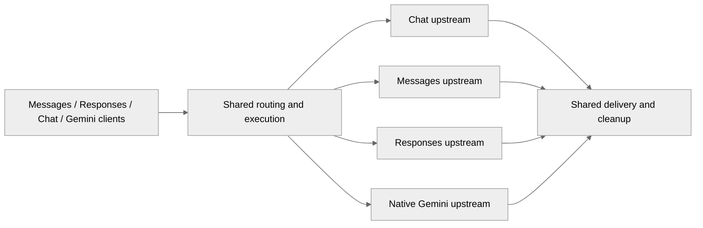

# Recent Activity in Starred Repositories
_161 active repos with 2580 new commits_

## [agent-skills](https://github.com/topics/agent-skills)
- [alibaba/open-code-review](https://github.com/alibaba/open-code-review) [1](https://github.com/alibaba/open-code-review/commits): fix(test): add TestMain to isolate cmd/opencodereview from the real home (#1707)

Co-authored-by: Kite <254839944+lizhengfeng101@users.noreply.github.com>
- [anthropics/skills](https://github.com/anthropics/skills) [1](https://github.com/anthropics/skills/commits): Move Office skills to the Apache 2.0 license (#2146)

docx, pdf, pptx and xlsx now use the same Apache 2.0 license as most other skills here, and the README is updated to match.

## [ai](https://github.com/topics/ai)
- [openclaw/openclaw](https://github.com/openclaw/openclaw) [262](https://github.com/openclaw/openclaw/commits): fix(media): cancel interrupted attachment downloads (#194399)

* fix(media): cancel interrupted attachment downloads

* test(media): preserve image request authority failures
- [BasedHardware/omi](https://github.com/BasedHardware/omi) [192](https://github.com/BasedHardware/omi/commits): fix(ci): pin clang-format 18.1.8 in the firmware formatting check (#24806)

<!-- claude-projects-attribution: {"github_login":"Git-on-my-level"} -->
_Requested by **David**_

## What changed and why

Fixes the Repo Checks / Formatting failure on PRs that touch firmware C
files with compound literals, for example #24393 (run 42305654687, job
128194880599, `tests/test_power_off_queue.c`).

GitHub's `ubuntu-latest` moved to ubuntu-26.04. Its clang-format adds a
space before compound-literal braces, while the firmware pre-commit hook
pins clang-format 18, which removes it. The hosted check therefore
rejects files the local hook accepts.

The Formatting job now installs `clang-format==18.1.8` into a dedicated
venv under `$RUNNER_TEMP` and runs that binary. That matches the local
pre-commit pin and holds when runners change again. No runner image is
pinned.

## Product invariants affected

None. The change is limited to the CI formatting step.

## How it was verified

- The workflow file parses as YAML.
- The local firmware formatter check is still clang-format 18, per
scripts/pre-commit.
- Not run here: the hosted Formatting job. The first real run on this PR
is the check.

## Tests

None added. The hosted Formatting job is the test.

## UI evidence

Not applicable.

## Failure class (fixes)

Failure-Class: new

New class definition:
`.github/failure-classes/FC-clang-format-runner-image-drift.json`. This
PR is its evidence.

## New guards (only when adding a check or ratchet)

The Formatting job now pins the formatter version itself. The local
pre-commit guard already refuses other versions.


<!-- This is an auto-generated description by cubic. -->
<a
href="https://cubic.dev/pr/BasedHardware/omi/pull/24806?utm_source=github"
target="_blank" rel="noopener noreferrer"
data-no-image-dialog="true"><picture><source
media="(prefers-color-scheme: dark)"
srcset="https://www.cubic.dev/buttons/review-in-cubic-dark.svg"><source
media="(prefers-color-scheme: light)"
srcset="https://www.cubic.dev/buttons/review-in-cubic-light.svg"></picture></a>
<a
href="https://www.cubic.dev/action/auto-fix/pr/BasedHardware/omi/24806?returnTo=https%3A%2F%2Fgithub.com%2FBasedHardware%2Fomi%2Fpull%2F24806&source=description"
target="_blank" rel="noopener noreferrer"
data-no-image-dialog="true"><picture><source
media="(prefers-color-scheme: dark)"
srcset="https://www.cubic.dev/buttons/turn-on-auto-fix-dark.svg"><source
media="(prefers-color-scheme: light)"
srcset="https://www.cubic.dev/buttons/turn-on-auto-fix-light.svg"></picture></a>
<!-- End of auto-generated description by cubic. -->
- [docling-project/docling](https://github.com/docling-project/docling) [16](https://github.com/docling-project/docling/commits): fix(jats): keep tables published as an image (#5078)

* fix(jats): keep tables published as an image

A <table-wrap> that holds a <graphic> instead of a <table> was dropped
together with its label and caption, because the table content was empty
and _add_table returned before it added the caption. PMC ships many
tables this way, for example in Medicine (Wolters Kluwer) articles.

Add such a table as a picture with its label and caption, the same way as
a <fig>, so the image is also embedded when fetch_images is enabled.

Signed-off-by: Aditya Gupta <84338325+MaiAditya@users.noreply.github.com>

* test(jats): cover alternative and mixed renditions of image tables

Add a case with two <graphic> renditions in <alternatives>, which must
give one picture, and a case with both a <graphic> and a <table>, which
must stay one table and not also become a picture. Declare the xlink
namespace the same way in all cases.

Signed-off-by: Aditya Gupta <84338325+MaiAditya@users.noreply.github.com>

* test(jats): cover image tables without a caption and table-wraps without content

Signed-off-by: Aditya Gupta <84338325+MaiAditya@users.noreply.github.com>

* fix(jats): keep tables published as an inline graphic

Handle the image case in the else branch of the table content selection,
so the original content check stays as it was. A <table-wrap> that holds
only an <inline-graphic>, directly or in <alternatives>, now also becomes
a picture with its label and caption, and its image is embedded when
fetch_images is enabled. Assert the position of the picture in the
Markdown and turn the test comments into docstrings.

Signed-off-by: Aditya Gupta <84338325+MaiAditya@users.noreply.github.com>

* fix(jats): drop inline-graphic support for image tables

A direct <inline-graphic> child is not valid in <table-wrap> or <fig> in
JATS 1.3. Only <graphic> is. Remove the inline-graphic handling and its
tests, which also changes how <fig> images are loaded. Drop a check in
_add_tables that can no longer fail.

Signed-off-by: Cesar Berrospi Ramis <ceb@zurich.ibm.com>

* test(jats): move image table tests to the main JATS test file

Signed-off-by: Cesar Berrospi Ramis <ceb@zurich.ibm.com>

---------

Signed-off-by: Aditya Gupta <84338325+MaiAditya@users.noreply.github.com>
Signed-off-by: Cesar Berrospi Ramis <ceb@zurich.ibm.com>
Co-authored-by: Cesar Berrospi Ramis <ceb@zurich.ibm.com>
- [google-gemini/gemini-cli](https://github.com/google-gemini/gemini-cli) [13](https://github.com/google-gemini/gemini-cli/commits): fix(core,cli): allow overriding 60s API headers timeout across all auth modes (`model.requestTimeoutMs` / `GEMINI_API_HEADERS_TIMEOUT_MS`) (#30183)
- [github/spec-kit](https://github.com/github/spec-kit) [11](https://github.com/github/spec-kit/commits): ci: focus default Python matrix on minimum and maintained releases (#5302)

Keep full Python 3.11–3.15 coverage for scheduled and manual runs.

Assisted-by: GitHub Copilot (model: GPT-6.1 Sol, autonomous)

Co-authored-by: Copilot App <223556219+Copilot@users.noreply.github.com>
- [t8y2/dbx](https://github.com/t8y2/dbx) [11](https://github.com/t8y2/dbx/commits): fix(desktop): route Linux compositor close through tray settings
- [specstoryai/getspecstory](https://github.com/specstoryai/getspecstory) [5](https://github.com/specstoryai/getspecstory/commits): Stop a stuck fsnotify Close from hanging watcher shutdown on Windows.
- [lutzroeder/netron](https://github.com/lutzroeder/netron) [3](https://github.com/lutzroeder/netron/commits): Update to 9.3.5
- [faridrashidi/kaggle-solutions](https://github.com/faridrashidi/kaggle-solutions) [2](https://github.com/faridrashidi/kaggle-solutions/commits): 🔖 Release 2026.11.5
- [google/magika](https://github.com/google/magika) [1](https://github.com/google/magika/commits): rust/lib: merge CachedInput and Input into a concrete Input<'a> type

Replace the `Input` trait and internal `CachedInput<I>` wrapper with a
concrete `Input<'a>` struct backed by either a `std::fs::File` (with
lazy prefix/suffix caching) or an in-memory `Cow<'a, [u8]>`.

Previously, `CachedInput<&[u8]>` started in the `Partial` state and
allocated/copied slices into `Box<[u8]>` buffers on read, and `stdin`
buffers in the pipeline were copied a second time. Using `Cow<'a, [u8]>`
for in-memory inputs avoids these allocations and copies, and removes
generic monomorphization over `I: Input` across resolvers, custom rules,
and feature extraction.

Assisted-by: Gemini <gemini@google.com>
- [Kiln-AI/Kiln](https://github.com/Kiln-AI/Kiln) [1](https://github.com/Kiln-AI/Kiln/commits): Merge pull request #2002 from Kiln-AI/claude/kind-edison-154za6

feat: remove the counts row above the experiment lineage graph

## [ai-agents](https://github.com/topics/ai-agents)
- [slopus/happy](https://github.com/slopus/happy) [83](https://github.com/slopus/happy/commits): happy-ios: dictation sends on release; Stop leaves a draft; open-task setting

Kirill's call on the microphone's endings:

- Let go, tap the big circle while locked, or press the button again
  while locked: the words are sent. On home that starts a new task; in a
  chat they go as the next message.
- Stop (the locked pill, now "Stop and edit"): the words open as a
  draft. On home, new work opens with them typed in; in a chat they
  wait in the composer.
- Leaving the app mid-recording keeps the words as a draft too.

New this-phone setting, Settings › Agents › Open task after dictating
(LocalSettings.dictationOpensTask, on by default). Off, a task started
from home's microphone is made from home: its row comes in and home
stays. If it isn't made (offline, refused), it opens with the message
waiting to retry; if the message couldn't be saved, the words come
back typed in.

RecordButtonUITests walks send-on-release, the draft from Stop, the big
circle's send, and staying on home (testFilmStaysHome).
- [earthtojake/text-to-cad](https://github.com/earthtojake/text-to-cad) [1](https://github.com/earthtojake/text-to-cad/commits): Release 0.10.4: an export tolerance holds on faces with loose edges, and dependency updates (#774)

Releases 0.10.4 when merged.

- **An export's tolerance holds on every face** (#771 by @zhangkom,
already on `main`; fixes #766). A face whose edges carry a looser
tolerance than the one asked for (common in imported STEPs) was meshed
from those edges: a sphere band asked for 0.01 mm came out 0.146 mm off.
With a tolerance, the export now sets `ForceFaceDeflection`. Tested
locally: that band now comes out 0.008 mm off; the viewer's mesh and
every default export are byte-identical to 0.10.3; a 600-part arm at
0.05 mm and 0.01 mm is byte-identical and the same speed (none of its
faces have loose edges). This PR rewords `mesh.py`'s docstring (two
knobs now, not one) and adds a line to the cad skill's Print tolerance
section.
- **Dependencies:** the npm minor/patch group (#763: three-mesh-bvh
0.9.17, lucide-react 1.66, postcss, shadcn 4.23 and others; shadcn's own
dependency swap drops ~950 lockfile lines) and `astral-sh/setup-uv`
10.3.3 (#725), merged in as-is.

🤖 Generated with [Claude Code](https://claude.com/claude-code)

---------

Signed-off-by: dependabot[bot] <support@github.com>
Co-authored-by: dependabot[bot] <49699333+dependabot[bot]@users.noreply.github.com>
Co-authored-by: earthtojake <jakefitz64@gmail.com>
Co-authored-by: Claude Opus 5.5 <noreply@anthropic.com>

## [clickhouse](https://github.com/topics/clickhouse)
- [clickvisual/clickvisual](https://github.com/clickvisual/clickvisual) [14](https://github.com/clickvisual/clickvisual/commits): Merge pull request #1270 from clickvisual/fix/ask-ai-provider-tool-output-github

feat(ask): TECHNOLOGY-4015 增加 AI 日志排障与告警分析
- [ClickHouse/clickhouse-go](https://github.com/ClickHouse/clickhouse-go) [10](https://github.com/ClickHouse/clickhouse-go/commits): Merge pull request #2020 from fallintoplace/fix/ipv4-address-validation

fix(column): reject non-IPv4 addresses in IPv4 appends
- [Altinity/clickhouse-backup](https://github.com/Altinity/clickhouse-backup) [4](https://github.com/Altinity/clickhouse-backup/commits): Merge pull request #1667 from Altinity/issue_1663_cross_disk_reuse

Reuse parts moved between local disks in --diff-from-remote, fix #1663

## [cross-platform](https://github.com/topics/cross-platform)
- [Snapchat/Valdi](https://github.com/Snapchat/Valdi) [7](https://github.com/Snapchat/Valdi/commits): Internal Change

GitOrigin-RevId: 9be20cc45fddb89d25e3e7da349ad204cea2a8c0
- [cjpais/Handy](https://github.com/cjpais/Handy) [1](https://github.com/cjpais/Handy/commits): fix(deps): address TLS dependency security advisories (#2432)

Co-authored-by: Jesse Dyer <jdyer@ecrs.com>
Co-authored-by: Copilot <223556219+Copilot@users.noreply.github.com>

## [dashboards](https://github.com/topics/dashboards)
- [thingsboard/thingsboard](https://github.com/thingsboard/thingsboard) [10](https://github.com/thingsboard/thingsboard/commits): Merge pull request #16571 from thingsboard/rc

Merge rc into master
- [taleshape-com/shaper](https://github.com/taleshape-com/shaper) [1](https://github.com/taleshape-com/shaper/commits): Improve link support for cards, subtitles, and tables (#455)

* Improve link support for cards, subtitles, and tables

- Add card linking via ::LINK and ::LINK_NEWTAB DuckDB custom types
- Support links in section and card subtitles with extended markdown syntax [text](url){target="..." rel="..."}
- Support bare URLs without stripping http/https prefixes and add .shaper-inline-link class
- Validate links against safe protocols (http, https, mailto, relative, hash, query)
- Prevent accidental navigation on interactive buttons (fullscreen, chart/table downloads)
- Disable card links in fullscreen mode and ensure pointer cursor on linked chart cards

* fix go CVSs

* fix ci

## [distributed-systems](https://github.com/topics/distributed-systems)
- [databendlabs/openraft](https://github.com/databendlabs/openraft) [8](https://github.com/databendlabs/openraft/commits): test: turmoil: heal link latency before the liveness checks

# Summary

`heal_network()` now sets every link's latency to zero, as it already
did for message loss, instead of restoring the seeded latency band. The
liveness phase therefore checks the healed cluster over timely links.

# Details

Seeded links delay each message by up to 50 ms, while the replication
RPC deadline is the soft TTL of `heartbeat_interval`, as little as
37.5 ms. A healed cluster could time out its AppendEntries RPCs and
fail the liveness phase with nothing wrong in it. When chaos restores
link quality without healing, `restore_link_quality()` still restores
the seeded band.

The new `healing_removes_latency_that_exceeds_the_rpc_deadline` test
sets the link latency to `heartbeat_interval` and checks that a
request-response exchange finishes within the soft TTL after healing.
It lives in the fuzz binary, so `make test-turmoil-default` and
`make test-turmoil-threshold`, which the CI turmoil jobs run, now also
run the binary's tests.
- [bloomberg/blazingmq](https://github.com/bloomberg/blazingmq) [2](https://github.com/bloomberg/blazingmq/commits): Feat[mqbact]: add clusterNodeId to ConnectClusterNode action

Add `clusterNodeId` to the `ConnectClusterNode` authorization action, and
populate it during session negotiation using the peer's
`ClientIdentity`.

This lets authorizer plugins see which logical cluster node is connecting.

Signed-off-by: Christopher Beard <cbeard9@bloomberg.net>

## [docker](https://github.com/topics/docker)
- [lavie/runlike](https://github.com/lavie/runlike) [15](https://github.com/lavie/runlike/commits): Merge pull request #151 from alexyoungbot/release-dist-name

release: publish the signed binaries, not the test job's artifact
- [khuedoan/homelab](https://github.com/khuedoan/homelab) [9](https://github.com/khuedoan/homelab/commits): refactor: better DX for secret injection

Use server-side diff with IncludeMutationWebhook to avoid false diffs.
Secret injection no longer requires explicit labels.
- [cshum/imagor](https://github.com/cshum/imagor) [3](https://github.com/cshum/imagor/commits): docs: supported image formats

## [embedded](https://github.com/topics/embedded)
- [hathach/tinyusb](https://github.com/hathach/tinyusb) [4](https://github.com/hathach/tinyusb/commits): Merge pull request #4443 from metebalci/audio-out-zlp-rearm

audio: re-arm the OUT endpoint after a zero-length packet
- [wasm-micro-runtime/wasm-micro-runtime](https://github.com/wasm-micro-runtime/wasm-micro-runtime) [1](https://github.com/wasm-micro-runtime/wasm-micro-runtime/commits): feat(ba-issues): add runs, honor -i, drop dedup (#5201)

One wasm with several exports needed a config entry per export, and
the same id could only run once. Add an item-level `runs` list, one
entry per iwasm invocation with its own options, argument and expected
return. Shared compile runs once per (item, id).

-i/--issues now filters build and run, not only the summary. Duplicate
ids across items all run; the old dedup silently skipped them.

## [esp32](https://github.com/topics/esp32)
- [arendst/Tasmota](https://github.com/arendst/Tasmota) [8](https://github.com/arendst/Tasmota/commits): Fix TuyaV1 and TuyaV2 out-of-bounds accessing `tuya_fnid_map[]` (#25222)
- [espressif/arduino-esp32](https://github.com/espressif/arduino-esp32) [7](https://github.com/espressif/arduino-esp32/commits): fix(ledc): Drop deprecated intr_type assignment in ledcAttachChannel (#13082)

ESP-IDF 6 deprecates ledc_channel_config_t.intr_type (the driver now
handles the interrupt), so this assignment warns with
-Wdeprecated-declarations.  The struct is already memset to 0 and
LEDC_INTR_DISABLE is 0, so behavior is unchanged on IDF 5 and 6.

Co-authored-by: Claude Opus 5.5 <noreply@anthropic.com>
- [schreibfaul1/ESP32-audioI2S](https://github.com/schreibfaul1/ESP32-audioI2S) [6](https://github.com/schreibfaul1/ESP32-audioI2S/commits): Merge pull request #1427 from podaen/master

Add custom CA certificate support for HTTPS streams
- [crosspoint-reader/crosspoint-reader](https://github.com/crosspoint-reader/crosspoint-reader) [1](https://github.com/crosspoint-reader/crosspoint-reader/commits): feat(about): SD card size, used and free space (#4331)

## [extension](https://github.com/topics/extension)
- [fishjar/kiss-translator](https://github.com/fishjar/kiss-translator) [2](https://github.com/fishjar/kiss-translator/commits): fix(input): keep focus when a delayed translation returns (#1281)

Co-authored-by: irontaek <13810291+irontaek@users.noreply.github.com>
- [brookhong/Surfingkeys](https://github.com/brookhong/Surfingkeys) [1](https://github.com/brookhong/Surfingkeys/commits): fix(hints): reduce collision shift threshold to prevent drift in compact lists (#2470)

In placeHints(), links aligned along the same vertical or horizontal axis
are shifted when their distance to the preceding link is under 20px. In
densely spaced lists (such as tables or sidebars with row heights between
10px and 20px), this causes hints to repeatedly get pushed downward into
the subsequent row, creating a cascading drift.

Lower the collision detection threshold from 20px to 10px so tightly
stacked items avoid triggering false vertical offsets.

Fixes #2469

Signed-off-by: Clark Wang <dearvoid@gmail.com>

## [golang](https://github.com/topics/golang)
- [davidhampgonsalves/Life-Dashboard](https://github.com/davidhampgonsalves/Life-Dashboard) [1](https://github.com/davidhampgonsalves/Life-Dashboard/commits): Read lunch menus from all eml files

Mount /media/share and read every *.eml in LUNCH_DIR.

Co-Authored-By: Claude Opus 5.5 <noreply@anthropic.com>
- [tidwall/gjson](https://github.com/tidwall/gjson) [1](https://github.com/tidwall/gjson/commits): Fix utf8 character drop after a broken emoji

fix #403

## [ios](https://github.com/topics/ios)
- [pinterest/PINRemoteImage](https://github.com/pinterest/PINRemoteImage) [3](https://github.com/pinterest/PINRemoteImage/commits): Merge pull request #657 from vnavarro/vnavarro/BUG-PINProgressiveImageCrash

Fix for NSInvalidArgumentException in PINProgressiveImage.m:268
- [fastlane/fastlane](https://github.com/fastlane/fastlane) [2](https://github.com/fastlane/fastlane/commits): [gym] visionOS example: drop the template's Swift package, which xcodebuild -showBuildSettings loads inside fastlane's timeout (#30530)

On fresh macos-15 and macos-26 runners, loading it took 13-31 s of the 45 s the build settings tries allow (fastlane#30410).

## [javascript](https://github.com/topics/javascript)
- [tdewolff/minify](https://github.com/tdewolff/minify) [4](https://github.com/tdewolff/minify/commits): Merge pull request #1064 from max-moser/master

Update go version in Python jobs
- [gibbok/typescript-book](https://github.com/gibbok/typescript-book) [1](https://github.com/gibbok/typescript-book/commits): News: faster TypeScript incremental rebuilds through parallel checks (#295)

* news: parallel incremental rebuild signature checks

* ci: temporary news build validation

* ci: remove temporary validation workflow

## [llm](https://github.com/topics/llm)
- [NousResearch/hermes-agent](https://github.com/NousResearch/hermes-agent) [350](https://github.com/NousResearch/hermes-agent/commits): fix(gateway): a named session.create or resume matches its snapshot contract

session.create and session.resume return local_session_info as the
snapshot's info, and that info now carries client for a named session.
Only CanonicalSessionInfo declared the field, so the closed
CanonicalSnapshotInfo model refused it: a named create raised
ContractViolation under HERMES_TEST_ISOLATION and logged a wire-contract
error in production. Declare client on the snapshot info too and
regenerate the contracts with scripts/gen_gateway_contracts.py.

The new test drives create and resume through AuthorityConnection.dispatch
and validates each result against its declared model.

Suggested by @BearHuddleston in review (patch applied as written), after
the Greptile finding on canonical.py.
- [yetone/magpie](https://github.com/yetone/magpie) [157](https://github.com/yetone/magpie/commits): gateway: a reply of several requests tells the last one's prompt, bills them all

Claude Code reads a reply's input, cache_creation and cache_read as how
full its conversation is. A reply more than one upstream request made
summed all three across them. In the bridge: Claude Code's own
ToolSearch/WebSearch going on into the answering message, a TUI message
written after its call was told (lateUsage), a cut stream's retry
(b42ff722). Each later request re-sends what the earlier one had, so the
reporter's TaskStop reply after a ToolSearch said cache_read 1,154,857
(577,009 + 577,848) and cache_creation 829 (253 + 576) for a ~577k
conversation, and Claude Code compacted early. 12 of their 30 replies
after ToolSearch were about 2x.

The translated route summed the same way across its tries (#5115): the
empty reply asked again (#667), a loop's re-ask (#1359), a cut reply's
continuation (#853), and search.go's web search rounds. The Anthropic
passthrough has no in-reply fold; each try is its own call.

Usage.after (claude_subscription.go) replaces plus at these joins: the
client is told the last request's input, cache writes and cache reads,
and every request's output and reasoning (all of it was streamed). The
earlier requests' prompts go in Deferred, which the ledger bills
(billed()) and no encoder tells. Usage.restart makes a later request's
prompt counts replace the earlier's, a zero too, so a later request that
reads nothing from the cache isn't told, or billed again, the earlier's
reads. Cache writes are last-only for the client as well: the later
request reads what the earlier wrote, so summed they count it twice.
ggbdpq's #5115 analysis named the translated route's case; no code of
theirs was used.

Tests (usage_last_prompt_test.go), on the reporter's numbers:
- TestClaudeOwnCallReplyTellsLastPrompt: bridge, told 6/576/577848,
  billed 8/829/1154857; and a second request that missed the cache.
- TestClaudeTUILateMessagePromptNotTold: interactive mode's late message.
- TestRetriedReplyTellsLastPrompt: Gemini three reasoning-only replies
  then an answer, Chat and Anthropic clients; ledger has all four.
- TestLaterTryZeroCacheReadNotTold: a continuation and a search round
  whose later request reads 0 from the cache.
Tests that pinned the summed client numbers now pin the last request's
and check the billed sum (CachePartialUpdateMatrix, Probe1717 zero split,
cut stream retry, own WebSearch, search rounds, StreamCutUsage renamed
TestStreamCutUsageTellsLastTry).

Run (mote, Go 1.26.8, -tags nogui):
- The new tests on origin/main ca77a9ea8: red, the client told
  8/829/1154857 (the report's numbers), prompt_tokens 2,000,000 for
  four 500k tries.
- Broken by hand: restart dropped -> TestClaudeCutStreamGoesOnInRetry
  and the cache-missed case red (reads billed twice); after() put back
  to plus -> 12 tests red; restart on the translated tries dropped ->
  TestLaterTryZeroCacheReadNotTold red (cache reads 200 billed, 111
  told). The last one was green before that test was added.
- go test ./internal/gateway/ whole: ok except
  TestClaudeInternalMessagesKeepCacheWrites, which pinned the sum and
  was updated after; that test with the usage, cache, search,
  continuation and TUI tests then ok (61.8s).
- go vet ./internal/gateway for darwin, linux and windows; gofmt clean.
- The full suite runs after the push (mote's suite lock held 3h+ by
  another session).

Not tried: a real Claude Code account or the real TUI, the reporter's
session, a real Gemini/translated provider, Windows or Linux runs of
the package.

Reported-by: sleepy_shibe (Discord)
- [unslothai/unsloth](https://github.com/unslothai/unsloth) [102](https://github.com/unslothai/unsloth/commits): Studio: preserve S3 dataset files with colliding names (#16830)

## What was broken

S3 audio datasets can silently pair transcripts with the wrong
recording. Distinct object keys can map to one local filename, so the
later download replaces the earlier recording while both manifest rows
remain. Manifest shards can also overwrite each other, and structured
downloads overwrite existing files in an explicitly supplied
destination.

## Repro

1. On main at `0ab3f0773`, prepare an S3 audio dataset containing
distinct `datasets/audio/clip.wav` and `datasets/audio//clip.wav`
objects. Reference each by its full S3 URI in a JSONL manifest.
2. Load it through `prepare_s3_dataset_download`.
3. Both rewritten audio paths point to the second recording. Case-only
and NFC/NFD filename differences cause the same loss on case-insensitive
or normalization-insensitive filesystems.

## Fix

Reserve distinct local paths before downloading, using the existing
suffix allocator with case-insensitive, Unicode-normalized reservations.
Keep the original S3 key-to-path mapping for JSON, JSONL and CSV
reference rewriting. Existing local files are preserved.

Parquet references cannot be rewritten here. If an audio filename must
change, fail before downloading with guidance instead of returning a
dataset bound to the wrong file. Non-colliding Parquet audio paths stay
unchanged, and colliding Parquet manifest shards can still be renamed
safely.

## Test

Thirteen initial regression cases fail on main. Expanded coverage checks
recordings and transcripts across JSON, JSONL and CSV, manifest shards,
generated suffix collisions, existing files, and Parquet refusal and
compatibility paths. Tests use the existing fake S3 client with real
local files; no AWS credentials or GPU are needed.

From `studio/backend`:

```text
$ python -m pytest -q --tb=short --timeout=330 tests/test_s3_audio_dataset.py tests/test_s3_dataset.py
97 passed in 1.95s
```

```text
$ python -m pytest -q --tb=short -n 4 --dist loadgroup --timeout=330 tests/test_s3_audio_dataset.py tests/test_s3_dataset.py tests/test_s3_runtime.py tests/test_s3_optional.py
120 passed in 11.16s
```

All seven repository checks, the pinned formatter and strict i18n parity
pass locally. No schema or dependency changes.

---------

Co-authored-by: oobabooga <112222186+oobabooga@users.noreply.github.com>
- [kortix-ai/CompanyOS](https://github.com/kortix-ai/CompanyOS) [79](https://github.com/kortix-ai/CompanyOS/commits): fix(web): the Inbox moves from the sidebar into the workspace menu (KRTX-1742) (#11986)

## Summary

The project sidebar no longer has a permanent "Inbox" row under "New
session". The Inbox is now a row in the workspace menu (the workspace
name at the top left), with the unread count beside it. When an unread
question, permission request or failure waits, a small yellow dot shows
on the workspace tile. A plain unread update (a finished turn) shows no
dot. The command palette's "Inbox" entry (⌘K) is unchanged. This follows
the `notification_center` flag graduating on 2026-11-06, which put the
row in front of every project (KRTX-1742).

## Demo

**Web, `/projects/<id>`, 1440×900, synthetic user with 1 unread question
+ 1 unread finished turn (2× speed): the sidebar has no Inbox row, the
tile has a dot, the menu shows "Inbox 2", the row opens `/inbox`, and
"Mark all as read" removes the dot.**


https://github.com/user-attachments/assets/02450631-7824-4f7f-a51d-037497e1cefe

| Menu open (light) | Dot on the tile (dark) |
| --- | --- |
|

|

|

## What is affected

- Web and desktop (Electron renders `apps/web`): the project sidebar and
the workspace menu.
- The Inbox page, its route (`/projects/<id>/inbox`), the notification
API, toasts and emails are unchanged.
- No API, migration, IAM, billing or SDK change. Mobile keeps its own
bell (`apps/mobile`), unchanged.

## Verification

| Check | Result | Proves |
| --- | --- | --- |
| agent-browser on the worktree stack, sidebar DOM | PASS |
`[data-sidebar=content] a[href*="/inbox"]` absent; trigger label "Switch
project. Inbox: 2 unread" |
| agent-browser, open the menu | PASS | menu items include "Inbox 2
unread", between "Rename" and "Settings" |
| agent-browser, click "Inbox" | PASS | URL becomes
`/projects/<id>/inbox`, RSC `GET …/inbox` → `200` |
| agent-browser, "Mark all as read" | PASS | `workspace-inbox-dot` gone,
trigger label back to "Switch project" |
| Dark theme, new unread permission | PASS | dot renders with the
sidebar ring |
| `bun test project-sidebar-kbd.test.tsx` | PASS 6/6 | no Inbox row with
chat off and on |
| `bun test workspace-switcher.test.tsx` | PASS 3/3 | Inbox row sits
between identity and Settings, dot only for "needs you" |
| `bun test command-palette-search.test.ts` | PASS 79/79 | ⌘K "inbox"
still lists the Inbox first |
| `pnpm --filter Kortix-Computer-Frontend typecheck` | PASS (exit 0) | |
| `eslint` on touched files; `gen-exports.mjs` | PASS | 0 errors; new
deep export written |
| `kortix-brand/scripts/audit.sh` on touched files | 1 violation,
pre-existing | `CaretUpDownIcon` `text-muted-foreground/50`, untouched
line |

Not verified: the native Electron shell (the change is inside the shared
menu content and the avatar tile; no titlebar CSS changed).

## Risks and rollback

- A person who used the sidebar row now reaches the Inbox in two clicks,
or with ⌘K. Waiting questions and permission requests still surface
through the dot and the toasts.
- Revert the squash commit to restore the row.

## Reviewer focus

1. The tile dot:
`apps/web/src/features/workspace/project-sidebar/workspace-switcher.tsx`
(only `needsYou`, not any unread).
2. Row placement in the menu, in the same file, above "Settings".

<details><summary>Changed files</summary>

-
`apps/web/src/features/workspace/project-sidebar/workspace-switcher.tsx`:
Inbox menu row, tile dot, trigger label.
- `packages/ui/src/internal/notifications/use-inbox-summary.ts`: href,
unread count, "needs you" from the polled inbox (no new request).
- `packages/ui/src/workspace/sidebar/project-sidebar.tsx`,
`footer/project-inbox-nav.tsx` (deleted): sidebar row removed.
- `packages/ui/scripts/deep-exports.json`, `packages/ui/package.json`:
export for the hook.
- `apps/web/src/lib/menu-registry.ts`: comment points at the new row.
- Tests: `project-sidebar-kbd.test.tsx`, `workspace-switcher.test.tsx`.

</details>


<!-- codesmith:footer -->
---
<a
href="https://backend.blacksmith.sh/track/enable-autofix?expires=1796600684&installation_model_id=434224&pr_number=11986&ref=codesmith_pr_footer&repository=kortix-ai%2FCompanyOS&return_to=https%3A%2F%2Fgithub.com%2Fkortix-ai%2FCompanyOS%2Fpull%2F11986&signature=4dc8d7240e0ffcfcb31bdf0123b1222a2141122e524aa095a7df192932781d27"><picture><source
media="(prefers-color-scheme: dark)"
srcset="https://pr-comments-assets.blacksmith.sh/codesmith/autofix-with-codesmith-dark.svg"><source
media="(prefers-color-scheme: light)"
srcset="https://pr-comments-assets.blacksmith.sh/codesmith/autofix-with-codesmith-light.svg"></picture></a>
<sup><a
href="https://app.blacksmith.sh/kortix-ai/codesmith/CompanyOS/pr/11986?autoLogin=true&ref=codesmith_pr_footer">Open
in [code]smith</a> · Need help on this PR? Tag
<code>@codesmith-bot</code> with what you need.</sup>

<!-- codesmith:autofix:disabled -->
<!-- /codesmith:footer -->
- [QwenLM/qwen-code](https://github.com/QwenLM/qwen-code) [56](https://github.com/QwenLM/qwen-code/commits): fix(managed-agent): let a late snapshot publication wait for the claim instead of losing deadlocks (#16489)

* fix(managed-agent): let a late snapshot publication wait for the claim instead of losing deadlocks

Since #16143 resource_key is a secondary unique index, so a second
publication's manifest upsert queues for the first's uncommitted row with
a next-key lock. Every page the first Build inserts into that lock's gap
rolls the queued publication back, and on longer journals #16446's three
attempts run out: on a 31-page journal a late second publication failed
for 15 of 40 snapshot ids.

The claim now locks the manifest row by key first. At READ COMMITTED that
takes a record lock when the row exists, which does not block the inserts
into the gap, and only a missing row is upserted. Two publications that
both find no row can still meet in the upsert; #16446's retry handles the
one rolled back, whose locking read then waits for the winner.

The MySQL cases pin both paths and assert the key order they depend on.

* test(managed-agent): pin the snapshot claim's reads, upserts and rollback interleaving

- State in the claim's Javadoc that the wait on the manifest row lasts at
  most innodb_lock_wait_timeout and that a lock wait timeout (1205) is not
  retried, only deadlock victims (1213) are.
- Count the claim's locking reads and upserts in the test JdbcTemplate and
  assert them in the new concurrent cases, so a reworded claim statement
  fails those cases instead of turning them into plain races.
- Cover a publication queued on a claim that rolls back: it finds no row
  and publishes the snapshot itself.
- Check that publications run at READ COMMITTED, which the claim's comment
  relies on.
- Read the monitor fixture through one helper.
- [BerriAI/litellm](https://github.com/BerriAI/litellm) [46](https://github.com/BerriAI/litellm/commits): fix(bedrock): forward Codex agent messages that carry encrypted content intact (#50457)

* fix(bedrock): forward Codex agent messages that carry encrypted content intact

Codex multi-agent v2 sends worker messages as agent_message items whose
encrypted_content block only the model server can decrypt. Bedrock Mantle and
Bedrock Runtime used to 400 on agent_message, so LiteLLM rewrote every one into
assistant text, pasting the ciphertext into the prompt and dropping the sender
and recipient. Bedrock now decrypts these items itself, so the rewrite left the
recipient model reading an opaque token instead of its task.

Agent messages with an encrypted_content block now go to Bedrock untouched on
both endpoints. The Bedrock configs declare supports_encrypted_agent_messages,
and the shared normalizer keys off that flag so the two cannot drift. Mantle's
/v1/responses route for open-weight models still rejects agent_message in any
form, so it keeps the old rewrite. Plaintext-only agent messages keep the
rewrite on every route.

* fix(bedrock): only keep worker messages locked for OpenAI GPT models

Gemma and Grok on Mantle's OpenAI route never lock Codex worker messages, so
Codex puts plain text in the locked slot and Bedrock rejected it with
invalid_encrypted_content once the route alone decided to forward it intact.
Decide from the model instead, and restore the full-value rewrite assertion.
- [langgenius/dify](https://github.com/langgenius/dify) [43](https://github.com/langgenius/dify/commits): refactor(api): enable strict typing for events/extensions test files (#44875)

Co-authored-by: Felix Shi <204130665+shi-felix@users.noreply.github.com>
- [CherryHQ/cherry-studio](https://github.com/CherryHQ/cherry-studio) [34](https://github.com/CherryHQ/cherry-studio/commits): docs(remote-access): propose client-owned P2P transport (#23636)

### What this PR does

Before this PR: the client-owned P2P design was recorded outside the
desktop repository that maintains the shared remote-access packages.

After this PR: a bilingual proposed Agent Note defines the shared
package boundary, endpoint adapters, authenticated signaling, connection
selection, bounded binary transport, and implementation acceptance
criteria.

Fixes: N/A — no linked issue.

### Why we need it and why it was done in this way

Keep the P2P implementation with the desktop-maintained shared packages
while leaving the existing Relay runtime and account service boundaries
intact. The proposal uses `node-datachannel` on desktop and
`react-native-webrtc` on mobile behind an independent
`@cherrystudio/remote-transport/p2p` entry point.

The following tradeoffs were made: attempt P2P before handing a new
connection to business traffic; authenticate the candidate with fresh
Noise and grants; retain Relay fallback and bounded
negotiation/buffering. STUN is configurable and optional to self-host.

The following alternatives were considered: server-owned P2P signaling,
a `relay-client/p2p` export, additional signaling/TURN services,
migration of active business sessions, and a separate custom UDP
transport.

Links to places where the discussion took place: N/A — agreed in the
development conversation. Related Relay integration work: desktop #23505
and [mobile
#1600](https://github.com/CherryHQ/cherry-studio-app/pull/1600).

### Agent Note / Spec

Agent Note:
[English](https://github.com/CherryHQ/cherry-studio/blob/docs/remote-p2p-plan-20261105/.agents/notes/proposed/architecture/2026-11-05-remote-p2p.md)
/
[中文](https://github.com/CherryHQ/cherry-studio/blob/docs/remote-p2p-plan-20261105/.agents/notes/proposed/architecture/2026-11-05-remote-p2p.zh.md).

Spec PR: This PR.

Acceptance criteria: the following are defined for subsequent
implementation and remain pending:

- AC1: shared package ownership, portable exports, and isolated native
dependencies.
- AC2: new/old endpoint compatibility, pairing, direct access, and P2P
opt-out.
- AC3: identity, generation, grants, and single-use candidate binding
without authorization bypass.
- AC4: one business connection, bounded negotiation, and deterministic
handoff/failure handling.
- AC5: real binary transfers, slow-reader backpressure, bounded queues,
and cleanup.
- AC6: cross-network/mobile lifecycle validation, existing Relay
fallback, and measured performance.

### Verification

- Documentation: `pnpm docs:check` passed (links, structure,
frontmatter, Agent Notes, bilingual pairing, terminology, and generated
index).
- Documentation: focused `pnpm docs:check-pairing` passed; scoped Oxfmt
check passed for the translation sidecar. Markdown is excluded by the
repository formatter configuration.
- Scope: `pnpm change:scope --base origin/main` confirmed only the two
proposed notes and their translation sidecar. `pnpm docs:affected --base
origin/main` reported no additional documentation source matches.
- Commit: whitespace checks, staged bilingual checks, cryptographic
signature, and DCO sign-off passed.
- AC1–AC6: runtime verification is pending implementation; this
documentation-only PR does not claim those criteria are satisfied.

### Breaking changes

None. Documentation only.

### Special notes for your reviewer

Review the ownership, authentication, handoff, and deployment boundaries
before implementation. The note remains `proposed`. This PR contains no
package, application, Relay runtime, or deployment code changes; the
related Relay integration PRs remain separate work.

### Checklist

This checklist is not enforcing, but it's a reminder of items that could
be relevant to every PR.
Approvers are expected to review this list.

- [x] Branch: This PR targets `main`
- [x] PR: The PR description is expressive enough and will help future
contributors
- [ ] Code: [Write code that humans can
understand](https://en.wikiquote.org/wiki/Martin_Fowler#code-for-humans)
and [Keep it simple](https://en.wikipedia.org/wiki/KISS_principle)
- [ ] Refactor: You have [left the code cleaner than you found it (Boy
Scout
Rule)](https://learning.oreilly.com/library/view/97-things-every/9780596809515/ch08.html)
- [x] Upgrade: Impact of this change on upgrade flows was considered and
addressed if required
- [ ] Documentation: A [user-guide update](https://docs.cherry-ai.com)
was considered and is present (link) or not required. Check this only
when the PR introduces or changes a user-facing feature or behavior.
- [x] Self-review: I have reviewed my own code (e.g., via
[`/gh-pr-review`](/.claude/skills/gh-pr-review/SKILL.md), `gh pr diff`,
or GitHub UI) before requesting review from others

### Release note

```release-note
NONE
```

Signed-off-by: suyao <sy20010504@gmail.com>
- [screenpipe/screenpipe](https://github.com/screenpipe/screenpipe) [20](https://github.com/screenpipe/screenpipe/commits): Merge pull request #7904 from screenpipe/fix/workflows-dark-mode

fix: respect the app theme in Workflows
- [OpenHands/OpenHands](https://github.com/OpenHands/OpenHands) [18](https://github.com/OpenHands/OpenHands/commits): feat: edit executable plugin configuration in automation help (#19453)

Co-authored-by: Alona <228736368+ak684@users.noreply.github.com>
- [winfunc/opcode](https://github.com/winfunc/opcode) [18](https://github.com/winfunc/opcode/commits): Merge pull request #488 from shahuldxb666-crypto/fix/462-tauri-events-esm

Fix: deliver backend events to the chat on desktop (spinner never stops, #462)
- [google/adk-python](https://github.com/google/adk-python) [16](https://github.com/google/adk-python/commits): fix: refcount toolsets on Runner so close() waits for last holder

Track active Runners holding each BaseToolset in a weak-reference
registry so Runner.close() only closes a toolset when no other active
Runner still holds it. This prevents parallel Runners sharing an agent
or parallel AgentTool invocations from closing a stateful toolset
while sibling runs are still in flight.

Thanks to @claxman for originally proposing this fix in PR #7045.

Closes #4045

PiperOrigin-RevId: 1015953186
- [EvolvingAgentsLabs/evolving-agents](https://github.com/EvolvingAgentsLabs/evolving-agents) [6](https://github.com/EvolvingAgentsLabs/evolving-agents/commits): Merge pull request #208 from EvolvingAgentsLabs/ai-sdk-e3

ai-sdk: middleware, HarnessAgent skills and the bench on Vercel Sandbox (E3 code, not run)
- [mangiucugna/json_repair](https://github.com/mangiucugna/json_repair) [3](https://github.com/mangiucugna/json_repair/commits): bump
- [google/langextract](https://github.com/google/langextract) [1](https://github.com/google/langextract/commits): fix: write Ollama visualization HTML as UTF-8 (#550)
- [gptme/gptme](https://github.com/gptme/gptme) [1](https://github.com/gptme/gptme/commits): docs(providers): correct stale PyPI caveat in airgapped tokenizer note (#4787)

* docs(providers): correct stale PyPI caveat in airgapped tokenizer note

The note claimed PyPI releases do not include the character-based tokenizer
fallback. It has shipped since v0.32.1 (#3205), so current releases fall back
just like source installs.

Restate pre-caching as an optimisation (avoids the first-use stall) rather
than a requirement, and document GPTME_TIKTOKEN_TIMEOUT, including =0 to skip
tiktoken entirely.

Git-Session-Id: 8e45957f-1480-4a44-ace5-a500ae4e1dcf

* docs(providers): clarify cached local token counts remain estimates

Git-Session-Id: 6f6fecfa-3e88-5aca-8768-3ac1c9e2e603
- [openai/openai-agents-python](https://github.com/openai/openai-agents-python) [1](https://github.com/openai/openai-agents-python/commits): docs: simplify agent instructions while preserving requirements (#5565)

docs: simplify agent instructions without losing requirements

## [machine-learning](https://github.com/topics/machine-learning)
- [microsoft/ML-For-Beginners](https://github.com/microsoft/ML-For-Beginners) [15](https://github.com/microsoft/ML-For-Beginners/commits): Merge pull request #1079 from microsoft/dependabot/npm_and_yarn/quiz-app/multi-5b97d3b206

chore(deps): bump @vue/server-renderer and vue in /quiz-app
- [lakehq/sail](https://github.com/lakehq/sail) [10](https://github.com/lakehq/sail/commits): test: fix session cleanup issue (#2961)
- [skypilot-org/skypilot](https://github.com/skypilot-org/skypilot) [5](https://github.com/skypilot-org/skypilot/commits): [Core] Remove the per-process advisory lock cap (#11307)

[Core] Remove process-wide advisory lock cap

Allow long-lived holders and nested acquisitions to use independent lock connections while retaining the dedicated unpooled engine.

Agent: locks-cap (gpt-6.1-sol xhigh)
- [microsoft/FLAML](https://github.com/microsoft/FLAML) [3](https://github.com/microsoft/FLAML/commits): Upgrade version to 2.8.0 (#1658)
- [s60sc/ESP32-CAM_MJPEG2SD](https://github.com/s60sc/ESP32-CAM_MJPEG2SD) [3](https://github.com/s60sc/ESP32-CAM_MJPEG2SD/commits): 10.9.9h

10.9.9h
- [EthicalML/awesome-production-machine-learning](https://github.com/EthicalML/awesome-production-machine-learning) [2](https://github.com/EthicalML/awesome-production-machine-learning/commits): Fall back to REST for repositories GraphQL will not answer (#851)

mosaicml/composer, mosaicml/streaming and maximhq/bifrost failed every
GraphQL attempt in both the October and November runs, so they were
listed as "could not be checked" each time. Composer has been archived
since April and the report never said so.

Anything still unanswered after the retries is now looked up once more
through the public REST endpoint without a token, and anything that
stays unanswered is listed with the error GitHub returned.
- [stefan-jansen/machine-learning-for-trading](https://github.com/stefan-jansen/machine-learning-for-trading) [1](https://github.com/stefan-jansen/machine-learning-for-trading/commits): Refresh the README offerings block from the Maven schedule (#1183)

Co-authored-by: ml4t-offerings[bot] <41898282+github-actions[bot]@users.noreply.github.com>

## [macos](https://github.com/topics/macos)
- [acsandmann/rift](https://github.com/acsandmann/rift) [4](https://github.com/acsandmann/rift/commits): fix: unminimizing window not moving to correct place
- [openai/tart](https://github.com/openai/tart) [2](https://github.com/openai/tart/commits): Report a failed ASIF disk resize only once (#1413)

performASIFResize threw its "Failed to resize ASIF disk image" error
inside the do block that's meant to catch a failure to start diskutil,
so the catch wrapped it again and tart set --disk-size printed
"Failed to execute diskutil resize: Failed to resize ASIF disk image:
...". Only wrap the error from process.run().
- [electrikmilk/cherri](https://github.com/electrikmilk/cherri) [1](https://github.com/electrikmilk/cherri/commits): Update ReadMe.md
- [ly05010419/MacNativeGames](https://github.com/ly05010419/MacNativeGames) [1](https://github.com/ly05010419/MacNativeGames/commits): feat: adapt TotK VR to calibrated Quest stereo rendering

Use native controller/camera ownership and update every view of the controlled
camera with per-eye Quest projection. Retain B2 recordings by renderer/layer
identity and publish only complete frame packets in replay order.

Track actual GPU image projection through verified coordinate producers, map
HUD rays without aspect distortion, and display each flat menu from its final
native present so previews and UI share one completed composition.

Keep streaming fixed at 2048x2208 per eye, apply eight render sizes live, default
to third person, and exclude legacy AFR, position and magnified preview paths.
Handle duplicate NVN color storage consistently for clears and pipeline state.

Validation: 71 related tests; 11 VR regressions after final composition changes
(overlapping suites); formal Mac App build and BotW 1.6/1.9 links; 7 modified
iOS objects compiled. Final Mac/Quest menu and eight-size runs completed in
101s/162s with 1465 published packets, no mixed order, rollback or GPU errors.
Headset subjective fusion/turn comfort and iOS device validation remain open.

## [markdown](https://github.com/topics/markdown)
- [foambubble/foam](https://github.com/foambubble/foam) [3](https://github.com/foambubble/foam/commits): Read the completion settings through Config (#1769)
- [microsoft/markitdown](https://github.com/microsoft/markitdown) [3](https://github.com/microsoft/markitdown/commits): fix: match ExifTool directories case-insensitively on Windows (#2837)

ExifTool auto discovery accepts the path from shutil.which only when its
directory equals one of the trusted directories. shutil.which keeps the
spelling of the PATH entry, and the default Windows PATH spells System32
as C:\WINDOWS\system32, so the exact comparison against
C:\Windows\System32 fails and image and audio metadata are silently
dropped.

Compare os.path.normcase of both sides. normcase is the identity on
POSIX, so Linux and macOS matching is unchanged; the candidate already
goes through abspath, which normalizes separators.

Co-authored-by: Adam Fourney <adamfo@microsoft.com>

## [openai](https://github.com/topics/openai), [speech-to-text](https://github.com/topics/speech-to-text), [inference](https://github.com/topics/inference), [speech-recognition](https://github.com/topics/speech-recognition), [transformer](https://github.com/topics/transformer), [whisper](https://github.com/topics/whisper)
- [ggml-org/whisper.cpp](https://github.com/ggml-org/whisper.cpp) [1](https://github.com/ggml-org/whisper.cpp/commits): whisper : clamp segment end times to the audio length (#4137)

* whisper : clamp segment end times to the audio length

* make `n_len` variable and keep things dry
- [SYSTRAN/faster-whisper](https://github.com/SYSTRAN/faster-whisper) [1](https://github.com/SYSTRAN/faster-whisper/commits): Make collect_chunks() linear in the number of chunks (#1692)

* Make collect_chunks() linear in the number of chunks

collect_chunks() grew its output with np.concatenate() inside the loop,
so every chunk copied all the audio merged so far. Collect the slices
instead and join each group once, when it's complete.

Fixes #1690

* Delete tests/test_vad.py

---------

Co-authored-by: Purfview <69023953+Purfview@users.noreply.github.com>

## [protocol-buffers](https://github.com/topics/protocol-buffers)
- [nanopb/nanopb](https://github.com/nanopb/nanopb) [6](https://github.com/nanopb/nanopb/commits): pb_decode: fix out-of-bounds release of pointer fixed count arrays (GHSA-5v96-h584-4px4)

When all of the following conditions apply:
1) PB_ENABLE_MALLOC is used
2) There is a repeated submessage array with "(nanopb).fixed_count = true" set
   and more than one entry.
3) The submessages contain PB_POINTER fields
4) The decoded message does not contain the correct amount of entries for the array

Then pb_release() may end up calling free() on a pointer that has uninitialized value,
which can lead to either program crash or heap corruption.

This issue was independently found and reported by multiple people:
- Vladimir Kukharenko (GenProof)
- Keshava P

This commit contains the patch proposed by Keshava P in pull request #1211.
Original commit message follows:

---

For a repeated field with fixed_count and FT_POINTER, pSize points at
array_size, so pb_release_single_field() always walks array_size
entries. decode_pointer_field() grew the array one entry at a time and
never checked array_size, so when the input had fewer entries than
max_count, the pb_release() call in pb_decode_ex() read past the array,
passed the following heap data to pb_free() and wrote NULL over it.
Submessage arrays were released out of bounds in the same way, and a
string or bytes fixed count array that was absent from the message made
pb_release() dereference the NULL array pointer.

Allocate and initialize all array_size entries when the first entry is
decoded, reject extra entries with "array overflow" like static fixed
count arrays do, and skip the string/bytes release loop when the array
was never allocated. Other pointer arrays have array_size 1 and are not
affected.

Extend the fixed_count test with an empty message, a truncated array
and an over-long one.
- [bufbuild/buf](https://github.com/bufbuild/buf) [1](https://github.com/bufbuild/buf/commits): Lazily initialize WASM runtime (#4778)

## [python](https://github.com/topics/python)
- [binance/binance-connector-python](https://github.com/binance/binance-connector-python) [28](https://github.com/binance/binance-connector-python/commits): Release wallet v13.10.0

### Changed (1)

- Updated `binance-common` library to version `4.9.0`
- [esphome/esphome](https://github.com/esphome/esphome) [23](https://github.com/esphome/esphome/commits): [mqtt] keep MQTT disconnected after mqtt.disable on ESP32 (#22321)

Co-authored-by: pre-commit-ci-lite[bot] <117423508+pre-commit-ci-lite[bot]@users.noreply.github.com>
Co-authored-by: J. Nick Koston <nick@home-assistant.io>
- [CyC2018/CS-Notes](https://github.com/CyC2018/CS-Notes) [22](https://github.com/CyC2018/CS-Notes/commits): Merge pull request #1561 from CyC2018/search-parent

Update search ranking with parent headings
- [adafruit/circuitpython](https://github.com/adafruit/circuitpython) [18](https://github.com/adafruit/circuitpython/commits): Merge pull request #11771 from adafruit/dhalbert-samd-claimed-pins

atmel-samd: track claimed pins in a table instead of by hardware state
- [arnegiacomo/fugleramme](https://github.com/arnegiacomo/fugleramme) [9](https://github.com/arnegiacomo/fugleramme/commits): chore(assets): recut the Blue Jay from the whole Havell plate and add a Vieillot variant
- [vacanza/holidays](https://github.com/vacanza/holidays) [4](https://github.com/vacanza/holidays/commits): Update India holidays: add missing Kerala (KL) public holidays (#3969)

Co-authored-by: ~Jhellico <jhellico@gmail.com>
- [kurigram-org/kurigram](https://github.com/kurigram-org/kurigram) [3](https://github.com/kurigram-org/kurigram/commits): feat(errors): add `FLOOD_SKIP_FAILED_WAIT` (420) and `MESSAGE_IDS_MISMATCH` (400) found in TDLib sources (#533)
- [locustio/locust](https://github.com/locustio/locust) [3](https://github.com/locustio/locust/commits): Merge pull request #3594 from even-even/chore/delete_allow_prereleases_in_python3.15_tests_and_up_libs

chore: delete allow_prereleases in python3.15 job and up libs
- [pymupdf/PyMuPDF](https://github.com/pymupdf/PyMuPDF) [3](https://github.com/pymupdf/PyMuPDF/commits): .github/workflows/build_wheels.yml: removed because unused for ages.
- [vinta/awesome-python](https://github.com/vinta/awesome-python) [3](https://github.com/vinta/awesome-python/commits): Merge branch 'docs/cli-intro-cyclopts'
- [CadQuery/cadquery](https://github.com/CadQuery/cadquery) [1](https://github.com/CadQuery/cadquery/commits): Fix slow vertical rotation in the Sphinx viewer on tall pages (#2124)

The interactor was bound to document.body and vtk.js scales mouse
positions by the size of the bound element, so on pages where the body
is taller than the window vertical drags were shrunk. Bind to an object
that listens on the body but reports the canvas size.
- [ESPARGOS/pyespargos](https://github.com/ESPARGOS/pyespargos) [1](https://github.com/ESPARGOS/pyespargos/commits): Reliability improvements for UART tunneling
- [norvig/pytudes](https://github.com/norvig/pytudes) [1](https://github.com/norvig/pytudes/commits): Add files via upload
- [pyodide/pyodide](https://github.com/pyodide/pyodide) [1](https://github.com/pyodide/pyodide/commits): PERF Implement fast path toJs conversion for immutable types (#6520)

## [pytorch](https://github.com/topics/pytorch)
- [remsky/Kokoro-FastAPI](https://github.com/remsky/Kokoro-FastAPI) [3](https://github.com/remsky/Kokoro-FastAPI/commits): ci(test): apt install on runners skip ffmpeg and cmake (#592)

* ci(test): drop ffmpeg and cmake from the apt install

* temp(ci): disable uv cache for one run, see if cmake can stay dropped

* Revert "temp(ci): disable uv cache for one run, see if cmake can stay dropped"

This reverts commit 4cd830012ef234c253ed1b8d2832d07976bfa7d7.
- [mlfoundations/open_clip](https://github.com/mlfoundations/open_clip) [2](https://github.com/mlfoundations/open_clip/commits): Update README.md
- [pyannote/pyannote-audio](https://github.com/pyannote/pyannote-audio) [2](https://github.com/pyannote/pyannote-audio/commits): fix(pipeline): fix `VBxClustering` crashing with requested speakers than embeddings (#2079)

## [react](https://github.com/topics/react)
- [formkit/formkit](https://github.com/formkit/formkit) [11](https://github.com/formkit/formkit/commits): fix(addons): honor control field in localStorage plugin (#1816)

The inner const controlNode shadowed the outer variable, so the control
was never consulted when deciding whether to save, and a control set to
false was ignored at startup and on use-local-storage re-enable.

Co-authored-by: Claude Sonnet 5.5 <noreply@anthropic.com>
- [bndw/wifi-card](https://github.com/bndw/wifi-card) [3](https://github.com/bndw/wifi-card/commits): feat(card): add card styles and custom CSS (#364)

* feat(card): add card styles and custom CSS

Add a Style control with Default, Café, Guest Pass and Custom options.
Custom opens a CSS editor that starts from the selected style and uses
stable wc-* class names and QR color variables.

Parse custom CSS and scope it to the cards, so it can't affect the app
and also applies in print. Warn when QR colors may not scan. Save the
card style locally, but never network details.

Add a Content Security Policy to production builds, so custom CSS can't
load remote files. Print card backgrounds, and add a gap between
printed cards.

Co-Authored-By: Claude Opus 5.5 <noreply@anthropic.com>

* docs: add a card styles demo gif

Co-Authored-By: Claude Opus 5.5 <noreply@anthropic.com>

* fix(card): prevent custom CSS scope escapes

Restrict custom rules to flat, public wc-* selectors and filter conditional rules recursively so nesting and sibling selectors cannot style the app.

Co-Authored-By: Claude Code <noreply@anthropic.com>

* docs: remove the card styles demo gif

It now lives on the pr-assets branch, so it stays out of master's history.

Co-Authored-By: Claude Opus 5.5 <noreply@anthropic.com>

* fix(card): skip QR contrast check for colors it can't parse

Setting a QR color variable to none made the check throw, which blanked
the app. The CSS is saved, so it stayed blank after a reload. Only check
rgb() colors and show no warning for anything else.

Co-Authored-By: Claude Opus 5.5 <noreply@anthropic.com>

---------

Co-authored-by: Claude Opus 5.5 <noreply@anthropic.com>

## [risc-v](https://github.com/topics/risc-v)
- [bouffalolab/bouffalo_sdk](https://github.com/bouffalolab/bouffalo_sdk) [1](https://github.com/bouffalolab/bouffalo_sdk/commits): chore(sync): replace PAT with GitHub App token

Jira-Id: BS-1460

1. Fixed mirror sync relying on a personal
   PAT, which stops all three mirrors when
   the owner leaves or the token expires.
2. Fixed it by minting a short-lived App
   token per job with create-github-app-
   token v3.3.0 (SHA pinned), limited to
   one mirror repo with contents:write.
   Removed the redundant token check step.
3. This resolves the single point of
   failure. It needs SYNC_APP_PRIVATE_KEY
   secret and SYNC_APP_CLIENT_ID variable.
4. Dry run on a branch passed. The push
   path is not verified yet.

Change-Id: I76c32e166484c108d1997dc8775df4ddd215dbe8
Signed-off-by: SunJ <jsun@bouffalolab.com>
- [wagiminator/CH32V003-GameConsole](https://github.com/wagiminator/CH32V003-GameConsole) [1](https://github.com/wagiminator/CH32V003-GameConsole/commits): Add new game link

## [rust](https://github.com/topics/rust)
- [embassy-rs/embassy](https://github.com/embassy-rs/embassy) [31](https://github.com/embassy-rs/embassy/commits): Merge pull request #7448 from emincan2000/fdcan-bit-timing-range

stm32/fdcan: keep bit timing within the register fields
- [dora-rs/dora](https://github.com/dora-rs/dora) [12](https://github.com/dora-rs/dora/commits): ci: remove the issue labeler (#4076)

github/issue-labeler added area labels by regex over the issue title and
body, so any issue mentioning "daemon", "doc", "bug" or "critical" got
that label. Most issues ended up with a long list of labels that said
nothing about them. Labels are applied by hand from now on.

Co-authored-by: Claude Opus 5.5 <noreply@anthropic.com>
- [rmk-rs/rmk](https://github.com/rmk-rs/rmk) [12](https://github.com/rmk-rs/rmk/commits): Merge pull request #1423 from rmk-rs/daily_review/20261106-source-review

fix(iqs5xx): send the end-of-window data byte
- [probe-rs/probe-rs](https://github.com/probe-rs/probe-rs) [2](https://github.com/probe-rs/probe-rs/commits): ESP32: warn when the flash is powered at 1.8 V (#4640)
- [nextest-rs/nextest](https://github.com/nextest-rs/nextest) [1](https://github.com/nextest-rs/nextest/commits): Update Rust crate unicode-ident to 1.0.27 (#3694)

This PR contains the following updates:

| Package | Type | Update | Change |
|---|---|---|---|
| [unicode-ident](https://redirect.github.com/dtolnay/unicode-ident) |
workspace.dependencies | patch | `1.0.24` → `1.0.27` |

---

### Release Notes

<details>
<summary>dtolnay/unicode-ident (unicode-ident)</summary>

###
[`v1.0.27`](https://redirect.github.com/dtolnay/unicode-ident/releases/tag/1.0.27)

[Compare
Source](https://redirect.github.com/dtolnay/unicode-ident/compare/1.0.26...1.0.27)

- Optimize trie layout to create headroom for new identifiers in future
unicode versions
([#&#8203;54](https://redirect.github.com/dtolnay/unicode-ident/issues/54),
[#&#8203;56](https://redirect.github.com/dtolnay/unicode-ident/issues/56))

###
[`v1.0.26`](https://redirect.github.com/dtolnay/unicode-ident/releases/tag/1.0.26)

[Compare
Source](https://redirect.github.com/dtolnay/unicode-ident/compare/1.0.25...1.0.26)

- Use entry within trie as fallback for out-of-range codepoints
([#&#8203;50](https://redirect.github.com/dtolnay/unicode-ident/issues/50),
thanks [@&#8203;Marcondiro](https://redirect.github.com/Marcondiro))

###
[`v1.0.25`](https://redirect.github.com/dtolnay/unicode-ident/releases/tag/1.0.25)

[Compare
Source](https://redirect.github.com/dtolnay/unicode-ident/compare/1.0.24...1.0.25)

- Update to Unicode 18.0.0
([#&#8203;51](https://redirect.github.com/dtolnay/unicode-ident/issues/51))

</details>

---

### Configuration

📅 **Schedule**: (in timezone America/Los_Angeles)

- Branch creation
  - "after 8pm,before 6am"
- Automerge
  - "after 8pm,before 6am"

🚦 **Automerge**: Enabled.

♻ **Rebasing**: Whenever PR is behind base branch, or you tick the
rebase/retry checkbox.

🔕 **Ignore**: Close this PR and you won't be reminded about this update
again.

---

- [ ] <!-- rebase-check -->If you want to rebase/retry this PR, check
this box

---

This PR has been generated by [Mend
Renovate](https://redirect.github.com/renovatebot/renovate).

<!--renovate-debug:eyJjcmVhdGVkSW5WZXIiOiI0My4yODguMCIsInVwZGF0ZWRJblZlciI6IjQzLjI4OC4wIiwidGFyZ2V0QnJhbmNoIjoibWFpbiIsImxhYmVscyI6WyJkZXBlbmRlbmNpZXMiXX0=-->

## [sqlite](https://github.com/topics/sqlite)
- [benbjohnson/litestream](https://github.com/benbjohnson/litestream) [1](https://github.com/benbjohnson/litestream/commits): fix(sftp): handle IPv6 hosts without an explicit port (#1617)

Co-authored-by: Cory LaNou <cory@lanou.com>
- [pointfreeco/sqlite-data](https://github.com/pointfreeco/sqlite-data) [1](https://github.com/pointfreeco/sqlite-data/commits): Fix RateLimitingTests initializer.

## [swift](https://github.com/topics/swift)
- [trycua/cua](https://github.com/trycua/cua) [51](https://github.com/trycua/cua/commits): fix(cua-driver): restore the Windows foreground only after typed input drained (#6779)

* test(cua-driver): model the Windows foreground typing restore rule in TLA+

windows_typing.tla models one foreground input turn: sends, short inserts,
read timeouts, foreground_lost, and the restore decision. With the old rule
(restore on every exit) TLC finds a stalled or short insert whose unread
input is read by the user's window. With restore-only-from-drained every
invariant holds. CUA-3679

* fix(cua-driver): restore the Windows foreground only after typed input drained

with_confirmed_foreground restored the previous foreground on every exit,
including a stalled text unit, a short SendInput and a final drain that
timed out, so input the target had not read could land in the user's
window. It also took the foreground back after foreground_lost.

The body now records a TypingTurn and restores_previous restores only when
nothing inserted may be unread and no other window took the foreground.
Otherwise the target stays in front and the error says focus was not
restored, with foreground_restored:false in the tool result. A final drain
timeout is now an input_delivery_stalled error instead of a silent success.
CUA-3679

* fix(cua-driver): mark undrained input even when the target was already in front

Browser setup fronts the browser before its Enter key, so the keyboard
helper saw previous == target and returned a stalled drain unmarked; the
caller then restored its own prior window. Mark every undrained exit.
The model gains the zero-insert SendInput exit. CUA-3679

* fix(cua-driver): do not resend the setup tab close chord while it may be unread

If Ctrl+W was inserted but not confirmed read, abort's cleanup would send
a second Ctrl+W that could close another tab once both are read. CUA-3679

* fix(cua-driver): send no setup cleanup input while a setup key may be unread

Browser setup aborts after a failed Enter or Ctrl+W. When that key was
inserted but not confirmed read, cleanup would still send Ctrl+W. Track it
on the handle, skip input-based cleanup, and report it in the refusal
detail; opened_setup_page stays true. CUA-3679

* fix(cua-driver): record an unread cleanup Ctrl+W in the setup refusal detail

abort() copied input_may_be_unread before its own cleanup Ctrl+W, and
close() dropped that send's error. Cleanup now records it and abort reads
the flag afterwards. CUA-3679
- [tw93/MiaoYan](https://github.com/tw93/MiaoYan) [30](https://github.com/tw93/MiaoYan/commits): docs(readme): load the new composite past GitHub's image cache

The composite on miaoyan.app was rebuilt as the maintainer's pick (thinner device bezels on a wallpaper ground), but GitHub's camo proxy kept serving the previous picture, since it caches by URL and the site sends max-age=86400 with a week of stale-while-revalidate. A ?v= date on the two image URLs gives camo a new URL. AGENTS.md records the pick and the step for the next rebuild.

Verified: camo returned the old bytes before this change; checked again after the push.

Revert: git revert this commit.
- [supabase/supabase-swift](https://github.com/supabase/supabase-swift) [12](https://github.com/supabase/supabase-swift/commits): refactor(storage)!: uppercase ID in public names (#1756)

* refactor(storage)!: uppercase ID in public names (versionID, bucketID, ownerID, invalidUploadID)

Wire keys are unchanged: request bodies map to the existing camelCase keys through explicit CodingKeys.

Refs SDK-2868

* fix(storage): map bucketId explicitly in the purge-cache integration helper
- [Beingpax/VoiceInk](https://github.com/Beingpax/VoiceInk) [6](https://github.com/Beingpax/VoiceInk/commits): Merge pull request #1061 from Beingpax/streaming-reliability

Improve streaming transcription reliability
- [modelcontextprotocol/swift-sdk](https://github.com/modelcontextprotocol/swift-sdk) [1](https://github.com/modelcontextprotocol/swift-sdk/commits): fix: Pin Swift 6.1 Linux test to Ubuntu 24.04 (#320)
- [SwiftOldDriver/iOS-Weekly](https://github.com/SwiftOldDriver/iOS-Weekly) [1](https://github.com/SwiftOldDriver/iOS-Weekly/commits): fix #5469

## Other
- [openai/codex](https://github.com/openai/codex) [70](https://github.com/openai/codex/commits): Omit sensitive process inputs from spawn trace logs (#60034)

## Why

Command arguments and environment variables can contain credentials. Logging them when spawning a child process can expose those credentials in trace output.

## What changed

Replace argument, `arg0`, and environment contents in `spawn_child_async` trace logs with argument and environment counts and a flag indicating whether `arg0` is overridden. Keep the program, working directory, network sandbox policy, and stdio policy in the trace.

## Testing

Add a regression test that captures trace output and verifies that argument, `arg0`, and environment canaries are omitted while the program path remains visible.

GitOrigin-RevId: c317e7dcc6fd8b4eafb6fcfe98dc8634807c813d
- [earendil-works/pi](https://github.com/earendil-works/pi) [47](https://github.com/earendil-works/pi/commits): p2: a reloaded page's leftover layer no longer blocks the drawer swipe

After a live reload the page loads new code, and the browser restores the route it had: with a sheet open
(the activity sheet, a notice's details), the restored layer may name something the new code no longer shows
(a run's row keyed differently). Nothing renders it, yet it stays in the route: the drawer's swipe waits for
open layers to close and never starts, and Back first closes the invisible layer. A refresh after closing
everything cleared it, so it looked like the gestures broke until a refresh.

- Sheets and viewers count themselves while on screen (`useShownModal`); the drawer's swipe waits only for a
  layer that shows (`modalShown`).
- A top sheet or viewer layer that nothing shows for 1.5 s leaves the route (`useUnshownLayers`, in the app's
  layout), so Back and the gestures act on what is on screen.
- The activity sheet finds its run by the call it shows when the run's row key changed.

ui-gestures-reload.test.ts drives the drawer, the wheel and the activity sheet with touch (CDP) before and
after a plugin reload that keeps the page, one that loads the new page, and one that restores a sheet the new
code does not show.
- [ghostty-org/ghostty](https://github.com/ghostty-org/ghostty) [46](https://github.com/ghostty-org/ghostty/commits): libghostty-vt: start 1.1.0-dev, add the ABI baseline and version gate (#15128)

Housekeeping to move dev to 1.1.0 for libghostty. This also commits the
ABI golden for future CI runs.

This also fixes an issue where our tests didn't run properly on the 1.0
tag, and we want it to run for the ABI golden upload.
- [buildroot/buildroot](https://github.com/buildroot/buildroot) [42](https://github.com/buildroot/buildroot/commits): package/python-wtforms: bump to version 3.3.2

Signed-off-by: James Hilliard <james.hilliard1@gmail.com>
Signed-off-by: Julien Olivain <ju.o@free.fr>
- [RfidResearchGroup/proxmark3](https://github.com/RfidResearchGroup/proxmark3) [36](https://github.com/RfidResearchGroup/proxmark3/commits): Merge pull request #3743 from mishamyte/feat/supercard-gen2-uid-write

hf mf supercard - UID write on super card generation 2
- [block/buzz](https://github.com/block/buzz) [26](https://github.com/block/buzz/commits): fix(media): revoke private channel attachment reads (#9077)

## Summary

Removed private-channel members can currently download attachments if
they know the URL. With `BUZZ_MEDIA_READ_MODE=enforce`, fresh GET, HEAD
and Range requests check current membership and readable references on
the primary database. Removed members receive 404; remaining members
retain access, and rejoining restores access. Thumbnail aliases use the
parent attachment’s permissions.

Publication checks also prevent copied private URLs from granting new
access. They cover attachments, link previews, profile pictures,
banners, group pictures and emoji. Persona creation and changed-avatar
edits, plus team and individual snapshot imports, transfer animated
posters and animations under the agent’s signer before profile
publication. Failed persona transfers preserve existing local records;
import failures appear in the results.

Authorization uses bounded queries, a two-second statement deadline and
transaction-local JIT suppression. An index on edit targets avoids broad
scans. Publications have a 512-reference limit, and capacity waits up to
500 ms before refusal.

Protection defaults off. Existing downloaded bytes cannot be recalled.
All modes stop creating immutable HTTP cache entries.

### Related issue

Related approaches: #7565, #5185, #8451 and #8444. This change evaluates
live stored references directly.

### Testing

Published head: `3d1aa7431cc495a001a0f13e95e2e422c5a77ab1`, rebased on
main `2cd40badb85de059a6916206e133da7a0a88fb2e`. Push hooks were
**SKIPPED** with explicit author approval. Current-head HTTP, full
package, PostgreSQL migration/media and profile-filter mutation checks
are pending; CI is pending. The earlier complete HTTP journey passed at
`f20b449262` (identical source tree), with its evidence attributed
separately. Earlier failing preview/report-fixture runs are preserved;
they do not count as passes.

The HTTP journey covers upload/publication, fresh GET/HEAD/Range
revocation and rejoin, emoji replacement, edited previews, persona
visibility and non-reference decoys. The migration regression forces an
index timeout, verifies no 0086 history or media tables, then proves a
migrator through the base's 0085 can restart.

Human attachment removal/rejoin testing passed on the pinned
`1f08a8e0fd2edf19dc94321f7258518149fe1bf6` trial. Native animated
persona edits and team/individual import acceptance remain incomplete.
That old-snapshot database stays intact and cannot run the reconciled
binary; a new trial needs a separate fresh database.

### Rollout prerequisites

- Build and verify the reference index before shadow mode. Small
databases can auto-migrate through one atomic 0086 migration within the
configured timeouts. It builds the index before creating the media
tables, so failure records no new migration version. Large deployments
must disable auto-migration and prebuild indexes concurrently.
- **Enforce remains blocked unless the operator can rule out SDK/CLI
attachment edits and the unverified agent-harness edit producer.**
SDK/CLI edits still omit attachment metadata. That behavior is deferred,
not fixed. Removing this blocker requires latest-effective attachment
metadata across successive edits, no restoration of removed files, and
an upload → successive edits → GET/HEAD regression.
- Validate client signer compatibility and split emoji publications
above 512 references before enforce mode.
- Complete the human workflows above in an isolated community with
enforce enabled.
- Follow the [index deployment
guide](https://github.com/block/buzz/blob/honor/private-channel-media/docs/private-media-index-deployment.md)
and [operator
guidance](https://github.com/block/buzz/blob/honor/private-channel-media/docs/operator-private-media.md)
for rollout and rollback.

The [prebuild timeout
finding](https://github.com/block/buzz/pull/9077#discussion_r4486221478)
and [avatar-transfer
finding](https://github.com/block/buzz/pull/9077#discussion_r4486221458)
are implemented and independently reviewed.

### Schema change checklist

- [x] Additive expand and code deployment; no backfill or contract
phase. Prebuild/verify before shadow under either schema deployment
path.
- [x] No SQL function, trigger, procedure, rule or foreign key added.
Signed events are untouched.
- [x] No migration mutates existing rows.
- [x] Migration and desired-state schema match. Catalog parity, target
parsing, future partition inheritance and upgrade refusal are covered.
- [x] Old/new binaries coexist for serving. Suspend community deletion
during expansion and while rolled back to a binary with the old deletion
catalog.
- [x] Keep auto-migration disabled on old binaries after schema
expansion; sqlx rejects unknown versions.
- [x] Migration lock timeout 1 s; statement timeout 5 s. Small populated
databases build inline within those budgets; large deployments use
concurrent child-index prebuild/attachment with auto-migration off.
Missing, invalid or wrong indexes fail verification.

Generated with Codex

---------

Signed-off-by: Brad Seiler <seiler@squareup.com>
Co-authored-by: Honor <e0bf479eeebe47dde1e35705212a4df70616a7bc834d907ddfb18cf0405f8b1b@seiler-test.communities.public.builderlabstaging.xyz>
- [Mentra-Community/MentraOS](https://github.com/Mentra-Community/MentraOS) [25](https://github.com/Mentra-Community/MentraOS/commits): Merge pull request #1217 from Mentra-Community/claude/sdk-unworn-poweroff-default

Default the Bluetooth SDK's unworn power-off to off, like the firmware

GitOrigin-RevId: 1b1c292b659b6a28fcad66359bf647b1f888fd20
- [prusa3d/PrusaSlicer](https://github.com/prusa3d/PrusaSlicer) [17](https://github.com/prusa3d/PrusaSlicer/commits): Bumped up version to 3.0.0-alpha14
- [THU-MAIC/OpenMAIC](https://github.com/THU-MAIC/OpenMAIC) [15](https://github.com/THU-MAIC/OpenMAIC/commits): feat(edit): course-level undo timeline for manual and agent edits (#2159)

Adds one course-level undo/redo timeline to the workbench editor, covering hand edits and agent edits alike, with header buttons and keyboard shortcuts. Steps are diffs per scene, agent runs group into single steps, learner state in PBL v2 projects stays off the history, and steps that would restore reclaimed media expire after 45 minutes.

Known limitations (listed in the PR): concurrent agent writes and manual edits to the same course stay last-write-wins, and ASSET_COLLECTION_GRACE_MS below 45 minutes is unsupported.

Co-Authored-By: Claude Opus 5.5 <noreply@anthropic.com>
- [usetrmnl/trmnl-firmware](https://github.com/usetrmnl/trmnl-firmware) [15](https://github.com/usetrmnl/trmnl-firmware/commits): Fixed the partial refresh log on full and fast refreshes (#788)

The line now prints only when the refresh really is partial.

Co-authored-by: Claude Opus 5.5 <noreply@anthropic.com>
- [embassy-rs/stm32-data](https://github.com/embassy-rs/stm32-data) [14](https://github.com/embassy-rs/stm32-data/commits): Merge pull request #955 from xoviat/cleanup

Add MIT/Apache-2.0 license files and workspace license metadata
- [espressif/esp-nn](https://github.com/espressif/esp-nn) [14](https://github.com/espressif/esp-nn/commits): Merge branch 'feat/dual_core_claim_macro' into 'master'

feat(multicore): add ESP_NN_HAS_DUAL_CORE_CLAIM

See merge request espressif/esp-nn!87
- [MobSF/Mobile-Security-Framework-MobSF](https://github.com/MobSF/Mobile-Security-Framework-MobSF) [14](https://github.com/MobSF/Mobile-Security-Framework-MobSF/commits): Merge pull request #2769 from MobSF/feat/sbom-osv-vuln-scan

Improve Android SBOM extraction and add iOS SBOM support
- [apple/swift-collections](https://github.com/apple/swift-collections) [13](https://github.com/apple/swift-collections/commits): Merge pull request #839 from sandeepvijayarao09/sorted-collections-fuzz-tests

[SortedCollections] Add differential fuzz tests for SortedDictionary and SortedSet
- [jdx/mise](https://github.com/jdx/mise) [13](https://github.com/jdx/mise/commits): fix(config): honor tool aliases in enable and disable filters (#15437)

`MISE_ENABLE_TOOLS` / `MISE_DISABLE_TOOLS` (`enable_tools` /
`disable_tools`) ignored `[tool_alias]` names when the tool is declared
under its full backend ID:

```toml
[tool_alias]
myjq = "aqua:jqlang/jq"

[tools]
"aqua:jqlang/jq" = "1.7.1"
```

`MISE_ENABLE_TOOLS=myjq` used to exclude jq instead of selecting it, and
`MISE_DISABLE_TOOLS=myjq` did not exclude it. Now the alias identifies
the same tool as its full ID in both filters. An explicit enable
allowlist still overrides `disable_tools`.

Search, the interactive tool picker, and early backend discovery are
unchanged; they run before project aliases are loaded.

Based on the fix by @zeitlinger in discussion #15433 (commit
e055fd30ef).

🤖 Generated with [Claude Code](https://claude.com/claude-code)

*AI-assisted — Tool: Claude Code; model: Anthropic/claude-sonnet-5-5;
version: unavailable.*

<!-- CURSOR_SUMMARY -->
---

> [!NOTE]
> **Medium Risk**
> Core tool inclusion/exclusion and python venv gating changed;
mis-resolved aliases could incorrectly hide or keep tools on PATH.
> 
> **Overview**
> **Tool allow/deny lists now treat `[tool_alias]` names as the backend
they point to**, so `MISE_ENABLE_TOOLS` / `MISE_DISABLE_TOOLS` (and
`enable_tools` / `disable_tools`) match fully-qualified tools when the
filter uses an alias, including aliases with inline options. An explicit
allowlist still overrides `disable_tools`; an empty allowlist still
blocks everything.
> 
> **Implementation:** `tool_enabled_for_backend` /
`tool_enabled_for_backend_in` replace the old registry `tool_enabled`
for these checks, resolving alias targets from config and comparing
normalized full backend IDs (options stripped). `ToolRequestSetBuilder`
keeps filter sets as short strings consistent with that logic.
**`_.python.venv` uses the same path** via `python_venv_enabled` so
disabling an aliased python turns off `VIRTUAL_ENV` like disabling
`python` directly.
> 
> **Coverage:** New e2e script exercises alias allow/deny, allowlist
precedence, option-bearing aliases, and python venv env output.
> 
> <sup>Reviewed by [Cursor Bugbot](https://cursor.com/bugbot) for commit
1835372150debdc43cd8c0062e0df97bc3b3a279. Bugbot is set up for automated
code reviews on this repo. Configure
[here](https://www.cursor.com/dashboard/bugbot).</sup>
<!-- /CURSOR_SUMMARY -->

<!-- This is an auto-generated comment: release notes by coderabbit.ai
-->
<!-- coderabbit-ai-generated:v1 -->

## Summary by CodeRabbit

* **Bug Fixes**
* Tool enablement and disablement rules now recognize configured aliases
as well as backend names, including aliases with inline options.
* Allowlists apply consistently when tools are referenced by an alias or
backend name. When an allowlist is set, it takes precedence over
denylist entries; without one, denylist rules can match either name.
* An explicitly empty allowlist continues to block all tools, including
those configured with aliases.
* Python virtual environment directives now reflect tool enablement
settings when Python is configured through an alias.
<!-- end of auto-generated comment: release notes by coderabbit.ai -->

---------

Co-authored-by: Gregor Zeitlinger <gregor.zeitlinger@grafana.com>
Co-authored-by: Claude Sonnet 5.5 <noreply@anthropic.com>
- [sirmalloc/ccstatusline](https://github.com/sirmalloc/ccstatusline) [13](https://github.com/sirmalloc/ccstatusline/commits): docs: prepare 2.2.34 release
- [huggingface/AnyLanguageModel](https://github.com/huggingface/AnyLanguageModel) [10](https://github.com/huggingface/AnyLanguageModel/commits): Let a tool delegate add messages between tool rounds (#376)
- [perkeep/perkeep](https://github.com/perkeep/perkeep) [8](https://github.com/perkeep/perkeep/commits): pkg/importer: pass attributes as KeyValue pairs, not alternating strings

Object.SetAttrs and friends, and the OAuth and importers' API request
helpers, took a "keyval ...string" of alternating keys and values. An
odd count was only caught at run time, by a panic or an error, and
code that built such lists had to step through them two at a time.

Add KeyValue, a key and its value, and KV to make one, and take
...KeyValue in their place:

	o.SetAttrs(importer.KV(nodeattr.Title, title), importer.KV(nodeattr.URL, u))

KV keeps call sites short without the unkeyed fields of
importer.KeyValue{k, v}, which vet's composites check flags in other
packages.

This also fixes bluesky's checks for whether a record's attributes
already had a camliContent or title, which searched the flat list's
values as well as its keys.
- [rstacruz/cheatsheets](https://github.com/rstacruz/cheatsheets) [8](https://github.com/rstacruz/cheatsheets/commits): Sheets: audit React, JavaScript and TypeScript (#2308)

> 💡 Check out the [PR review
guide](https://github.com/rstacruz/cheatsheets/pull/2308#issuecomment-6654681336).

### Three tiered sheets refreshed against November 2026 upstream.

## Accuracy and additions

- **React:** now covers 19.0–19.3. Added Activity, View Transitions,
`browser()`, `useOptimistic`, `useFormStatus`, ref cleanup, Fragment
refs, root error callbacks, metadata and resource hints. Corrected
removal wording and Compiler version.
- **JavaScript:** fixed locale-dependent `toLocaleString`, dynamic
default imports, `res.ok` range and promise placeholders. Added
`Promise.any`, ES2022–2026 built-ins and Temporal.
- **TypeScript:** restructured into H2/H3 and fixed invalid snippets.
Added TS 7 defaults, enums, assertions, predicates, decorators, `using`,
`satisfies`, compiler options and utility types. Basic types now splits
into Primitives and Special types tables.

## Links

All 96 external URLs return 200; 21 deep anchors and 15 internal sheet
links verified. New links use react.dev, MDN and typescriptlang.org.

## Live verification

Rendered locally in Chromium; [full evidence
comment](https://github.com/rstacruz/cheatsheets/pull/2308#issuecomment-6654659524).
`pnpm run ci` and the PR build pass.

| Page | Proves |
| --- | --- |
| 
| React 19.3 content renders |
| 
| Modern built-ins and Temporal |
| 
| Restructured outline and tables |

<details>
<summary>Checks</summary>

- `pnpm run ci` → exit 0: 160 unit tests, 22 Playwright tests, lint,
format, icons and build
- Link audit: 96 URLs, 21 anchors, 15 internal links
- Chromium capture of the built site: no console or page errors

</details>
- [adafruit/Adafruit-GFX-Library](https://github.com/adafruit/Adafruit-GFX-Library) [7](https://github.com/adafruit/Adafruit-GFX-Library/commits): Merge pull request #540 from adafruit/arch-write-color

Move SPITFT hardware SPI fill into src/arch
- [input-output-hk/daedalus](https://github.com/input-output-hk/daedalus) [7](https://github.com/input-output-hk/daedalus/commits): Merge pull request #3459 from input-output-hk/fix/update-installer-reuse

fix(updater): reuse a verified installer and prepare 11.6.2
- [lancedb/lancedb](https://github.com/lancedb/lancedb) [7](https://github.com/lancedb/lancedb/commits): docs: update example names (#4887)

Use neutral placeholder names and values in a few code examples in the
docs and Python docstrings. Text-only; no behavior change.

---
_Generated by [Claude
Code](https://claude.ai/code/session_019iqZdtD3ZMnvTMeoNsULgX)_

---------

Co-authored-by: Claude <noreply@anthropic.com>
- [meta/idb](https://github.com/meta/idb) [7](https://github.com/meta/idb/commits): Read leak roots that leaks prints by address alone

Summary:
`idb profile leaks --json` (and `idb profile memgraph --json`) could report a nonzero `leakCount` with an empty `groups` list. The companion builds the groups from the roots of the tree `leaks` prints, and it only recognised roots that `leaks` had typed:

```
4 (10.1K) ROOT CYCLE: <Node 0x101864120> [48]
```

`leaks` prints an allocation it cannot type, such as a plain `malloc` block, by address and size alone:

```
7 (224 bytes) ROOT LEAK: 0x101204460 [32]
   6 (192 bytes) 0x101204620 [32]
```

The totals line still counted those leaks, so a process whose leaks were all untyped got a count with no groups. This is what the iOS 27 simulator runtime's `leaks` reports for `ReplHost`, so the end-to-end test that checks the two agree failed with every client.

The parser now reads both root forms. Roots `leaks` could not type are grouped together with no type name: `LeakGroup.typeName` is optional, and on the wire it is the empty string, as `ProfileFrame.binary` already is for an unknown binary. Their node and byte counts come from the tree as before. If `leaks` counts leaks but prints no root the parser can read, parsing now fails with "leaks output has no leak roots" instead of returning a report whose groups contradict its count.

No `idb.proto` change and no client change: both the Python and Rust clients show the untyped group with an empty `typeName`. A client talking to an older companion still sees the old report.

The new parser fixture is real `leaks` output from `ReplHost` on an iOS 27.0 simulator; the existing iOS 26.5 fixture parses identically.

Differential Revision: D130308061

fbshipit-source-id: 517898148662305e94376e94b1593b3975dafdae
- [nicklockwood/SwiftFormat](https://github.com/nicklockwood/SwiftFormat) [6](https://github.com/nicklockwood/SwiftFormat/commits): Update for 0.64.6 release
- [espressif/esp-dl](https://github.com/espressif/esp-dl) [5](https://github.com/espressif/esp-dl/commits): Merge branch 'docs/readme' into 'master'

Docs/readme

See merge request ai/esp-dl!374
- [awesomedata/awesome-public-datasets](https://github.com/awesomedata/awesome-public-datasets) [4](https://github.com/awesomedata/awesome-public-datasets/commits): Update README sha: 41182f0ce6542f7a658377ad3bac4fcbe9c2da49
- [commonmark/cmark](https://github.com/commonmark/cmark) [4](https://github.com/commonmark/cmark/commits): Rename escape_xml_str to escape_xml_attr
- [RasmusKoit/pipar](https://github.com/RasmusKoit/pipar) [4](https://github.com/RasmusKoit/pipar/commits): Merge pull request #5 from RasmusKoit/licence-detection

Rename hardware licence to LICENSE so GitHub shows CERN-OHL-S
- [zhaohongxuan/obsidian-weread-plugin](https://github.com/zhaohongxuan/obsidian-weread-plugin) [4](https://github.com/zhaohongxuan/obsidian-weread-plugin/commits): feat: 3.0.0 阅读手记、统一书架与统计升级 (#497)

* feat: 新增阅读手记与统一书架并升级至 2.4.0

* feat: 升级至 3.0.0 并修复合入功能的兼容问题

* style: 调整偏好作者布局并为今日痕迹增加卡片
- [biliup/biliup](https://github.com/biliup/biliup) [3](https://github.com/biliup/biliup/commits): chore: 更新 README 与 WebP 图片并修复 CI 测试
- [GameTec-live/ChameleonUltraGUI](https://github.com/GameTec-live/ChameleonUltraGUI) [3](https://github.com/GameTec-live/ChameleonUltraGUI/commits): chore: release 1.4
- [ophub/amlogic-s9xxx-armbian](https://github.com/ophub/amlogic-s9xxx-armbian) [3](https://github.com/ophub/amlogic-s9xxx-armbian/commits): Merge pull request #3763 from weixr18/add-z93a

Add z93a
- [adafruit/Adafruit_nRF52_Bootloader](https://github.com/adafruit/Adafruit_nRF52_Bootloader) [2](https://github.com/adafruit/Adafruit_nRF52_Bootloader/commits): Add agent build and HIL contracts with an nRF52840 DK battery (#409)

CMake becomes the build (byte-identical to make on all 49 boards), CLAUDE.md replaces AGENTS.md, and hil.yml runs an 11-step UF2, serial-DFU and self-update battery on the ci.lan nRF52840 DK with a sticky PR report.
- [embassy-rs/trouble](https://github.com/embassy-rs/trouble) [2](https://github.com/embassy-rs/trouble/commits): Merge pull request #735 from embassy-rs/l2cap-credit-overflow-test

fix: prevent l2cap channel overflow
- [espressif/esp-matter](https://github.com/espressif/esp-matter) [2](https://github.com/espressif/esp-matter/commits): Merge branch 'fix-door-lock-fabric-delegate' into 'main'

examples/door_lock: handle fabric delegate registration result

See merge request app-frameworks/esp-matter!1793
- [tensorflow/tflite-micro](https://github.com/tensorflow/tflite-micro) [2](https://github.com/tensorflow/tflite-micro/commits): Add Xtensa HiFi optimized MAXIMUM and MINIMUM kernels (#3965)

* Add Xtensa HiFi optimized MAXIMUM and MINIMUM kernels

- Add tensorflow/lite/micro/kernels/xtensa/maximum_minimum.cc with NNLib-optimized Int8 element-wise (xa_nn_elm_min_8x8_8, xa_nn_elm_max_8x8_8) and 4D/8D broadcast (xa_nn_broadcast_8_8, xa_nn_elm_{min,max}_{4D,8D}_Bcast_8x8_8) evaluation paths for HiFi4/HiFi5/HiFi_IQ and reference fallbacks.
- Add Int8WithBroadcastTest to maximum_minimum_test.cc covering single-input and multi-input 4D/5D broadcast cases.

* Guard >4D broadcast test case for CMSIS-NN in maximum_minimum_test

* Address review comments for Xtensa MAXIMUM/MINIMUM kernels

- Make tensor index constants inline constexpr int and remove unused
  KernelType enum in maximum_minimum.h.
- Align reference maximum_minimum.cc includes and Eval/Register style
  with xtensa/maximum_minimum.cc.
- Precompute broadcast dimensions, extents, and strides in Prepare via
  OpData, and remove TF_LITE_ENSURE macros from Eval in
  xtensa/maximum_minimum.cc.
- Split Int8WithBroadcastTest into Int8WithBroadcastTest,
  Int8With4DBroadcastTest (true 4D shapes), and
  Int8With5DBroadcastTest.

* Prefix tensor constants and use placement new in Xtensa MAXIMUM/MINIMUM
- [AcademySoftwareFoundation/OpenShadingLanguage](https://github.com/AcademySoftwareFoundation/OpenShadingLanguage) [1](https://github.com/AcademySoftwareFoundation/OpenShadingLanguage/commits): fix(optix): LLVM 23 vs OptiX fixes (#2202)

* fix(optix): use the NVPTX target DataLayout for all modules

LLVM 23 rejects PTX generation when the shader group module has OSL's
hard-coded DataLayout instead of the NVPTX target machine's layout.
OSL also replaced the bitcode inputs' layout before linking.

Set the destination triple before obtaining the target layout, and
apply that layout to the shader group, shadeops, and renderer modules
before linking. Use it for empty modules and all supported LLVM
versions so the linked modules agree with the code generation target.

Representative shader groups produced byte-identical PTX with the old
and new layouts on LLVM 15, 20, and 22.

* fix(optix): preserve shadeop call arguments with LLVM 23

LLVM 23's dead argument elimination can replace shadeop call
arguments with poison when linked renderer bitcode makes them appear
unused. OSL later discards non-inlined shadeop bodies and links against
separately compiled PTX that still expects those arguments.

Give defined library functions available_externally linkage on LLVM 23.
This permits inlining while preventing LLVM from treating their bitcode
bodies as final definitions when optimizing surviving calls. Keep
function declarations and earlier LLVM behavior unchanged.

Assisted-by: OpenAI Codex / GPT-6

Signed-off-by: Tim Grant <tgrant@nvidia.com>
- [Alishahryar1/free-claude-code](https://github.com/Alishahryar1/free-claude-code) [1](https://github.com/Alishahryar1/free-claude-code/commits): minor: Add Chat Completions ingress and native Gemini egress (#2285)

## Why

FCC lacks a Chat Completions endpoint for clients. Gemini currently uses
Google's Chat compatibility API, which mixes thought-tag text into
content instead of exposing native thought Parts consistently.

## How

Add `/v1/chat/completions` with streaming and JSON replies, and switch
the Gemini provider to native GenerateContent and paginated model
discovery. Connect the four client protocols to all four upstream
protocols, covering sixteen combinations. Direct Chat preserves native
choices and extensions, while translated paths reject unsupported
controls explicitly. Preserve Chat refusal and reasoning history, accept
nullable native deltas, and retain non-strict function defaults when
translating to Responses.

Translate Gemini thought Parts directly and preserve signed Parts, tool
arguments, and provenance through subsequent turns. Save declared tool
defaults with replay records so harness normalization and resumed
conversations retain Google's original signed content. Integrate both
new paths with the existing routing, admission, retries, history
negotiation, stream cleanup, and continuation owners. Use
model-appropriate Gemini thinking controls, preserve explicitly typed
custom tools, object-valued tool results, and fragmented native tool
calls, and prevent continuation of truncated structured output. Retain
the shared classifier reasoning preparation and correction behavior,
using provider defaults where native models cannot disable thinking.

Responses ingress remains streaming-only. Native-only features without
an equivalent translation are rejected, including strict function-tool
guarantees on Gemini. Saved Google Chat compatibility signatures require
a fresh conversation when switching to native Gemini.


<!-- greptile_comment -->

<!-- greptile_summary -->

<h2><a
href="https://app.greptile.com/api/retrigger?id=97967267&amp;sig=a33a1ccd5e62ea007fe03f688c4a278aedfceb4d52dfebfcbb42e4bc12f2d840"><picture><source
media="(prefers-color-scheme: dark)"
srcset="https://greptile-static-assets.s3.amazonaws.com/badges/RetriggerDark.svg?v=2"><source
media="(prefers-color-scheme: light)"
srcset="https://greptile-static-assets.s3.amazonaws.com/badges/Retrigger.svg?v=2"></picture></a><a
href="https://app.greptile.com/-/switch-tenant?tenant=alishahryar1&amp;next=%2FAlishahryar1%2Ffree-claude-code%2Fpull%2F2285&amp;utm_source=greptile_review&amp;utm_medium=github&amp;utm_campaign=view_in_greptile"><picture><source
media="(prefers-color-scheme: dark)"
srcset="https://greptile-static-assets.s3.amazonaws.com/badges/ViewInGreptileDark.svg?v=2"><source
media="(prefers-color-scheme: light)"
srcset="https://greptile-static-assets.s3.amazonaws.com/badges/ViewInGreptile.svg?v=2"></picture></a>Confidence Score: 5/5</h2>

<!-- greptile-impact-verdict --> The PR appears safe to merge; no new
actionable issues remain.

<details open><summary><h3>Summary</h3></summary>

Adds `/v1/chat/completions` and moves Gemini requests to native
GenerateContent.
- Chat Completions requests can now reach all four upstream protocols.
- Gemini calls now use native GenerateContent and native model
discovery.
- Gemini conversations keep signed Parts and declared tool defaults
across turns.
- Shared recovery and reasoning paths now cover Chat and native Gemini
streams.
</details>

<details open><summary><h3>Diagram</h3></summary>


</details>

<!-- greptile_confidence_score:5 -->

<sub>Reviews (7) · Last reviewed commit: ["Handle nullable native Chat
fields and
t..."](https://github.com/alishahryar1/free-claude-code/commit/6c40e39b29ba8600f4e18641dd046f9ca5f405f0)
· [Reviewed by
Greptile](https://www.greptile.com/?utm_source=greptile_review&utm_medium=github&utm_campaign=review_public&utm_content=alishahryar1/free-claude-code)</sub>

<!-- /greptile_comment -->
- [anthropics/claude-agent-sdk-python](https://github.com/anthropics/claude-agent-sdk-python) [1](https://github.com/anthropics/claude-agent-sdk-python/commits): chore: bump bundled CLI version to 2.1.319
- [anthropics/claude-code](https://github.com/anthropics/claude-code) [1](https://github.com/anthropics/claude-code/commits): chore: Update CHANGELOG.md and feed.xml
- [astral-sh/ty](https://github.com/astral-sh/ty) [1](https://github.com/astral-sh/ty/commits): Update benchmarks for ty 0.0.99 (#4957)

## Summary

Rerun the benchmarks with [ty 0.0.99](https://github.com/astral-sh/ty/releases/tag/0.0.99): CLI wall time and peak RSS for all 18 projects, plus diagnostic fetching and incremental edits for all 17 LSP fixtures. The project revisions, dependencies, configuration, file scope, and concurrency settings are unchanged.

Against ty 0.0.96, the geometric-mean CLI runtime decreased by 1.8%. Home Assistant took 2.11 seconds, compared with 2.09 previously. LSP diagnostic fetching decreased by 1.7%; incremental edits increased by 3.1%. RSS was essentially unchanged overall. These aggregate changes may include run-to-run variation. Individual incremental results include pandas increasing from 43.8 to 52.7 ms and HTTPX from 7.5 to 8.9 ms.

The other checkers retain their November 4 CLI and November 3 LSP measurements. The existing NumPy/Zuban CLI timeout and three Zuban incremental-edit crashes are retained. This isolates the ty release update using the same [recorded harness](https://github.com/astral-sh/ruff/tree/504457130a2183e9f0c6f4e92ce1c43e970b70ca/scripts/ty_benchmark).

[Raw CLI and LSP measurements](https://github.com/astral-sh/ty/tree/0c120ac4a867fbdff8955ea9f6887d0d13775210/benchmark-results/2026-11-06-ty-0.0.99), including the prior ty measurements and input metadata, are preserved in the commit history. The final diff contains only the report and charts.

## Test Plan

- Verified the official release archive checksum and executable version/hash.
- Passed the frozen runner's 43 focused tests and strict type check with ty 0.0.99.
- Passed all 18 CLI root-scope checks and 34 LSP benchmark tests; verified that temporary edits were restored and input/dependency fingerprints were unchanged.
- Independently recomputed raw sample statistics and checked retained results, report values, and both rendered chart themes.
- Passed repository hooks on the changed files.
- [cline/cline](https://github.com/cline/cline) [1](https://github.com/cline/cline/commits): feat(ui): refresh shared color and typography tokens (#15432)

* feat(ui): add the 11px typography step

Add text-xxs with matching global, scoped, and prefixed theme mappings. Document the token and show it in the Foundations typography example.

* feat(ui): refresh shared palette and semantic color roles

Derive alpha steps from authored solid colors and regenerate scoped tokens.
Keep existing controls and Markdown readable, and align Mermaid color defaults.
Add contrast and compositing checks with updated theme guidance.

* style(ui): refine dark status palette

* style(ui): use shared typography for queued prompt labels

* fix(desktop): use readable error text colors

* chore(desktop): remove optional error contrast harness

* chore(ui): remove optional theme browser suite

* style(ui): refresh status palette and generated tokens

* style(ui): use semantic colors for pull request status

* fix(ui): use semantic colors for agent status indicators

* style(ui): refine error and info palette ramps

* refactor(ui): use explicit error roles for filled controls

* fix(desktop): preserve destructive toast contrast

* fix(ui): separate readable error text from status fills

* refactor(desktop): restore destructive text aliases

* refactor(ui): retain destructive text aliases

* fix(ui): preserve destructive text and fill utilities

* style(ui): refine light status palettes and generated colors

* style(ui): use subtle surfaces for verification status icons

* style(ui): use shared small text in command output

* test(ui): remove small colored text contrast assertion

Remove the light and dark neutral/tinted-surface contrast cases added by this PR, while retaining semantic-fill contrast coverage.

* test(desktop): match context ring semantic color classes

Update warning and critical token-ring selectors to the shared semantic utilities, preserving threshold, stroke width, and saturation assertions.

* style(ui): use shared xxs typography for changed-file count

* fix(desktop): match ghost button text to selected accent

* refactor(ui): keep existing Mermaid fallback palette

* style(ui): brighten dark accent and info palette steps

* test(ui): trim palette implementation assertions

* style(ui): lighten light neutral surface steps

* test(vscode): wait for the first chat turn to finish

Allow the mock response the same 30-second budget as neighboring chat tests instead of the default five seconds. Wait for the footer Cancel control to disappear before opening New Task so session-history assertions run after turn completion.

* test(ui): trim redundant theme assertions

* fix(ui): give screenshot status markers an opaque backing

Isolate translucent status surfaces from screenshot pixels with a circular theme background on thumbnail markers. Preserve the subtle caption icon styling.

* fix(ui): refine dark accent palette colors
- [GNOME/librsvg](https://github.com/GNOME/librsvg) [1](https://github.com/GNOME/librsvg/commits): security.rst: Note the 2.52.13 release for RUSTSEC-2026-0305

Part-of: <https://gitlab.gnome.org/GNOME/librsvg/-/merge_requests/1237>
- [grpc/proposal](https://github.com/grpc/proposal) [1](https://github.com/grpc/proposal/commits): A93: xDS ExtProc Support (#484)

* WIP

* more WIP

* nail down some details

* reference A102

* flow control for o11y mode

* added a lot more details, and a lot of TODOs

* lots more details

* fix section header scope

* trace context

* flow control, and remove event list

* no message timeout

* add TODO about metrics

* avoid the need for flow control by using full duplex streaming

* use streamed body response, and add request_drain field

* flesh out metrics

* fix typo

* add end_of_stream_without_message fields

* move metrics section

* spell out drain workflow

* document filter state retention

* add mailing list link

* improve description of body send mode

* document interaction with compression

* fix typo

* refer back to A92 for header rewriting

* refer to A92 also for header mutation rules

* separate env var guards on client and server side

* don't support separate grpc_initial_metadata field in override config

* address dfawley comments

* review changes

* add links to A106 and A103

* fix section on mode overrides

* clarify flow control

* review comments

* add TODO about flow control problem

* add note about not requiring CEL

* remove mode override support

* review changes

* refer to A102 instead of A92 for header-related fields

* failure_mode_allow not supported once we start sending messages

* revamp flow control

* review comments

* clarify early termination of ext_proc stream in o11y mode

* clarify behavior on ext_proc stream OK status without drain

* add receiver flow control enforcement

* clarify receiving half-close

* clarify flow control behavior

* remove backend_service label from metrics

* remove lingering references to backend service label

* address comments about flow control

* clarify flow control behavior for performance

* update draining process

* add link to A110, remove link to A92, update link to A102

* dfawley comments

* remove unnecessary status field
- [loro-dev/loro](https://github.com/loro-dev/loro) [1](https://github.com/loro-dev/loro/commits): docs: add LoroDoc memory analysis (#1259)

Measured heap by component, cold-open expansion, per-document overhead and
the cost of a shadow document, with a ranked optimization list. Rationale
and data are in context/memory-analysis.md.

No behavior change. The prototype is included as a patch, not applied.

Co-authored-by: LodyAI <agent@lody.ai>
Co-authored-by: Claude Opus 5.5 <noreply@anthropic.com>
- [motherduckdb/grafana-duckdb-datasource](https://github.com/motherduckdb/grafana-duckdb-datasource) [1](https://github.com/motherduckdb/grafana-duckdb-datasource/commits): Use native arm runner to speed up CI (#126)
- [openclaw/acpx](https://github.com/openclaw/acpx) [1](https://github.com/openclaw/acpx/commits): fix(ci): right-size mock conformance runner (#979)
- [swiftlang/swift-format](https://github.com/swiftlang/swift-format) [1](https://github.com/swiftlang/swift-format/commits): Add back comment reflowing (revert #1327). (#1328)

* Prepare comment handling for comment reflowing

- Return Substring views from whitespace trimming helpers in Comment.swift to avoid intermediate allocations.
- Track 0-space leading indentation for comments at the start of a file and avoid merging end-of-line comments with subsequent standalone line comments.
- Account for pending indentation when emitting PrettyPrinter findings at the start of a line.

* Add comment reflowing for line and block comments

- Add ReflowCommentsConfiguration with regularComments and docComments behaviors (.never, .onlyLinesOverLength, .always).
- Reflow standalone line and block comments by parsing their body as Markdown and wrapping paragraphs while preserving inline spans, code blocks, and banner lines.

* Support Markdown lists, task lists, and blockquotes when reflowing comments

- Reflow ordered, unordered, and task lists while preserving bullet spelling, post-marker spacing, loose-list blank lines, and continuation alignment.
- Reflow blockquote blocks while preserving leading '>' prefixes across lines and blank separator lines.

* Support commentPragmas and built-in ignore directives when reflowing comments

- Always exclude swift-format-ignore and swift-format-ignore-file directives from comment reflowing.
- Add commentPragmas regex patterns to ReflowCommentsConfiguration to exclude matching single- or multi-line directives from reflowing.

* Ensure reflowing works as expected when comments are in or overlap with selected line ranges.

* Use binary search when matching commentPragmas line ranges

* Fix star-tab block comments and inline closing delimiter overflow

* Exclude trailing blank lines from indented code blocks when reflowing

* Fix container prefix stripping on verbatim blocks in lists and blockquotes

* Preserve Markdown link and attribute reference definitions when reflowing

* Preserve shortcut and collapsed reference links and fallback link titles

* Fix inline source slicing on indented and lazy continuation lines

* Preserve inline formatting and escapes after hard line breaks

* Avoid emitting raw newlines for multi-line link suffixes and inline HTML

* Handle updated swift-cmark source positions after hard line breaks

Newer versions of swift-cmark (swiftlang/swift-cmark@f1e8a5a2) increment subj->line and reset subj->column_offset in handle_backslash when consuming a newline after a trailing backslash hard line break, whereas older versions included via tagged swift-markdown releases do not. Compare the reported source line against currentSourceLine in InlineWordCollector so inline source slicing works with both swift-cmark versions.

* Restore testReflowCommentFindingsWithSelection removed by #1327

Restore the reflow comment selection linting test that was added in #1326 and removed when #1327 reverted #1324.

Signed-off-by: Tony Allevato <allevato@google.com>

---------

Signed-off-by: Tony Allevato <allevato@google.com>
- [TactilityProject/Tactility](https://github.com/TactilityProject/Tactility) [1](https://github.com/TactilityProject/Tactility/commits): gps: deliver GSV/GSA with NMEA talker ID to apps and export the GPS API (#733)

Some apps need the satellite data from GSV and GSA (satellites in view and used, signal strength, DOP), and with several satellite systems they need to know which system a sentence is from.
- [tauri-apps/wry](https://github.com/tauri-apps/wry) [1](https://github.com/tauri-apps/wry/commits): fix(macos): avoid panics when WKWebView URL is nil (#1857)
- [verl-project/verl](https://github.com/verl-project/verl) [1](https://github.com/verl-project/verl/commits): [doc] fix: fix ascend tutorial links and navigation (#8573)

### What does this PR do?

Use Sphinx cross-references for documentation links and GitHub URLs for
repository files and directories. Generate local tables of contents and
enable MyST heading anchors.

Correct Qwen model names and URLs, and add the missing .sh extension to
the MXFP8 Megatron example script.

### Checklist Before Starting

- [x] Search for similar PRs. Paste at least one query link here: ...
- [x] Format the PR title as `[{modules}] {type}: {description}` (This
will be checked by the CI)
- `{modules}` include `fsdp`, `megatron`, `veomni`, `sglang`, `vllm`,
`rollout`, `trainer`, `ci`, `training_utils`, `recipe`, `hardware`,
`deployment`, `ray`, `worker`, `single_controller`, `misc`, `perf`,
`model`, `algo`, `env`, `tool`, `ckpt`, `doc`, `data`, `cfg`, `reward`,
`fully_async`, `one_step_off`
- If this PR involves multiple modules, separate them with `,` like
`[megatron, fsdp, doc]`
  - `{type}` is in `feat`, `fix`, `refactor`, `chore`, `test`
- If this PR breaks any API (CLI arguments, config, function signature,
etc.), add `[BREAKING]` to the beginning of the title.
  - Example: `[BREAKING][fsdp, megatron] feat: dynamic batching`
- [Y2Z/monolith](https://github.com/Y2Z/monolith) [1](https://github.com/Y2Z/monolith/commits): Pre-rendering websites using various browsers

* utilize BiDi and replays to properly save web apps

* add support for DevTools

* make browser color scheme and resolution adjustable

* add e2e tests