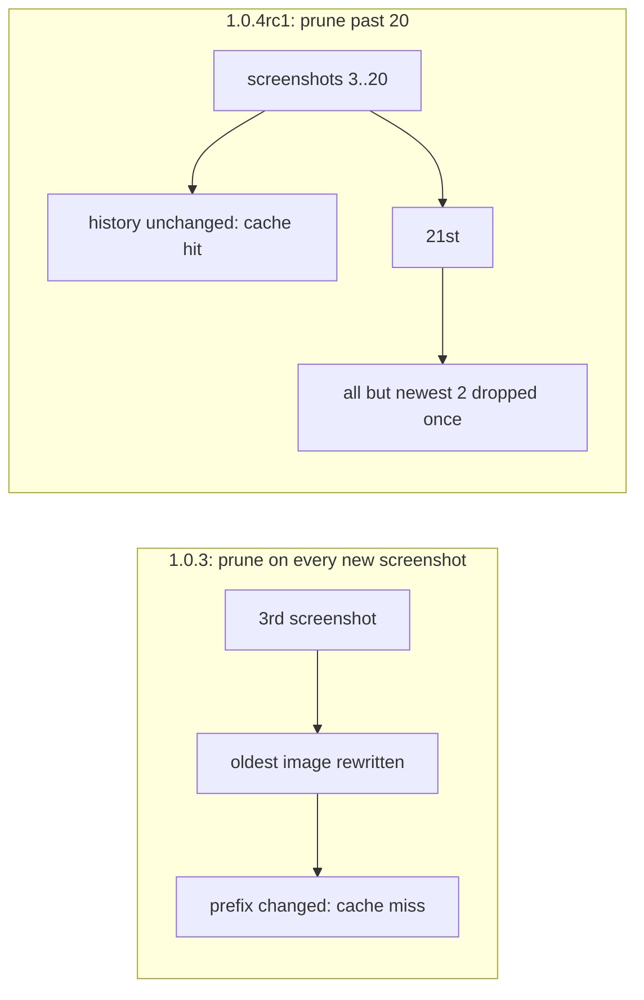

# Recent Activity in Starred Repositories
_174 active repos with 4286 new commits_

## [ai](https://github.com/topics/ai)
- [openclaw/openclaw](https://github.com/openclaw/openclaw) [278](https://github.com/openclaw/openclaw/commits): fix(test): clean proxy CA fixtures after setup and teardown failures (#198577)

* docs(test): record proxy CA fixture cleanup candidate

* fix(test): clean proxy CA fixtures after failures
- [BasedHardware/omi](https://github.com/BasedHardware/omi) [170](https://github.com/BasedHardware/omi/commits): SCA-2072: fix(batch): fresh-first pick reads the settle instant; probe reads past one page (#25243)

## What

Follow-up to #25213 and #25226. Three small things in the batch
pipeline, backend only. No store, query or index change, and no new
setting.

1. **Fresh-first pick reads the settle instant.** When an owner's
earliest pending fresh row is not ready, a later ready fresh row may
pass it after the head wait. That wait was measured only from
`ready_at`. It now uses `_ready_since`, which the head-wait path already
uses: `ready_at`, or for a provider row while provider merge membership
is on, `provider_intent.settled_at`.
2. **A full probe page with no ready row is logged.** `event=batch_merge
outcome=fresh_probe_full_no_ready`. The probe itself is unchanged (one
page of 32).
3. **Recent-discovery fallback is recorded.** The newest-commits read
added in #25213 swallowed a failed query. It now calls `record_fallback`
(`recent_discovery` to `main_cursor`). This was the valid P1 from the
automated review on #25213.

Also carries two docs-only commits for #25213's change note that were
written after it merged (wording about replicas, restarts and what the
main cursor guarantees), cherry-picked from the then-deleted branch.

## Why

Production, 2026-11-13, job metadata and counts only: 15 of 71 owners
with fresh provider units committed none of them. Each had a fresh unit
held on a rate-limited vendor at the front, and the ready fresh rows
behind it had no `ready_at` (settled while the stamp was off, or removed
by an operator script that day). The pick could never measure their
wait, so the probe returned nothing on every drain. 7,784 ready fresh
units were affected; they were released by restoring `ready_at` with a
reviewed operator script (7,375 rows written). This change removes the
dependency on that field for provider rows.

## Risk and cost

- Only fresh rows are eligible, as before: the pick returns only fresh
rows, and the transaction re-verifies that the picked row is pending,
ready and fresh behind a catch-up or held-backlog head, and that every
earlier row the probe returned is still unready. The held provider
backlog stays held (while
`BATCH_PIPELINE_PROVIDER_BACKLOG_RELEASE_ENABLED` is off, the default).
- Newly eligible: the pick takes the longest time any ready fresh row on
the probe page has been ready, and when that reaches the head wait it
commits the earliest ready row on the page (this shape is main's). The
change is which rows can supply that time: a ready fresh provider row
without `ready_at` now supplies its settle instant. So such a row can
now pass an unready earlier fresh row, and it can also make an earlier
ready fresh row on the same page eligible, including a GPU row that has
no `ready_at` of its own. That is the intent for provider rows. The
skipped unready row appends later as a late capture, as before.
- No extra reads. No new setting, index, job field, metric or pipeline
state. One warning log line per commit attempt that finds an owner's
first 32 pending fresh rows all unready. The line is not throttled:
every commit attempt that reaches the probe and finds such a page logs
it. An attempt that commits through the strict order does not reach the
probe.

## Known limits

- **Not in this PR: nothing re-offers an owner whose drain left ready
fresh rows waiting.** An owner drains when one of its units settles,
when maintenance finds one of its rows on the global ready page, or when
it carries a hold marker. Since the provider backlog hold the ready page
holds only held backlog rows and no marker is written for a held-backlog
head, so an owner that goes quiet with ready fresh rows inside the head
wait is not drained again (2026-11-13: 23 owners, about 3,400 rows). A
merge change for this was written and reviewed in this PR and then cut
by the rollout lead's ruling after repeated code findings; it goes to
its own PR. Until then an operator script re-offers such owners.

- A fresh unit held on a vendor still waits for the vendor.
- The probe still reads one page of 32. If an owner's first 32 pending
fresh rows are all unready, ready rows behind them are not seen; the new
log line reports it. An earlier version of this PR read further pages;
review found that a probe of several pages is not one consistent read,
and the rollout lead ruled to cut it. A pick that sees past one page,
made inside the transaction, is recorded as a requirement of the metered
release work.
- The probe is a hint read outside the transaction, on main and here
alike: a row it did not return that becomes ready between probe and
transaction can be passed by the picked row, and then commits on a later
drain as a late capture. Unchanged by this PR.
- A GPU row's own settle time is not read: only a provider row supplies
a settle instant. A ready GPU row without `ready_at` still cannot start
the wait by itself, but, as stated under Risk and cost, a later provider
row's settle instant can now make it the row picked.
- The settle instant is the provider intent's `settled_at`. A recovered
provider unit normally carries `ready_at` from recovery; if that were
removed, the pick could use an earlier attempt's settle instant and so
shorten the wait behind an unready row. The row must still be
`result_ready` to be picked.
- A persistent failure of the newest-commits read logs one fallback
warning per tick per instance, unthrottled.

## Deploy

backend-integration and the GPU batch worker, both of which run the
merge. Never roll either below f3902ec: older code releases the held
provider backlog through rows that carry `ready_at`. Off switch: none of
its own; `BATCH_PIPELINE_PROVIDER_MERGE_MEMBERSHIP_ENABLED=false`
removes the settle-instant fallback with the rest of membership.

Must stay clean after deploy: no non-fresh provider commits; share of
under-1h fresh captures unprojected at 10 to 20 minutes; `fallback`
events with `from_mode=recent_discovery` near zero;
`fresh_probe_full_no_ready` lines near zero.

## Tests

- `test_batch_provider_merge_membership.py`: the production shape end to
end (held backlog head, a fresh unit that never settles, ready fresh
rows without `ready_at`): nothing inside the wait, both ready rows after
it, backlog and held unit untouched. Fails without the fix. Also: a full
probe page with no ready row commits nothing and logs the line.
- `test_batch_terminal_poll_skip.py`: the pick uses the settle instant
for provider rows only and only with membership on.
- `test_batch_pipeline_projection_discovery.py`: the failed recent read
records the fallback.
- The tests added here do not sleep or read the wall clock.

Not tested here: production behaviour.

Failure-Class: FC-backlog-release-shares-lane-with-fresh-work

🤖 Generated with [Claude Code](https://claude.com/claude-code)
- [t8y2/dbx](https://github.com/t8y2/dbx) [61](https://github.com/t8y2/dbx/commits): feat(ci): remove the Atlas Cloud sponsor and AI integrations
- [XiaomiMiMo/MiMo-Code](https://github.com/XiaomiMiMo/MiMo-Code) [8](https://github.com/XiaomiMiMo/MiMo-Code/commits): fix(sdk): launch mimo and match its listening line (#2808)

* fix(sdk): launch mimo and match its listening line

createOpencodeServer and createOpencodeTui spawned `opencode`, which is a
different program. Without OpenCode installed the SDK could not start a
server; with it installed, the SDK connected to OpenCode's server instead
of MiMoCode's. The server launcher also waited for "opencode server
listening", while `mimo serve` prints "mimocode server listening". Spawn
`mimo` and match its real readiness line in both the v1 and v2 entries.
The public function names stay unchanged.

* test(sdk): write fake mimo argv atomically and restore an unset PATH
- [lutzroeder/netron](https://github.com/lutzroeder/netron) [6](https://github.com/lutzroeder/netron/commits): Update to 9.3.6
- [docling-project/docling](https://github.com/docling-project/docling) [5](https://github.com/docling-project/docling/commits): fix(docx): detect headings from paragraph-level w:outlineLvl (#3312) (#4129)

* fix(docx): detect headings from paragraph-level w:outlineLvl

Signed-off-by: nina-mir <ninamirf@gmail.com>

* test(docx): cover paragraph-level w:outlineLvl heading detection

Signed-off-by: nina-mir <ninamirf@gmail.com>

* docs(docx): note paragraph-level outlineLvl in test module docstring

Signed-off-by: nina-mir <ninamirf@gmail.com>

* test(docx): cover a numbered paragraph with a direct outline level

Signed-off-by: nina-mir <ninamirf@gmail.com>

---------

Signed-off-by: nina-mir <ninamirf@gmail.com>
- [zylon-ai/private-gpt](https://github.com/zylon-ai/private-gpt) [5](https://github.com/zylon-ai/private-gpt/commits): fix(settings): wire HTTPS_PROXY to the proxy.https_proxy field (#2432)

settings.yaml named the computed property 'https_server' instead of the model field 'https_proxy', so pydantic ignored the key: the documented HTTPS_PROXY/https_proxy value never reached ProxySettings and 'https_proxy' stayed None.

build_scrape_config reads 'proxy.https_server or proxy.http_server' and hands that to Chromium, which ignores proxy environment variables, so a deployment that set only HTTPS_PROXY (with PROXY_ENABLED=true) scraped without a proxy.

Add a regression test that loads the shipped settings.yaml with HTTPS_PROXY set and asserts the value reaches both the model field and the scraper's https_server/http_server selection.
- [google-gemini/gemini-cli](https://github.com/google-gemini/gemini-cli) [2](https://github.com/google-gemini/gemini-cli/commits): fix(cli): initialize auth capabilities and deduplicate options when listing models (#30271)
- [pykeio/ort](https://github.com/pykeio/ort) [2](https://github.com/pykeio/ort/commits): fix(sys): only rerun if dylib target path exists, closes #673

if the thing in rerun-if-changed doesnt exist cargo treats it as always stale
- [specstoryai/getspecstory](https://github.com/specstoryai/getspecstory) [2](https://github.com/specstoryai/getspecstory/commits): Merge pull request #404 from specstoryai/dependabot/github_actions/actions-minor-patch-bd5ef2e49e

Bump anthropics/claude-code-action from 1.0.270 to 1.0.271 in the actions-minor-patch group
- [google/magika](https://github.com/google/magika) [1](https://github.com/google/magika/commits): resolvers: populate PRONOM PUID, LoC FDD, and subformat metadata (#1618)

Populate RegularFileType::metadata for files identified by native resolvers
using the key-value store introduced in #1618:

- pronom_puid: UK National Archives PRONOM PUID (271 unique PUIDs)
- loc_fdd: US Library of Congress FDD identifier (132 unique FDDs)
- subformat: finer-grained variant already distinguished by existing verifiers
  (437 subformats across 129 content types, 183 with subformat-level PUID/FDD
  overrides)

No new parsing or matching logic is added; resolver ContentType decisions
remain identical.

Note on future optimization: subformats are currently stored as static string
descriptors for simplicity. If needed later, they can be represented internally
as a typed enum tree with optional/lazy string materialization so subformat
identification avoids any string handling when metadata is not requested.

## [ai-agents](https://github.com/topics/ai-agents)
- [slopus/happy](https://github.com/slopus/happy) [126](https://github.com/slopus/happy/commits): android: keep picker controls stable and bound photo editor work
- [earthtojake/text-to-cad](https://github.com/earthtojake/text-to-cad) [1](https://github.com/earthtojake/text-to-cad/commits): Release 0.11.10: fixes from the telemetry review, and the CAD app's export, snapshot and inspect tools removed (#832)

**Releases 0.11.10**, a patch: `VERSION` and its stamps are on this
branch (`scripts/release/bump-version.sh patch`), so merging this pull
request releases it, and with automatic updates on it installs itself on
every device.

**A departure, stated as the repo rules ask.** `CONTRIBUTING.md` ("Which
number a release bumps") counts a removed tool as breaking, which would
take the minor slot and a migration guide. This release removes three
CAD app tools and takes the patch slot on the owner's decision. No skill
names the three tools, and the operations remain as `cad` commands.

**Before merging**
- [ ] `Deploy API` first: this release sends telemetry schema 10, and a
receiver that does not read it rejects the whole batch.
- [ ] Tested in Claude Code, Codex and Cursor (not done yet).
- [ ] The privacy policy says the next `cad` command starts the
telemetry sender; the engine now starts it too. That copy is not edited
here.

A review of telemetry on 0.10 and 0.11 found no serious regression, and
found one rising failure rate, one crash class, a gap in what telemetry
counts, and several smaller defects. This fixes them.

## Exports

- **A refused export writes nothing.** Every destination is checked
before any is written. Before, a mixed export could write the STEP and
STL and then refuse the DXF.
- **A write that fails partway** exits 1 and names the files already
written.
- **Mixed exports with `--tolerance`.** One command naming a STEP
alongside STL, 3MF or GLB with `--tolerance` is refused whole, and a
skill line led agents into it. The skill and the command's help now say
which options apply to which files, and a policy test
(`DocumentedExportOptions`) holds the documented options to the engine.
The engine's contract is unchanged.

## Kernel environment

- **Views that need no kernel no longer start it.** Mesh, DXF and KiCad
files open without warming the kernel pool.
- **A failed making is remembered** instead of re-run on every call.
Network, killed, file, download and unresolvable-release failures retry
after five minutes; the rest wait for a restart or `cad run -c "import
build123d"`.
- **Every failure message says what to do next.**

## CAD app

- **`cad_export`, `cad_snapshot` and `cad_inspect` are removed**, with
the operation contract (request IDs, polling, cancel) that existed for
them. Hard cutover (law 15, tier 1): a call to one gets what any unknown
tool name gets.
- **The commands are the one route.** Exporting, inspecting and the
agent's own snapshot are `cad model export`, `cad model inspect` and
`cad model snapshot` (`cad <type> ...` for a file), which the cad skill
already documents. The server's instructions now name them, for an agent
that has the server and has not loaded the skill.
- **What this costs.** A host whose agent has no shell on the device
(Claude Desktop's Chat tab, and its agent mode, whose shell is a Linux
VM) loses these three operations from the agent. Codex, Claude Code and
Cursor keep them as commands: in Codex's default sandbox on macOS the
commands work whenever the engine is running, which the plugin's server
sees to.
- **An older running server** is reported as `outdated`, not as a
refused request.
- **A refused relative path** names the argument and the path.

## Telemetry (schema 10)

- **Model builds are counted again.** They went uncounted from 0.10. The
engine counts each build it answers, by the consent of whoever asked;
the library and a model's own process still count nothing.
- **`failed` means the system failed** (`analytics.SYSTEM_FAILURES`). A
script that raises, or a kernel refusal it triggers, is counted as a
build and nowhere else. Our own bugs, a missing kernel environment,
memory, file errors and worker deaths are failures.
- **One crash report per failed making** of the kernel environment, with
a cause word, instead of one per call.
- **Sending.** The engine starts the detached sender when the spool has
waited five minutes, and never waits on the network.
- **Receiver.** `apps/api` reads schema 10 and still reads schemas 1 to
9 unchanged.

## Tests

Run locally on this branch:

- Python: 14 library and 555 server tests pass (CAD app, viewer,
telemetry, update, exports, kernel environment).
- `scripts/test/test-global.sh`: 288 pass, 1 skipped.
- `npm --prefix apps/api test`: 53 of 53.
- `scripts/bundle/bundle.sh --check` (the pre-commit hook) and
`scripts/release/check-version.sh` pass.

Not run locally: the full Python suite, the JS suites, and anything on
Windows or Linux; CI runs every job for a `VERSION` change.

## Not fixed here

- A process-pool loader refusal seen on Windows has no reproduction.
- A sandbox that allows local network and forbids the state folder can
start an engine that stays confined for its whole life, so builds and
snapshots fail for every caller until `cad stop`. Codex's default
sandbox never gets that far.

🤖 Generated with [Claude Code](https://claude.com/claude-code)

---------

Co-authored-by: earthtojake <jakefitz64@gmail.com>
Co-authored-by: Claude Fable 5.2 <noreply@anthropic.com>

## [cross-platform](https://github.com/topics/cross-platform)
- [cjpais/Handy](https://github.com/cjpais/Handy) [3](https://github.com/cjpais/Handy/commits): fix: try the next paste tool when one fails on Linux (#2495)

An installed but unusable tool (ydotool without ydotoold, wtype on a
compositor without virtual-keyboard support) aborted the paste even when
another tool or enigo could have sent the keys. ydotool also prints its
errors on stdout, so the log showed an empty 'ydotool failed:'.
- [Snapchat/Valdi](https://github.com/Snapchat/Valdi) [3](https://github.com/Snapchat/Valdi/commits): Internal Change

GitOrigin-RevId: 385a6ee98504749e8e0f2b7bf23b395b26b1b93e
- [wasmi-labs/wasmi](https://github.com/wasmi-labs/wasmi) [3](https://github.com/wasmi-labs/wasmi/commits): Add missing `wasmi_error_message` C-API (#2092)

* add wasmi_error_message C-API impl

* add changelog item

* fix trailing newline in Display impl
- [xyproto/algernon](https://github.com/xyproto/algernon) [1](https://github.com/xyproto/algernon/commits): Update dependencies

## [esp32](https://github.com/topics/esp32)
- [espressif/idf-extra-components](https://github.com/espressif/idf-extra-components) [10](https://github.com/espressif/idf-extra-components/commits): Merge pull request #902 from RathiSonika/feat/nand_generic_chip_detection

feat(spi_nand_flash): generic nand flash chip detection
- [arendst/Tasmota](https://github.com/arendst/Tasmota) [9](https://github.com/arendst/Tasmota/commits): Matter subscriptions fix (#25259)
- [crosspoint-reader/crosspoint-reader](https://github.com/crosspoint-reader/crosspoint-reader) [2](https://github.com/crosspoint-reader/crosspoint-reader/commits): fix: epd diplay enhancements for all panels (#4362)

1. Improves image rendering on picco
2. Adds immediate mode AA for x4pro and x4c
3. Reduces ghosting on picco and eego
4. Improves night mode on picco
5. Improves epd speed on picco

Relies on a freeink PR that hasn't been merged yet (just awaiting some
final testing)
- [xinnan-tech/xiaozhi-esp32-server](https://github.com/xinnan-tech/xiaozhi-esp32-server) [2](https://github.com/xinnan-tech/xiaozhi-esp32-server/commits): Merge pull request #3559 from xinnan-tech/py-tts-session

fix(tts): 流式 TTS 会话延迟到首个有效文本开启，修复慢 LLM 场景合成结果为空
- [78/xiaozhi-esp32](https://github.com/78/xiaozhi-esp32) [1](https://github.com/78/xiaozhi-esp32/commits): fix: preserve C6 branch in CST3530 dependency condition (#2422)
- [HASwitchPlate/openHASP](https://github.com/HASwitchPlate/openHASP) [1](https://github.com/HASwitchPlate/openHASP/commits): Merge pull request #1048 from u236/watchdog

Add object timer attributes
- [schreibfaul1/ESP32-audioI2S](https://github.com/schreibfaul1/ESP32-audioI2S) [1](https://github.com/schreibfaul1/ESP32-audioI2S/commits): slow stream
 #951

## [golang](https://github.com/topics/golang)
- [cshum/imagor](https://github.com/cshum/imagor) [7](https://github.com/cshum/imagor/commits): refactor(blob): keep ReadAll unlimited and bound at caller (#888)

* refactor(blob): keep ReadAll unlimited and bound at the call site

ReadAll sized its buffer from the source's declared size. The fix for that
grew it from the bytes read but also capped it at 100 MiB, which narrowed
the method's contract for callers that never had a problem.

Keep ReadAll the way io.ReadAll is: it reads what the source sends, and the
declared size is only a capacity hint. Add ReadAllLimit for callers that
have a budget of their own — the SVG sanitizer and the lang rewrite (32 MiB,
the point past which a document is not served as a vector either), and the
ImageMagick buffer fallback (the pixels a MaxResolution decode would cost).

* test(vipsprocessor): cover the buffer fallback limit
- [esimov/caire](https://github.com/esimov/caire) [7](https://github.com/esimov/caire/commits): Updated release badge to v1.6.0
- [daptin/daptin](https://github.com/daptin/daptin) [4](https://github.com/daptin/daptin/commits): docs: clarify group relationships and permission editing
- [ClickHouse/clickhouse-go](https://github.com/ClickHouse/clickhouse-go) [3](https://github.com/ClickHouse/clickhouse-go/commits): Merge pull request #2096 from ClickHouse/kavirajk/deprecate-with-async-helper

chore: deprecate `withasync` helpers
- [gojue/ecapture](https://github.com/gojue/ecapture) [3](https://github.com/gojue/ecapture/commits): chore: update CHANGELOG for v2.11.0 release with breaking changes, new features, and fixes

Signed-off-by: CFC4N <cfc4n.cs@gmail.com>
- [wader/fq](https://github.com/wader/fq) [2](https://github.com/wader/fq/commits): Merge pull request #1432 from wader/mod-update

go: Update golang.org/x/* mods
- [chromedp/chromedp](https://github.com/chromedp/chromedp) [1](https://github.com/chromedp/chromedp/commits): Update cdproto to v0.160.1 and describe the new termcast

The README shows that termcast has no flags, detects the terminal in
Start, and draws with no flicker in kitty and Ghostty.

Co-Authored-By: Claude Opus 5.5 <noreply@anthropic.com>
- [clickvisual/clickvisual](https://github.com/clickvisual/clickvisual) [1](https://github.com/clickvisual/clickvisual/commits): Merge pull request #1271 from clickvisual/kl7sn/261108-ch-query-hang

fix(query): bound log queries and release database resources
- [jhump/protoreflect](https://github.com/jhump/protoreflect) [1](https://github.com/jhump/protoreflect/commits): Fix potential hang and stack overflow in remotereg (#670)

If the types fetched from the server resulted in files with an import
cycle, `Registry` would recurse forever and the calling program would
terminate with a "stack overflow" fatal error. This could happen with
legitimate schemas if the server didn't provide source
context/filenames, since mutually recursive types would each
(incorrectly) be assigned to their own synthetic file, resulting in an
import cycle. Such types are now put into the same synthesized file, and
any explicit import cycle (when the server does provide file names) is
reported as an error.

The number of types that may be reachable from a single requested type
is now limited, to 1500 by default. Previously, a malicious server could
serve an endless chain of types, causing the client to fetch forever.
Even very large real-world schemas (such as Parfetto Trace and Google
Ads APIs) have fewer than 1200 types reachable from any one type, so
this limit should not be reached in practice. But if there is a schema
that exceeds it, the limit can be raised with a new
`Registry.MaxReachableTypes` config field.

A number of other bugs were fixed along the way to addressing the above:
* Previously, the name of a fetched type was not checked. A type's name
must now be a valid fully-qualified name, and it must match the name in
the URL from which the type was fetched. Similarly,
`DescriptorConverter.ToMessageDescriptor` and `ToEnumDescriptor` now
return an error if the given type has an invalid name.
* Previously, nested types that did not indicate their file (server did
not provide a source context and file name) could fail to resolve, with
an error about a name conflict between a package and a message. Nested
types are now put into the same file as their enclosing type which
resolves the ambiguity and fixes the resulting descriptors.
* If a requested type exists but refers to another type that cannot be
found, the returned error now identifies the missing type and the field
that refers to it. This error no longer matches `protoregistry.NotFound`
when checked with `errors.Is`, since `NotFound` means that the requested
type itself is unknown. (Requesting a type that is unknown still returns
exactly `protoregistry.NotFound`.)
* Previously, resolving a type that referred to an already-cached
message could fail with a "cannot resolve type" error if the cached
message had a nested message that referred to other types. Resolving a
type that referred to already-cached types could also intermittently
fail with a "missing dependency" error, if those cached types did not
indicate their file. Both have been fixed.
* `DescriptorConverter.ToServiceDescriptor` no longer drops nested types
from request and response messages that are already in the `Registry`.
- [tidwall/gjson](https://github.com/tidwall/gjson) [1](https://github.com/tidwall/gjson/commits): fix uint overflow

fixes #404

## [gpu](https://github.com/topics/gpu)
- [ProjectPhysX/FluidX3D](https://github.com/ProjectPhysX/FluidX3D) [3](https://github.com/ProjectPhysX/FluidX3D/commits): More consistent naming for assebly dump files
- [skypilot-org/skypilot](https://github.com/skypilot-org/skypilot) [3](https://github.com/skypilot-org/skypilot/commits): [Jobs] Deprecate managed job `event_callback` and make it opt-in (#11355)

* [Jobs] Deprecate managed job `event_callback` and make it opt-in

`event_callback` is a shell script that the jobs controller runs whenever a
managed job changes status. It is undocumented and rarely used. Deprecate it
and disable it by default. An API server administrator can keep using it by
setting `jobs.allow_event_callback: true` in the API server config.

- `sky jobs launch` rejects a job that sets `event_callback` unless the API
  server enables it, with a message that names the setting. When it is
  enabled, the launch logs a deprecation warning.
- The setting is read from the API server's config only; a client config
  cannot change it.
- The jobs controller reads the setting when it starts, and skips the
  callbacks of jobs that were submitted before callbacks were disabled.
- A jobs controller on its own cluster keeps running callbacks: its jobs were
  checked by the API server when they were submitted.
- Internal state-transition callbacks are unchanged.
- Document `jobs.allow_event_callback` in the config reference.

Co-Authored-By: Claude Opus 5.5 <noreply@anthropic.com>
Agent: event-callback-opt-in (claude-opus-5-5 xhigh)

* Format the client-override test

Co-Authored-By: Claude Opus 5.5 <noreply@anthropic.com>
Agent: event-callback-opt-in (claude-opus-5-5 xhigh)

* [Docs] Note that event callbacks can run user code on the API server

Co-Authored-By: Claude Opus 5.5 <noreply@anthropic.com>
Agent: event-callback-opt-in (claude-opus-5-5 xhigh)

* Always allow callbacks on a jobs controller on its own cluster

A jobs controller on its own cluster read `jobs.allow_event_callback` from
the copy of the config it got when it was created. If that copy had
`false`, and an administrator later enabled callbacks on the API server,
the server accepted new callback jobs but the existing controller skipped
their callbacks.

Such a controller now always allows callbacks: the API server already
checked each of its jobs when it was submitted. The setting is read only in
the API server and its consolidation-mode controllers, which restart with
the server. This also drops the function-level import.

Co-Authored-By: Claude Opus 5.5 <noreply@anthropic.com>
Agent: event-callback-opt-in (claude-opus-5-5 xhigh)

---------

Co-authored-by: Claude Opus 5.5 <noreply@anthropic.com>

## [ios](https://github.com/topics/ios)
- [fastlane/fastlane](https://github.com/fastlane/fastlane) [11](https://github.com/fastlane/fastlane/commits): [fastlane_core] pkg_file_analyser: fail with xar's message when it cannot extract the pkg (#30557)

* [fastlane_core] pkg_file_analyser spec: reproduce nil results when xar cannot extract the pkg

* [fastlane_core] pkg_file_analyser: fail with xar's message when it cannot extract the pkg
- [supabase/supabase-swift](https://github.com/supabase/supabase-swift) [3](https://github.com/supabase/supabase-swift/commits): refactor(examples): adopt the typed query API, typegen and typed Realtime in Reminders (#1817)

* refactor(examples): adopt the typed query API, typegen and typed Realtime in Reminders

- Generate App/Supabase/Database.swift with supabase gen types --lang swift. The app
  models are the generated @Table structs, renamed through typealiases.
- Repositories use from(T.self), .where, .order, Draft inserts, closure updates and
  the generated client.rpc methods. The custom null-writing encoder is gone.
- Realtime takes each table from its @Table type, and member and invitation changes
  are typed too.
- Invitation.status is the generated InvitationStatus enum.
- Link PostgrestMacros to the Reminders target.

* chore(examples): regenerate the Reminders types with the do-not-edit notice

The notice comes from supabase-typegen in #1819.

## [llm](https://github.com/topics/llm)
- [NousResearch/hermes-agent](https://github.com/NousResearch/hermes-agent) [1906](https://github.com/NousResearch/hermes-agent/commits): fix(redact): mask a coloured token clipped at a line break

A token wrapped as ESC[32msk-...\nbutton had its shadow match clipped to
the first line, which carried no noise, so it was left to the ordinary
prefix pass — whose lookbehind rejects the escape's trailing 'm'. Also
mask the clipped span when the byte left of it is stripped noise.

Refs #81012
- [BerriAI/litellm](https://github.com/BerriAI/litellm) [85](https://github.com/BerriAI/litellm/commits): feat(custom-logger-v2): add the contract for rust callbacks and bind the proxy request scope (#51526)

* feat(custom-logger-v2): add types, dispatcher and route callback call sites (step 0)

* feat(custom-logger-v2): add the rust contract for native callbacks and bind the proxy request scope

* fix(custom-logger-v2): add field projections and keep the request scope across copies

* fix(custom-logger-v2): pass the request scope to the async failure attempt_ended line

* fix(custom-logger-v2): add v2 callbacks from litellm.callbacks to the success and failure lists

_safe_add_callback_to_list dropped CustomLoggerV2 instances, so a V2 callback registered through litellm.callbacks got provider events but never log_prepare or attempt_ended. The manager now adds each V2 instance once by identity, and proxy startup fans V2 callbacks out like CustomLogger ones.

* fix(custom-logger-v2): contain a failing v2 callback on logging hooks

A V2 log_prepare writer that raised, or returned Abort or Respond, ended the line and escaped async_success_handler, so attempt_ended delivery, sync-for-async scheduling and the Redis flush were skipped. On hooks off the request path a V2 entry's exception or outcome is now counted and logged like a legacy logger's exception, and the line goes on. ContractViolation and BaseException still propagate, and legacy entries are unchanged.

* fix(custom-logger-v2): run blocking and awaited v2 callbacks on synchronous logging lines

run_plan_sync raised ContractViolation for a V2 log_prepare writer or any awaited V2 subscriber, the logging plane swallowed it, and every legacy logger at that hook was skipped. Legacy entries now always run in order as before. A V2 writer or awaited subscriber runs inline in list order through asyncio.run when the thread has no running event loop, so sync SDK calls apply its patch and finish it before the handler returns. On a thread with a running loop it cannot block, so it is delivered off-path and its patch is not applied. Lines without such entries take the unchanged legacy path.

* fix(custom-logger-v2): map a v2 abort to its http error at every proxy hook point

Only pre_call turned a V2 Abort into an HTTP error. during_call, post_call_success, post_mcp_call, list_models and the deferred stream hook raised V2Outcome, which reached the client as a 500, and post_call_failure, which never raised before, raised it too. Abort now raises the exception it carries or an HTTPException with its status, message and headers at those points, and at post_call_failure it becomes the transformed error through keep_first. Respond is still not wired and keeps raising V2Outcome. The pre_call routing test is updated to the HTTPException raise_v2_abort already makes.

* fix(custom-logger-v2): apply no-log to v2 logging subscribers without a request scope

The proxy request scope already carries no-log and caller opt-outs, so a V2 callback that honors no-log is skipped on proxy requests. SDK calls have no scope, and the logging plane ran V2 subscribers with an empty selection, so a no-log call was still delivered to them. Without a bound scope the logging lines now open one with no_log set when the call's litellm_params carry no-log, unless global_disable_no_log_param is on. Callbacks that do not honor no-log, and so every writer or abortable, are unaffected.

* fix(custom-logger-v2): deliver a failed attempt to v2 subscribers once per logging object

Callers such as MCP tool errors and Responses streaming run both failure handlers without for_async_request, so a V2 attempt_ended subscriber, now present in both failure lists, got the failure twice. The first failure handler to include V2 subscribers claims the delivery on the Logging object and the other skips them. Legacy callbacks are unchanged.

* refactor(custom-logger-v2): settle a synchronous v2 run through the shared gather and use aware times in the new tests

Drops the blind except the sync line used to capture a V2 callback's exception, reusing _gather_started, and gives the new logging tests timezone-aware times, so the strict ruff counts do not grow.

* fix(custom_logger_v2): await a single-entry v2 stage in the caller's context

A native handler in its own stage ran inside an asyncio.gather child task, so a ContextVar it set was lost when the stage ended, while a legacy callback's stays visible to later callbacks and the rest of the request. A stage with one v2 entry is now awaited directly, with gather's exception handling kept. Multi-entry parallel stages still gather.

* fix(custom-logger-v2): raise a native callback panic as a runtime error

* fix(custom-logger-v2): run a synchronous v2 line on a private event loop

* fix(custom-logger-v2): deliver an mcp tool failure to v2 subscribers from the async failure handler

* fix(custom-logger-v2): raise an abort's carried exception at the deployment hooks and keep the original failure at post_deployment_failure

* fix(custom-logger-v2): apply caller opt-outs to v2 logging lines without a bound request scope

* fix(custom-logger-v2): dedupe v2 callbacks in the event lists by logger key so a native built twice is delivered once

* fix(custom-logger-v2): log an unregistered abort error kind and keep the carried traceback at post_call_failure

* fix(callbacks): reject a selection name or alias that is not lowercase

* fix(custom-logger-v2): run v2 deployment callbacks on rust bridge deployment hooks

* fix(router): type the fallback event kwargs handed to the v2 dispatch

* feat(custom_logger_v2): type the contract fields as records and mark derived-only fields

Fields that the host derives from a hook's arguments now carry pydantic records on the Python side and matching serde records in litellm-callbacks, with records.json as the shared sample both sides check. Twelve new fields take bits 30 to 41, a write to a derived-only field is a manifest error, and pre_call can write budget_reservation and rate_limit_statuses in place. The payload reference field and the PayloadHost trait give Rust a handle to the logging payload instead of a copy

* feat(custom_logger_v2): derive typed fields from hook arguments and always build call facts

A slot table maps each typed field to a function over the hook's arguments. A derived slot runs only when a subscriber reads it, once per hook invocation, and off-path readers settle their reads before the hook returns. Auth fields come from the auth object only, budget_plan is claimed once, and budget_reservation and rate_limit_statuses write through to their carriers so the next pre_call subscriber sees them. Call facts are now built on unscoped logging lines and at post_call_success, post_call_failure and response_headers

* feat(callbacks-python): hand the logging payload to native callbacks by reference

NativeCallback stashes the shallow payload copy it is given and passes Rust a PayloadRef. The Python host renders a handle with a safe_dumps compatible encoder, on the caller's event loop while the hook runs and on the blocking pool after it, and dropping the last reference releases the stash entry. The encoder and its JSON helpers move here from the S3 logging bridge so every port shares one copy

* feat(custom_logger_v2): accept every value python accepts for typed members and serve logged key identity

Typed members keep the bool, int, float or str python holds through a Scalar
type on both sides, so ids, limits and priorities no longer lose values that
lax pydantic refused. A member the contract cannot carry is named in rejected
so a port can reproduce what python does with it.

Logging hooks get logged_key_identity, built from the payload metadata the
python loggers read on every route, while key_identity stays on request hooks
and keeps reading the auth object.

* fix(custom_logger_v2): read the live budget reservation dict and carry non-finite floats both ways

budget_reservation read the dict budget_reservation.py builds with a KeyError
on callback_bound. Undeclared keys are now ignored, callback_bound is a member,
entries keep a non-mapping item as null so capacity's model access group check
stays exact, and costs read as the float budgets computes with float(x or 0.0).

Float members cross as the raw json marker when they are not finite, and a
native verdict returns through json_to_py, so an infinite or NaN cost survives
a read and a write instead of turning into null.

* feat(callbacks): carry a python value as its str() text and truthiness in scalar members

Scalar gains a Stringified variant with the str() text and bool() of a value
that is not a bool, int within i128, float or str, so a port can reproduce
the label, path or log text python formats and the falsiness of an empty
container without confusing it with a real string. Budget reservations say
whether python held the entries as a list.

* feat(custom_logger_v2): carry non-scalar values and any iterable tags or entries across the boundary

A Scalar member now carries a list, dict, set, bytes, object or an int past
i128 as its str() text and truthiness instead of naming it in rejected, which
stays for values whose str() or bool() raises. request_tags carries any
iterable as the items prometheus iterates, and budget reservation entries
carry what budgets iterates with entries_is_list for capacity's list check,
never written back to the shared dict.

* feat(custom_logger_v2): say whether a stringified value hashes and whether it is an int

A Stringified scalar now carries hashable, from trying hash() at the
boundary, so a port can raise the TypeError capacity's priority lookup and
the limiter's descriptor identities raise for a list, dict or set and not
for a tuple or object. It also carries integer, so an int past i128 is told
apart from any other value whose text is digits.

* fix(custom_logger_v2): wrap a non-list guardrail mode as one mode like prometheus does

Prometheus treats any guardrail_mode that is not a list as a single mode, so a
tuple mode holds no str mode and a missing mode is one None mode. The
derivation unpacked tuples and rejected other non-str modes instead.

* feat(callbacks): let a native handler await typed host calls the python caller serves

* test(callbacks-python): drive a native handler's host calls through the python dispatcher

* test(custom_logger_v2): route a native logger with a host through the execution driver

* fix(custom_logger_v2): type the wrapped guardrail modes for pyright

* feat(custom_logger_v2): carry the python type name and hash error text of a stringified value

* feat(custom_logger_v2): serve the model group the logging handlers compute and key remaining limits by it

* feat(custom_logger_v2): tell a budget reservation that is not a mapping apart from none

* feat(custom_logger_v2): name malformed team model preferences in rejected with the text capacity logs

* feat(custom_logger_v2): serve a logging payload that is not a mapping apart from a missing one

* fix(callbacks-python): render null keys like a python dict merge, adding a missing key last

* feat(custom_logger_v2): carry an explicit output cap past i64 as a scalar

* feat(custom_logger_v2): serve the custom metadata labels prometheus derives from the logged payload

* feat(custom_logger_v2): serve the input sequence length bucket prometheus picks at attempt end

* feat(custom_logger_v2): carry the start and end times prometheus reads from the call details

* feat(custom_logger_v2): serve the limiter's body tags, session id, resolved agent and agent policy limits at pre_call

* fix(callbacks): export the limiter request record

* test(custom_logger_v2): give the type name cases stable ids and sort the record exports

* fix(custom_logger_v2): type the new derivations and tests for pyright

* fix(custom_logger_v2): drop team model preferences and serve the fallback_on_saturation handoff main's capacity callback reads

* style(callbacks): rustfmt the record exports

* refactor(custom_logger_v2): rename native callbacks to rust callbacks

native.py becomes rust.py, with native_logger, NativeLogger, NativeHandle,
NativeState and HostedNative renamed to their rust forms. The pyo3 classes
NativeCallback and NativeRequestState become RustCallback and
RustRequestState, and the tests, fixtures and messages follow.

* refactor(custom_logger_v2): rename slots to field sources

slots.py becomes field_sources.py: Slot is FieldSource, SlotFields is
SourcedFields, and with_slots, NO_SLOTS and slot_table_problem follow. A
table that only derives is named DERIVED_*_FIELDS, and a table that can
write back keeps SOURCES (PRE_CALL_AUTH_SOURCES, PRE_CALL_SOURCES). The
include_v2 comment moves down to the functions that take it.

* refactor(litellm_logging): place the v2 members of Logging beside what they serve

v2_scope, v2_auth and v2_failure_delivered join the other per-request
class defaults, v2_logging_scope and its opt-out helper follow
should_run_callback, v2_call_facts sits by the standard logging payload
builder, and claim_v2_failure sits above failure_handler.
bind_v2_request_scope checks for a Logging object directly instead of two
runtime protocols.

* refactor(proxy): rename v2_fields to v2_proxy_fields and say why it is separate

* refactor(custom_logger_v2): drop the logged_payload_not_a_mapping field

A logged payload that is present but not a mapping now looks the same to a
rust callback as a missing one, a parity gap accepted for a case that does
not occur. metadata_labels, input_sequence_length and limiter_request move
down to bits 44-46, on both sides of the contract.

* feat(callbacks): type a rust callback's request state

Callback gains an associated State type: request_state returns it and
handle and handle_hosted receive Option<&State> beside the input, which no
longer carries the state. ErasedCallback is the object-safe form the python
wrapper stores; it carries the state type-erased and downcasts it once,
returning CallbackError::StateType rather than panicking on a mismatch.
handle_hosted's default names its unused host _host. The record sample
count follows the dropped logged_payload_not_a_mapping field.

* docs(callbacks): say what PayloadRef, PayloadHost and RenderOptions.null_keys are

* refactor(callbacks-python): render payloads with python-compat's json writers

pyjson.rs reimplemented py_encode_basestring_ascii and json's floatstr.
python-compat's json module now exposes write_string, generic over a String
or byte sink, and float_text, and the payload renderer uses them.

* docs(callbacks): note why Respond, Reroute, call_ended and flush are not wired yet

* docs(custom_logger_v2): add a README for the package

* fix(custom_logger_v2): import the field sources tests from field_sources

* test(callbacks-python): stub the litellm package in each payload test

* fix(custom_logger_v2): type the disabled callbacks lookup and the v2 dedupe check
- [unslothai/unsloth](https://github.com/unslothai/unsloth) [62](https://github.com/unslothai/unsloth/commits): Studio: keep <bos> in Gemma 4 chat training text (#17678)

## Problem

Studio trains Gemma 4 chat datasets with no `<bos>` token.

`format_and_template_dataset` removes the leading `<bos>` from the
rendered text for every model whose name contains "gemma". That is
correct for Gemma 1, 2, 3 and 3n. Their tokenizers add `<bos>` again
when the text is tokenized. Gemma 4 tokenizers do not add it, so each
training row ends up without one. At inference the chat template always
emits `<bos>`, so the model is trained on a format it never sees again.

This affects `gemma-4-E2B-it`, `gemma-4-E4B-it`, `gemma-4-26B-A4B-it`
and `gemma-4-31B-it` on text chat datasets (ChatML and ShareGPT). Alpaca
and image datasets were never stripped.

## Change

**Fix:** strip the template's `<bos>` only when the tokenizer adds one
itself.

- `studio/backend/utils/datasets/dataset_utils.py`: the new helper
`_tokenizer_adds_bos` tokenizes a short string and checks whether the
first id is `bos_token_id`. For a processor it checks the inner
tokenizer.
- Gemma 1, 2, 3 and 3n are unchanged. The text is stripped and the
tokenizer adds `<bos>` back.
- Gemma 4 text now keeps the template's `<bos>`. The trainer already
turns `add_special_tokens` off when the text starts with `<bos>`, so the
row has exactly one.
- New test file `studio/backend/tests/test_gemma_bos_prefix.py`.

## Results

**Tokenized training row.** Studio's formatter and the trainer's
`add_special_tokens` rule, run on the real tokenizers:

| Model | `<bos>` count before | `<bos>` count after |
|---|---|---|
| `gemma-4-31B-it` | 0 | 1 |
| `gemma-4-26B-A4B-it` | 0 | 1 |
| `gemma-4-E4B-it` | 0 | 1 |
| `gemma-4-E2B-it` | 0 | 1 |
| `gemma-3-4b-it` | 1 | 1 |
| `gemma-3-270m-it` | 1 | 1 |
| `gemma-3n-E2B-it` | 1 | 1 |
| `gemma-2-2b-it` | 1 | 1 |

**Studio training A/B.** `unsloth/gemma-4-31B-it`, 4-bit, LoRA r=32,
alpha=32, LR 2e-4, batch 2, gradient accumulation 4, context 2048, 200
rows of about 1,500 tokens each, 25 steps, RTX 6000 Ada. The control is
this branch with only the new condition removed.

| | Without `<bos>` | With fix |
|---|---|---|
| Loss at step 1 | 4.56 | 3.60 |
| Gradient norm, max | 422.8 | 13.7 |
| Steps with gradient norm above 10 | 5 of 25 | 2 of 25 |
| Mean loss, steps 16 to 25 | 2.44 | 2.41 |

Chat with the trained adapter gave coherent text in both arms.

**Per-row gradients outside Studio.** Same model, Unsloth's Gemma 4
template, adapter at initialization, 40 rows of 1,100 to 2,048 tokens,
one row per step:

| | Without `<bos>` | With `<bos>` |
|---|---|---|
| Mean loss | 4.66 | 3.88 |
| Gradient norm, median | 6.6 | 2.9 |
| Gradient norm, max | 210.6 | 50.5 |
| Rows with gradient norm above 10 | 16 of 40 | 3 of 40 |

With a partly trained adapter, the loss for the same row and weights
also changed with the order of the rows when `<bos>` was missing (3.36
and 3.64 for one 717-token row). With `<bos>` the loss was identical in
both orders tested.

## Tests

- `tests/test_gemma_bos_prefix.py`: 8 passed. They check the rendered
text and that the tokenized row starts with exactly one `<bos>`. Four of
the eight fail without the change.
- 20 dataset and training test files in `studio/backend/tests`: 572
passed, 12 failed. The same 12 fail on main (8 in
`test_dataset_tools_column.py`, 4 in `test_pretokenized_dataset.py`).

## Not covered

- This came out of a user report of a `gemma-4-31b` LoRA that outputs
gibberish after one epoch (https://redd.it/1xrmo8f). I could not
reproduce that output, with or without this change, so this PR does not
claim to fix it. It fixes a real difference between training and
inference on the path that report most likely used.
- The MLX training path was not run. It uses the same formatter.
- Only `gemma-4-31B-it` was trained. For the other Gemma 4 sizes only
the tokenized row was checked.
- Adapters already trained in Studio without `<bos>` are not changed. In
my runs they still gave coherent output when prompted with `<bos>`.
- Scripts that strip `<bos>` themselves (`text.removeprefix("<bos>")`,
as older Gemma notebooks did) are outside Studio and not covered here.

---------

Co-authored-by: pre-commit-ci[bot] <66853113+pre-commit-ci[bot]@users.noreply.github.com>
- [kortix-ai/CompanyOS](https://github.com/kortix-ai/CompanyOS) [50](https://github.com/kortix-ai/CompanyOS/commits): fix(release): pre-promote tripwire script, Capture WebView2 wait, stable lockfile (#12701)

## Summary

Follow-ups from the v0.15.11 release (#12672). That release needed 3
release-suite runs, about 1 h each. Its Deploy Prod run then failed once
on a Capture check.

1. **`scripts/pre-promote-tripwires.sh`:** 17 checks the release suite
fails on, run in about 2.5 min with no server and no database. The
kortix-release skill's Step 2 runs it before each Promote dispatch. It
gives the 2026-10-21 ledger rule ("run the release suite's fast
tripwires before every Promote") the enforcer that rule lacked.
2. **Capture Windows MSI check:** it now waits up to 60 s for the
WebView2 process and records the wait. Before, it waited a fixed 10 s.
3. **`pnpm-lock.yaml`:** re-resolved. #12675 left it unstable: every
`pnpm install --lockfile-only` rewrote 46 lines.
4. **`gitleaks-download-verification.test.ts`:** the test installs into
a temp `bin`. Before, it extracted into `/usr/local/bin`, which replaced
a developer's real gitleaks or failed on a binary another user owns.
5. **`scripts/ghsa-audit.mjs`:** the root lockfile advisory filter,
moved out of `ci.yml`. One copy now serves CI and the script.
6. **kortix-release skill:**
- The gateway's version is on `/health/live`. `/health` answers
`{status}` only, by design.
- The staging web is behind Vercel auth (an anonymous request gets
`302`).
   - Deploy Staging runs list the `dev` SHA as their head.
7. **Learnings entry:** supersedes the 2026-10-21 tripwire entry.

No demo video: CI, scripts and docs only.

## Evidence

| Check | Result |
|---|---|
| `bash scripts/pre-promote-tripwires.sh` on this branch | 17 of 17 ok |
| Same script on `eab0879db1` (the `dev` SHA v0.15.11 first promoted) |
9 red: api tripwires, flow registry, route coverage, cli commands doc,
web i18n audit, web route registries, ui layers, starter budgets, GHSA.
These are the first release-suite run's failures, found in about 2.5 min
instead of 1 h. |
| `node scripts/ghsa-audit.mjs` on this branch / on `5418d83309^` | exit
0 / exit 1 naming GHSA-r3h5-4585-7x3w (astro, @astrojs/node) and
GHSA-3v2p-hm54-8qcq |
| `pnpm install --lockfile-only`, run twice | the second run leaves no
diff; `--frozen-lockfile` passes |
| `vitest` gitleaks-download-verification, app-runtime-workflow,
sandbox-workflow, learnings-ledger, no-docs-tree | 49 pass;
`/usr/local/bin/gitleaks` untouched |
| `actionlint` ci.yml, capture-build.yml | clean |

## Capture: why a wait, not a code change

Deploy Prod run 43533482514, attempt 1: the Start menu window opened
(`title: Kortix Capture`). The WebView2 profile existed in
`LocalAppData`, and the window wrote no `ui.log`. The screenshot shows a
blank white window, and `webview_processes` was 0 after 10 s. Attempt 2
on the same build: the full UI and 1 WebView2 process. The job passed,
and the Capture installers were attached. A cold WebView2 first start on
a runner that was recording at the same time took longer than 10 s. A
window that never gets a WebView still fails after 60 s.

## Capture check on a real runner

`capture.yml` dispatched on this branch (run 43542763240): every build
and verify job passed. The Windows MSI evidence reads
`webview_processes: 1, webview_wait_s: 0`.

## Risks and rollback

- `ci.yml`: the root GHSA step now runs the script. Its ignore list and
severity rule are unchanged.
- Revert this PR to roll back. Nothing deploys from it.
- [QwenLM/qwen-code](https://github.com/QwenLM/qwen-code) [47](https://github.com/QwenLM/qwen-code/commits): test(cli): deflake managed runtime terminal replay test (#17192) (#17194)

Co-authored-by: github-actions[bot] <41898282+github-actions[bot]@users.noreply.github.com>
Co-authored-by: Qwen-Coder <qwen-coder@alibabacloud.com>
- [CherryHQ/cherry-studio](https://github.com/CherryHQ/cherry-studio) [40](https://github.com/CherryHQ/cherry-studio/commits): refactor(data-migration): replace v1 conversion with native installer downloads (#23998)

<!-- Template from
https://github.com/kubevirt/kubevirt/blob/main/.github/PULL_REQUEST_TEMPLATE.md?-->
<!--  Thanks for sending a pull request!  Here are some tips for you:
1. Consider creating this PR as draft:
https://github.com/CherryHQ/cherry-studio/blob/main/CONTRIBUTING.md
-->

### What this PR does

Before this PR: current builds include the v1 conversion engine,
migration window/exporters/IPC, and Settings remigration action.

After this PR: remove that conversion runtime and block unmigrated
profiles during read-only preboot. Eligible installations offer
one-click download, verification, installation and restart into the
pinned migration-capable **2.2.2** release. Other installations retain
direct platform-matched downloads. Unknown or pre-1.9.12 history directs
users through 1.9.12 first. Fresh and established v2 profiles continue
normally.

Fixes: None

### Why we need it and why it was done in this way

The following tradeoffs were made: migration remains in the fixed
historical release. A session-scoped updater avoids bootstrapping normal
data/settings services. A 24-target manifest pins edition, platform,
architecture and SHA-512; library installers retain signature
verification and replacement ownership. Cache and updater bookkeeping
are isolated from legacy data.

The following alternatives were considered: retaining conversion,
reusing the lifecycle-dependent normal updater, browser-only downloads,
mutable latest feeds, or custom replacement scripts. Extend the existing
electron-updater 6.7.0 patch instead of accessing private fields: custom
AppAdapters retain the Electron downloader, MacUpdater exposes disposal
of its own listeners/staging server, RpmUpdater selects explicit
downgrade commands only for older targets, and PortableUpdater stages
and verifies the portable EXE before exit, then replaces and relaunches
it at the same path with backup recovery. Custom profiles use a durable
BootConfig handoff read by 2.2.2.

Links to places where the discussion took place: user-approved design
and dependency-patch direction in the implementation session.

### Agent Note / Spec

Agent Note:
`.agents/notes/implemented/simplification/2026-11-09-retire-v1-data-migration.md`;
`.agents/notes/proposed/feature/2026-11-11-preboot-bridge-install.md`
(with Chinese counterparts).

Spec PR: This PR; the user explicitly authorized implementing the
proposal and extending the existing dependency patch in this PR.

Acceptance criteria: retirement AC1–AC5; bridge AC1–AC3 and AC6–AC8 have
scoped implementation/test evidence. AC4 and AC5 now also have Linux
ARM64 AppImage, deb and RPM replacement/restart/migration evidence.
**Other platform, architecture and signing acceptance remains
incomplete; the bridge Spec stays proposed.**

### Verification

- `pnpm exec vitest run --project main
src/main/data/migration/__tests__/legacyBridgeUpdaterPatch.test.ts
src/main/data/migration/__tests__/legacyBridgeInstaller.test.ts
src/main/data/migration/__tests__/legacyBridgeTarget.test.ts
src/main/data/migration/__tests__/legacyUpgrade.test.ts
src/main/data/migration/__tests__/legacyUpgradeWindow.test.ts
src/main/core/preboot/__tests__/legacyUpgradeGate.test.ts
src/main/core/paths/__tests__/pathRegistry.test.ts
src/main/services/__tests__/AppUpdaterService.test.ts`: **8 files, 182
tests passed**. Covers prerequisites/target matrix, cancel/retry/late
events, native listener disposal, custom-adapter transport, trusted IPC,
and updater-owned exit versus ordinary quit.
- `pnpm test:renderer
src/renderer/windows/legacyUpgrade/__tests__/LegacyUpgradeApp.test.tsx`:
**5 passed**, including horizontal progress, cancellation, retry,
handoff controls and prerequisite actions.
- `pnpm typecheck:node`, `pnpm typecheck:web`, `pnpm exec electron-vite
build`: passed.
- Changed-file Oxfmt, Oxlint `--deny-warnings` and ESLint: passed. `pnpm
i18n:check` (all 15 locales), `pnpm docs:check`, and `git diff --check`:
passed.
- `pnpm check --plan`, `pnpm change:scope --base origin/main` and `pnpm
docs:affected --base origin/main`: inspected; base refreshed to
`2e6575901a59e6edb5748a2df18713f48635f658`. No full local suite was run.
- Isolated macOS Electron exercised the actual patched downloader with
local HTTP fixture bytes: valid SHA-512 downloaded; invalid SHA-512
rejected; disposal completed. No native installer was called.
- Production renderer with a shared horizontal Progress component in an
isolated Electron fixture: initial, progress, cancel/restart,
failure/retry and handoff states; light/dark and 440×380 footer/overflow
checks passed, with no renderer errors. IPC progress/handoff was
simulated. Temporary test instance exited; existing borrowed instance
was preserved. Report and screenshots are under
`.context/cherry-electron-dev/oneclick/` (local evidence, not
committed).
- Earlier retirement validation covered affected provider/model
consumers, real production-schema SQLite fixtures, reset/restore and
Settings removal. Shipped SQLite migrations are unchanged.
- Linux package extension: `pnpm test:main
src/main/data/migration/__tests__/legacyBridgeLinux.test.ts
src/main/data/migration/__tests__/legacyBridgeUpdaterPatch.test.ts
src/main/data/migration/__tests__/legacyBridgeInstaller.test.ts
src/main/data/migration/__tests__/legacyBridgeTarget.test.ts
src/main/data/migration/__tests__/legacyUpgrade.test.ts
src/main/core/preboot/__tests__/legacyUpgradeGate.test.ts
src/main/data/migration/__tests__/legacyUpgradeWindow.test.ts
src/main/services/__tests__/AppUpdaterService.test.ts`: **8 files, 112
tests passed**. After simplifying the historical filename lookup, the
two affected test files passed again (**45 tests**).
- Latest extension: `pnpm typecheck:node`, `pnpm exec electron-vite
build`, scoped ESLint/Oxlint/Oxfmt, `pnpm docs:check`, and `git diff
--check` passed. Change scope and affected docs inspected against
refreshed `origin/main` (`135094397393a867072f6f73520c91b950312171`).
- Real Linux ARM64 packaged tests: Ubuntu deb via `pkexec`/`dpkg` and
Fedora 45 RPM via `sudo`/`dnf downgrade` both replaced 2.2.0 with the
pinned official 2.1.0 package, relaunched its migration wizard and
completed migration. Both package databases confirmed 2.1.0. Read-only
SQLite assertions verified the synthetic assistant/prompt/topic, two
message bodies/IDs, parent chain, completed migration marker, integrity
and foreign keys. Missing elevation authentication kept the deb
installation at 2.2.0 with Retry available; authorizing the isolated
test user allowed retry to complete.
- Earlier real AppImage test verified pinned SHA-512, automatic 2.1.0
launch/migration, and reopening migrated messages in the current build.
Local reports/screenshots: `.context/cherry-electron-dev/replacement/`
and `.context/bridge-packages/` (not committed).
- Test limits: package tests use ARM64/global and synthetic text data.
Headless test elevation used isolated-user authorization; no interactive
authentication dialog was accepted. The Fedora container GUI ran with
`--no-sandbox`; Ubuntu deb ran without that flag. x64, CN, macOS/Windows
signed replacement and other package-manager backends were not exercised
end-to-end. Remote CI for this commit is pending.

- Custom/portable extension: 10 explicit main test files
(legacyBridgeLinux, legacyBridgeInstaller, legacyBridgeUpdaterPatch,
legacyBridgeTarget, legacyUpgrade, legacyUpgradeWindow,
legacyUpgradeGate, userDataLocation, AppUpdaterService, pathRegistry),
**236 tests passed**; node typecheck, electron-vite build, scoped
lint/format and docs checks passed.
- Real Ubuntu ARM64 deb acceptance with spaces and Chinese characters in
custom paths: persisted the chosen path, installed 2.1.0 and restarted
into its migration wizard. A full run from an already configured custom
directory completed all 16 steps; read-only SQLite assertions preserved
the assistant, prompt, topic, message bodies/IDs and parent chain, with
valid integrity/foreign keys. The legacy-discovered path also completed
migration after correcting the test launcher's missing UTF-8 locale; the
first C-locale run failed inside historical Chromium IndexedDB. Windows
portable replacement/signature/rollback and macOS/Windows custom-path
installation remain unverified natively. Base refreshed to
`0c34fa9fc72e54628d23c2123981121268c60b33`.

- CI repair for run `43260177792` / job `131329327461`: removed the two
unused `settings.theme.window.style` catalog keys from all 15 renderer
locales. `pnpm i18n:sync`, `pnpm i18n:check`, `pnpm i18n:unused:check`,
changed-file `pnpm exec oxfmt --check`, and `git diff --check` passed.
This catalog-only repair needs no additional Agent Note; existing
retirement and bridge notes remain applicable.


- Bridge target refresh: the latest published `v2.2.2` source retains
the migration engine and accepts v1.9.12+. All 24 targets were rebuilt
from the fixed official release manifests; four portable EXEs were
downloaded, checked against release SHA-256 digests and hashed with
SHA-512. CN downloads use the published GitCode assets. Version text is
interpolated from the bridge constant. Scoped main/renderer tests, node
typecheck, i18n sync/catalog/unused checks, changed-file lint/format,
and docs checks passed. Earlier native replacement evidence above is for
2.1.0; native installation/migration with 2.2.2 has not been rerun.

### Breaking changes

Action required for unmigrated v1 profiles: migrate through 2.2.2 before
using the current release; 1.9.11 or earlier/unknown sources first
require 1.9.12. Keep existing data. The Settings remigration action is
removed. Completed v2 profiles retain compatibility records.

### Special notes for your reviewer

Review read-only classification and profile continuity, pinned asset
integrity, and updater exit ownership. Custom profiles and Windows
portable installations are supported. Automatic installation excludes
translated processes, unknown Linux package forms, unpackaged builds and
non-portable Windows installations lacking publisher metadata. Portable
signatures must be valid and match before exit. Those cases retain
manual downloads. Download cancellation never installs; handoff disables
ordinary quit; observable native errors restore recovery. This PR does
not automate migration itself or the return from 2.2.2 to the latest
release. **Remaining platform acceptance is still required before
release.**

### Checklist

This checklist is not enforcing, but it's a reminder of items that could
be relevant to every PR.
Approvers are expected to review this list.

- [x] Branch: This PR targets `main`
- [x] PR: The PR description is expressive enough and will help future
contributors
- [x] Code: [Write code that humans can
understand](https://en.wikiquote.org/wiki/Martin_Fowler#code-for-humans)
and [Keep it simple](https://en.wikipedia.org/wiki/KISS_principle)
- [x] Refactor: You have [left the code cleaner than you found it (Boy
Scout
Rule)](https://learning.oreilly.com/library/view/97-things-every/9780596809515/ch08.html)
- [x] Upgrade: Impact of this change on upgrade flows was considered and
addressed if required
- [x] Documentation: A [user-guide update](https://cherryai.com/docs)
was considered and is present (link) or not required. Check this only
when the PR introduces or changes a user-facing feature or behavior.
- [x] Self-review: I have reviewed my own code (e.g., via
[`/gh-pr-review`](/.claude/skills/gh-pr-review/SKILL.md), `gh pr diff`,
or GitHub UI) before requesting review from others

### Release note

```release-note
<!--LANG:en-->
[Data upgrade] action required: v1 users must migrate through Cherry Studio 2.2.2. Eligible installations offer one-click installation of the migration release; other installations retain direct platform-matched downloads.
<!--LANG:zh-CN-->
[数据升级] action required：v1 用户需先通过 Cherry Studio 2.2.2 完成迁移；符合条件的安装支持一键安装迁移版本，其他情况保留匹配系统架构的直接下载。
<!--LANG:END-->
```

---------

Signed-off-by: suyao <sy20010504@gmail.com>
- [langgenius/dify](https://github.com/langgenius/dify) [39](https://github.com/langgenius/dify/commits): test(api): bring the rag pipeline generate service tests under strict pyrefly (#46290)
- [gptme/gptme](https://github.com/gptme/gptme) [24](https://github.com/gptme/gptme/commits): feat(hooks): hooks run matches keyworded memories; hooks install is the single documented path (#4911)

* feat(hooks): make hooks run match keyworded memories, document it as the single install

hooks run only matched lessons, while memory match only matched memories (plus
lessons behind --lessons), so a Claude Code setup with one of the two silently
lacked the other. hooks run now matches keyworded memories in the same pass
(opt out with GPTME_LESSONS_INCLUDE_MEMORIES=false), so 'gptme-util hooks
install' is the one hook to install. Document it in memory.rst.

Refs #4868

Git-Session-Id: 34a4e465-72f5-4858-aab7-1e36c2f10a1d

* fix(hooks): preserve nested memory triggers and workspace discovery

Git-Session-Id: e6a6a347-5409-5564-af90-81a1da750b9c

* fix(hooks): deliver context in Claude Code event envelope

Git-Session-Id: 667ac0cf-b483-59ec-ad10-278c098b7e74

* test(hooks): isolate memory fixtures from user lessons

Git-Session-Id: cec116d4-adca-58eb-a817-ce920a820819
- [browser-use/browser-use](https://github.com/browser-use/browser-use) [11](https://github.com/browser-use/browser-use/commits): 1.0.4rc1: batch screenshot pruning keeps the prompt cache, plus #6387 #6388 (#6394)

1.0.4rc1: screenshots pruned in one batch, so screenshot-heavy runs keep
the prompt cache. Plus #6387 and #6388.



| | 1.0.3 | 1.0.4rc1 |
|---|---|---|
| cache-missing requests, 200 steps, screenshot every step | 197/199 |
10/199 |
| same, screenshot every 3rd step | 65/199 | 3/199 |
| max images in one request | 2 | 20 (Anthropic caps at 100) |

- **Why:** BU Bench 1.0.3 (evals agent, 1,624 requests on 6 traces):
every request that pruned missed the OpenAI cache, and every request
that didn't prune hit it. On 14 screenshot-heavy tasks, that cost $47 of
the run's $87.
- **Proof:** a scratch replay of `_prune_images` across 200 turns (table
above). `tests/ci/test_loop.py` passes (70/70); the old keep-2 test is
rewritten for batch pruning. `pytest tests/ci -m "not chrome"`: 897
passed. pyright: 0 errors.
- **Also in it:** #6387 (BU_NAME own Chromium) and #6388 (upgrade hint),
both already green as drafts.
- **Risk:** the agent now sees up to 20 old screenshots instead of 2, so
it has more context per request and behaves differently. BU Bench v2.1
on this SHA decides that. Rollback: set `PRUNE_IMAGES_AT =
KEEP_IMAGE_RESULTS` (the 1.0.3 behavior).

<!-- This is an auto-generated description by cubic. -->
---
## Summary by cubic
Finalizes 1.0.4: screenshots are pruned in one batch once more than 20
tool results carry one (previously on every new one), keeping the
provider's prompt cache on screenshot-heavy runs — in BU Bench 1.0.3
every pruning request missed the cache, costing $47 of a run's $87. Also
bundles #6387 and #6388.

**New Features**
- The CLI now falls back to launching its own Chromium when BU_NAME is
set, instead of failing on headless boxes; its daemon and profile are
named `<BU_NAME>-chromium`.
- When attaching a browser fails, the CLI and `--cli-mcp` ask PyPI (2 s
timeout, cached a day) and print a line naming a newer release with the
matching upgrade command; `BROWSER_USE_NO_UPDATE_CHECK=1` disables that.

**Notes**
- The agent now sees up to 20 old screenshots a request instead of 2;
undo the pruning change with `PRUNE_IMAGES_AT = KEEP_IMAGE_RESULTS`.
- A BU_NAME that ran a cloud browser still fails closed, and an overlong
BU_NAME keeps the old behavior with a line explaining why.

<sup>Written for commit 7f4a23e0195bc882c14a128e9eec9f4d49bfb01a.
Summary will update on new commits.</sup>

<a
href="https://cubic.dev/pr/browser-use/browser-use/pull/6394?utm_source=github"
target="_blank" rel="noopener noreferrer"
data-no-image-dialog="true"><picture><source
media="(prefers-color-scheme: dark)"
srcset="https://www.cubic.dev/buttons/review-in-cubic-dark.svg"><source
media="(prefers-color-scheme: light)"
srcset="https://www.cubic.dev/buttons/review-in-cubic-light.svg"></picture></a>
<a
href="https://www.cubic.dev/action/auto-fix/pr/browser-use/browser-use/6394?returnTo=https%3A%2F%2Fgithub.com%2Fbrowser-use%2Fbrowser-use%2Fpull%2F6394&source=description"
target="_blank" rel="noopener noreferrer"
data-no-image-dialog="true"><picture><source
media="(prefers-color-scheme: dark)"
srcset="https://www.cubic.dev/buttons/turn-on-auto-fix-dark.svg"><source
media="(prefers-color-scheme: light)"
srcset="https://www.cubic.dev/buttons/turn-on-auto-fix-light.svg"></picture></a>

<!-- End of auto-generated description by cubic. -->
- [google/adk-python](https://github.com/google/adk-python) [7](https://github.com/google/adk-python/commits): fix: only create the agents file watcher when agent reload is enabled

ApiServer.get_fast_api_app constructed a watchdog Observer on every call,
even when no setup_observer callback was given, and never stopped it. Since
watchdog 7, InotifyObserver opens an inotify instance and starts a reader
thread in its constructor, so every app built without --reload_agents leaked
one inotify instance and one thread. Unit tests build hundreds of apps per
process, which exhausted fs.inotify.max_user_instances and failed the CI unit
test jobs with "OSError: [Errno 24] inotify instance limit reached".

setup_observer and tear_down_observer now default to None, and the observer
is only created when setup_observer is given.

Co-authored-by: Liang Wu <wuliang@google.com>
PiperOrigin-RevId: 1021255454
- [screenpipe/screenpipe](https://github.com/screenpipe/screenpipe) [7](https://github.com/screenpipe/screenpipe/commits): Bump app to 2.7.149
- [OpenHands/OpenHands](https://github.com/OpenHands/OpenHands) [5](https://github.com/OpenHands/OpenHands/commits): chore(canvas): update Debian snapshot to 20261108T000000Z (#18968)

Co-authored-by: github-actions[bot] <github-actions[bot]@users.noreply.github.com>
Co-authored-by: openhands <openhands@all-hands.dev>
- [cactus-compute/cactus](https://github.com/cactus-compute/cactus) [1](https://github.com/cactus-compute/cactus/commits): Add binaries license to README (#194)
- [steel-dev/steel-browser](https://github.com/steel-dev/steel-browser) [1](https://github.com/steel-dev/steel-browser/commits): fix(commands): fix dialog hint, CSS selector errors and element markdown (#432)

## [macos](https://github.com/topics/macos)
- [yetone/magpie](https://github.com/yetone/magpie) [216](https://github.com/yetone/magpie/commits): usage: the Requests card's up arrow opens what the bytes sent upstream were made of

theforeveriris (X, 2121408745616162998) saw 8169 requests send 8.6 GB
up and 1.0 GB down and wanted to know why. About 1 MB a request is
normal: every request sends the whole conversation again, with the
system prompt and the tools' definitions. This shows it.

Gateway: promptOf, which already parses the body off the request path,
now also counts the bytes of the system prompt, the tool definitions
and images in the body it read. upParts scales those to the wire bytes
and puts them on Record.UpParts. Nothing new runs on the request path,
and a body that isn't parsed stays "Not measured".

Usage: a packed row keeps the mix in 255ths under flag rowUpParts
(32768); the row stays 152 bytes. Totals gain up_calls, up_measured,
up_system, up_tools and up_images, and Shares carry up_bytes and
up_calls by agent and by model. settledCountVersion goes 4 -> 5, so
settled days are counted again once on the next start.

GUI (Usage -> Requests): the "↑ 8.6 GB" on the Requests card is a
button that opens a "Sent upstream" card: the average per request, one
sentence on why, a bar and legend for Conversation / Tool definitions /
System prompt / Images / Not measured, and the top 8 agents and models
with bytes sent and per request. The open state is kept; × closes it.
A request's details get a "Made of" line. zh, zh-TW, ja, de strings.
Entrance is 200ms ease-out, no movement under reduced motion.

Run (mote, at this head on 27e43ed26):
- go test ./internal/usage ./internal/usageapi: ok
- go test -run 'Prompt|UpParts|UpBytes|DownBytes|Traffic|Ledger|
  CodexOwnTurn' ./internal/gateway: ok
- go test -run Budget ./internal/gui: ok (after the rebase)
- go vet -tags nogui for darwin, linux, windows on usage, gateway,
  usageapi, gui: ok; gofmt -l clean
- GUI: usage-upload.test.cjs 32/32 (chromium + webkit, 1180 and 420,
  en zh zh-TW ja de); with i18n-keys, i18n-en-no-cjk,
  usage-ledger-bytes, usage-traffic, usage-ledger-detail: 144 pass,
  0 fail
- GUI subset i18n*, usage*, ledger* at f1f34d624: the only reds are
  usage-agents-hide, usage-cards-hide, usage-fold,
  usage-hidden-way-back, usage-ledger, usage-range-times and
  usage-speed-all-models. They are red the same way on origin/main
  f1f34d624 without this change and are already filed (#3414, #3415,
  #6003, #6294, #6295, #6499, #5834).
- Screenshots of the card: chromium en 1180 light, webkit zh 1180
  dark, chromium zh 420 light.
- Benchmark: promptOf on a 1.17 MB body, 2.8-3.9 ms/op with counting
  vs 3.2-3.7 without, same allocations (noise).
- Broken by hand: without the b.again guard,
  TestPromptKnowsWhatItsBytesWere goes red.

Not run: the full go test ./... and the full GUI suite. mote and mica
were loaded, with a suite already queued under suite.lock.
- [ly05010419/MacNativeGames](https://github.com/ly05010419/MacNativeGames) [29](https://github.com/ly05010419/MacNativeGames/commits): fix: align Skyward Sword packaging with MNG standards (after PR #2093)
- [trycua/cua](https://github.com/trycua/cua) [29](https://github.com/trycua/cua/commits): fix(ci): close superseded post-publish installer PRs (#7675)

The release workflow opened a bookkeeping PR per release and never closed
older ones that did not merge. Close and delete the branches of older
post-publish-installer PRs when a new one opens, via a tested script.

Co-authored-by: Claude Sonnet 5.5 <noreply@anthropic.com>
- [JerryZLiu/Dayflow](https://github.com/JerryZLiu/Dayflow) [28](https://github.com/JerryZLiu/Dayflow/commits): release: update appcast for v2.9.3
- [electrikmilk/cherri](https://github.com/electrikmilk/cherri) [14](https://github.com/electrikmilk/cherri/commits): Error when a statement is left unclosed at the end of the file

Unclosed if, repeat and menu statements compiled without any error and
produced a Shortcut with a missing End action.

Co-Authored-By: Claude Sonnet 5.5 <noreply@anthropic.com>
- [pqrs-org/Karabiner-Elements](https://github.com/pqrs-org/Karabiner-Elements) [10](https://github.com/pqrs-org/Karabiner-Elements/commits): Update NEWS
- [jundot/omlx](https://github.com/jundot/omlx) [8](https://github.com/jundot/omlx/commits): fix(minimax-m3): probe MSA prefill kernel threadgroup before use (#5239)

* fix(minimax-m3): probe MSA prefill kernel threadgroup before use

Fixes #5233

Signed-off-by: begcdn <begcdn@users.noreply.github.com>

* refactor(minimax-m3): probe K1 through msa_sparse_attention_b1

---------

Signed-off-by: begcdn <begcdn@users.noreply.github.com>
Co-authored-by: begcdn <begcdn@users.noreply.github.com>
Co-authored-by: jundot <jundot@users.noreply.github.com>
- [onevcat/Kingfisher](https://github.com/onevcat/Kingfisher) [8](https://github.com/onevcat/Kingfisher/commits): Merge pull request #2619 from onevcat/takeover/pr-2618-download-task-shell-cancellation

Replay cancellation and priority on linked download tasks
- [tw93/MiaoYan](https://github.com/tw93/MiaoYan) [7](https://github.com/tw93/MiaoYan/commits): docs(rules): record the sandboxed preview and promise-reader contracts

I-43 and I-44 go into docs/incidents.md for the two #578 defects fixed in
5ea57d0b and f59c2ed9, both first visible only when the built App Store
(sandboxed) app is run. preview.md now says local media loads only through
miaoyan-file:// with read access limited to the page's folder, and that
media-loading changes are tried on a sandbox-signed build; it also loads
for MPreviewView and LocalMediaSchemeHandler. swift.md records why a
callback AppKit runs on a given queue is built outside the main actor.

Verified: scripts/check_incidents.py (44 rows, 0 problems) and
scripts/test_review_gates.py.
- [shadowsocks/ShadowsocksX-NG](https://github.com/shadowsocks/ShadowsocksX-NG) [5](https://github.com/shadowsocks/ShadowsocksX-NG/commits): ci: use generic destination for CodeQL
- [acsandmann/rift](https://github.com/acsandmann/rift) [3](https://github.com/acsandmann/rift/commits): fix: no reraise after window removal (#677)
- [FluidInference/FluidAudio](https://github.com/FluidInference/FluidAudio) [3](https://github.com/FluidInference/FluidAudio/commits): fix(tts): release builds trimmed the first and last word of each phoneme chunk (#1160)

### Why is this change needed?

Since #1153, release builds of Paradee drop the first and last word of
every chunk: "Whoever saves one life, saves the world entire." is spoken
as "saves one life, saves the world". Debug builds and the test suite
are fine, so CI doesn't see it.

The cause is a Swift 6.4 `-O` miscompile. An unapplied method reference
such as `allSatisfy(CharacterSet.whitespacesAndNewlines.contains)`
returns the inverted answer once the module holds a second one. #1153
added two `contains(where: CharacterSet.alphanumerics.contains)` calls
in the vocabulary rescorer. After that, `PhonemeChunker`'s trim treated
every non-space scalar as whitespace and cut each chunk back to its
outer spaces. A standalone two-function package reproduces it in `-c
release` (Apple Swift 6.4, swiftlang-6.4.0.34.1) and not in debug.

### What changes?

The three references (the chunker's and #1153's two) are now closures,
which compile correctly.

### Testing

- `git bisect` with a release CLI: first bad commit 5fff83ae (#1153).
- Paradee v1.2, release CLI, the sentence above: 2.6 s on main, 3.625 s
here, the same as at a7c887af (#1073).
- `tts-benchmark --corpus minimax-english`, Paradee v1.2 `af_heart`,
release: WER 13.2 % on main, 0.93 % here, the figure in
`Documentation/TTS/Paradee.md`.
- KokoroAne, which goes through `chunkRanges`, renders the same length
on main and here. Inflect and StyleTTS2 call the same `chunk` entry
point as Paradee; I didn't measure them.
- Chunker, vocabulary-rescorer and Paradee suites: 80 tests pass.
swift-format 601 is clean.
- `CharacterSetMethodReferenceTests` scans `Sources/` for an unapplied
`CharacterSet.<set>.contains` passed as a function, since debug test
runs can't see the miscompile. It fails on main with the three
references above and passes here. `testChunksKeepTheirFirstAndLastWords`
pins the chunk edges.

Found while working on #1159.

🤖 Generated with [Claude Code](https://claude.com/claude-code)

<!-- devin-review-badge-begin -->

---

<a
href="https://app.devin.ai/review/fluidinference/fluidaudio/pull/1160"
target="_blank"><picture><source media="(prefers-color-scheme: dark)"
srcset="https://static.devin.ai/assets/gh-devin-review-dark.svg?v=4"></picture></a>
<!-- devin-review-badge-end -->
- [Clipy/Clipy](https://github.com/Clipy/Clipy) [1](https://github.com/Clipy/Clipy/commits): Add AlternativeMenu for upcoming search support (#792)
- [Kiln-AI/Kiln](https://github.com/Kiln-AI/Kiln) [1](https://github.com/Kiln-AI/Kiln/commits): Merge pull request #2020 from Kiln-AI/model-sweep/adds-2026-11-11

chore: add Mi:dm K 3.0 Pro to model list (openrouter)

## [markdown](https://github.com/topics/markdown)
- [foambubble/foam](https://github.com/foambubble/foam) [7](https://github.com/foambubble/foam/commits): Update vulnerable dependencies (replaces Dependabot #1775–#1779) (#1782)

* Update vulnerable dependencies within their existing ranges

Lockfile-only. Covers the in-range part of Dependabot's security PRs
#1775 (group), #1776 (nanoid), #1777 (source-map-js), #1778 (vite) and
#1779 (postcss): postcss 8.5.32, nanoid 3.3.20, source-map-js 1.2.2,
vite 7.3.8, zod 4.6.7, @modelcontextprotocol/sdk 1.32.2 (pulls
@hono/node-server 2.1.8), markdown-it 14.3.3, axios 1.21.1,
body-parser 2.4.0, brace-expansion 1.1.22/2.1.8/5.0.13, fast-uri 3.1.9,
follow-redirects 1.16.3, handlebars 4.7.10, hono 4.13.18,
ip-address 10.7.6, js-yaml 3.15.2/4.3.2, morgan 1.12.1,
postcss-selector-parser 6.1.6, proxy-addr 2.0.8, qs 6.17.1.

markdown-it stays on 14.x: 14.3.3 carries the 15.0.x security fixes,
so #1775's move of the range to ^15.0.3 is not needed (and its
lockfile never resolved it).

Co-Authored-By: Claude Opus 5.5 <noreply@anthropic.com>
Claude-Session: https://claude.ai/code/session_01Cbk4GGXMAYVeFSgwo8EMDD

* Update happy-dom to 21.0.4

Fixes GHSA-834v-8h66-3h79, GHSA-c8p4-j97h-3vg8 and GHSA-5fpq-26gf-qwcr;
21.0.4 is the first release outside GHSA-834v's range, so there is no
20.x fix. It's only used as the test environment for @foam/graph-view.
21.0's breaking change (CSS and iframe loading off by default) doesn't
touch those tests.

Co-Authored-By: Claude Opus 5.5 <noreply@anthropic.com>
Claude-Session: https://claude.ai/code/session_01Cbk4GGXMAYVeFSgwo8EMDD

---------

Co-authored-by: Claude <noreply@anthropic.com>
- [markedjs/marked](https://github.com/markedjs/marked) [3](https://github.com/markedjs/marked/commits): fix: Fix bracket escapes inside code spans in link text being stripped (#4205)

* Fix bracket escapes inside code spans in link text being stripped

The link label matcher consumes backslash-escaped brackets, and outputLink then removes those escapes from the label text. It did so over the whole label, so a backslash-escaped bracket inside a code span also lost its backslash even though code span content is literal: [`\]`] rendered <code>]</code> instead of <code>\]</code>.

Scan the label and copy code spans through verbatim, unescaping brackets only outside of them.

Refs #4176

Co-authored-by: generaltony007 <144252170+GeneralTony007@users.noreply.github.com>

* Add spec tests for bracket escapes in link text code spans

Refs #4176

Co-authored-by: generaltony007 <144252170+GeneralTony007@users.noreply.github.com>

* Add expected HTML for bracket escapes in link text code spans

Refs #4176

Co-authored-by: generaltony007 <144252170+GeneralTony007@users.noreply.github.com>

---------

Co-authored-by: generaltony007 <144252170+GeneralTony007@users.noreply.github.com>

## [middleware](https://github.com/topics/middleware)
- [thingsboard/thingsboard](https://github.com/thingsboard/thingsboard) [65](https://github.com/thingsboard/thingsboard/commits): Merge branch 'rc'
- [bloomberg/blazingmq](https://github.com/bloomberg/blazingmq) [4](https://github.com/bloomberg/blazingmq/commits): Fix[mqbblp::RemoteQueue]: drop PUSH with malformed SubQueueInfos

Signed-off-by: Yuan Jing Vincent Yan <yyan82@bloomberg.net>

## [python](https://github.com/topics/python)
- [adafruit/circuitpython](https://github.com/adafruit/circuitpython) [25](https://github.com/adafruit/circuitpython/commits): Merge pull request #11872 from vegardw/stm-timealarm-fraction

stm: keep the fraction of a second in TimeAlarm
- [chdb-io/chdb](https://github.com/chdb-io/chdb) [17](https://github.com/chdb-io/chdb/commits): Merge pull request #786 from wudidapaopao/fix-groupby-as-index-false-labels

Keep groupby(as_index=False) row labels through a later sort, filter or slice
- [esphome/esphome](https://github.com/esphome/esphome) [13](https://github.com/esphome/esphome/commits): [serial_proxy] Keep received bytes when the client's connection is blocked (#22687)
- [vacanza/holidays](https://github.com/vacanza/holidays) [6](https://github.com/vacanza/holidays/commits): Update Euronext holidays: add Athens holidays (#4098)

Co-authored-by: ~Jhellico <jhellico@gmail.com>
- [arnegiacomo/fugleramme](https://github.com/arnegiacomo/fugleramme) [4](https://github.com/arnegiacomo/fugleramme/commits): docs: name both XIAO boards in the screens diagram
- [dbcli/mycli](https://github.com/dbcli/mycli) [4](https://github.com/dbcli/mycli/commits): Merge pull request #2430 from jayhemnani9910/batch-delimiter

Support DELIMITER in batch input
- [pyodide/pyodide](https://github.com/pyodide/pyodide) [4](https://github.com/pyodide/pyodide/commits): Changelog for v314.0.8 (#6554)
- [pymupdf/PyMuPDF](https://github.com/pymupdf/PyMuPDF) [3](https://github.com/pymupdf/PyMuPDF/commits): docs/document.rst: fix indentation of new items to match existing layout.
- [vinta/awesome-python](https://github.com/vinta/awesome-python) [2](https://github.com/vinta/awesome-python/commits): Merge pull request #3405 from IsmeetPandey/update-ai-agents-intro-links
- [coleifer/peewee](https://github.com/coleifer/peewee) [1](https://github.com/coleifer/peewee/commits): Better check on error
- [doronz88/pymobiledevice3](https://github.com/doronz88/pymobiledevice3) [1](https://github.com/doronz88/pymobiledevice3/commits): remote: List each manual-pairing device once in `remote pair` (#2201)

A device advertising `_remotepairing-manual-pairing._tcp` on several
addresses (an Apple TV on IPv6 link-local and IPv4) became one candidate
per address under the same identifier, so `remote pair` prompted between
copies of one device, and failed outright without a terminal.

Group the bonjour answers by identifier, try routable addresses before
link-local ones and fall back to the next address when the TCP connect
fails (`RemotePairingManualPairingService.open_stream`, before any
pairing exchange). A single candidate no longer prompts, and the new
`--udid` selects a device by its identifier.

`--udid` does not read PYMOBILEDEVICE3_UDID: that variable names the
device every other command targets, by its UDID, which is never a
manual-pairing identifier.
- [kurigram-org/kurigram](https://github.com/kurigram-org/kurigram) [1](https://github.com/kurigram-org/kurigram/commits): feat: Bot API 10.4
- [lemon24/reader](https://github.com/lemon24/reader) [1](https://github.com/lemon24/reader/commits): docs: prefer autodoc-provided type hints to hand-written types.

## [rest-api](https://github.com/topics/rest-api)
- [binwiederhier/ntfy](https://github.com/binwiederhier/ntfy) [12](https://github.com/binwiederhier/ntfy/commits): Merge pull request #2195 from binwiederhier/go-1274

Build with Go 1.27.4
- [swagger-api/swagger-codegen](https://github.com/swagger-api/swagger-codegen) [1](https://github.com/swagger-api/swagger-codegen/commits): build: reduce Maven Central release size (#12785)

Cut the per-release upload to Maven Central from ~51 MB to ~23 MB:

- stop publishing swagger-generator: exclude it from the Central Portal
  bundle via the central-publishing plugin's excludeArtifacts (the plugin
  ignores maven.deploy.skip). The WAR is only consumed by the
  swagger-generator Docker images, which are built from target/, and it
  is not usable as a library dependency. The module is still built.
- exclude resources from sources jars: the templates already ship in the
  main jar, which made swagger-codegen-sources.jar ~3 MB instead of 0.5 MB
- slim the CLI shaded jar by removing lambdaj (and with it hamcrest-all,
  cglib and objenesis); its uses in Langs and Meta are replaced with
  Java 8 streams
- remove commented-out formatter and checkstyle config from the root pom

## [rust](https://github.com/topics/rust)
- [rmk-rs/rmk](https://github.com/rmk-rs/rmk) [30](https://github.com/rmk-rs/rmk/commits): Merge pull request #1448 from tompre/async-matrix-fix

fix(matrix): skip wait_for_key while a key press is debouncing
- [embassy-rs/embassy](https://github.com/embassy-rs/embassy) [25](https://github.com/embassy-rs/embassy/commits): Merge pull request #7538 from felipebalbi/rtc-fixes

[MCXA] more RTC fixes
- [dora-rs/dora](https://github.com/dora-rs/dora) [13](https://github.com/dora-rs/dora/commits): fix(ros2-bridge): keep whitespace inside quoted msg-gen string literals (#4165)

Quoting a `.msg` string default or constant is the only way to keep
leading or trailing whitespace, but the quoted branches of
`string_literal` and `string_literal_sequence` trimmed their contents.
`string x "  padded  "` became `"padded"`, and the `string<=N` bound
was checked against the trimmed value. Unquoted values are still
trimmed.

Fixes #4164


Claude-Session: https://claude.ai/code/session_017Yk5WJxGi1odmTCXhvZjCq

Co-authored-by: Claude <noreply@anthropic.com>
- [nextest-rs/nextest](https://github.com/nextest-rs/nextest) [13](https://github.com/nextest-rs/nextest/commits): [site] include reference docs with pymdownx.snippets

Previously, an MkDocs hook expanded `<!-- include: <path> -->` comments.
Zensical doesn't support hooks, so the three reference pages built with
no content there.

Use `pymdownx.snippets` instead. Its base path is now the repo root, and
`check_paths` makes a missing file fail the build, as the hook did. The
shortcode extension runs after snippets, so badges in the included files
still render. With that, the hook is no longer needed, so remove it.

The generated HTML is unchanged.
- [W-Mai/mirui](https://github.com/W-Mai/mirui) [13](https://github.com/W-Mai/mirui/commits): ✨(ui): let a text input take the padding its author writes

The line of an input was placed from the corner radius alone, so two
fields with the same corner could not differ in how far the text sat
from the edge, a square one always had two pixels, and an input with no
height of its own had none at all.

Each side now reads the padding as the layout does: pixels or a share of
the box. A side left unwritten keeps what it had: the sides stay clear
of the corner by three fifths of its radius, top and bottom keep two
pixels from the border; zero is written and so flush. The line is
centred in the box that padding leaves. An input with no height takes
its line plus the padding above and below, six pixels each when
unwritten.

The content rectangle takes the way the lines sit in it, Middle for a
field and Top for the lines of a text area, so that a multi-line field
can use the same geometry. No widget lays out more than one line yet.
- [probe-rs/probe-rs](https://github.com/probe-rs/probe-rs) [6](https://github.com/probe-rs/probe-rs/commits): Let applications select hidapi's Linux backend for cmsisdap_v1 (#4700)
- [sunng87/handlebars-rust](https://github.com/sunng87/handlebars-rust) [3](https://github.com/sunng87/handlebars-rust/commits): fix(ci): raise MSRV to 1.88 and update Tarpaulin (#802)

* fix(ci): raise MSRV to 1.88 and update Tarpaulin

* chore: lint fix

* chore: cargo toml lint
- [zesterer/flume](https://github.com/zesterer/flume) [3](https://github.com/zesterer/flume/commits): Fixed wasm32 CI
- [rust-itertools/itertools](https://github.com/rust-itertools/itertools) [2](https://github.com/rust-itertools/itertools/commits): fmt check

Signed-off-by: Gauravpawar101 <Gauravpawar2522@gmail.com>
- [sigoden/dufs](https://github.com/sigoden/dufs) [2](https://github.com/sigoden/dufs/commits): fix: preserve cache headers in 304 responses (#786)
- [ast-grep/ast-grep](https://github.com/ast-grep/ast-grep) [1](https://github.com/ast-grep/ast-grep/commits): ci(pyo3): build Python 3.15 wheels on Linux and Windows (#3094)

The Linux and Windows jobs build the versions in PYTHON_VERSION, which
stopped at 3.14, so only the macOS job, which finds every interpreter,
published cp315 wheels.

Assisted-by: Claude Code:claude-opus-5-5
- [lakehq/sail](https://github.com/lakehq/sail) [1](https://github.com/lakehq/sail/commits): feat: refactor `schema_of_` functions and implement `schema_of_xml` (#3022)
- [notify-rs/notify](https://github.com/notify-rs/notify) [1](https://github.com/notify-rs/notify/commits): fix: preserve recursive coverage when unwatching child paths (#1097)
- [tokio-rs/mio](https://github.com/tokio-rs/mio) [1](https://github.com/tokio-rs/mio/commits): Release v1.2.5

## [swiftui](https://github.com/topics/swiftui)
- [siteline/swiftui-introspect](https://github.com/siteline/swiftui-introspect) [3](https://github.com/siteline/swiftui-introspect/commits): chore: fix inaccurate docs and remove stale project files (#530)
- [iziz/libPhoneNumber-iOS](https://github.com/iziz/libPhoneNumber-iOS) [2](https://github.com/iziz/libPhoneNumber-iOS/commits): Merge pull request #460 from heymansmile/users/onlivan/EDAFRONT-52973-upstream-nullability

Annotate core helper nullability for Swift

## [wearable](https://github.com/topics/wearable), [wearables](https://github.com/topics/wearables)
- [OpenStrap/edge](https://github.com/OpenStrap/edge) [72](https://github.com/OpenStrap/edge/commits): Merge pull request #715 from kurexw/docs/agents-stress-item

docs: AGENTS.md lists a fixed stress bug as still open
- [Mentra-Community/MentraOS](https://github.com/Mentra-Community/MentraOS) [12](https://github.com/Mentra-Community/MentraOS/commits): Merge pull request #1570 from Mentra-Community/claude/friendly-dirac-m85qlr

Merge staging into dev

GitOrigin-RevId: 7ef15bc6ae3e7c6070bb74354da719c7fad4cecd

## Other
- [openai/codex](https://github.com/openai/codex) [88](https://github.com/openai/codex/commits): Add thread ID inclusion filters to `thread/list` (#61446)

## Why

Clients reconciling saved thread IDs need to retrieve matching summaries within the current list filters, including threads beyond the first page of history.

## What changed

- Add `includedThreadIds` with up to 100 entries, applied before pagination alongside existing filters. Exclusions take precedence, and results retain the requested list sort.
- Treat omitted or null inclusions as unrestricted and an empty array as matching nothing. Reject invalid IDs and oversized arrays without truncating them.
- Use indexed metadata and primary-key lookups for local inclusion queries, without scanning rollouts for repairs. IDs absent from the index do not match.
- Update protocol schemas, generated bindings, and documentation, including guidance to verify server support before treating missing saved IDs as removals.

## Testing

Add coverage for saved IDs across project moves and archiving, pagination, exclusions, validation limits, and combinations with search, account, and relationship filters. Add a SQLite query-plan test for primary-key lookups across scopes.

GitOrigin-RevId: 90b02a12aee5716f872a9d5d6168d23cf86c6333
- [block/buzz](https://github.com/block/buzz) [37](https://github.com/block/buzz/commits): perf(acp): avoid repeated observer batch serialization (#9483)

Replaces #9413 with the packing optimization refreshed against main on a
branch in this repository.

## Summary

Busy agent activity streams repeatedly build and serialize a growing
JSON batch just to check whether the next event fits. Reuse cached event
sizes, measure the newest outer envelope, and build the batch payload
once per completed frame.

Preserve the wire format, greedy packing, per-channel order, channel
barriers, byte budget, and one-frame-per-second relay cadence.
Exact-limit coverage checks escaping, UTF-8, optional metadata, and
array separators. Move the queue tests into a separate module to satisfy
the file-size rule; their test names stay unchanged.

### Related issue

Related to #7987. This builds on the merged fitting/locking work in
#9381 and retention limits in #9436. Closest earlier batching work:
#4917. No duplicate packing fix found among open PRs.

### Testing

The ignored probe fills the production queue before timing, drains every
event, and checks complete FIFO delivery, frame byte limits, and empty
byte accounting.

```sh
CARGO_INCREMENTAL=0 CARGO_PROFILE_RELEASE_LTO=thin CARGO_PROFILE_RELEASE_CODEGEN_UNITS=4 \
  cargo test --release -p buzz-acp --lib observer::packing_tests::publish_queue_drain_probe -- \
  --exact --ignored --nocapture

BUZZ_OBSERVER_PROBE_EVENTS=100 cargo test --release -p buzz-acp --lib \
  observer::packing_tests::publish_queue_drain_probe -- --exact --ignored --nocapture
```

Five alternating fresh release processes per arm and workload compared
baseline `59ae028a3` with candidate `237b928b9` on macOS arm64, Rust
1.98.1. Both arms used `opt-level=3`, thin LTO and four codegen units,
with incremental compilation and compiler-cache wrappers off. Each
executable was rebuilt separately and its probe identity verified.
Medians:

| Events | Before | After | Frames in both arms |
| --- | ---: | ---: | ---: |
| 100 | 6.760 ms | 0.108 ms | 1 |
| 10,000 | 1,597.509 ms | 7.844 ms | 30 |

The one-event control measured 2.04 → 2.21 microseconds. The timed
region covers packing only; ingestion, validation, encryption, publish
pacing, relay delivery, and rendering are excluded. These local results
do not establish an overall app latency improvement. No timing threshold
was added to CI.

Native and deployed-relay latency, independent review, and human
verification remain pending. Keep this PR in draft.

Generated with AI assistance

Signed-off-by: Sanket Kanjalkar <sanketk@squareup.com>
Co-authored-by: Codex <codex@openai.com>
- [RfidResearchGroup/proxmark3](https://github.com/RfidResearchGroup/proxmark3) [36](https://github.com/RfidResearchGroup/proxmark3/commits): armsrc: make sc_pps_remember/sc_pps_forget static

Only used in i2c.c; the CMake RDV4 build warned about missing prototypes.

Co-Authored-By: Claude Opus 5.5 <noreply@anthropic.com>
- [public-apis/public-apis](https://github.com/public-apis/public-apis) [34](https://github.com/public-apis/public-apis/commits): Merge pull request #8690 from artemecom/add-cartviral-mcp

Add CartViral MCP
- [earendil-works/pi](https://github.com/earendil-works/pi) [33](https://github.com/earendil-works/pi/commits): docs(chord): design.md current with the connection loop, sign-in lifetimes, themes, store notifications, group commit and sync

Folds what was built or decided but missing from design.md: the connection loop's rules (21e4cb80d: canRetry beside the next attempt, single-flight; a drop after a wake retried at once), clients starting offline (3c771bd18), base bundle assets (da44c4df3), links.opened, sign-in lifetimes, Looks and themes, store.onCommitted (6268cc5cd), group commit (S18), session sync's batch apply, root exports of invalid and forbidden, the telemetry-ingest subpath.
- [jdx/mise](https://github.com/jdx/mise) [20](https://github.com/jdx/mise/commits): chore(ci): migrate lock workflows to GitHub App client IDs (#15714)

Renovate lockfile regeneration now calls renovate-config v1.2.0 with the
GitHub App client-ID contract. The lock workflow passes the supplied
public client ID under `AUBE_LOCK_APP_CLIENT_ID`, preserving existing
private-key references and generated-file tasks.

Validation: online jactionlint 2.6.0 passed in a disposable Docker
container. App token generation and authenticated pushes were not
exercised.

*AI-assisted — Tool: Codex; model: unavailable; version: unavailable.*

<!-- CURSOR_SUMMARY -->
---

> [!NOTE]
> **Low Risk**
> CI-only workflow pin and secret wiring change; no application runtime
impact, though lockfile pushes depend on the new shared workflow
behavior.
> 
> **Overview**
> Upgrades the reusable **aube-lock** workflow from
`jdx/renovate-config` **v1.0.2** to **v1.2.0**, aligning with its GitHub
App authentication contract.
> 
> Caller secrets are updated: **`AUBE_LOCK_APP_ID`** (repo secret) is
replaced by **`AUBE_LOCK_APP_CLIENT_ID`** set to the app’s public client
ID; **`AUBE_LOCK_APP_PRIVATE_KEY`** is unchanged.
> 
> <sup>Reviewed by [Cursor Bugbot](https://cursor.com/bugbot) for commit
0c7dabf95ab0ff977a112d11a30bb3a502dd44af. Bugbot is set up for automated
code reviews on this repo. Configure
[here](https://www.cursor.com/dashboard/bugbot).</sup>
<!-- /CURSOR_SUMMARY -->

<!-- This is an auto-generated comment: release notes by coderabbit.ai
-->

<!-- coderabbit-ai-generated:v1 -->

## Summary by CodeRabbit

* **Chores**
* Updated the automated repository maintenance workflow and its
authentication configuration. No changes to user-facing functionality.

<!-- end of auto-generated comment: release notes by coderabbit.ai -->
- [anthropics/claude-code](https://github.com/anthropics/claude-code) [15](https://github.com/anthropics/claude-code/commits): chore: Update mods/
- [ghostty-org/ghostty](https://github.com/ghostty-org/ghostty) [15](https://github.com/ghostty-org/ghostty/commits): font: don't blank a row when a fallback face can't be loaded (#15216)

A user on 1.4.0 (Snap) reported that any row containing U+1F17C (🅼) was
drawn completely blank, though the text was still there to copy.
Starship's
default Maven symbol is 🅼, so the first line of their prompt vanished.

`ghostty +show-face --cp=0x1F17C` on their machine printed:

```
info(font_codepoint_resolver): found codepoint 0x1F17C in fallback face=<error>
Unable to get face: error.FontconfigNoMatch
```

Fontconfig returned a fallback match whose charset claims U+1F17C but
which
has no `file`, `index` or family.

Two things in Ghostty turned that into a blank row:

- Fallback discovery accepted the match, so the codepoint was given a
face
  that can never load.
- `SharedGrid.getIndex` preloads the face and returned the error. The
run
iterator passes it up, `rebuildRow` fails, and the renderer clears the
whole
  row. The failed lookup wasn't cached, so it was retried every frame.

AI disclosure: Claude Code was used in the preparation of this PR.
- [signalapp/libsignal](https://github.com/signalapp/libsignal) [15](https://github.com/signalapp/libsignal/commits): Update SPQR to v1.7.0
- [Le0Michine/FusionGridfinityGenerator](https://github.com/Le0Michine/FusionGridfinityGenerator) [14](https://github.com/Le0Michine/FusionGridfinityGenerator/commits): Test bins and baseplates whose shared parameters change after building

A case can set gfBaseWidth, gfBaseLength and gfHeightUnit once built. The
recomputed bodies are compared with the snapshot and with the case built with
those values from the start, a timeline warning after the change fails it.
More cases vary the settings of the dialog and the shared parameters.

The test windows keep a case run or refreshed alone open in the viewport, keep
their controls in a sticky header and filter the cases by name or description.
The Fusion log gets the reports and what an unhealthy feature refers to.
- [fishjar/kiss-translator](https://github.com/fishjar/kiss-translator) [11](https://github.com/fishjar/kiss-translator/commits): Merge pull request #1339 from fishjar/dev

Release v2.2.3
- [hathach/tinyusb](https://github.com/hathach/tinyusb) [10](https://github.com/hathach/tinyusb/commits): Merge pull request #4516 from anirudh12032008/msc-host-status-stage

msc host: fail the command when a CBW or CSW transfer fails or is short
- [Y2Z/monolith](https://github.com/Y2Z/monolith) [10](https://github.com/Y2Z/monolith/commits): leave SVGs of other origins out of USE elements
- [gperftools/gperftools](https://github.com/gperftools/gperftools) [9](https://github.com/gperftools/gperftools/commits): ci: add clang, LTO and -O0 autotools configs; cancel superseded runs

New opt-in-tagged autotools configs:

 * autotools clang: ubuntu-latest and ubuntu-24.04-arm
 * autotools lto (gcc, -flto=auto): ubuntu-latest and ubuntu-24.04-arm
 * autotools O0: ubuntu-latest

Also use ccache for the plain autotools config, and cancel in-progress
runs when the same branch or PR gets a new push.

Co-Authored-By: Claude Opus 5.5 <noreply@anthropic.com>
- [remsky/Kokoro-FastAPI](https://github.com/remsky/Kokoro-FastAPI) [9](https://github.com/remsky/Kokoro-FastAPI/commits): Merge pull request #600 from remsky/fix/portuguese-followups

fix(normalizer): Portuguese feminine numbers, signs, percent and currency edge cases (#598)
- [wireapp/generic-message-proto](https://github.com/wireapp/generic-message-proto) [9](https://github.com/wireapp/generic-message-proto/commits): v1.64.0
- [sonocotta/esp32-audio-dock](https://github.com/sonocotta/esp32-audio-dock) [7](https://github.com/sonocotta/esp32-audio-dock/commits): Build ESPHome factory firmware
- [THU-MAIC/OpenMAIC](https://github.com/THU-MAIC/OpenMAIC) [7](https://github.com/THU-MAIC/OpenMAIC/commits): fix(pbl): batch review evidence reads and clarify step recovery (#2258)

## Summary

PBL review responses can remain pending after their complete text is
already available because current-version evidence reads each source
file through separate remote operations. This batches the same fresh
source set through one owned provider connection. Invalid
`read_next_skill` advances now report the actual feedback source, active
section and next action, instead of encouraging paraphrase/flag retry
loops.

## Related Issues

Fixes #2256. Follow-up to #2173.

## Changes

- Add optional bounded `readTexts` support, a guarded UTF-8 workspace
reader and the existing single-file provider fallback. Use it for PBL
source fingerprints while retaining source budgets, ownership, path/link
validation, cancellation and deadlines.
- Reject feedback for an unopened section. Explain how to recover when
no eligible learner reply exists, and distinguish protocol rejection
from a transient network failure.
- Cover fresh evidence and immediate committed-response visibility,
invalid feedback before remote I/O, UTF-8/BOM decoding, total size,
invalid paths/links and cancellation cleanup. Existing approval gates
and recovered-failure display rules remain unchanged.
- Fix the two CI causes: update the remaining source-scope service mocks
to `readTexts`, and keep the fixed workbench root from becoming a
programmatic scroll container. The latter fixes a docked mobile tour
whose root scrolled 61px and displaced its SVG highlight. Inner panes
remain scrollable; the existing viewport matrix now also checks that the
root stays at scrollTop=0.

## Type of Change

- [x] Bug fix (non-breaking change that fixes an issue)

## Verification

### Steps to reproduce / test

Run with `PG_CONTRACT_URL` pointing at an isolated test database:

```sh
pnpm exec vitest run tests/pbl/v3/runtime.pg.test.ts tests/pbl/v3/conversation.test.ts tests/pbl/v3/guided-review.test.ts tests/pbl/v3/teaching-context.test.ts tests/sandbox/e2b-compatible.test.ts tests/sandbox/workspace-file-operations.test.ts --maxWorkers=1 --no-file-parallelism
```

### What you personally verified

- Main-based checkout: **460 passed / 461 total**. The existing
`large-source` supervisor test fails with macOS `os.killpg`
`PermissionError: EPERM`; the same case also fails on untouched main
(`002e678`). Its code and assertions were not changed.
- Full repository Prettier check passed. Full lint: zero errors, 19
warnings outside changed files; changed-file lint is clean.
- Full typecheck is blocked by missing workspace test dependencies in
the reused local install. Targeted checks of all eight changed
production files produce the same two existing Buffer/Uint8Array
diagnostics as untouched main, with no new diagnostics.
- Earlier local cloud measurement of this read path: eight source files,
one batch read and zero single-file reads; raw batch read 9.52s and
installed fingerprint path 15.38s, with the same fingerprint. These are
source-read timings, not an end-to-end latency guarantee for this public
commit.

- Follow-up verification: 23 focused source-scope/onboarding/layout unit
tests pass. Changed-file lint and formatting pass. The local standalone
E2E dev server could not compile its existing Edge instrumentation
dependencies; the production-build CI matrix is the browser verification
for the follow-up commit.

### Evidence

The failed browser evidence is retained in [the original E2E
job](https://github.com/THU-MAIC/OpenMAIC/actions/runs/43400283271/job/131801135539),
including the trace with workbench `scrollTop=61`. No browser assertion
was removed or weakened.

The integration regression asserts that `request_skill_review` takes one
fresh batch snapshot, records that fingerprint, publishes its unchanged
response in the conversation and ends the turn. Missing-evidence
rejection performs no source read; changed-version, approval and
cancellation regression coverage stays active.

- [ ] CI passes (`pnpm check && pnpm lint && npx tsc --noEmit`)
- [x] Manually tested locally, with the limits above

## Checklist

- [x] My code follows the project's coding style
- [x] I have performed a self-review of my code
- [x] No operator configuration or published package changes
- [x] No new warnings in changed files
- [bumptech/glide](https://github.com/bumptech/glide) [6](https://github.com/bumptech/glide/commits): Merge pull request #5565 from bumptech:renovate/ksp-monorepo

PiperOrigin-RevId: 1021367980
- [comtrya/comtrya](https://github.com/comtrya/comtrya) [6](https://github.com/comtrya/comtrya/commits): fix(directory.copy): a link back to a directory above it fails instead of copying forever (#761)
- [huggingface/lerobot](https://github.com/huggingface/lerobot) [6](https://github.com/huggingface/lerobot/commits): chore: fix typo in pyproject.toml comment (#5275)

dependecy -> dependency

Signed-off-by: Dheiver Francisco Santos <165256830+dheiver2@users.noreply.github.com>
- [lancedb/lancedb](https://github.com/lancedb/lancedb) [6](https://github.com/lancedb/lancedb/commits): chore(deps): bump Rust deps flagged by security scans (#5035)

## Summary

Bumps the Rust dependencies flagged by Aikido that have a
semver-compatible fix available. Supersedes #5009 (rustls in the docs
lockfile is included here).

Root `Cargo.lock`:

| Crate | From | To |
| --- | --- | --- |
| mio | 1.2.0 | 1.2.5 |
| smallvec | 1.15.1 | 1.16.5 |
| thread_local | 1.1.9 | 1.1.10 |
| tinyvec | 1.11.0 | 1.13.3 |
| zerocopy / zerocopy-derive | 0.8.48 | 0.8.63 |
| event-listener | 5.4.1 | 5.4.2 |
| arrayvec | 0.7.6 | 0.7.8 |
| wasm-bindgen (+ js-sys, web-sys) | 0.2.121 | 0.2.130 |
| getrandom 0.4 | 0.4.2 | 0.4.3 (drops wasip3 → wasmparser 0.244) |
| brotli | 3.5.0 | 9.1.1 (via `random_word` dev-dep 0.4.3 → 1.0.0) |

`docs/web-tests/rs/Cargo.lock` gets the same crates plus rustls, hyper,
h2, moka, bytes, crossbeam-epoch and anyhow. That crate is not a
workspace member, so cargo refused to resolve it; it now has an empty
`[workspace]` table.

Still open, blocked upstream: quick-xml 0.41 (lance-io), rand 0.9
(datafusion/lance/candle), heapless 0.8 (rstar via geo), paste,
unsafe-libyaml (rattler_conda_types, lindera), fast-float/smartstring
(polars 0.39), number_prefix (needs hf-hub 1.0 migration), zstd 0.13
(arrow-ipc).

## Merge Risk

**Door:** two-way. Lockfile patch/minor bumps and a dev-only dependency.
**Blast Radius:** none expected; no source changes. The docs crate is
not built in CI.

🤖 Generated with [Claude Code](https://claude.com/claude-code)

Co-authored-by: Claude Opus 5.5 <noreply@anthropic.com>
- [Piebald-AI/claude-code-system-prompts](https://github.com/Piebald-AI/claude-code-system-prompts) [6](https://github.com/Piebald-AI/claude-code-system-prompts/commits): Update changelog for v2.1.325
- [databendlabs/openraft](https://github.com/databendlabs/openraft) [5](https://github.com/databendlabs/openraft/commits): feat: rt: add cancellable futures

# Summary

Add AsyncRuntime::cancellable_by() for work and a cancellation future.
Expose it and cancellable() through C.

# Details

cancellable() creates a CancelHandle with its oneshot receiver and
delegates to cancellable_by(). Work completion returns Some(output); a
ready cancel future returns None and drops the work. Cancellation wins
when both futures are ready.

CancelHandle::cancel() drops the handle's oneshot sender, which
completes the receiver the wrapped future waits on. Dropping the handle
drops the sender too, so it cancels without a Drop impl.

TypeConfigExt::cancellable() returns CancelHandleOf<C>, a new alias in
type_config::alias for the CancelHandle of C's runtime.

Runtime adapters inherit the default implementation. Callers control
spawning and joining. Borrowed futures and local futures in
single-threaded builds are supported.

Refs: #2304
- [rstacruz/cheatsheets](https://github.com/rstacruz/cheatsheets) [5](https://github.com/rstacruz/cheatsheets/commits): Update markdown.md (#2034)

i change how to iclude img in markdown because in the way was made
doesn't work

Co-authored-by: Rico Sta. Cruz <rstacruz@users.noreply.github.com>
- [facebookincubator/muse-gadget-sdk](https://github.com/facebookincubator/muse-gadget-sdk) [4](https://github.com/facebookincubator/muse-gadget-sdk/commits): linux: install a pinned, verified uv and harden the installer (#409)

- Download uv's release archive from GitHub and check it, and the uv binary
  in it, against pinned SHA-256s for each architecture, instead of piping
  uv's install script. Unpack it without owners or modes and install it
  root-owned, mode 0755, as a new file. An existing uv is reused only if its
  bytes are exactly the pinned binary, and is never run before that check.
- Require /opt, /opt/musegadget and its bin to be root-owned directories
  only root can write, and check the whole prefix after installing.
- Build a new venv beside the old one on every install and swap it in, so a
  failed install keeps the working one.
- Keep the current directory out of root's work: uv runs with UV_NO_CONFIG
  and copies rather than links from its cache, and every Python run as root
  uses -I.
- Upgrade wheels through the installer instead of running its uv with sudo.
- Add installer tests that run as root in a private mount namespace, and run
  them as root in CI.
- [usetrmnl/trmnl-firmware](https://github.com/usetrmnl/trmnl-firmware) [4](https://github.com/usetrmnl/trmnl-firmware/commits): Fixed a crash sending stored logs when memory runs out (#833)

serializeApiLogRequest returns a String with no buffer when its
allocation fails, and submitLogToApi then logged it with %s; printing
the null string crashed in strlen (core dump from a desk OG running low
on memory). It now stops and keeps the logs for the next try, as it does
for any other failed send.

Co-authored-by: Claude Opus 5.5 <noreply@anthropic.com>
- [verl-project/verl](https://github.com/verl-project/verl) [4](https://github.com/verl-project/verl/commits): [vllm, rollout] fix: preserve the length stop reason in token outputs (#8680)

### What does this PR do?

Preserve vLLM's `finish_reason="length"` in `TokenOutput.stop_reason`.
Today the vLLM rollout server reports `completed` both when generation
stops naturally and when the output budget cuts it off. A caller
translating this value to the Anthropic Messages API consequently sends
`end_turn` for a truncated response, and the client can exit with work
still in progress.

### Design and compatibility

Map vLLM's `stop` to `completed` and let `length` pass through the
existing fallback. Callers can now return `max_tokens` to Anthropic
clients. Abort still maps to `aborted`. Callers that previously treated
`completed` as the only successful engine response should handle
`length` explicitly.

The open [training metrics PR
#7906](https://github.com/verl-project/verl/pull/7906) proposes an
`is_truncated` flag for clip-ratio reporting and explicitly preserves
existing stop reasons. This change addresses the stop reason returned
directly to generation clients. [Related PR
search](https://github.com/verl-project/verl/pulls?q=is%3Apr+is%3Aopen+%22stop_reason%22+%22length%22).

### Tests

The regression test runs both engine outcomes with two generated tokens
and a budget of two. It checks the reported backend reason even when a
natural stop lands exactly at the budget.

```sh
python -m pytest -q tests/workers/rollout/rollout_vllm/test_submitter_gate_on_cpu.py tests/workers/rollout/test_llm_server_response_length_cap_on_cpu.py
```

On base `8a2d1d9` with the new regression test, the natural stop passed
and the length case failed with `completed`. With the fix, all 29 tests
in the two files passed. In a separate DeepSWE v1.1 run on a downstream
checkout with the same mapping, Claude Code 2.1.148 continued after
truncation and submitted a patch.

OpenAI Codex assisted with implementation, testing, and preparing this
draft. Human review and a submitter test run are pending.
- [alibaba/open-code-review](https://github.com/alibaba/open-code-review) [3](https://github.com/alibaba/open-code-review/commits): fix(action): show warnings in zero-finding PR summaries (#1766)

Co-authored-by: Frank-zhu2000 <332350688+Frank-zhu2000@users.noreply.github.com>
Co-authored-by: kite <lizhengfeng.lzf@alibaba-inc.com>
- [Automattic/simplenote-ios](https://github.com/Automattic/simplenote-ios) [3](https://github.com/Automattic/simplenote-ios/commits): Bump CI toolkit to 7.1.1 for AWS cost saving and adopt its SwiftPM cache (#1862)
- [buildroot/buildroot](https://github.com/buildroot/buildroot) [3](https://github.com/buildroot/buildroot/commits): package/dpdk: security bump to version 25.11.4

See the release note of the new versions:
- https://doc.dpdk.org/guides-25.11/rel_notes/release_25_11.html#id4
- https://doc.dpdk.org/guides-25.11/rel_notes/release_25_11.html#id7

Fixes the following CVEs:
- CVE-2026-86561
- CVE-2026-86562
- CVE-2026-86563
- CVE-2026-86565
- CVE-2026-86566
- CVE-2026-86567
- CVE-2026-86845
- CVE-2026-86846
- CVE-2026-86847
- CVE-2026-86848
- CVE-2026-86849
- CVE-2026-86856
- CVE-2026-93683
- CVE-2026-100236

Signed-off-by: Maxime Leroy <maxime@leroys.fr>
Signed-off-by: Julien Olivain <ju.o@free.fr>
- [daijro/camoufox](https://github.com/daijro/camoufox) [3](https://github.com/daijro/camoufox/commits): getter-cost-parity: fail the renderer strings only when they skip the round trip (#1039)

RENDERER and UNMASKED_RENDERER_WEBGL cost stock's synchronous round trip
to the GPU process, and that cost changes between browser sessions in
stock and Camoufox alike. The worker already left them out for that.
In the page, main's run after #1038 read stock at 15.0 and 20.6 us and
Camoufox at 31.3 and 35.0, just over the 2x bound, and the same code had
passed on the pull request an hour earlier. A local run read Camoufox at
12.0 and 20.0 us for the two strings in one session.

The spoof adds only a memoized lookup after the round trip, so a cost
above stock's says nothing about it. What the guard is there to catch, a
spoof that skips the round trip, still fails: it would read a few
hundred ns against stock's microseconds.

Co-authored-by: Claude Opus 5.5 <noreply@anthropic.com>
- [espressif/esp-adf](https://github.com/espressif/esp-adf) [3](https://github.com/espressif/esp-adf/commits): Merge branch 'bugfix/pin_av_record_component_deps' into 'master'

fix(av_record): Pin capture and GMF versions

See merge request adf/esp-adf-internal!1613
- [Huanshere/VideoLingo](https://github.com/Huanshere/VideoLingo) [3](https://github.com/Huanshere/VideoLingo/commits): test: 让测试在 Windows 上也能通过 (#644)

只改测试：渲染测试用相对路径、输入清单路径按正斜杠比较、日志测试跟上 OneKeyStart.bat 的新日志头。Windows 839 passed / 17 skipped / 0 failed，macOS 832 passed / 20 skipped。

Co-Authored-By: Claude Opus 5.5 <noreply@anthropic.com>
- [jina-ai/node-DeepResearch](https://github.com/jina-ai/node-DeepResearch) [3](https://github.com/jina-ai/node-DeepResearch/commits): saas: revert request path
- [loro-dev/loro](https://github.com/loro-dev/loro) [3](https://github.com/loro-dev/loro/commits): chore: make release version sync idempotent and fix Windows test portability (#1286)
- [NabuCasa/silabs-firmware-builder](https://github.com/NabuCasa/silabs-firmware-builder) [3](https://github.com/NabuCasa/silabs-firmware-builder/commits): Keep ZWA-2 NVM restores from erasing the token page (#254)

* Keep ZWA-2 NVM restores from erasing the token page

Before writing, ZPAL's `zpal_nvm_backup_write` erases the page a write ends in, but it takes the first byte after the write as the end. A write that ends exactly at the end of the NVM erases the page after it, 0x0807E000, which holds the manufacturing tokens and bootloader keys. Every full NVM restore over the Serial API ends with such a write. After the next boot the stack regenerates its own Z-Wave keys there, so the DSK changes, but the bootloader keys stay blank.

A new component wraps `zpal_nvm_backup_write`. For a write that ends at the end of the NVM and starts inside its last page, it passes everything but the last word to ZPAL and writes the last word through the NVM3 HAL itself. ZPAL's definition is built outside LTO so the stack's call reaches the wrapper.

Tested on a ZWA-2: page 63 stays intact through a full restore and a reboot, and an NVM with data in its last chunk is restored completely.

* Clarify the comments in the NVM restore fix

Each comment now describes the line it sits on. The checks for a write that ends at the end of the NVM are named, so the comment above the pass-through describes the remaining condition.

* Name the condition the NVM restore fix intercepts

* Describe when the NVM restore fix calls ZPAL directly

* Describe the unsafe ZPAL write in the NVM restore fix

The wrapper now checks for the write ZPAL mishandles and hands it to a helper. Each comment states the situation and what the code does in it.

* Restructure the NVM restore fix around its three cases

The wrapper now rejects every unaligned write first, since MSC_WriteWord only asserts alignment and release builds don't check it. Writes that start on a page boundary or end before the end of the NVM go to ZPAL directly. Only the remaining write is split. The comments follow those three steps.

* Keep ZPAL's handling of unaligned NVM writes

The wrapper no longer rejects unaligned writes. Like MSC_WriteWord, it only asserts alignment, so it changes nothing about ZPAL's behavior except the erase of the page after the NVM. The last word of the NVM is padded with 0xFF where the write doesn't cover it.

* Fail unaligned NVM writes before ZPAL writes them

Stock ZPAL fails every unaligned write, but the flash first writes the data to the word-aligned address below the requested offset. A 4-byte write at offset 0x9FC2 on a ZWA-2 came back with an error and changed 0x0807DFC0..0x0807DFC3. Failing early keeps the failure and drops the misplaced write. This restores the logic tested in 615ade3.

* clarify changelog

* Skip empty NVM writes at the end of the NVM

An empty write at offset nvm_size passes ZPAL's range check and starts on a page boundary, so ZPAL erases the page after the NVM before it looks at the length. The 1.4.2 Serial API handler never sends one, but the guard keeps the fix independent of the SDK's handler.

* Keep the 1.4.2 changelog summary under 255 characters

create_manifest.py uses the first line of each changelog entry as its summary and rejects lines longer than 255 characters. The toolbox hint moves to its own bullet.

* Apply suggestion from @zigpy-review-bot

Co-authored-by: zigpy-review-bot <286747149+zigpy-review-bot@users.noreply.github.com>

---------

Co-authored-by: zigpy-review-bot <286747149+zigpy-review-bot@users.noreply.github.com>
- [SCons/scons](https://github.com/SCons/scons) [3](https://github.com/SCons/scons/commits): Merge pull request #4947 from mwichmann/framework/tests

Add unit test files for framework modules
- [a2aproject/A2A](https://github.com/a2aproject/A2A) [2](https://github.com/a2aproject/A2A/commits): docs: add Raven to partners list (#2340)

Adds [Raven](https://raven.evermind.ai) to `docs/partners.md`, inserted
alphabetically between RagaAI Inc and Red Hat, following the existing `-
[Name](url)` format. One-line change. The link now points at Raven's
product site on EverMind's registered domain, not at the repository.

Raven is an open-source (Apache-2.0) multi-agent harness built and
maintained by EverMind. Its host agent implements A2A 1.0 in both
directions, available since v0.2.0:

- Agent Card at `/.well-known/agent-card.json`, JSON-RPC at `/a2a`,
protocol version 1.0, streaming, bearer authentication
- Inbound: `raven a2a enable` opens the endpoint on the `raven gateway`
/ `raven web` server; `raven a2a serve` runs it standalone
- Outbound: the `a2a_send` tool sends a task to a remote agent from its
card URL, with credentials configured per origin
- Docs:
https://evermind-ai.github.io/Raven/agent-protocols/#serve-raven-over-a2a

`markdownlint` with `.github/linters/.markdownlint.json` passes on
`docs/partners.md` both at the base commit and with this change.

Disclosure: I work on Raven at EverMind.


Fixes #2339 🦕

---------

Co-authored-by: Sampath Kumar <sam1990kumar@gmail.com>
- [anthropics/claude-agent-sdk-python](https://github.com/anthropics/claude-agent-sdk-python) [2](https://github.com/anthropics/claude-agent-sdk-python/commits): feat(types): expose user_message_uuid and user_message_uuids (#1505)

## What was wrong

A prompt sent while an injected turn (such as a background-task
notification) is running can be answered inside that turn. The result
then carries the injected turn's `origin`. The CLI also sends the
prompt's `uuid` on that result, but the SDK dropped it, so an app had no
way to find its answer. The `origin` docstrings even showed a check that
throws that answer away.

## The change

- `ResultMessage`, `AssistantMessage` and `StreamEvent` get optional
`user_message_uuid` and `user_message_uuids`, as in the TypeScript SDK.
They come last in each class, so positional construction still works.
- The `MessageOrigin` and `ResultMessage.origin` docstrings now say that
`origin` only tells what started the turn, and show how to match on the
uuids instead.

Only messages sent as dicts with their own `uuid` can be matched. String
prompts have none, and the docstrings say so.

Refs #1270, and doesn't close it: `queued_turn_count` and command
lifecycle messages are left out. #1271 and #1358 add these two fields
too.

## Testing

- `pytest tests/`: 1728 passed, 6 skipped. The new tests fail without
the source change. `ruff check`, `ruff format --check` and `mypy` are
clean.
- With a real CLI through `ClaudeSDKClient`: a dict prompt's uuid came
back on its `AssistantMessage` and `ResultMessage`, two prompts queued
during a turn and merged came back as both uuids with the last as
`user_message_uuid`, and a string prompt gave `None`. The model calls
failed there, so these were error results.
- Not run locally: the e2e test (extended here with uuid checks),
`StreamEvent` from a live stream, and a prompt answered inside a
background-task turn.

---
_Generated by [Claude
Code](https://claude.ai/code/session_01V6QzNNp7EwX3nWSoUwkScX)_

Co-authored-by: Claude <noreply@anthropic.com>
- [ccusage/ccusage](https://github.com/ccusage/ccusage) [2](https://github.com/ccusage/ccusage/commits): fix(nix): restore the Linux dev shell after the Rust 1.100 bump (#2083)
- [dfu-programmer/dfu-programmer](https://github.com/dfu-programmer/dfu-programmer) [2](https://github.com/dfu-programmer/dfu-programmer/commits): Merge pull request #113 from dfu-programmer/build/enable-wextra

Build with -Wextra by default
- [espressif/esp-bsp](https://github.com/espressif/esp-bsp) [2](https://github.com/espressif/esp-bsp/commits): Merge pull request #848 from espressif/fix/esp_video_idf_v5.5

fix(esp_video): Update esp_video component for fix issues in IDF v5.5
- [espressif/esp-nn](https://github.com/espressif/esp-nn) [2](https://github.com/espressif/esp-nn/commits): Merge branch 'contrib/AlixANNERAUD/softmax-signed-shift' into 'master'

fix(softmax): avoid signed shifts into the sign bit (GH #55)

See merge request espressif/esp-nn!92
- [FoloToy/ai-passport](https://github.com/FoloToy/ai-passport) [2](https://github.com/FoloToy/ai-passport/commits): Merge pull request #128 from FoloToy/fix/bsp-button-key-lock

fix(bsp): lock the decoded key so a held key cannot report its neighbour
- [GNOME/librsvg](https://github.com/GNOME/librsvg) [2](https://github.com/GNOME/librsvg/commits): Remove unused test file

Part-of: <https://gitlab.gnome.org/GNOME/librsvg/-/merge_requests/1239>
- [KittenML/KittenTTS](https://github.com/KittenML/KittenTTS) [2](https://github.com/KittenML/KittenTTS/commits): Merge pull request #192 from stellon-admin/kitten-tts-2-tiny

Add KittenTTS 2 Tiny: nano / pico / mini models (ONNX int8 + PyTorch)
- [meta/idb](https://github.com/meta/idb) [2](https://github.com/meta/idb/commits): Drop the wall-clock bound from the stall-probe duration test

Summary:
`AXRawTranslationReaderTests` asserted that the stall probe's time on the read's thread stays under 10 ms for two quick requests. That measures how busy the test host is, not the reader: for a request answered before the stall threshold, the probe on the read's thread only creates the watch, schedules one timer and stops it, and the reader charges exactly that span. On loaded hosts the span sometimes exceeds 10 ms, so the test failed intermittently while the reader behaved correctly.

The test keeps its deterministic part: a read that watched its requests reports a non-nil, positive `probeDuration`, the counterpart of `testAReadWithNoWatchedRequestHasNoProbeDuration` and the contract in the `FBSimulatorAX` README. It is renamed to say what it now checks. No product code changes.

Differential Revision: D131803090

fbshipit-source-id: 7b1ccb8fe6119c17651506f53eae043db5b0c0e3
- [ophub/amlogic-s9xxx-armbian](https://github.com/ophub/amlogic-s9xxx-armbian) [2](https://github.com/ophub/amlogic-s9xxx-armbian/commits): Merge pull request #3773 from enji-hex/fix-ugoos-x3-ram

amlogic: dts: fix default 2GB memory size for Ugoos X3

Thanks for sharing. The patch has been applied to the upstream kernel source.
6.18.y: https://github.com/ophub/linux-6.18.y/commit/001e3ff00c1cadcc0937e47a727974442f7b4a74
6.12.y: https://github.com/ophub/linux-6.12.y/commit/f9f6dfc3c082769aed1526f9efd8fbcac835ef76
- [smithy-lang/smithy](https://github.com/smithy-lang/smithy) [2](https://github.com/smithy-lang/smithy/commits): Build TopologicalIndex in polynomial time (#3373)
- [square/kotlinpoet](https://github.com/square/kotlinpoet) [2](https://github.com/square/kotlinpoet/commits): Preserve subtype return types when copying type names (#2429)
- [uber/tchannel-go](https://github.com/uber/tchannel-go) [2](https://github.com/uber/tchannel-go/commits): Back to development
- [zmkfirmware/zmk](https://github.com/zmkfirmware/zmk) [2](https://github.com/zmkfirmware/zmk/commits): fix(behaviors): make tap-dance binding pointer const (#3537)
- [astral-sh/ty](https://github.com/astral-sh/ty) [1](https://github.com/astral-sh/ty/commits): Update soupsieve to 4.0.1 (#5027)
- [Automattic/simplenote-macos](https://github.com/Automattic/simplenote-macos) [1](https://github.com/Automattic/simplenote-macos/commits): Bump activesupport from 8.1.3 to 8.1.4.1 (#1301)
- [awesomedata/awesome-public-datasets](https://github.com/awesomedata/awesome-public-datasets) [1](https://github.com/awesomedata/awesome-public-datasets/commits): Update README sha: abba4c03a7165df68f256df339f6332442bdb79c
- [bitbank2/JPEGDEC](https://github.com/bitbank2/JPEGDEC) [1](https://github.com/bitbank2/JPEGDEC/commits): Fixed for multiple buffer overflow potential vulnerabilities
- [bufbuild/buf](https://github.com/bufbuild/buf) [1](https://github.com/bufbuild/buf/commits): Fix LSP links for versioned buf.gen.yaml remote plugins (#4790)
- [cel-expr/cel-spec](https://github.com/cel-expr/cel-spec) [1](https://github.com/cel-expr/cel-spec/commits): Add conformance coverage matrix generator, report, and CI check (#542)

* Add conformance coverage matrix generator, report, and CI check

* Address PR #542 review feedback and bump runtime pins
- [GameTec-live/ChameleonUltraGUI](https://github.com/GameTec-live/ChameleonUltraGUI) [1](https://github.com/GameTec-live/ChameleonUltraGUI/commits): feat: Update translations (#1107)
- [ggml-org/whisper.cpp](https://github.com/ggml-org/whisper.cpp) [1](https://github.com/ggml-org/whisper.cpp/commits): cmake : propagate deprecated options and fix math library check on Windows (#4140) (#4168)
- [jamesbowman/cuflow](https://github.com/jamesbowman/cuflow) [1](https://github.com/jamesbowman/cuflow/commits): Flash8 checkpoint
- [larksuite/cli](https://github.com/larksuite/cli) [1](https://github.com/larksuite/cli/commits): feat: okr draft (#2914)
- [meta/FBRetainCycleDetector](https://github.com/meta/FBRetainCycleDetector) [1](https://github.com/meta/FBRetainCycleDetector/commits): migrate test_bridging_header to internal_bridging_imports

Summary:
Migrate 42 Apple test targets with Swift sources and no `use_graphql` setting from legacy `bridging_header` to `internal_bridging_imports`, using `test_internal_bridging_imports` on autotest owners.

Flatten 21 simple import-only wrappers into their ordered import lists. Retain the other 21 headers containing declarations, guards or other code as private test helper headers and import them by their qualified header-map names. Add five exact private header declarations where needed. Delete 19 obsolete import-only bridging wrappers whose imports are now in the lists. Retain the shared Macmate wrapper, which two app targets still use, and the helper headers containing declarations or guards. Existing helper contents, Swift imports, test bodies and assertions are unchanged.

Use the default explicit-module compilation mode: all 42 targets were evaluated with the `uses_explicit_modules = False` overrides removed, and all compile/link successfully. No explicit-module exception remains. The generated internal umbrella provides the same selected declarations through the internal bridging mechanism.

Rebased onto D131791465 on master `1db9d64c060da533180d711c6b5d80f300a0f492`. Bridging-import lists now contain bare header paths; the shared generator adds angle brackets. This remains independent of the paused Swift TestGraphQL migration. The three idb test conversions are deferred: although their native builds pass, project regeneration drops a required Xcode bridging-header setting. Their original configs are restored; no idb or generated project changes are included.

Reviewed By: d16r

Differential Revision: D131612332

fbshipit-source-id: e429810f9c23042f83572082f0564cbcc2ad233d
- [openscopeproject/InteractiveHtmlBom](https://github.com/openscopeproject/InteractiveHtmlBom) [1](https://github.com/openscopeproject/InteractiveHtmlBom/commits): fix(ci): ignore apt-installed packages in pip (#600)
- [qichengzx/coordtransform](https://github.com/qichengzx/coordtransform) [1](https://github.com/qichengzx/coordtransform/commits): docs: add rust version link (athxx/coordtransform-rs)

Closes #8
- [react/yoga](https://github.com/react/yoga) [1](https://github.com/react/yoga/commits): Export `LayoutResults::operator==`

Summary:
X-link: https://github.com/react/react-native/pull/59997

`yoga::Node` is exported from the Yoga library and hands out its `LayoutResults` through `getLayout()`, but `LayoutResults::operator==` is defined out of line and not exported. Code outside Yoga that compares two layout results fails to link wherever Yoga is built as a shared library with hidden visibility.

Mark the operator `YG_EXPORT` so React Native can compare a node's layout results with those of the node it replaces.

Changelog: [Internal]

Reviewed By: javache

Differential Revision: D131770771

Pull Request resolved: https://github.com/react/yoga/pull/2091
- [soundcloud/roshi](https://github.com/soundcloud/roshi) [1](https://github.com/soundcloud/roshi/commits): repo archive notice
- [sushi-labs/sushiswap](https://github.com/sushi-labs/sushiswap) [1](https://github.com/sushi-labs/sushiswap/commits): feat: extend support in any token deposit and add eth to it (#2345)

* feat: extend support in any token deposit and add eth to it

* feat: add base for any token deposits, fix progress bar on step 2
- [TactilityProject/Tactility](https://github.com/TactilityProject/Tactility) [1](https://github.com/TactilityProject/Tactility/commits): USB host for S3, date-time validation, DIO to QIO (#750)
- [tensorflow/tflite-micro](https://github.com/tensorflow/tflite-micro) [1](https://github.com/tensorflow/tflite-micro/commits): feat(compression): add operator options API (#3944)

Add an options property to the model editor's operators, so a caller
can set the builtin options that operators such as CONV_2D and WHILE
need without writing the private flatbuffer object. Until now, the
caller also had to set the union tag by hand to match the value. The
property sets the tag from the options object's class.