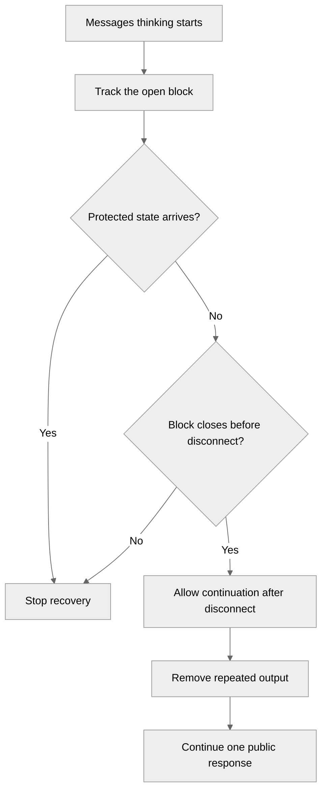

# Recent Activity in Starred Repositories
_159 active repos with 3187 new commits_

## [ai](https://github.com/topics/ai)
- [openclaw/openclaw](https://github.com/openclaw/openclaw) [563](https://github.com/openclaw/openclaw/commits): fix: stabilize Control UI update-triage tests on Bun (#207119)

Wait for the update report formatter to load before asserting that the failure is ready to diagnose.

Co-authored-by: daniel-lxs <57051444+daniel-lxs@users.noreply.github.com>
Co-authored-by: daniel-lxs <57051444+daniel-lxs@users.noreply.github.com>
Co-authored-by: roboclaw-bot <309084314+roboclaw-bot@users.noreply.github.com>
Co-authored-by: daniel-lxs <57051444+daniel-lxs@users.noreply.github.com>
- [unslothai/unsloth](https://github.com/unslothai/unsloth) [287](https://github.com/unslothai/unsloth/commits): Studio Translate: preserve cue boundaries in CR-delimited WebVTT files (#19473)

Closes #19472.

Studio reads uploaded subtitle files with `TextDecoder`, which preserves
carriage returns. A WebVTT file using CR for its line endings therefore
reached the parser intact, but the parser only split on LF and CRLF.
With no cues found, Translate sent the document through its plain-text
path.

The parser now recognizes all three WebVTT line terminators and keeps
the source separators when rebuilding the file. A single CRLF still
counts as one line ending. The numbered translation path also recognizes
CR inside a multiline caption.

I used a two-cue file with an identifier, an alignment setting and a
multiline caption. Chromium read both cues. On `0443880` the Studio
parser returned `null` for the CR version and two cues for the LF and
CRLF versions. With this change all three produced the same caption-only
translation request and kept the original timestamps and separators on
export.

The regression test runs the parser and translation code with a
deterministic reply. All 102 Translate tests passed locally on Windows
with Node 24.16.0.

---------

Co-authored-by: Lee Jackson <130007945+Imagineer99@users.noreply.github.com>
Co-authored-by: oobabooga <112222186+oobabooga@users.noreply.github.com>
- [NousResearch/hermes-agent](https://github.com/NousResearch/hermes-agent) [204](https://github.com/NousResearch/hermes-agent/commits): test(plugins): split launcher and linked-home tests out of test_plugin_host

Move launcher selection, env expansion, multiplexing, and extraction-launcher
cases (18 test functions, 26 collected ids, plus _tagging_launch_host) into
tests/hermes_cli/test_plugin_host_launcher.py, and move linked, relative,
renamed, and repointed profile-home cases (22 test functions, 35 collected
ids, plus _marked_profile_linked_out_of_the_root and repointed_profile_link)
into tests/hermes_cli/test_plugin_host_linked_homes.py.

Keep core host RPC, import isolation, managed-scope pin, hosted provider,
async callback, subagent lifecycle, and failed/abandoned-load tests (12 test
functions, 15 collected ids) in tests/hermes_cli/test_plugin_host.py.

Every moved test, helper, fixture, constant, and platforms() marker moves
verbatim with no production or assertion changes. The 76 collected test ids
before and after map one to one across the three suites.

Refs #159450
- [BasedHardware/omi](https://github.com/BasedHardware/omi) [195](https://github.com/BasedHardware/omi/commits): SCA-4656: Defer finalization while live audio is uncommitted (#26402)

Fixes SCA-4656 (incident SCA-4652, diagnosis SCA-4651). When a user
Finish arrives while the live listen session still holds uncommitted
audio, `POST /v1/conversation-finalization-jobs/run` waited 30 s, raised
`ServerBatchArchiveNotClosed` and answered HTTP 500. That spent an
attempt, and after five attempts the job was budget-requeued or
dead-lettered.

## Changes

- Wait up to 3 s for the live archive to commit (was 30 s). If it is
still uncommitted, yield the lease with a non-counting retry and answer
HTTP 200 `{"status": "deferred"}`. `attempt_count` and the worker claim
slot are unchanged.
- The deferred job becomes due 10 s later. `dispatch_requested_at` is
cleared and a due-time guard in `_claim_finalization_replay_txn` stops
any replay before the due time. The next reconciler pass then mints a
new dispatch generation.
- **Bound.** The first deferral stamps `live_archive_wait_started_at` on
the job. After `LIVE_ARCHIVE_MAX_WAIT` (10 min), the deferral
transaction raises `LiveArchiveWaitExpired` and writes nothing. The
worker then takes the pre-existing path: a counted
`ServerBatchArchiveNotClosed` retry under the normal attempt budget. A
session that never commits therefore cannot replay forever, and the
audio stays held.
- If the row is deleted during the wait, the delivery defers like any
other uncommitted delivery. The replay's admission read
(`_load_admitted_conversation`) then applies its existing missing-row
and fanout-claim handling. The deferral path adds no separate shortcut
for this case.

## Custody invariants and the tests that prove them

All tests are in
`backend/tests/unit/test_user_finish_first_archive_window.py`. They use
the real admission, claim, retry and replay transactions on the strict
Firestore fixture.

| Invariant | Test |
| --- | --- |
| Deferral never drops, deletes or finalizes without the held audio. The
conversation row is byte-identical after the delivery. The register,
complete and empty-delete writers are not called (the worker double
raises on any other writer). The projection deltas balance. |
`test_worker_defers_an_uncommitted_finish_and_replays_without_spending_an_attempt`
|
| A deferred job is not replayed before its due time, is replayed once
at the due time into generation 2 with attempts unchanged, and, once the
session commits, the redelivery hands the recording to batch (`register`
then `complete`, 200 `done`). | same test |
| Each redelivery inside the bound defers again without spending an
attempt, and the first start stamp is kept. |
`test_each_redelivery_inside_the_bound_defers_again` |
| At the bound, deferral stops and the pre-existing safe path runs: a
counted 500 `retry` with `attempt_count` 1 to 2, the conversation row
unchanged, and no delete or finalize. Mutation check: removing the
bound's `raise` fails this test. |
`test_deferral_is_bounded_then_takes_the_counted_not_closed_retry` |
| A row deleted mid-wait defers (non-counting) to the replay admission
read. |
`test_a_deleted_row_ends_the_wait_and_defers_to_the_replay_admission` |
| A natural end (`CAPTURE_END`) does not wait and keeps the not-closed
retry. | `test_a_natural_end_does_not_wait` |

## Firestore reads per delivery

A deferred delivery makes these reads. Reads this PR adds: **0**.

- Unchanged by this PR: claim transaction (job doc plus account-deletion
marker, 2), `get_finalization_job` (1), conversation admission read (1).
- Changed by this PR:
- Archive-wait polls: at most 6 conversation reads (3 s at 0.5 s), down
from at most 60 (30 s).
- The deferral transaction reads the job doc once. It replaces the read
that the pre-existing `_retry_or_dead_letter` retry transaction made.
- Per replay cycle (unchanged mechanism): 1 candidate row in the
reconciler page and 1 job read in the replay transaction.
- Cycles per job are bounded by `LIVE_ARCHIVE_MAX_WAIT`: about 10 at the
per-minute reconciler pass, and never more than 600 s / 10 s.

## Rollback and kill switch

- Rollback: revert this PR. The deferral adds no new data shape that
needs cleanup. `live_archive_wait_started_at` is an inert job field
after a revert.
- There is no dedicated flag for the deferral itself. The existing
switches remove the whole early-Finish path that reaches this code:
`CONVERSATIONS_V3_BATCH_MANUAL_END=off` restores the `no_content` answer
for an early Finish, and `CONVERSATIONS_V3_FAST_FINISH=cohort|off`
narrows admission.

## Verification

**Current head `f4668b1a4ca5129004d3142f34ebbdc3ff7bb988`** (origin/main
`c0e57162ec0` merged in, no rebase), m1-mac-studio, through
`bin/omi-heavy` with bounded timeouts:

- `tests/unit/test_user_finish_first_archive_window.py`: 22 passed.
- `bash test.sh` (changed-file selector, the same 651 files CI selects):
25,120 passed, 17 skipped, 2 failed. Both failures are in
`tests/unit/test_batch_coalescing_completion.py::test_mobile_hold_headers_survive_coalescing_and_publication[merged|individual]`
(503 `sync_batch_unavailable`). They fail identically with this PR's
three files reverted to origin/main, and on main CI since `92ad82907a`
(#26519, SCA-4372). This is main drift, not this change.
- Pre-push gate: passed on push.
- `git diff --check` is clean.

After the release lane serves the fix: on the first health tick, the
route's 5xx share should be under the tick rule, with no
`reason=server_batch_archive_not_closed` 500 and no
`cause=worker_failed` dead letter from this cause. Look for
`event=live_archive_wait outcome=expired` warnings, which mark sessions
that hit the bound.

**Earlier head `9d846f4db2983b7c44cb2d7f57b188980bb6dd7e` (not
current).** Five checks were red:
- PR Metadata Preflight and Hygiene: line-count ratchet, because the
exception was missing from the body.
- Backend unit shard 5/8 and Backend unit suite: the new route test hit
`UnsupportedFirestoreOperationError`. The strict fixture does not model
the projection-shard `set(merge=True)`, so the route answered 500. Fixed
by stubbing `_record_projection_delta`, as other finalization suites do.
- Backend Go Checks: a timing failure in
`TestScheduledResumeHandsBackClaimWhenStopWinsLaunch`, outside this
Python-only diff, and green on main.

Line-Count-Exception: backend/database/conversation_finalization_jobs.py
| 3765 -> 3794 | Keep the lease-fenced deferral, its bound and the
due-time replay guard inside the existing finalization transactions they
fence.

🤖 Generated with [Claude Code](https://claude.com/claude-code)
- [kortix-ai/CompanyOS](https://github.com/kortix-ai/CompanyOS) [48](https://github.com/kortix-ai/CompanyOS/commits): feat(evals): a drafts-only support agent and a team sign-in; long setups get a trial budget (#13234)

## Demo video

No video: eval tasks of the built-in My Kortix dataset.

## Quick verification

Outcome: two more core workspace flows are covered, a drafts-only
support agent and a sign-in for the whole team, and the long
company-setup tasks no longer run out of their trial budget.

- New `drafts-only-agent`: "a support agent that drafts Gmail replies
and never sends" must ask first (it gets Gmail), then leave the agent
with Gmail and a reply that claims no limit the setup lacks: a Gmail
rule that holds or blocks sends, or "only its instructions" with a rule
offered. The judge reads the Gmail rules from the workspace. Proof on
dev (job `d552d3c5`): oracle pass (`honest_limit` 1), nop fail. The
oracle's rule (`kortix connectors policy gmail set "send_*" ask`) was
checked on the local stack.
- New `connector-shared-for-team`: "connect Notion for the whole team"
must ask first and say the whole workspace uses the sign-in (judged);
after the yes the sign-in must be the workspace one, read from the
session's tool calls or its connect requests (`owner_type: project`).
Proof (job `933a9184`): oracle pass, nop fail.
- `company-setup-agency` and `company-setup-shop` set `budget_usd = 8`:
a fresh trial workspace may spend $2 by default, and long Kimi K3.1 Pro
setups stopped with "Out of credits" while the evals account had
credits.
- Dev after #13227, 15 tasks × 2 (job `e5d44eee`): GLM 29/30, DeepSeek
27/30, Kimi K3.1 Pro 27/30 (was 25, 23, 22). `role-change-asks-first`
6/6 (was 3/6), `event-automation-filtered` 5/6 (was 0/6).

<!-- codesmith:footer -->
---
<a
href="https://dashboardbackend.blacksmith.sh/track/run-proof?expires=1798426376&installation_model_id=434224&pr_number=13234&ref=codesmith_pr_footer&repository=kortix-ai%2FCompanyOS&return_to=https%3A%2F%2Fgithub.com%2Fkortix-ai%2FCompanyOS%2Fpull%2F13234&variant=start_proof&signature=753b77a6bbd0d8517ba87404416d93aff76c8d86b2470abb36a95036b74c8e72"><picture><source
media="(prefers-color-scheme: dark)"
srcset="https://pr-comments-assets.blacksmith.sh/codesmith/proof-start-proof-v2-dark.svg"><source
media="(prefers-color-scheme: light)"
srcset="https://pr-comments-assets.blacksmith.sh/codesmith/proof-start-proof-v2-light.svg"></picture></a>
<sup><a
href="https://app.blacksmith.sh/kortix-ai/codesmith/CompanyOS/pr/13234?autoLogin=true&ref=codesmith_pr_footer">Open
in [code]smith</a> · Need help on this PR? Tag
<code>@codesmith-bot</code> with what you need.</sup>

<!-- codesmith:autofix:disabled -->
<!-- /codesmith:footer -->
- [t8y2/dbx](https://github.com/t8y2/dbx) [41](https://github.com/t8y2/dbx/commits): fix(i18n): clarify filter group toggle labels

* Add switchable filter groups and bulk rule toggles

* chore(i18n): autofill new translations

* fix(grid): drop stale structured filter apply results

* fix(i18n): clarify filter group toggle labels

---------

Co-authored-by: wangqiurongbj <wangqiurongbj@kanyun.com>
Co-authored-by: dbx-i18n-bot <github-actions[bot]@users.noreply.github.com>
Co-authored-by: ThugKd <19286886+ThugKd@users.noreply.github.com>
Co-authored-by: t8y2 <t8y2@users.noreply.github.com>
Co-authored-by: 二丫讲梵 <eryajf@163.com>
- [QwenLM/qwen-code](https://github.com/QwenLM/qwen-code) [40](https://github.com/QwenLM/qwen-code/commits): feat(verify-pr): add host capability probes and per-round VM staging (#18552)

* feat(verify-pr): add host capability probes and per-round VM staging

* fix(verify-pr): harden host staging vault, seatbelt, FIFO, and CLI guards

* fix(verify-pr): re-verify vfkit profile pre-spawn and canonicalize roots/vault
- [Lightning-AI/pytorch-lightning](https://github.com/Lightning-AI/pytorch-lightning) [26](https://github.com/Lightning-AI/pytorch-lightning/commits): Keep training_step metrics when a nested hook also logs (#22245)

Under manual optimization, `manual_backward` and `optimizer.step` run hooks
inside `training_step`. If one of them logged, the next `self.log` call in
`training_step` reset the metrics that `training_step` had already logged on
the first batch of the epoch, so the first step value was dropped and the
epoch value was computed without that batch.

Do not reset a hook's metrics once it has logged in the current batch.
- [langgenius/dify](https://github.com/langgenius/dify) [24](https://github.com/langgenius/dify/commits): test(api): use SQLite for draft agent model validation (#47405)

Co-authored-by: shiwei.acc2 <shiwei.acc2@bytedance.com>
Co-authored-by: Claude Code <noreply@anthropic.com>
- [screenpipe/screenpipe](https://github.com/screenpipe/screenpipe) [8](https://github.com/screenpipe/screenpipe/commits): fix(attribution): keep pre-login desktop machine id anonymous so download-to-start merges into Clerk (#8064)
- [XiaomiMiMo/MiMo-Code](https://github.com/XiaomiMiMo/MiMo-Code) [7](https://github.com/XiaomiMiMo/MiMo-Code/commits): test(sync): cancel leaked resume session and isolate shared scheduler/flag state (#2879)
- [Kiln-AI/Kiln](https://github.com/Kiln-AI/Kiln) [4](https://github.com/Kiln-AI/Kiln/commits): Merge pull request #2093 from Kiln-AI/claude/peaceful-noether-qx438a

fix(mcp): apply bug bash quick fixes and add the gaps to the MCP backlog
- [s2b-dev/smart-second-brain](https://github.com/s2b-dev/smart-second-brain) [4](https://github.com/s2b-dev/smart-second-brain/commits): docs: track the Obsidian community listing text in the repo

Co-Authored-By: Claude <noreply@anthropic.com>
- [docling-project/docling](https://github.com/docling-project/docling) [2](https://github.com/docling-project/docling/commits): docs: add security rules for untrusted input to AGENTS.md (#5616)

* docs: add security rules for untrusted input to AGENTS.md

The published security advisories repeat a small set of defect classes:
declared sizes used without a limit, new code paths that skip a trust
option, external programs that get document content, and work that grows
faster than the input. Add the rules that prevent these classes, and name
the shared helpers that new code must reuse.

Signed-off-by: Michele Dolfi <dol@zurich.ibm.com>

* docs: clarify the rule for numbers that a document declares

Signed-off-by: Michele Dolfi <dol@zurich.ibm.com>

---------

Signed-off-by: Michele Dolfi <dol@zurich.ibm.com>
- [lutzroeder/netron](https://github.com/lutzroeder/netron) [2](https://github.com/lutzroeder/netron/commits): Update base.js
- [oraios/serena](https://github.com/oraios/serena) [2](https://github.com/oraios/serena/commits): System prompt: Explicitly point to serena_repl tool & encourage loading

This is relevant, in particular, to Claude Code with single-project activation at startup in combination
with tool search, as the REPL's scope is provided in the REPL tool's description rather than
the project activation message/initial instructions in this case, with the tool's description
being loaded lazily.
(In non-single-project contexts, the REPL's scope is part of the initial instructions.)
- [steel-dev/steel-browser](https://github.com/steel-dev/steel-browser) [2](https://github.com/steel-dev/steel-browser/commits): feat(api): log PDF scrape download and conversion times (#455)

Time the PDF download next to the existing conversion time and log both,
with the PDF size, status and content type, in one request log line. The
line is also written when conversion throws. It carries no URL, headers,
cookies or proxy URL.
- [specstoryai/getspecstory](https://github.com/specstoryai/getspecstory) [1](https://github.com/specstoryai/getspecstory/commits): Merge pull request #420 from specstoryai/dependabot/github_actions/actions-minor-patch-10ec664915

Bump anthropics/claude-code-action from 1.0.286 to 1.0.289 in the actions-minor-patch group

## [ai-agent](https://github.com/topics/ai-agent)
- [DIYgod/pinky](https://github.com/DIYgod/pinky) [23](https://github.com/DIYgod/pinky/commits): chore(release): 2026.1128.3

Co-Authored-By: Claude Opus 5.5 <noreply@anthropic.com>
- [trycua/cua](https://github.com/trycua/cua) [5](https://github.com/trycua/cua/commits): feat(cua-driver): share one local IPC client (#8448)

* fix(cua-driver): read daemon presence from one probe

Add DaemonPresence { Absent, Stale, Starting, Serving { pid, gate } } and
probe_presence, which reads the daemon's metadata answer, its socket lock
(tried and released at once) and its socket file together. Daemon
metadata gains an additive permissions_pending field so a daemon that
answers but refuses every tool call reads as Serving with a
PermissionsPending gate.

* fix(cua-driver): keep stop truthful while a daemon is starting

`serve` now claims its socket lock before it builds the desktop runtime,
and a disclaimed macOS relaunch inherits that claim, so a launch reads
as Starting from its first moments. `stop` waits (bounded) for a Starting
daemon to answer and then shuts it down instead of reporting "not
running" and leaving it alive. `serve`'s already-running refusal,
`status` and `wait_for_release` all read probe_presence: status reports
starting, stale socket files and a permissions-pending gate, and a stale
socket file no longer counts as unreleased.

* fix(cua-driver): close the stop race before serve claims its socket

`serve` claims its socket at the top of the serve command, and `stop`
keeps looking for half a second when it finds no daemon, so a launch
that has started but not yet claimed is still waited for and stopped.
The Windows presence probe now bounds its metadata reply, and a
relaunch validates an inherited lock descriptor and marks it
close-on-exec before adopting it.

* fix(cua-driver): clear a stale socket only once serve validates

The early socket claim now takes only the lock. A standalone daemon
removes a dead daemon's socket after startup authorization passes and
before it binds, and removes it only when it is a socket, so a rejected
launch leaves the path alone. `run_serve` is a Unix test helper and the
Unix serve body no longer keeps an `embedded` binding only macOS reads.

* fix(cua-driver): count only a socket as a stale daemon socket

probe_presence reports Stale only when the path is a Unix socket, so a
regular file at --socket is no longer promised to the next launch.
`status` and `stop` name such a file as occupying the path instead.

* fix(cua-driver): name only a non-socket path as occupied

A daemon that binds between the presence probe and the message no longer gets its live socket called a non-socket.

* fix(cua-driver): keep stop waiting while a Windows daemon's pipe still listens

A late metadata reply left the probe reading Starting, which the Windows
branch of is_released counted as released even with the pipe still up.
Count it released only once the pipe stops listening, and cover it with a
Windows test.

* fix(cua-driver): bound Windows daemon replies by REPLY_DEADLINE

Windows clients opened the daemon pipe with std::fs and then blocked in
ReadFile with no limit, so a stalled daemon hung the CLI, MCP proxy and
SDK service sessions forever. Open the pipe for overlapped I/O, wait on
each read and write for at most its timeout, and cancel with CancelIoEx
when it expires. The Unix exchange and service-session deadline loops
now run over it unchanged, and the presence probe no longer leaves a
blocked thread behind.

* fix(cua-driver): let only a closed pipe count as released on Windows

An embedded daemon holds no lock, so a late metadata reply read as Absent
and counted as released while its pipe still listened. On Windows every
state but Serving now asks the pipe. The Windows release test covers the
no-lock case too, and shard 1 runs it.

* fix(cua-driver): hold Windows pipe exchanges to one reply deadline

The service-session reader now checks its deadline after every buffer,
so a peer that trickles bytes without a newline still times out. A
daemon exchange spends one deadline on connect, write and read, which
keeps the presence probe within its two seconds. The overlapped pipe
calls pass one raw OVERLAPPED pointer and never take a reference while
the kernel may write to it.

* fix(cua-driver): count a busy Windows pipe as still held

The probe can hold the only pipe instance while it waits for a late reply,
so a free-instance check read a held pipe as gone. Release and the launch
refusal now ask whether any instance of the pipe exists, free or busy. A
launch beside a lockless embedded daemon that answers late is refused again,
as on main. The Windows test holds the only instance busy.

* fix(cua-driver): keep Windows stop and status truthful while a pipe is held

A lockless embedded daemon that answers late read as Absent, so stop said
the daemon was not running after its short settle and status agreed. On
Windows a held pipe now counts as a daemon that is not answering yet: stop
waits for it as for a starting daemon, and status says the endpoint exists
but is not answering.

* fix(cua-driver): stop Windows pipe reads and writes at the reply deadline

PipeStream takes an absolute deadline that caps every operation's
timeout, so neither a retried write nor a read after a partial reply
waits a further slice past it. The daemon exchange and the service
session set it on their pipe handles; Unix sockets are unchanged.

* fix(cua-driver): treat a Unix socket that still listens as held, not stale

A lockless embedded daemon that answered metadata late read as Stale, so a
standalone launch took the lock and unlinked its live socket, and
wait_for_release reported success while it still held the path. A socket
that still accepts connections now counts as a held endpoint on Unix, as a
held pipe does on Windows: launch refuses it, stop waits for it, status says
it is not answering, release waits for it, and the stale-socket cleanup
leaves it alone.

* fix(cua-driver): take only repeated refusal as a dead Unix socket

macOS refuses a connection while a live listener's accept queue is full,
so one refused connect read a held socket as dead. The socket probe now
retries a refusal for half a second, and treats any error other than a
refusal or a missing path as a listener that is still there.

* fix(cua-driver): build every Windows crate against windows 0.61

cua-driver-core, cua-driver-sdk (dev-dependencies) and platform-windows
were still on windows 0.58 while cua-driver, the testkit and the e2e crate
used 0.61. Move the three to 0.61 and port the API changes:

- BOOL moved to windows::core.
- VARIANT moved to Win32::System::Variant (new Win32_System_Ole and
  Win32_System_Variant features); its fields are read directly, and the
  owned BSTR is read in place instead of rebuilt and forgotten.
- PROPERTYKEY moved to Win32::Foundation.
- Nullable handle, string and flag parameters are Option<_>; null handles
  pass None, and HBITMAP/HMODULE convert into HGDIOBJ/HINSTANCE.

windows 0.58 leaves the driver lockfile. windows 0.59 stays: clipboard-rs
0.3.5, its latest release, still requires it. The cua-spacesd lockfiles
pick up platform-windows and cua-driver-core on 0.61.

* fix(cua-driver): never block a presence probe on a full Unix accept queue

On Linux a blocking connect to a listener whose accept queue is full waits
indefinitely, which left the metadata probe, wait_for_release and the
socket check without a bound. The presence probe now connects without
blocking and retries a full queue only until its reply deadline, and the
socket check treats a full queue as a listener that is still there.
send_request keeps its blocking connect.

* feat(cua-driver): share one local IPC client

Add cua_driver_core::ipc with LocalIpcClient, ConnectPolicy, exchange_line
and the async LocalIpcStream. The daemon request path and the SDK trusted
service session send one line through LocalIpcClient on every OS, with the
same connect retry, 10 s read poll and deadline. The MCP proxy control
connection and the MCP envelope relay connect through LocalIpcStream. The
Windows pipe client is written against windows 0.61 and replaces
pipe_stream and socket_io.

* fix(cua-driver): never hang on a FIFO lock or miss a symlinked live socket

A FIFO left at the lock path blocked the presence probe on open. The lock
now opens without blocking and only a regular file counts as a lock.

A symlink to a socket that still listens read as Absent and so as
released. A probe that finds no answer now follows the path and counts a
live socket behind it as held.

* fix(cua-driver): keep IPC reads, writes and connect retries inside their bounds

A blocking macOS socket write could run past the exchange deadline, and a
connect retry could sleep past its budget. Unix sockets are now nonblocking
and each read or write waits in poll for at most what is left of its slice;
the Windows pipe client takes the same per-operation timeout. A retry pause
is cut to the budget that is left.

* fix(cua-driver): refuse a Windows launch whose pipe was taken after its check

A standalone launch checks for a daemon before it builds its runtime. A
lockless embedded daemon could take the pipe name in between, and the
launch then opened a second instance beside it. Every daemon now takes
its first instance with the first-instance flag, so that launch fails
and says the pipe is already held.

The macOS unit lane now also runs the daemon presence tests.

* fix(cua-driver): record a Windows daemon's PID only once it holds its pipe

A launch that lost the pipe race wrote its PID file before the first
pipe instance was refused, so status named the rejected process. The PID
file is now written after the first instance is created, as on Unix.

The macOS and Windows unit lanes now run the whole cua-driver binary
suite instead of a module filter.

* fix(cua-driver): compare perception worker paths as paths in the extension test

The Windows binary suite now runs whole, which exposed a test that
matched worker arguments with string suffixes using forward slashes.
Windows joins those paths with backslashes, so the test compares them
as paths.

* fix(cua-driver): remove the Windows pipe tests' lock files when they end

* fix(cua-driver): wait out a pipe operation's whole timeout on Windows

WaitForSingleObject can end a timed wait up to a clock tick early, so a
read or write could report a timeout before its slice had passed.

* fix(cua-driver): format the Windows pipe wait

* fix(ci): retry the rootless Xwayland harness's first sway IPC request

sway's IPC socket appears before sway answers on a loaded runner, and
swaymsg waits only 3 s for a reply, so the Linux X11 capture step failed
before its test ran. Retry until the harness's existing deadline, and
print sway's log if it never answers.

## [ai-agents](https://github.com/topics/ai-agents)
- [slopus/happy](https://github.com/slopus/happy) [22](https://github.com/slopus/happy/commits): iOS: a conversation's failed read is an error seen only from an empty chat on screen

Production 2026.11.1 (163) posted error_shown area=conversation_load for
about a quarter of iOS direct-connection users a day, and Android none.
Conversation.failed posted every failed history read: over the rows the
phone kept, off screen in a warm chat, and again at every backoff retry,
though iOS shows no error for any of them and asks again by itself. Only
an empty chat on screen now posts it, as Android's Conversation.reload
does ("only an empty chat says it").

A direct connection's tunnel errors (TailcatError, TransportError,
TailcatTransportError, NWError) were all Problem.unknown. They are named
now: a Tailcat client that can't connect in its 20 seconds, the
`unknown` errors seen 20-30 s after an open, is a timeout.

A bootstrap whose mode, draft, context or a subagent this build can't
read decoded to nothing, and the conversation's read failed with
invalid_response on every try. Only the agent is required now, as in
Android's Bootstrap.parse.
- [steipete/agent-scripts](https://github.com/steipete/agent-scripts) [1](https://github.com/steipete/agent-scripts/commits): fix(nano-banana-pro): use GA Gemini image models and add --model

google-genai 3.x defaults to API v1, where the hardcoded
gemini-3.1-flash-image-preview id 404s; -preview ids exist only on v1beta.

- default to GA gemini-3.1-flash-image (Nano Banana 2)
- add --model / NANO_BANANA_MODEL with flash and pro aliases; pro selects
  gemini-3-pro-image (Nano Banana Pro), other ids pass through
- require google-genai>=3.6.1
- SKILL.md: agent-neutral $SKILL_DIR paths instead of ~/.codex/skills,
  model guidance, Pro has no 512 size
- scripts/nanobanana: same GA model id and SDK floor
- tests: model selection precedence, aliases, blank values

Live proof via uv run (google-genai 3.6.1): flash generate, flash edit,
pro 2K edit, and nanobanana edit succeed; pro at 512 returns 400.

## [compiler](https://github.com/topics/compiler)
- [markedjs/marked](https://github.com/markedjs/marked) [3](https://github.com/markedjs/marked/commits): fix: preserve Unicode whitespace in inline link destinations (#4249)

* fix: preserve Unicode whitespace in inline link destinations

Co-authored-by: GeneralTony007 <144252170+GeneralTony007@users.noreply.github.com>

* fix: preserve Unicode whitespace in inline link destinations

Co-authored-by: GeneralTony007 <144252170+GeneralTony007@users.noreply.github.com>

* fix: preserve Unicode whitespace in inline link destinations

Co-authored-by: GeneralTony007 <144252170+GeneralTony007@users.noreply.github.com>

* test: migrate reviewed regression to native fixture

Co-authored-by: GeneralTony007 <144252170+GeneralTony007@users.noreply.github.com>

* test: migrate reviewed regression to native fixture

Co-authored-by: GeneralTony007 <144252170+GeneralTony007@users.noreply.github.com>

* test: migrate reviewed regression to native fixture

Co-authored-by: GeneralTony007 <144252170+GeneralTony007@users.noreply.github.com>

* test: migrate reviewed regression to native fixture

Co-authored-by: GeneralTony007 <144252170+GeneralTony007@users.noreply.github.com>

* test: remove superseded regression after native fixture migration

Co-authored-by: GeneralTony007 <144252170+GeneralTony007@users.noreply.github.com>

* test: remove superseded regression after native fixture migration

Co-authored-by: GeneralTony007 <144252170+GeneralTony007@users.noreply.github.com>

* test: remove unrelated ASCII-tab link destination fixture

Remove the input identified in review. The existing parser mismatch is outside this Unicode-whitespace change; the corresponding expected output is removed in the companion commit.

Co-authored-by: GeneralTony007 <144252170+GeneralTony007@users.noreply.github.com>

* test: align link destination output with removed ASCII-tab case

Remove only the expected output corresponding to the reviewed ASCII-tab input. Unicode cases remain unchanged; this does not fix the separate parser mismatch. Full local npm test passed: 2039 specs and 256 unit tests.

Co-authored-by: GeneralTony007 <144252170+GeneralTony007@users.noreply.github.com>

---------

Co-authored-by: GeneralTony007 <144252170+GeneralTony007@users.noreply.github.com>
- [typst/typst](https://github.com/typst/typst) [1](https://github.com/typst/typst/commits): Fix stale error message in `TermItem` cast (#9115)

## [deep-learning](https://github.com/topics/deep-learning)
- [mlfoundations/open_clip](https://github.com/mlfoundations/open_clip) [8](https://github.com/mlfoundations/open_clip/commits): Default --lock-text-freeze-layer-norm to True via BooleanOptionalAction

Matches the freeze_layer_norm=True default across all model lock_text_tower() / lock() APIs, fixes --lock-text crashing on native text towers without silently ignoring explicit freeze_layer_norm=False, and avoids leaving LayerNorm weights trainable by default on BERT-style HF text towers. Pass --no-lock-text-freeze-layer-norm to opt into trainable LayerNorms.

Ref #1269
- [skypilot-org/skypilot](https://github.com/skypilot-org/skypilot) [4](https://github.com/skypilot-org/skypilot/commits): [Core] Default new authenticated users to the user role (#11521)

* [Core] Default new authenticated users to the user role

With rbac.default_role unset, every new identity was seeded as admin.
Authenticated identities (SSO, auth proxy, API-server basic auth) and
service accounts created without a role now get `user`; requests that
reach the server unauthenticated keep `admin`. While no authenticated
user or service account holds admin, the first new login through an
auth proxy or OAuth2 proxy becomes admin, so a deployment is never left
without one.

Co-Authored-By: Claude Opus 5.5 <noreply@anthropic.com>

* [Core] Count untyped admins with a password as existing admins

Rows from before user types existed have no type. One with a password was
authenticated, so it stops the first-admin bootstrap. An `sa-` id is not
counted: a client without authentication chooses its own user id.

Co-Authored-By: Claude Opus 5.5 <noreply@anthropic.com>

* [Core] Count only admins who can still log in before bootstrapping

An admin that can no longer authenticate left a deployment with no usable
admin and no bootstrap: a basic-auth admin after the API server's basic
auth is turned off (for example after moving to SSO), or a service
account whose tokens have all expired. Basic-auth admins now count only
while ENABLE_BASIC_AUTH is on, and service-account admins only while
service accounts are enabled and they hold an unexpired token. A token
also lets an untyped sa- row count, since only authenticated endpoints
write tokens.

Co-Authored-By: Claude Opus 5.5 <noreply@anthropic.com>

* [Docs] Name only ingress basic auth as the unauthenticated example

Co-Authored-By: Claude Opus 5.5 <noreply@anthropic.com>

* [Core] Bootstrap the first admin only when rbac.default_role is unset

A configured default role never produced an admin before; keep it that
way. The bootstrap still covers deployments that leave the default unset,
which used to make every new user an admin.

Co-Authored-By: Claude Opus 5.5 <noreply@anthropic.com>

---------

Co-authored-by: Claude Opus 5.5 <noreply@anthropic.com>
- [stefan-jansen/machine-learning-for-trading](https://github.com/stefan-jansen/machine-learning-for-trading) [2](https://github.com/stefan-jansen/machine-learning-for-trading/commits): Report a desynced pair outside the repo instead of crashing (#1195)

check_notebook_pair_sync.py accepts paths, so the natural way to reproduce a CI
pair-sync failure is to extract a PR head into a scratch directory and check it
there. Doing that found the desync, then died in the reporting loop on
`nb.relative_to(REPO_ROOT)`, printing a traceback where the gate had already
computed the answer.

The gate itself was never wrong - every path it sees in CI and in pre-commit is
inside the repo. It just could not say what it found when handed one that was not.

## [esp-idf](https://github.com/topics/esp-idf)
- [kirmisaki/FrameFilm](https://github.com/kirmisaki/FrameFilm) [12](https://github.com/kirmisaki/FrameFilm/commits): fix(ble): 修复经典固件 0x08 回包长度错误导致文件列表读取失败

- frame_film 的 FILE_DISPLAY_GET 缓冲区误声明为 6 字节并整块下发，与帧头 LEN=1 不符，ForFilm 以其作为列表结束标记时校验失败并超时

- ForFilm 改为按帧头 LEN 声明长度校验，兼容已烧录旧固件的设备
- [espressif/idf-extra-components](https://github.com/espressif/idf-extra-components) [1](https://github.com/espressif/idf-extra-components/commits): Merge pull request #916 from daniil4udo/fix/esp_encrypted_img-process-bin-realloc-leak

fix(esp_encrypted_img): keep the output buffer when realloc fails in process_bin

## [firefox](https://github.com/topics/firefox)
- [brookhong/Surfingkeys](https://github.com/brookhong/Surfingkeys) [2](https://github.com/brookhong/Surfingkeys/commits): fix(llm): keep bedrock thinking deltas, drop empty thinking blocks

Collect thinking_delta and signature_delta into the thinking block, and drop
thinking blocks with neither text nor signature before a request is sent.
Bedrock rejects the whole request over one ("each thinking block must contain
thinking"), and conversations stored before this fix still carry them.
- [daijro/camoufox](https://github.com/daijro/camoufox) [1](https://github.com/daijro/camoufox/commits): README: Remove old sponsor

## [firmware](https://github.com/topics/firmware)
- [OpenStickCommunity/GP2040-CE](https://github.com/OpenStickCommunity/GP2040-CE) [5](https://github.com/OpenStickCommunity/GP2040-CE/commits): Fix the uint32_t to uint8_t issues with latest commit (#1841)
- [crosspoint-reader/crosspoint-reader](https://github.com/crosspoint-reader/crosspoint-reader) [1](https://github.com/crosspoint-reader/crosspoint-reader/commits): fix(dict): apply reader's line spacing setting for plain text definition (#4633)


Currently line spacing in plain text definition is harcoded to 2.0f. I
have tried to trace back the git history, but can't find any thing that
explain that number. Meanwhile XHTML definition follows reading
setting's line spacing, so why can't plain text definition do the same?

## [golang](https://github.com/topics/golang)
- [d2lang/d2](https://github.com/d2lang/d2) [128](https://github.com/d2lang/d2/commits): Merge pull request #3105: Zoom through linked diagram layers

- sent from alixander's Codex
- [cshum/imagor](https://github.com/cshum/imagor) [16](https://github.com/cshum/imagor/commits): v1.10.6
- [twmb/franz-go](https://github.com/twmb/franz-go) [13](https://github.com/twmb/franz-go/commits): Merge pull request #1615 from twmb/kfake-kip360-last-epoch

kfake, kgo: fix KIP-360 fencing and EndTxn recovery
- [daptin/daptin](https://github.com/daptin/daptin) [9](https://github.com/daptin/daptin/commits): Pin patched release compiler and retain baseline vet coverage
- [ClickHouse/clickhouse-go](https://github.com/ClickHouse/clickhouse-go) [2](https://github.com/ClickHouse/clickhouse-go/commits): fix: keep per-query options off the HTTP server-info query (#2125)

* fix: keep per-query options off the HTTP server-info query

Important: Change affects how server timezone is handled. Previously it was set to result of `timezone()` what
returns server or session timezone. Today it is result of `serverTimezone()` that returns configured server timezone. 

The HTTP handshake ran its server-info query with the caller's context, so
per-query settings, the query id, the quota key and parameters were sent on
that internal statement. session_timezone was then stored as the connection
timezone, and settings that change Native encoding made the handshake
response undecodable.

Run the handshake with the caller's cancellation and deadline but with empty
query options. Connection-level settings stay on the connection URL.

Fixes #2123

* fix: keep the per-query JWT on the HTTP handshake

The handshake context dropped every query option, including the JWT.
dial uses the first query's context, so HTTPS with WithJWT and no
connection GetJWT sent the server-info request without Authorization
and the connection failed.

Keep the JWT. Drop settings, parameters, the query id, external tables
and the user location. quota_key is a query parameter and initial_user
is native-only, so those stay off the handshake too.

Fixes #2123

* fix: use serverTimezone() in the HTTP server-info query

* test: align HTTP handshake settings with context deadlines
- [gojue/ecapture](https://github.com/gojue/ecapture) [2](https://github.com/gojue/ecapture/commits): probe: fix cleanup after eBPF manager initialization failures (#1103)

## [ios](https://github.com/topics/ios)
- [fastlane/fastlane](https://github.com/fastlane/fastlane) [14](https://github.com/fastlane/fastlane/commits): [gym][scan][snapshot] Make disallow_xcodebuild_settings_lookup work end to end (#30379)

* [gym] Archive and export without build settings when the destination names the platform

Fixes #30365. With `disallow_xcodebuild_settings_lookup` on, an iOS archive
could not finish. After `xcodebuild archive`, `Gym::Runner#run` called
`building_for_ipa?`, which always read `SUPPORTS_MACCATALYST`, and then
`watchos?`, and no option avoided either. With the issue's own options gym
stopped even earlier, on the app name used for the log file.

- The platform checks answer from the configuration first. A destination
  that names an iOS, tvOS, watchOS or visionOS platform, in any case as
  xcodebuild accepts, with no `sdk` or `catalyst_platform` for macOS, rules
  out a macOS build. Anything else falls through to the project as before.
- The Mac Catalyst checks test `catalyst_platform`/`sdk` before asking if the
  project supports Mac Catalyst. The results are the same, and the
  provisioning profile mapping no longer fails at setup.
- The `watchos?` check moves into the opt-in generic archive fix it guards.
  When build settings can't be read, it goes by the destination.
- Without build settings, the log file is named after `output_name`, which
  is always set by then, instead of failing when `app_name` isn't set.
- Values that can't be avoided fail at setup, before the archive, and the
  error names the option to set: `destination`, `output_name`,
  `configuration`. A macOS export needs build settings to tell an app from a
  command-line tool, so it fails at setup too, unless `skip_archive` is set.
- Installer certificates only sign macOS packages. They aren't looked for
  without build settings, and installerSigningCertificate is only written
  for a package export.

In fastlane_core, `xcodebuild_settings_lookup_disallowed_by` is now public,
so callers can check it before a lookup they can do without. The new
`verify_xcodebuild_settings_lookup_allowed!` raises the lookup error naming
the option that replaces the value. This follows the pattern gym already
uses of checking the configuration before the project, rather than adding a
keyword to `build_settings`.

With the option off, results change in three cases only. A macOS-only
project given an iOS-family destination, which xcodebuild can't archive,
now reads as IPA. `building_for_ios?` is true for an iOS-family destination,
so `generate_appstore_info` also runs for a multiplatform project exported
without an `sdk`, as it already does for a single-platform one. And an IPA's
export options no longer include installerSigningCertificate, whose
selectors are Mac-only.

Co-Authored-By: Claude Opus 5.5 <noreply@anthropic.com>

* [gym] Report the build failure when the SDK can't be read for it

When a build or export fails, gym prints a summary of the build environment,
including the SDK, before raising the failure. Reading the SDK fetches the
project's build settings. With `disallow_xcodebuild_settings_lookup` on, that
raised the lookup error, so a failed archive was reported as a missing
SDKROOT build setting, telling the user to set an option that doesn't exist,
instead of as the build failure. A `-showBuildSettings` timeout at that point
replaced the failure the same way.

The summary now leaves the SDK out when it can't be read, and the failure is
raised as before. A local `rescue` fits here, unlike at call sites that can
act on the error: the summary is best-effort, and any error reading it would
otherwise hide the one that matters.

Co-Authored-By: Claude Opus 5.5 <noreply@anthropic.com>

* [scan] Test without build settings when the device or destination is given

With `disallow_xcodebuild_settings_lookup` on, scan only worked with `device`
or `devices`, and even then it read build settings for a deployment target
under an empty key. With `destination` alone it failed at setup, picking a
default simulator from the project's supported platforms that it didn't
need. Names derived from the app name failed after the tests had run.

- With `device`/`devices`, there is no deployment target to read, so the
  empty key isn't looked up. That also saves a `-showBuildSettings` run with
  the option off.
- With `destination` alone, no default simulator is picked, as for a Mac or
  Swift package target. The options that act on the simulators scan picks
  (`reset_simulator`, `reinstall_app`, `prelaunch_simulator`,
  `include_simulator_logs`) then fail at setup, asking for `device` or
  `devices`. Before, two of them crashed and two did nothing.
- Lookups that can't be avoided fail at setup and name the option to set:
  `device`, `devices` or `destination`, `derived_data_path`, and
  `destination` for a Mac Catalyst build.
- Without build settings, the log file and the Slack message are named after
  the scheme, as they are for a Swift package, unless `app_name` is set.

Builds on the fastlane_core helpers from the gym change for #30365.

Co-Authored-By: Claude Opus 5.5 <noreply@anthropic.com>

* [snapshot] Take screenshots without build settings when devices are given

With `disallow_xcodebuild_settings_lookup` on, snapshot couldn't run at all.
Every log file name started with the project's app name, read from the
build settings, before the first xcodebuild ran. Unlike gym and scan,
snapshot has no `app_name` option to provide it.

Without build settings, the log files are now named after the scheme
alone, as scan names a Swift package's. That avoids a new option for a
log file name. When `devices` isn't set, picking the default devices still
reads the build settings, and that error now names `devices`.

Builds on the fastlane_core helpers from the gym change for #30365.

Co-Authored-By: Claude Opus 5.5 <noreply@anthropic.com>

* [gym][scan] Skip the new specs that need Xcode where it isn't installed

The ubuntu CI job failed with "Unable to locate Xcode" and "No such file or
directory - xcrun". scan's setup reads the Xcode version and the default
simulator OS version, and gym's export options generator reads the Xcode
version, so these examples can't run without Xcode. Tag them with
`requires_xcode`, as the existing specs for the same code are, so they are
skipped there and still run on macOS.

Co-Authored-By: Claude Opus 5.5 <noreply@anthropic.com>

* [scan] Clear the simulators an earlier run picked when only the destination is given

`Scan.devices` lives on the module and is only set when scan picks
simulators. When build setting lookups are disallowed and only
`destination` is given, scan skips picking them, so a second `run_tests`
in the same lane kept the first run's simulators. `Runner#test_app` then
applied `disable_slide_to_type`, which is on by default, to a simulator
the run doesn't test on. Clear them on that path.

Co-Authored-By: Claude Opus 5.5 <noreply@anthropic.com>

* [scan] Don't reuse the project or simulators found by an earlier run

`Scan.project` and `Scan.devices` are kept on the module, and setup only
sets them when a run has them. Several `run_tests` calls in one lane share
them, so a run that needs neither kept the previous run's values:

- A macOS project tested after an iOS run got the previous simulator as
  its destination (`platform=iOS Simulator,id=...`) instead of
  `platform=macOS`, and the runner applied `disable_slide_to_type`, on by
  default, and the other simulator options to that simulator.
- A Swift package (`package_path`) tested after an Xcode project run kept
  that project. Setup then read the old project's build settings to pick
  simulators and to find the derived data path.

Setup now starts each run without them.

Co-Authored-By: Claude Opus 5.5 <noreply@anthropic.com>

* [fastlane_core][gym][scan][snapshot] Share the app name fallback, and fix review nits

Review feedback on the branch:

- gym's log name, scan's log name and Slack message, and snapshot's log
  names each repeated "the project's app name, unless build settings can't
  be read" in a slightly different way. `Project#app_name_if_lookup_allowed`
  now returns the app name, or nil when the lookup is disallowed, and each
  tool keeps its own fallback: `output_name` in gym, the scheme in scan and
  snapshot. snapshot's own helper for this is gone.
- scan's Slack message no longer crashes for a Swift package. There is no
  project then, and with `slack_url` set and no `app_name` the message read
  the app name from nil, as it does on master. It now names the scheme, as
  the log file does.
- The `Scan.devices = nil` in scan's destination-only path is gone. Setup
  now clears it at the start of every run.
- When several options can replace a lookup, the error now says "set one of
  the `device`, `devices` or `destination` options".

Co-Authored-By: Claude Opus 5.5 <noreply@anthropic.com>

* [fastlane_core][gym][snapshot] Comment the less obvious parts of the build settings guard

Co-Authored-By: Claude Opus 5.5 <noreply@anthropic.com>

* [gym][scan] Keep more of the environment out of the new specs, and cover destination with devices

Co-Authored-By: Claude Opus 5.5 <noreply@anthropic.com>

* [gym][scan][snapshot] Use the same description for disallow_xcodebuild_settings_lookup

Co-Authored-By: Claude Opus 5.5 <noreply@anthropic.com>

* [scan][snapshot] Clear the workspace and lookup switches in the new specs

Co-Authored-By: Claude Opus 5.5 <noreply@anthropic.com>

* [scan] Don't crash on reinstall_app or include_simulator_logs without simulators

A Swift package, or a project that doesn't test on a simulator, leaves
Scan.devices nil, and both options called `each` on it. They now skip like
reset_simulator, disable_slide_to_type and prelaunch_simulator already do.

Co-Authored-By: Claude Opus 5.5 <noreply@anthropic.com>

* [gym] Check the installer certificate search through the security gem

gym now searches with Security::Certificate.find (#30309), so the spec's
Helper.backticks expectation could no longer catch a search.

Co-Authored-By: Claude Opus 5.5 <noreply@anthropic.com>

* [spec] Clear every option's environment variable in the new specs

Listing the variables one by one kept missing some, so the specs now clear
everything a tool's options read, with a FastlaneSpec::Env helper, and list
only the variables read outside the options.

Co-Authored-By: Claude Opus 5.5 <noreply@anthropic.com>

* [gym] Report the packaging failure when the build log can't be named

When only exporting with `output_name` given, naming the build log is the
first build settings lookup, and a timeout there replaced the packaging
error being reported.

Co-Authored-By: Claude Opus 5.5 <noreply@anthropic.com>

* [spec] Drop with_option_env_values_cleared now that the suite unsets option variables

#30632 unsets every variable an option reads before the first example, so the
new specs only clear the two variables read outside the options.

Co-Authored-By: Claude Opus 5.5 <noreply@anthropic.com>

* [spec] Clear the global build settings lookup switch in specs that read build settings

FASTLANE_DISALLOW_XCODEBUILD_SETTINGS_LOOKUP isn't an option's variable, so
the suite leaves it set, and with it exported 226 examples in 17 files failed.
Each of those files now clears it, which makes the PR's narrower hooks in
three of them redundant.

Co-Authored-By: Claude Opus 5.5 <noreply@anthropic.com>

* [spec] Unset the global build settings lookup switch once, in the spec helper

No option reads FASTLANE_DISALLOW_XCODEBUILD_SETTINGS_LOOKUP, so the suite left it set and every spec that reads build settings had to clear it. Unsetting it next to the option variables covers them all, and specs added later can't forget it.

Co-Authored-By: Claude Opus 5.5 <noreply@anthropic.com>

---------

Co-authored-by: Claude Opus 5.5 <noreply@anthropic.com>
- [supabase/supabase-swift](https://github.com/supabase/supabase-swift) [1](https://github.com/supabase/supabase-swift/commits): fix(realtime)!: fail a channel the server shuts down with the server's reason (#1896)

* fix(realtime)!: fail a channel the server shuts down with the server's reason

Before it stops a channel, Realtime pushes a `system` message with
`extension: "system"`, `status: "error"` and the reason (`shutdown_response/2`
in `realtime_channel.ex`), then `phx_close`. The client reported that reason as
`replicationFailed`, moved a subscribed channel to `.unsubscribed`, and failed
pending pushes with "closed by the server while subscribing".

Now the channel keeps the reason of a `system` error on its current join. The
`phx_close` that follows moves it to `.failed` with a `RealtimeError` of kind
`.channelClosed`, whose message is the reason and whose code is parsed from a
`"<Code>: <message>"` reason. A waiting subscribe and pending pushes fail with
the same error. The channel is still spent and does not rejoin, as the
capability spec says of `phx_close`.

`replicationFailed` fires only while a join with `waitsForReplication` waits
for the replication report. A `phx_close` with no reason keeps the old
behavior, and `RealtimeError.channelClosedByServer` no longer says "while
subscribing".

Found by skirmish-bot when the local tenant passed `max_events_per_second`.

BREAKING CHANGE: a channel the server shuts down for a reason now becomes
`.failed(error)` with `error.kind == .channelClosed` instead of
`.unsubscribed`, and `events()` no longer emits `replicationFailed` for
shutdowns that are not a replication timeout.

* fix(realtime): keep the replication wait of a rejoin for new bindings

A replication `system` ok can confirm a join that rejoins at once for a new
binding. The flag was cleared after the confirmation, so it cleared the new
join's wait too, and a shutdown of that join emitted no `replicationFailed`.
Clear it before the confirmation.

Document that any shutdown before `replicationReady` emits `replicationFailed`
with its reason, since the client does not parse the server's reason. Cover a
`phx_error` without `join_ref` on a channel that left.

## [klipper](https://github.com/topics/klipper), [moonraker](https://github.com/topics/moonraker)
- [KlipperScreen/KlipperScreen](https://github.com/KlipperScreen/KlipperScreen) [6](https://github.com/KlipperScreen/KlipperScreen/commits): ci: install pytest directly in tox, not via dev-requirements

tox's -rscripts/dev-requirements.txt pulls in 'pygobject-stubs
--config-settings=config=Gtk3,Gdk3', whose inline option is mishandled
on py310 and leaks --config-settings into pytest's argv, failing the run.
Install pytest>=8.0 directly; dev-requirements still carries the stubs
and tooling for local development.
- [fluidd-core/fluidd](https://github.com/fluidd-core/fluidd) [2](https://github.com/fluidd-core/fluidd/commits): feat: add AppIcon with loading state

Signed-off-by: Pedro Lamas <pedrolamas@gmail.com>

## [llm](https://github.com/topics/llm)
- [yetone/magpie](https://github.com/yetone/magpie) [79](https://github.com/yetone/magpie/commits): zcode: the mover's min is 0.1.74, which asks ZCode's Start Plan as the installed ZCode, 4.0.0 at the least (plugins#1635, #1639)

Since ZCode 4.0.0 shipped, zcode.z.ai answers a Start Plan request asked
as 3.17.2 with a bare 200 {"code":0,"msg":"","logid":...} and no
stream. The plugin threw "did not stream" and magpie answered 502
(cdredfox on plugins#1635, shenchuhannb on #1639).

plugins 46ba1e4e (zcode 0.1.74, Linmord's plugins#1641 with a review
fix-up) asks as the ZCode installed here, read from every platform
folder of .zcode/v2/runtime/provider, and never as a version older than
4.0.0. A machine with no ZCode, or an old one, asks as 4.0.0. That empty
answer is now a 400 that names the version, not a 502. Only the version
changes: ZCode 4.0.0's own engine (Resources/glm/zcode.cjs) builds Start
Plan headers as 3.17.2's does and signs no Start Plan request. Raising
the min updates moved users (keepMovedCurrent).

npm: npm view @magpie-community/opencode-zcode-auth version
--prefer-online is 0.1.74 (served about 19 minutes after the publish step). The plugins publish run (46093372220) is red
only for middleware-system-prompt and middleware-think-tags (E404,
trusted publisher), as before; its log has
"+ @magpie-community/opencode-zcode-auth@0.1.74".

Run at this change on origin/main 36c4ee039, on mica (Go 1.26.8), then
rebased onto 96ee42fb4, which changes no internal/provider file:
- go test ./internal/provider -count=1 -timeout 45m: ok (146s).
- GOOS=linux and GOOS=windows go vet ./internal/provider: ok. gofmt -l:
  clean.
- Plugin side, at plugins b966fef5 on mica with HOME=$(mktemp -d):
  packages/zcode 298 pass; root bun test 9609 pass, 0 fail; the new
  version and start tests are red at the PR's first head and at main.
Not run: a full go test ./... (this change is one string in the mover).
Not tried: a Start Plan request on a real account (no real-account
probes). Linmord and shenchuhannb saw 4.0.0 stream on their own
accounts.
- [CherryHQ/cherry-studio](https://github.com/CherryHQ/cherry-studio) [40](https://github.com/CherryHQ/cherry-studio/commits): fix(api-gateway): map statusless context-overflow errors to 400 instead of 500 (#25614)

### What this PR does

Before this PR:
- In `src/main/features/apiGateway/errors.ts`,
`normalizeProviderError()` only mapped statusless errors for
`AI_InvalidArgumentError` (`400`) and timeout/abort shapes (`504`).
- Any context-window overflow arriving without an HTTP status/statusCode
(for example, a stream error frame or statusless `Error` /
`SerializedError` such as `Your input exceeds the context window of this
model.`) fell through to `HTTP 500` (`Internal server error` in
production builds for public clients, and `500 api_error` without
`category: 'context_length'` or `Prompt is too long:` for internal
runtimes).
- Because callers saw a retryable `500` instead of a deterministic `400`
context-overflow error, agent runtimes retried repeatedly (including
failing compaction requests with `500`) instead of triggering overflow
handling or surfacing the real cause.

After this PR:
- When a statusless, non-local, non-JS-runtime error carries
`providerErrorCategory: 'context_length'` or its message / structured
error code classifies as `context_length` via `classifyErrorCategory()`,
`normalizeProviderError()` maps it to `statusCode: 400` with `category:
'context_length'`.
- Public HTTP and SSE clients receive a bounded, redacted
`context_length_exceeded: <sanitized message>` payload (dropping
embedded JSON/HTML containers and redacting credentials) across
Anthropic, OpenAI Chat, OpenAI Responses, and Gemini dialects.
- Authenticated internal runtimes (`internalGatewayError` /
`objectGatewayError`) receive `400` with `Prompt is too long:`
(including `N tokens > M maximum.` when token counts are present) on the
Anthropic dialect and `code: 'context_length_exceeded'` on OpenAI
dialects, enabling Claude Code reactive compaction and preventing retry
storms.
- Genuine internal errors, JS runtime exceptions (`TypeError`, etc.),
local errors (`errorSource: 'local'`), and non-overflow rate-limit
messages remain `500` without leaking internal text in production.

Fixes #24258

### Why we need it and why it was done in this way

Statusless provider stream errors (such as OpenAI Responses
`response.failed` / SSE error events) do not carry an HTTP status code
when they reach `normalizeProviderError()`. Flattening a deterministic
context overflow into `500 Internal server error` hides the cause and
causes clients to treat it as a transient server failure.

The following tradeoffs were made:
- Restricted statusless 4xx classification specifically to
`context_length` (the confirmed failure class in #24258) rather than
mapping every error category from message text, preserving the existing
no-leak boundary for statusless transport, database, and internal
errors.
- Excluded `errorSource === 'local'` and native JS runtime error names
(`TypeError`, `ReferenceError`, `SyntaxError`, `RangeError`, `URIError`,
`EvalError`), and ran public messages through
`getSafeProviderErrorMessage()` so credentials and raw payloads cannot
leak.
- Reused `classifyErrorCategory()` rather than calling
`isContextOverflowMessage()` directly so precedence rules stay unified
(e.g., `rate_limit_exceeded` with "Too many tokens" is not misclassified
as `context_length`).

The following alternatives were considered:
- Mapping all statusless `classifyErrorCategory()` results to HTTP
4xx/5xx: rejected because existing gateway invariants require statusless
internal errors (e.g., `database timeout`, `MCP timeout`, `Service
temporarily overloaded`) to stay `500 Internal server error` in
production.
- Only fixing the Anthropic internal runtime path: rejected because
OpenAI/Responses/Gemini gateway clients and external HTTP callers hit
the same `normalizeProviderError()` fallback.

### Agent Note / Spec

Agent Note: N/A — localized bug fix extending gateway statusless error
normalization for context-length overflows; owning reference updated in
`docs/dev/references/api-gateway/README.md`.

Spec PR: N/A — direct bug fix for #24258.

Acceptance criteria:
- Statusless context-overflow errors return HTTP 400 (or terminal
400-class SSE error frames after commit) across all four gateway
dialects with sanitized public messages and zero secret/container
leakage.
- Authenticated internal runtime statusless overflows return `status:
400` with `Prompt is too long:` (and `N tokens > M maximum.` when token
counts are present) for Anthropic and `context_length_exceeded` for
OpenAI.
- Local errors, JS runtime exceptions, and non-overflow statusless
errors continue returning HTTP 500 without leaking internal text in
production.

### Verification

- TDD red run before fix: `vitest run --project main
src/main/features/apiGateway/__tests__/errors.http.test.ts` — 7 new
statusless overflow cases failed returning `500` instead of `400` (1,142
existing passed).
- Post-fix main test suites: `vitest run --project main
src/main/features/apiGateway/__tests__/errors.http.test.ts
src/main/features/apiGateway/__tests__/proxyStream.stream.test.ts
src/main/features/apiGateway/__tests__/objectStream.startup.test.ts
src/main/ai/utils/__tests__/serializeError.test.ts` — **PASS** (4 files,
1,330/1,330 passed).
- `oxfmt --check`, `oxlint --deny-warnings`, `eslint` on modified TS
files — **PASS** (0 warnings, 0 errors).
- `tsx scripts/docsGovernance/verify-doc-frontmatter.ts`,
`verify-doc-structure.ts`, `check-doc-links.ts` — **PASS**.
- `git diff --check` — **PASS**.

### Breaking changes

None. Statusless context-length overflow errors intentionally change
from `500 server_error` to `400 invalid_request_error` /
`context_length_exceeded`.

### Special notes for your reviewer

- Mirrors the sanitization and scope boundary established in #24640
(`AI_InvalidArgumentError` → `400`) and integrates directly with
#24830's `anthropicOverflowMessage` token-count shaping.

### Checklist

- [x] Branch: This PR targets `main`
- [x] PR: The PR description is expressive enough and will help future
contributors
- [x] Code: [Write code that humans can
understand](https://en.wikiquote.org/wiki/Martin_Fowler#code-for-humans)
and [Keep it simple](https://en.wikipedia.org/wiki/KISS_principle)
- [x] Refactor: You have [left the code cleaner than you found it (Boy
Scout
Rule)](https://learning.oreilly.com/library/view/97-things-every/9780596809515/ch08.html)
- [x] Upgrade: Impact of this change on upgrade flows was considered and
addressed if required
- [x] Documentation: A [user-guide update](https://cherryai.com/docs)
was considered and is present (link) or not required. Check this only
when the PR introduces or changes a user-facing feature or behavior.
- [x] Self-review: I have reviewed my own code (e.g., via
[`/gh-pr-review`](/.claude/skills/gh-pr-review/SKILL.md), `gh pr diff`,
or GitHub UI) before requesting review from others

### Release note

```release-note
The API gateway now classifies statusless context-window overflow errors as HTTP 400 (`context_length_exceeded` / `Prompt is too long:`) instead of HTTP 500, preventing retry storms and allowing Agent runtimes to trigger compaction.
```

---------

Signed-off-by: VIOLETee0 <1842771550@qq.com>
Signed-off-by: suyao <sy20010504@gmail.com>
Co-authored-by: suyao <sy20010504@gmail.com>
- [gptme/gptme](https://github.com/gptme/gptme) [38](https://github.com/gptme/gptme/commits): fix(browser): strip terminal control sequences from fetched page text and cell results (#5380)

* fix(browser): strip terminal control sequences from fetched page text

Page text, search results and console logs were returned as-is, so escape
sequences such as ESC c, OSC or DCS in a page reached the terminal.

Git-Session-Id: 1dccabf8-23f2-45a3-8403-b737d738bd35

* fix(ipython): strip terminal control sequences from cell results

The output filter only removed simple CSI sequences, and the console rendering
of a result was not filtered at all. Share one helper with the browser tools.

Git-Session-Id: 1dccabf8-23f2-45a3-8403-b737d738bd35

* test(browser): isolate the ipython shell in the control-sequence test

Git-Session-Id: 1dccabf8-23f2-45a3-8403-b737d738bd35

* fix(ipython): strip terminal controls from timed-out cell output

The timeout branch returns before the shared strip, so a cell that printed
fetched text could still put escape sequences into the message and the log.

Git-Session-Id: 13c2ec91-f3a8-5358-a4a4-e0980c8ea541

* fix(ipython): strip terminal controls from Message results a cell returns

Cell and bridge messages skip the string path, so they reached the console
and the conversation log with raw escape sequences.

Git-Session-Id: 13c2ec91-f3a8-5358-a4a4-e0980c8ea541

* fix(ipython): strip terminal controls from sandbox execution output

The docker/wasmtime branch builds its own message from stdout/stderr and
returned before any strip.

Git-Session-Id: 13c2ec91-f3a8-5358-a4a4-e0980c8ea541
- [BerriAI/litellm](https://github.com/BerriAI/litellm) [37](https://github.com/BerriAI/litellm/commits): fix(proxy): preserve team member caps for blank default budgets (#54933)
- [jjang-ai/vmlx](https://github.com/jjang-ai/vmlx) [24](https://github.com/jjang-ai/vmlx/commits): fix(hy4): accept canonicalized <think>/</think> aliases during streaming reasoning parse
- [OpenHands/OpenHands](https://github.com/OpenHands/OpenHands) [2](https://github.com/OpenHands/OpenHands/commits): fix(files): throttle auto-refresh invalidations (#20132)

Co-authored-by: Claude Opus 5.5 <noreply@anthropic.com>
- [google/langextract](https://github.com/google/langextract) [1](https://github.com/google/langextract/commits): Forward caller-supplied schema kwargs in Gemini batch mode (#642)

## [macos](https://github.com/topics/macos)
- [mizorewww/Rayon](https://github.com/mizorewww/Rayon) [190](https://github.com/mizorewww/Rayon/commits): perf(settings): search results are worked out once per query, after typing pauses

Each keystroke in Settings search matched every terminal setting, and
parsed every shortcut in use, twice (once to decide whether anything
matched, once to draw it), and again on every redraw. The results are now a
value, TerminalSettingsSearch, made once per query; Settings keeps it in
state and makes the next one 150 ms after the query stops changing (the
first query shows at once).

Co-Authored-By: Claude Opus 5.5 <noreply@anthropic.com>
- [permissionlesstech/bitchat](https://github.com/permissionlesstech/bitchat) [37](https://github.com/permissionlesstech/bitchat/commits): Reduce iOS Release size: optimize Arti build-std and compress localizations (#1928)

* Optimize Arti xcframework for binary size with build-std and stripped logs

* Compress non-plural app localizations into Localizations.zlib

* Ignore unused comment parameter in compressed String(localized:) overloads

---------

Co-authored-by: jack <jackjackbits@users.noreply.github.com>
- [ly05010419/MacNativeGames](https://github.com/ly05010419/MacNativeGames) [16](https://github.com/ly05010419/MacNativeGames/commits): fix: Odyssey carries its own relr.py, Start game opens versions without options, the app icon is optional

- #2413: Odyssey's prepare_runtime.py imported relr.py from games/by3,
  which MNG Launcher's source snapshot does not carry: every Launcher
  build of Odyssey stopped at step 5/8. Odyssey now has its own copy, and
  tests/test_launcher_source.py also catches a path joined onto a left-out
  game's folder name (it only looked for "games/<folder>").
- #2385: Start game refused an app whose version has no Launcher start
  options (Tears of the Kingdom 1.0.0) before calling open. It now opens
  the app as it is; only a missing app or a running game is refused.
- #2401: Ocarina of Time's pinned official icon went 404. The pinned-image
  icon step is optional now (Ocarina of Time, Bananza, Pokopia), as the
  control-data one already was, and the build record reads the icon only
  when there is one; OOT points at the store's current image (sha256
  a9e8bc20..., checked). tests/test_app_icon_optional.py.

Co-Authored-By: Claude Opus 5.5 <noreply@anthropic.com>
- [Beingpax/VoiceInk](https://github.com/Beingpax/VoiceInk) [9](https://github.com/Beingpax/VoiceInk/commits): Merge pull request #1095 from Beingpax/assemblyai-stt-3-7

Add AssemblyAI STT-3.7
- [Toxblh/MTMR](https://github.com/Toxblh/MTMR) [9](https://github.com/Toxblh/MTMR/commits): Merge #494: new widgets, outline icons, live preview, Chinese, Focus fix

Merges #485-#493 (see the PR for the review and conflict resolution).
- [tw93/MiaoYan](https://github.com/tw93/MiaoYan) [7](https://github.com/tw93/MiaoYan/commits): fix(editor): a drop keeps a quote's lazy line in it, a failed copy leaves no empty line

Three low items the release review left open, closed before the release.

A plain line right under a quote's paragraph is part of the quote in
cmark-gfm. A drop on the quote put the link between the two and pulled
that line out; a drop on the line put the link inside the quote. Both
now go after the whole quote. A line that opens a heading, list, code,
table or formula ends the quote as before.

A file dropped on the empty line between two paragraphs gets a break
on each side. When its copy failed later only the first went back out
with the link; the second does too.

The attachment path pattern still started a match on the slash of each
`../`, so 20,000 of them with no attachment after took 26s. A match no
longer starts there; the randomized comparison with the plain pattern
still holds.

Verified: the new assertions fail on the old sources, swift test for
MiaoYanCore (151) and the whole xcodebuild test (633, 1 skipped) pass,
SwiftLint and swift-format strict pass.
Revert: git revert this commit.
- [MarkEdit-app/MarkEdit](https://github.com/MarkEdit-app/MarkEdit) [6](https://github.com/MarkEdit-app/MarkEdit/commits): Fix table cell background issues (#1919)
- [acsandmann/rift](https://github.com/acsandmann/rift) [4](https://github.com/acsandmann/rift/commits): fix: skip_empty ignores min/hidden
- [GeoPortApp/geoport-desktop](https://github.com/GeoPortApp/geoport-desktop) [1](https://github.com/GeoPortApp/geoport-desktop/commits): chore(broadcast): update Desktop broadcast message [gp-ops]

## [mqtt](https://github.com/topics/mqtt)
- [arendst/Tasmota](https://github.com/arendst/Tasmota) [6](https://github.com/arendst/Tasmota/commits): Modify command args in settings.json for upload port

Updated PIO command arguments to include upload port.
pioarduino V1.4.9 adds the command `platformio-ide.activePort`
- [thingsboard/thingsboard](https://github.com/thingsboard/thingsboard) [5](https://github.com/thingsboard/thingsboard/commits): Merge pull request #16847 from thingsboard/fix/entity-group-test-duplicate-import-lts-4.4

Fixed test compilation: removed duplicate RandomStringUtils import in EntityGroupControllerTest (lts-4.4)
- [1technophile/OpenMQTTGateway](https://github.com/1technophile/OpenMQTTGateway) [1](https://github.com/1technophile/OpenMQTTGateway/commits): [CONNEX] Add gateway for Dimplex Connex heaters (nRF24L01) (#2430)

* Add Connex gateway for Dimplex Connex heaters (nRF24L01)

- gatewayCONNEX / config_CONNEX: passive RX of wall controller frames,
  controller ID learn, per-zone setpoint TX bursts, HA climate discovery
- esp32dev-connex environment (RF24 + BME280)
- BME280_I2C_ADDR can be overridden at build time

CONNEX: announce only zones that have been used

A zone gets its Home Assistant climate entity once it has a last setpoint
(paired, commanded or heard from the wall controller); the entity is
announced on first use. Zones never used have their entity removed with an
empty retained config, and erase clears the zones and removes all of them.

docs: add Dimplex Connex gateway setup page

Wiring with pin build flags, firmware, learning an existing wall controller,
pairing heaters, setting temperatures, what the gateway can and can't know,
configuration commands and build flags. Linked under Hardware setup.

CONNEX: single status topic, last setpoints, power and burst options

- Publish everything on one retained CONNEXtoMQTT/gateway topic; drop the
  per-zone topics. The status lists each zone's last setpoint (sent or heard
  from the wall controller) with frames sent/acked and age in seconds.
- Save last setpoints to NVS; after a reboot they are reported with
  "restored":true and "age":null, and are not resent.
- Age uses the core uptime(); no NTP in the module.
- Configurable transmit power: CONNEX_PA_LEVEL / {"power":"min|low|high|max"}.
- End a burst after CONNEX_BURST_ACKS (default 10) acked frames;
  {"acks":n}, 0 sends the full burst.
- Home Assistant climate discovery reads zone setpoints from the gateway
  status. Configs trimmed (device ids only, default availability payloads)
  so they fit the publish queue's re-parse buffer and are no longer dropped.
- erase also clears saved setpoints.
- Harness: default base topic home/OpenMQTTGateway, power and acks options,
  zone checks read the gateway status, test restores zone 1 afterwards.

CONNEX: two-byte setpoint, 0-30 C range

The setpoint is 16-bit big-endian tenths of a degree in frame bytes 5-6.
The wall controller never went above 25.5 C, so byte 5 was always 0x00.
Heaters were tested to follow 0, 26 and 30 C, matching their own controls.

- encode/decode the setpoint as two bytes (TX, RX and frame validation)
- default range 0.0-30.0 C; CONNEX_MIN_TEMP / CONNEX_MAX_TEMP overridable
- harness test: reject 30.5 and -1 C, send 26 and 30 C for a display check

CONNEX: make minimum setpoint a build flag

CONNEX_MIN_TEMP can now be overridden at build time (default stays 5.0 C),
and encodeSetpoint() uses it instead of a hard-coded 50 (5.0 C) floor.
Testing showed the heaters accept setpoints down to 0 C.

CONNEX: fix set commands routed to setpoint handler

cmpToMainTopic is a prefix match, so MQTTtoCONNEXset also matched
MQTTtoCONNEX and every set command (learn, pair, id, ...) was dropped.

CONNEX: add MQTT test harness script

CONNEX: add pair command

Generates and saves a controller ID if none is set, then sends a setpoint
frame for the heater in sync mode to adopt.

esp32dev-connex: add BH1750, 115200 upload, OTA env
Co-Authored-By: Claude Opus 5.5 <noreply@anthropic.com>

* [CONNEX] Fix erase, round setpoints to 0.5 C, accept zone as string

- erase now also clears the controller ID and settings in RAM (after
  removing the zone climate entities), cancels learn and restores the
  default transmit power
- setpoints are rounded to CONNEX_TEMP_STEP (0.5 C) for commands and pairing
- "zone" and "pair" accept numeric strings ("1") as well as numbers

Co-Authored-By: Claude Opus 5.5 <noreply@anthropic.com>

* [CONNEX] Apply clang-format

Co-Authored-By: Claude Opus 5.5 <noreply@anthropic.com>

* [CONNEX] Address review: input validation, failed bursts, radio retry

- Reject null, boolean and non-numeric temperatures (setpoint and pair)
  instead of reading them as 0 C
- An unacked burst keeps the zone's known setpoint and is reported as
  status "failed" with failed_setpoint
- Reject commands while the radio is down and retry radio init every 30 s
- Rejected commands publish a non-retained state with an "error" field
- erase/init cancel the active burst, pending setpoints and learn mode;
  init reapplies the transmit power and removes the zone climate entities
- RX de-dup window restarts on each repeat, so a long repeat run is one event
- NVS zone save only when a setpoint or its source changes
- Declare getMacAddress, eraseTopic and the 13-column
  createDiscoveryFromList in config_mqttDiscovery.h
- Add esp32dev-connex to the CI/release environment list; drop the
  personal esp32dev-connex-ota env
- Harness: PINGREQ keepalive for long waits, error checks for rejected commands

Co-Authored-By: Claude Opus 5.5 <noreply@anthropic.com>

* [CONNEX] Address second review: re-announce zones, age after reboot, nits

- Re-announce climate entities after init/erase when the ID is valid again
  (load in the same or a later message), also on pair error paths
- Leaving the restored state restarts age instead of reporting uptime
- A wall-controller frame clears a stale failed_setpoint
- Handle learn after init/erase so {"erase":true,"learn":true} works
- connex_mqtt.py: accept any gateway message with error in the window

Co-Authored-By: Claude Opus 5.5 <noreply@anthropic.com>

---------

Co-authored-by: Claude Opus 5.5 <noreply@anthropic.com>

## [python](https://github.com/topics/python)
- [serhii-londar/open-source-mac-os-apps](https://github.com/serhii-londar/open-source-mac-os-apps) [56](https://github.com/serhii-londar/open-source-mac-os-apps/commits): Generate README
- [CyC2018/CS-Notes](https://github.com/CyC2018/CS-Notes) [31](https://github.com/CyC2018/CS-Notes/commits): Merge pull request #1570 from CyC2018/fix-website-pr-checkout

更新网站构建工作流的 PR 关闭取消机制
- [esphome/esphome](https://github.com/esphome/esphome) [31](https://github.com/esphome/esphome/commits): [storage] Add the storage component and the ram_disk platform (#23407)
- [gunthercox/ChatterBot](https://github.com/gunthercox/ChatterBot) [16](https://github.com/gunthercox/ChatterBot/commits): Use more specific types
- [doronz88/pymobiledevice3](https://github.com/doronz88/pymobiledevice3) [13](https://github.com/doronz88/pymobiledevice3/commits): Merge pull request #2236 from doronz88/refactor/dedup

Remove six repeated blocks (RTP handling, websocket relay, tunnel start-up, certificates, DTX wait)
- [vacanza/holidays](https://github.com/vacanza/holidays) [13](https://github.com/vacanza/holidays/commits): Fix `istartswith` matching when lowercasing expands a prefix (#4084)

Co-authored-by: ~Jhellico <KJhellico@users.noreply.github.com>
Co-authored-by: ~Jhellico <jhellico@gmail.com>
- [ESPARGOS/pyespargos](https://github.com/ESPARGOS/pyespargos) [9](https://github.com/ESPARGOS/pyespargos/commits): Support per-sensor WiFi IQ gain and restore it after calibration
- [locustio/locust](https://github.com/locustio/locust) [9](https://github.com/locustio/locust/commits): Merge pull request #3610 from even-even/chore/add_PLE_ruff_rules

chore: add PLE ruff rules
- [norvig/pytudes](https://github.com/norvig/pytudes) [9](https://github.com/norvig/pytudes/commits): Add files via upload
- [lakehq/sail](https://github.com/lakehq/sail) [4](https://github.com/lakehq/sail/commits): fix: resolve local actions in Copilot review setup (#3125)
- [xlwings/xlwings](https://github.com/xlwings/xlwings) [4](https://github.com/xlwings/xlwings/commits): Merge pull request #2805 from xlwings/fix-copied-sheet-pivot-ids

Drop the source's pivot IDs from a copied sheet
- [CadQuery/cadquery](https://github.com/CadQuery/cadquery) [3](https://github.com/CadQuery/cadquery/commits): Add assy imprint method (#2128)

* move/moved undo and solid/shell history tracking

* Initial impl of Assembly.imprint

* Add inverted() for consistency

* Optional default value for modified

* Some Assembly.imprint() fixes

* Fix subshape handling

* Add a test

* Fix subassy iteration

* Test subassy imprinting

* Rework default handling

* Extend coverage to other obj types

* Update docs

* x-ref fix

* Test undoMove(d)

* Check bool ops for errors

* Revert unintended changes

* Fix subshape handling and extend the test

* Add unpack and improve compound handling in history

* Fix edge cases for assy imprint

* Add more cases

* Apply batched suggestions from code review

Co-authored-by: Jeremy Wright <wrightjmf@gmail.com>

* Fix path-related failure

* Remove undoMove

* Remove unused var

Co-authored-by: Jonathan Shimwell <mail@jshimwell.com>

* Update AssemblyProtocol.__iter__

Seems like an additional default arg on the implementation side does not break the contract, but still adding it for completeness.

* Update doc/assy.rst

Co-authored-by: Jonathan Shimwell <mail@jshimwell.com>

* Fix _copy()

* Add tests/testcases

---------

Co-authored-by: adam-urbanczyk <13981538+adam-urbanczyk@users.noreply.github.com>
Co-authored-by: Jeremy Wright <wrightjmf@gmail.com>
Co-authored-by: Jonathan Shimwell <mail@jshimwell.com>
- [pymupdf/PyMuPDF](https://github.com/pymupdf/PyMuPDF) [3](https://github.com/pymupdf/PyMuPDF/commits): Updates changelog.txt to better highlight new features
- [binance/binance-connector-python](https://github.com/binance/binance-connector-python) [2](https://github.com/binance/binance-connector-python/commits): Release stocks v2.0.0

### Added (2)

#### REST API

- `bstocks_corporate_action_records()` (`GET /sapi/v1/bstocks/corp-action/history`)
- `corporate_action_records()` (`GET /sapi/v1/equity/corp-action/history`)

### Removed (2)

#### REST API

- `bstocks_corporate_action_records()` (`GET /sapi/v1/bstocks/corp-action`)
- `corporate_action_records()` (`GET /sapi/v1/equity/corp-action`)
- [dbcli/mycli](https://github.com/dbcli/mycli) [2](https://github.com/dbcli/mycli/commits): Merge pull request #2476 from pcbeingused333/fix/pipe-once-non-utf8

fix: replace undecodable bytes in /pipe_once command output
- [hynek/structlog](https://github.com/hynek/structlog) [2](https://github.com/hynek/structlog/commits): Slim is plenty
- [kurigram-org/kurigram](https://github.com/kurigram-org/kurigram) [2](https://github.com/kurigram-org/kurigram/commits): Update Kurigram to v2.2.28
- [lemon24/reader](https://github.com/lemon24/reader) [2](https://github.com/lemon24/reader/commits): Bump version to 3.29.dev0.
- [pyodide/pyodide](https://github.com/pyodide/pyodide) [2](https://github.com/pyodide/pyodide/commits): Run SciPy tests in `pyodide venv` (#6593)
- [confident-ai/deepeval](https://github.com/confident-ai/deepeval) [1](https://github.com/confident-ai/deepeval/commits): fix(voice): tune voice metrics for precision against a labelled set of real calls (#3792)

* fix(voice): tune voice metrics for precision against a labelled set of real calls

* fix(voice): tune audio level, prosody and transcription metrics against labelled real calls

Co-Authored-By: Claude Opus 5.5 <noreply@anthropic.com>

* fix(voice): ask the decision model about erratic pitch for erratic Pitch Variation flags

Co-Authored-By: Claude Opus 5.5 <noreply@anthropic.com>

---------

Co-authored-by: Claude Opus 5.5 <noreply@anthropic.com>
- [huangjunsen0406/py-xiaozhi](https://github.com/huangjunsen0406/py-xiaozhi) [1](https://github.com/huangjunsen0406/py-xiaozhi/commits): fix(audio): 限制输出设备声道数上限为 2 以兼容 Linux ALSA 128ch 虚拟设备 (#344)
- [vinta/awesome-python](https://github.com/vinta/awesome-python) [1](https://github.com/vinta/awesome-python/commits): Merge pull request #3408 from divya0795/fix/intro-multi-pick-links

## [rust](https://github.com/topics/rust)
- [embassy-rs/embassy](https://github.com/embassy-rs/embassy) [6](https://github.com/embassy-rs/embassy/commits): Merge pull request #7658 from leftger/feat/usart-stop-wake

stm32/usart: allow Stop mode while idle-listening with surviving kernel clock
- [mozilla/sccache](https://github.com/mozilla/sccache) [6](https://github.com/mozilla/sccache/commits): feat/startup: add domain socket for daemon launch to funnel information  (#3015)

* dist: preserve Tokio descriptors across daemonization

* dist: initialize scheduler after daemonization

Keep runtime and authentication initialization in the daemon, and report readiness or startup errors to the original process.

* tests: name foreground scheduler startup failures accurately

* tests: share scheduler setup between startup modes

* tests: gate scheduler startup tests on dist-server

* dist: remove raw startup socket descriptor duplication

* tests: consolidate scheduler daemon lifecycle coverage

Keep startup failures, readiness, JWT authentication, descriptor cleanup, and detachment checks in one integration target. Exercise launcher loss during blocked JWKS retrieval and serialize descendant cleanup.

* tests: cover malformed startup messages and bound watchdog checks

Reject malformed, truncated, oversized, and empty-error startup responses and incorrect readiness confirmations. Synchronize watchdog setup with blocking runtime work and bound child-process waits.

* dist: return an error for startup sockets on standard descriptors

* fix/freebsd: closing logc

* simplify
- [retsimx/tlsr8266_mesh](https://github.com/retsimx/tlsr8266_mesh) [6](https://github.com/retsimx/tlsr8266_mesh/commits): feat(platform): share BLE status and OTA packet window (#132)

Move BLE status response and OTA staging storage into tlsr8266-platform behind one
serialized PacketWindow<16>. Remove legacy radio-owned response buffers and
parameterize radio coexistence paths over the static port.

- Preserve status duplicate, ring-capacity, and OTA staging behavior
- Serialize status and OTA lifecycle transitions and OTA claimant order
- Wire app, IRQ, mesh, and OTA composition to the shared platform window

Closes #117
- [W-Mai/mirui](https://github.com/W-Mai/mirui) [5](https://github.com/W-Mai/mirui/commits): 🐛(ci): restore unstripped std::option::Option paths in trybuild event-type stderr snapshots

- When CI runs cargo xtask ci contracts-std and contracts-linux-fb with CARGO_PROFILE_DEV_DEBUG=0 and CARGO_PROFILE_DEV_STRIP=symbols, rustc 1.97.0 formats Option invariance notes as std::option::Option<...> rather than Option<...>.
- Restore the three event_type_contracts .stderr snapshots (callback_borrows.stderr, cell_create_app.stderr, deferred_borrow.stderr) while keeping the updated macro expansion note in cell_create_source.stderr so both contracts-std and contracts-linux-fb pass under the CI profile environment.
- [dora-rs/dora](https://github.com/dora-rs/dora) [4](https://github.com/dora-rs/dora/commits): ci(release): build the macOS CLI on macos-15 (#4344)

GitHub no longer serves the macos-14 runner image: the v1.2.0-rc.1
release run cancelled `Build CLI binaries (aarch64-apple-darwin)` two
seconds in with "The configuration 'macos-14-arm64-us-default' is not
supported", so the GitHub Release and its verification were skipped.
The wheel builds in pip-release.yml already use macos-15.


Claude-Session: https://claude.ai/code/session_017Yk5WHpsRapHwWsd1vZy4w

Co-authored-by: Claude <noreply@anthropic.com>
- [jaemk/cached](https://github.com/jaemk/cached) [2](https://github.com/jaemk/cached/commits): release: bump version to 4.2.0 (#352)

* add opt-in zstd compression for I/O stores

* cover raw fallback and both healing readers in compression CI

* make zstd decoding fallible and shorten Redis pool checkout

* preserve cache entries when decompression allocation fails

* release Redis connections before decoding stored values

* preserve compressed cache entries above the reader limit

* skip duplicate decoding during redb lookup revalidation

* make zstd encoder allocations fallible

* test standalone I/O compression builds in CI

* document I/O compression rollout and read error behavior

* release: bump version to 4.2.0
- [ast-grep/ast-grep](https://github.com/ast-grep/ast-grep) [1](https://github.com/ast-grep/ast-grep/commits): fix(outline): list every Go type in grouped declarations and aliases (#3125)

* fix(outline): list every Go type in grouped declarations and aliases

Go type rules matched the whole type_declaration, so a grouped
`type ( ... )` block produced only its first spec, and struct members
of every spec in the group were attached to that first item. Type
aliases (`type A = B`) are a type_alias node, not a type_spec, and
were never listed.

Keep matching ungrouped declarations so their signature still starts
with `type`, and fall back to one item per type_spec/type_alias inside
a parenthesized group.

* test(outline): cover grouped Go struct member ownership

---------

Co-authored-by: mansur-akhmadi <10739460+mansur-akhmadi@users.noreply.github.com>
Co-authored-by: HerringtonDarkholme <2883231+HerringtonDarkholme@users.noreply.github.com>
- [google/OpenSK](https://github.com/google/OpenSK) [1](https://github.com/google/OpenSK/commits): Handle invalid peer keys in ECDH key agreement (#848)

Wasefire's Public::import stores peer coordinates without validating
that the point lies on P-256 and defers validation to Shared::new.
Because SecretKey::diffie_hellman unwrapped Shared::new, an off-curve
ClientPIN or hmac-secret key agreement key panicked the authenticator
instead of returning CTAP1_ERR_INVALID_PARAMETER.

Make ecdh::SecretKey::diffie_hellman return Option<Self::SharedSecret>,
propagate Shared::new errors as None in the Wasefire environment, and
map None to CTAP1_ERR_INVALID_PARAMETER in PinProtocol::decapsulate.
- [nextest-rs/nextest](https://github.com/nextest-rs/nextest) [1](https://github.com/nextest-rs/nextest/commits): Update Rust crate regex to 1.13.2 (#3732)

This PR contains the following updates:

| Package | Type | Update | Change |
|---|---|---|---|
| [regex](https://redirect.github.com/rust-lang/regex) |
workspace.dependencies | patch | `1.13.1` → `1.13.2` |

---

### Release Notes

<details>
<summary>rust-lang/regex (regex)</summary>

###
[`v1.13.2`](https://redirect.github.com/rust-lang/regex/blob/HEAD/CHANGELOG.md#1132-2026-11-17)

[Compare
Source](https://redirect.github.com/rust-lang/regex/compare/1.13.1...1.13.2)

\===================
Bug fixes:

-
[#&#8203;1333](https://redirect.github.com/rust-lang/regex/issues/1333):
  Fix a glob syntax error in `package.include`.
-
[#&#8203;1388](https://redirect.github.com/rust-lang/regex/issues/1388),
[#&#8203;1344](https://redirect.github.com/rust-lang/regex/issues/1344):
  Panic in `BoundedBacktracker` when haystack length exceeds capacity.
-
[#&#8203;1389](https://redirect.github.com/rust-lang/regex/issues/1389):
  Revert default pool capacity change.
-
[#&#8203;1394](https://redirect.github.com/rust-lang/regex/issues/1394),
[#&#8203;1392](https://redirect.github.com/rust-lang/regex/issues/1392):
  Allow Parser to be reused in `regex-syntax`.
-
[#&#8203;1395](https://redirect.github.com/rust-lang/regex/issues/1395),
[#&#8203;1393](https://redirect.github.com/rust-lang/regex/issues/1393):
  Make Position's Ord match Eq in `regex-syntax`.
-
[#&#8203;1400](https://redirect.github.com/rust-lang/regex/issues/1400):
Fix incorrect match offsets for alternations whose branches start with
the
  same repetition.
-
[#&#8203;1415](https://redirect.github.com/rust-lang/regex/issues/1415):
  Avoid PikeVM panic with excess capture slots.
-
[#&#8203;1417](https://redirect.github.com/rust-lang/regex/issues/1417):
  The `Pattern` trait now requires `unsafe`.
-
[#&#8203;1419](https://redirect.github.com/rust-lang/regex/issues/1419):
  Read the high half of a serialized `ByteSet` from the right offset.
-
[a1e367b](https://redirect.github.com/rust-lang/regex/commit/a1e367bbb6a51aaad2d0b23a74608c09a3a50b87):
  Fix a bug when `WhichCaptures::None` is used.
-
[#&#8203;1406](https://redirect.github.com/rust-lang/regex/issues/1406):
  Fix off-by-one error.

Enhancements:

-
[80b9d14](https://redirect.github.com/rust-lang/regex/commit/80b9d14e4be9f0b703a742d11c064abce05f210b):
  Add is\_match\_with to `regex-automata::meta::Regex`.

Performance:

-
[#&#8203;1352](https://redirect.github.com/rust-lang/regex/issues/1352):
  Do codepoint range canonicalization in-place.

Documentation:

-
[#&#8203;1380](https://redirect.github.com/rust-lang/regex/issues/1380):
  Document overflow for `Span::offset`.

</details>

---

### Configuration

📅 **Schedule**: (in timezone America/Los_Angeles)

- Branch creation
  - "after 8pm,before 6am"
- Automerge
  - "after 8pm,before 6am"

🚦 **Automerge**: Enabled.

♻ **Rebasing**: Whenever PR is behind base branch, or you tick the
rebase/retry checkbox.

🔕 **Ignore**: Close this PR and you won't be reminded about this update
again.

---

- [ ] <!-- rebase-check -->If you want to rebase/retry this PR, check
this box

---

This PR has been generated by [Mend
Renovate](https://redirect.github.com/renovatebot/renovate).

<!--renovate-debug:eyJjcmVhdGVkSW5WZXIiOiI0My4yODguMCIsInVwZGF0ZWRJblZlciI6IjQzLjI4OC4wIiwidGFyZ2V0QnJhbmNoIjoibWFpbiIsImxhYmVscyI6WyJkZXBlbmRlbmNpZXMiXX0=-->

## [s3](https://github.com/topics/s3)
- [benbjohnson/litestream](https://github.com/benbjohnson/litestream) [5](https://github.com/benbjohnson/litestream/commits): fix(retention): preserve unconsumed LTX files (#1627)
- [Kuingsmile/PicList](https://github.com/Kuingsmile/PicList) [4](https://github.com/Kuingsmile/PicList/commits): :sparkles: Feature: support cancelable bucket downloads and reuse account clients

Schedule downloads with per-account limits and expose cancellation in the
bucket panel. Reuse provider clients and invalidate them when account
settings change.

## [semantic-search](https://github.com/topics/semantic-search)
- [lancedb/lancedb](https://github.com/lancedb/lancedb) [8](https://github.com/lancedb/lancedb/commits): docs(sql): document text and JSON descriptions

Apply the reviewed DESCRIBE TEXT and JSON contract.
- [brianpetro/obsidian-smart-connections](https://github.com/brianpetro/obsidian-smart-connections) [3](https://github.com/brianpetro/obsidian-smart-connections/commits): up

## [usb](https://github.com/topics/usb), [usb-host](https://github.com/topics/usb-host)
- [hathach/tinyusb](https://github.com/hathach/tinyusb) [6](https://github.com/hathach/tinyusb/commits): Merge pull request #4621 from mikeysklar/dwc2-fs-interrupt-nak-retry

dwc2/hcd: keep a USB keyboard working on ESP32-P4 host
- [cherry-embedded/CherryUSB](https://github.com/cherry-embedded/CherryUSB) [4](https://github.com/cherry-embedded/CherryUSB/commits): docs: update rst

Signed-off-by: sakumisu <1203593632@qq.com>

## [wearable](https://github.com/topics/wearable), [wearables](https://github.com/topics/wearables)
- [Mentra-Community/MentraOS](https://github.com/Mentra-Community/MentraOS) [17](https://github.com/Mentra-Community/MentraOS/commits): Merge pull request #1943 from Mentra-Community/claude/managed-settings-phone

Managed miniapp settings on the phone: layers, cached files, onChange

GitOrigin-RevId: 57aaff57687f57dfad681aace06c165d40b8528a
- [OpenStrap/edge](https://github.com/OpenStrap/edge) [8](https://github.com/OpenStrap/edge/commits): coach: dont throw on non-http base urls in coachEndpointOrigin (#929)

## Other
- [earendil-works/pi](https://github.com/earendil-works/pi) [188](https://github.com/earendil-works/pi/commits): chore(p2): update Elanor to elanor-react 0.1.2 and design-tokens 0.1.1
- [espressif/esp-idf](https://github.com/espressif/esp-idf) [103](https://github.com/espressif/esp-idf/commits): Merge branch 'fix/esp_tee_spi1_cmd_validation' into 'master'

fix(esp_tee): Harden SPI1 flash command and address validation

Closes IDF-15975

See merge request espressif/esp-idf!54235
- [espressif/esp-nn](https://github.com/espressif/esp-nn) [64](https://github.com/espressif/esp-nn/commits): Merge branch 'contrib/learistocats/add-s3-output-align' into 'master'

fix(add/s3): take the scalar loop when the output is not 8-byte aligned (GH #73)

See merge request espressif/esp-nn!107
- [RfidResearchGroup/proxmark3](https://github.com/RfidResearchGroup/proxmark3) [36](https://github.com/RfidResearchGroup/proxmark3/commits): Merge pull request #3944 from toxxic94/fix/mfdes-keyversion-output

Fix/mfdes keyversion output
- [jdx/mise](https://github.com/jdx/mise) [32](https://github.com/jdx/mise/commits): test(bootstrap): keep the planted-config check within valid staging paths (#16158)

`e2e/cli/test_bootstrap_remote` fails on `main`. Two PRs that each
passed CI alone conflict:

- #16080 made `mise bootstrap remote` reject any staging path that is
not directly `/tmp/mise-bootstrap.<suffix>` (no `/` in the suffix).
- #16089 added a check that config search on the target stops at the
staging directory, and ran it with
`REMOTE_STAGE=/tmp/mise-bootstrap.<x>-planted/stage`, a nested path that
the validation now rejects ("remote mktemp returned an unsafe staging
path").

This changes the test, not the validation. The planted `mise.toml` now
sits in a valid staging directory itself
(`/tmp/mise-bootstrap.<x>-planted`), above the `project/` directory the
remote mise runs in. The ceiling directory is excluded from config
search, so the config is unreachable only if the search stops at
`MISE_CEILING_PATHS`. The test still asserts that `MISE_CEILING_PATHS`
is the staging directory and that the planted config's `exec()` never
runs. Planting in the real parent (`/tmp`) is not an option in a test
because the e2e harness refuses to run with a `/tmp/mise.toml` present.

No user-facing change.

*AI-assisted — Tool: Claude Code; model: anthropic/claude-sonnet-5-5;
version: unavailable.*

🤖 Generated with [Claude Code](https://claude.com/claude-code)

<!-- CURSOR_SUMMARY -->
---

> [!NOTE]
> **Low Risk**
> Test-only change with no production or user-facing behavior impact.
> 
> **Overview**
> Fixes a **failing e2e test** after bootstrap staging-path validation
started rejecting nested paths like
`/tmp/mise-bootstrap.*-planted/stage`.
> 
> The **planted-config ceiling test** now uses a **valid** staging dir
(`$remote_stage-planted`) with `mise.toml` at the staging root (not
under a nested `stage/` subtree). Assertions still check
`MISE_CEILING_PATHS` equals that staging path and that the planted
config’s `exec()` never runs. Comments explain why the config is planted
in the staging directory itself instead of shared `/tmp`.
> 
> <sup>Reviewed by [Cursor Bugbot](https://cursor.com/bugbot) for commit
054047ef12987f16e31cd238f71415e00615f9e0. Bugbot is set up for automated
code reviews on this repo. Configure
[here](https://www.cursor.com/dashboard/bugbot).</sup>
<!-- /CURSOR_SUMMARY -->

<!-- This is an auto-generated comment: release notes by coderabbit.ai
-->

<!-- coderabbit-ai-generated:v1 -->

## Summary by CodeRabbit

* **Tests**
* Updated a remote-command staging-directory test to verify that
configuration in the staging directory is not executed and that the
directory is set as the configuration boundary.

<!-- end of auto-generated comment: release notes by coderabbit.ai -->

Co-authored-by: Claude Sonnet 5.5 <noreply@anthropic.com>
- [openai/codex](https://github.com/openai/codex) [23](https://github.com/openai/codex/commits): Honor declared filesystem permissions in Windows sandboxes (#64416)

## Why

MXC volume expansion can generate child grants that override restrictions on
directory aliases. The restricted-token backend can also reject valid workspace
policies because its compatibility check assumes the working directory is
writable.

## What changed

- Check directory identity before MXC expands writable volume roots. Suppress
  generated write grants that conflict with read-only aliases, including through
  junctions on other volumes, while preserving narrower explicit grants.
  Reject launch if a writable volume is also denied or its relationship to a
  restricted directory cannot be determined.
- Let the restricted-token backend accept the supplied workspace roots when
  the working directory has no explicit write grant, while retaining exact
  root matching for filesystem-root write grants.

## Testing

Add regression coverage for restricted volume aliases, junctions across
writable roots, explicit drive-root denials, and restricted-token workspace
roots with nested or read-only working directories or an empty root list.

GitOrigin-RevId: 0cd880b52185d0a38c479df17ae48aa68d45eeb1
- [rstacruz/cheatsheets](https://github.com/rstacruz/cheatsheets) [22](https://github.com/rstacruz/cheatsheets/commits): Add snippet explanation format checks (#2525)

Adds three deterministic, baselined checks for snippet explanation
paragraphs:

- `snippet/bold-summary-words` — bold lead at most five words.
- `snippet/summary-expounds` — non-bold text after the lead, before
`See`.
- `snippet/see-link` — inline `See [label](url)` with a real link.

Legacy violations are recorded in three new baseline files, so only new
pages fail. Docs and rule slugs are updated in `_docs/rules.md` and
`_docs/snippets.md`.

This PR is intentionally separate from the Jinja companion-snippets
work.
- [comtrya/comtrya](https://github.com/comtrya/comtrya) [10](https://github.com/comtrya/comtrya/commits): feat(manifests): version 2 preview: parse first, templates per value,one name per action and field, title (#786)
- [ophub/amlogic-s9xxx-armbian](https://github.com/ophub/amlogic-s9xxx-armbian) [10](https://github.com/ophub/amlogic-s9xxx-armbian/commits): Add contributors for CX3566-Z(rk3566): allonmymind
- [binwiederhier/ntfy](https://github.com/binwiederhier/ntfy) [9](https://github.com/binwiederhier/ntfy/commits): Credit the VulnCheck report in the v2.38.3 release notes
- [schreibfaul1/ESP32-audioI2S](https://github.com/schreibfaul1/ESP32-audioI2S) [9](https://github.com/schreibfaul1/ESP32-audioI2S/commits): add #include "stdint-gcc.h"
- [koalaman/shellcheck](https://github.com/koalaman/shellcheck) [8](https://github.com/koalaman/shellcheck/commits): Fix broken build (should have done `cabal build` and not just `cabal test`)
- [public-apis/public-apis](https://github.com/public-apis/public-apis) [8](https://github.com/public-apis/public-apis/commits): Merge pull request #8976 from hazy2go/add-sodax

Add SODAX API
- [buildroot/buildroot](https://github.com/buildroot/buildroot) [7](https://github.com/buildroot/buildroot/commits): DEVELOPERS: merge duplicate Shubham Chakraborty entries

Commit 8ddf1d864770 ("package/zstd: add pzstd support") accidentally
appended a second Shubham Chakraborty block with package/zstd/ at the
end of the file instead of placing it in the existing block.

Move package/zstd/ into the existing Shubham Chakraborty entry in
alphabetical order and drop the duplicate trailing block.

Signed-off-by: Shubham Chakraborty <chakrabortyshubham66@gmail.com>
Signed-off-by: Peter Korsgaard <peter@korsgaard.com>
- [ccusage/ccusage](https://github.com/ccusage/ccusage) [7](https://github.com/ccusage/ccusage/commits): fix(ci): stop macOS jobs rebuilding Nix paths that depend on dead cache packs (#2585)
- [ziishaned/learn-regex](https://github.com/ziishaned/learn-regex) [7](https://github.com/ziishaned/learn-regex/commits): Merge pull request #278 from ziishaned/docs/review-followup

Correct inaccuracies in the new README sections found in review
- [fishjar/kiss-translator](https://github.com/fishjar/kiss-translator) [6](https://github.com/fishjar/kiss-translator/commits): style: 统一代码格式 (#1442)
- [databendlabs/openraft](https://github.com/databendlabs/openraft) [5](https://github.com/databendlabs/openraft/commits): chore: bench: replay saved sampled CPU audits

# Summary

Make CPU qualification and calibration recoverable from their saved
artifacts, with results written separately from the original study.

# Details

The calibration phase previously guessed its parent audit helper's path
from the phase directory and failed after recording completed. Resolve
pinned dependencies from each protocol and use an explicit phase plan so
recovery also works from another working directory.

Keep qualification gates and signed calibration estimates intact. Record
terminal phase states so an audit failure cannot look like a running
measurement. Compile pinned validators with assertions enabled even when
Python itself runs with optimization.

Reject unknown phases so a misspelled calibration cannot appear complete
with an empty set of qualification comparisons.
- [mulaRahul/keyviz](https://github.com/mulaRahul/keyviz) [4](https://github.com/mulaRahul/keyviz/commits): Merge pull request #525 from Official-Echo/fix/drag-group-inplace-replacement

Fix #524: Replace the group and the dragging entry at the same index
- [pvvx/TLSRPGM](https://github.com/pvvx/TLSRPGM) [4](https://github.com/pvvx/TLSRPGM/commits): Merge branch 'main' of github.com:pvvx/TLSRPGM
- [TactilityProject/Tactility](https://github.com/TactilityProject/Tactility) [4](https://github.com/TactilityProject/Tactility/commits): OTA: Avoid overwriting/cleanup of uploads, improve UI/UX (#787)
- [espressif/esp-bsp](https://github.com/espressif/esp-bsp) [3](https://github.com/espressif/esp-bsp/commits): Merge pull request #847 from espressif/bsp/M5Stack_StopWatch

Bsp/m5 stack stop watch
- [huggingface/lerobot](https://github.com/huggingface/lerobot) [3](https://github.com/huggingface/lerobot/commits): feat(sim): sim_settings per suite, with features declared up front (#5513)

* feat(sim): resolve sim_settings per suite and let suites declare their features

* fix(sim): describe each served suite with its own settings and check every suite where its env is created

* refactor(envs): remove EnvConfig.sim_config

* refactor(sim): LocalVectorEnv takes SimSettings, the server uses its config.sim

* refactor(sim): SimConfig.resolve takes SimSettings, which reads a missing task as every task
- [loro-dev/loro](https://github.com/loro-dev/loro) [3](https://github.com/loro-dev/loro/commits): fix: bound run-length columns when decoding change blocks (#1349) (#1354)

Read the delete-start-id column lazily and decode the position arena
row by row, so crafted updates are refused without expanding runs.
Rationale: context/internal-encoding.md, "Run-length columns in change
blocks".

Co-authored-by: Claude Opus 5.5 <noreply@anthropic.com>
- [newsnext/newsnow](https://github.com/newsnext/newsnow) [3](https://github.com/newsnext/newsnow/commits): chore: release v0.0.44
- [THU-MAIC/OpenMAIC](https://github.com/THU-MAIC/OpenMAIC) [3](https://github.com/THU-MAIC/OpenMAIC/commits): feat(pbl): support course-defined role narration voices (#2436)

## Summary

Course authors can assign a narration voice to each PBL role in
`project.json`. The workbench uses the speaking role’s voice for its
live replies, including queued speech. This extends the workbench
narration introduced in #2382.

Each binding names a provider and voice, with an optional model. It
applies when compatible with the active speech service. A missing or
incompatible binding uses the platform narrator. Existing studies read
their pinned project version. If Doubao refuses a role’s speaker,
playback retries the same line with an available narrator and uses it
for queued lines bound to that speaker. Other roles keep their own
voice.

## Verification

- Imported a project with separate role voices into PostgreSQL, replaced
the classroom’s project revision, and reopened the study. It kept the
original voices. An older package without bindings kept the platform
narrator.
- Queued speech from all four roles, including two sharing a voice. Each
segment requested the expected voice once. Checked provider and model
mismatches, a restricted voice catalogue, and browser speech.
- Replayed a speaker refusal through the synthesis route and player. The
current line played once, a queued role sharing the refused voice used
the narrator, and the next role retained its own voice. Covered paused
playback, changed speech accounts, an unavailable fallback, and ordinary
service errors.
- Local regression runs passed for PBL, audio, model settings, and the
PostgreSQL teaching runtime. TypeScript, formatting and lint checks
passed for the changes.

AI-assisted implementation and review.
- [78/micropixel](https://github.com/78/micropixel) [2](https://github.com/78/micropixel/commits): Merge pull request #41 from Wvirgil123/feat/reterminal-d1001-support

feat(firmware): add Seeed reTerminal D1001 board support
- [Alishahryar1/free-claude-code](https://github.com/Alishahryar1/free-claude-code) [2](https://github.com/Alishahryar1/free-claude-code/commits): patch: Continue streams after unsigned Messages thinking (#2563)

## Why

Anthropic-compatible providers that send thinking without a signature
(#2544) could not be continued or handed off after a mid-stream
disconnect. Messages stream recovery treated every `thinking` block,
`thinking_delta` and `signature_delta` as signed, so:

- any thinking set `unsafe_reason = "signed_thinking"` and recovery
stopped,
- a completed unsigned block was never cleared from pending reasoning,
- a replacement attempt failed with "cannot be combined" as soon as it
started its own thinking block,
- an empty `signature_delta` marked the delivered prefix `opaque_delta`.

Fixes #2550.

## How

- `providers/continuation.py`: in the Messages branch of
`SourceRecoveryState.observe`, only real protected state is unsafe:
`redacted_thinking`, or a non-empty `signature` or `extra_content` on a
block start or delta. Stream pieces are not decoded as FCC replay
records, because a record can be split across deltas and a readable
record would keep the untrimmed thought in a continuation.
- It still runs on each raw event as it arrives, so protected state is
seen before anything queued behind or beside it is published.
- Thinking blocks are tracked as open until `content_block_stop`, signed
or not. An open block is reported as `open_thinking`, both in the
attempt's own snapshot and in the evidence a local retry inherits for
model fallback.
- `core/delivered_response.py`: an empty accumulated signature no longer
marks the prefix opaque.
- Tests cover:
- completed unsigned thinking, with and without an empty
`signature_delta`, continuing over Messages and Responses wires with
both thoughts delivered once
  - a disconnect inside an open thinking block stopping
  - a split signature not aborting a healthy stream
  - a replacement with a readable record failing instead of combining
  - a tool call not being published before later redacted thinking
  - citations stopping recovery
  - a retry keeping earlier open thinking for fallback

Accepted tradeoffs:

- A thinking block still open at disconnect stops recovery. The
signature arrives last, so an open block cannot be shown to be unsigned.
- A replacement attempt streams thinking normally and fails with the
existing "cannot be combined" error only when protected state actually
appears. Nothing is buffered.
- A chained FCC upstream that sends a readable replay record as a
signature stops recovery, as it did before.
- Only shapes real providers send are classified. These are not
detected:
  - an event named only by its SSE `event:` line
  - invented or typeless delta types
  - unknown fields such as `encrypted_content` on thinking
  - malformed `message_start`, block or delta objects

  Main only caught some of them because it refused all thinking.

No handoff test was added. Messages cannot hand off because a tool call
only completes at `message_delta`, which already marks the normal stop.

🤖 Generated with [Claude Code](https://claude.com/claude-code)


<!-- greptile_comment -->

<!-- greptile_summary -->

<h2><ruby><rp>Confidence Score: 5/5 · The PR appears safe to merge
within its stated provider-shape limits.</rp></ruby><a
href="https://app.greptile.com/api/retrigger?id=121581683&amp;sig=2d6361c2b1016b84bd9dc472af258504993521aae67dba35dc194338a1da24b1"><picture><source
media="(prefers-color-scheme: dark)"
srcset="https://greptile-static-assets.s3.amazonaws.com/badges/RetriggerDark.svg?v=2"><source
media="(prefers-color-scheme: light)"
srcset="https://greptile-static-assets.s3.amazonaws.com/badges/Retrigger.svg?v=2"></picture></a><a
href="https://app.greptile.com/-/switch-tenant?tenant=alishahryar1&amp;next=%2FAlishahryar1%2Ffree-claude-code%2Fpull%2F2563&amp;utm_source=greptile_review&amp;utm_medium=github&amp;utm_campaign=view_in_greptile"><picture><source
media="(prefers-color-scheme: dark)"
srcset="https://greptile-static-assets.s3.amazonaws.com/badges/ViewInGreptileDark.svg?v=2"><source
media="(prefers-color-scheme: light)"
srcset="https://greptile-static-assets.s3.amazonaws.com/badges/ViewInGreptile.svg?v=2"></picture></a>Confidence Score: 5/5</h2>

<!-- greptile-impact-verdict --> The PR appears safe to merge within its
stated provider-shape limits.

<details open><summary><h3>Summary</h3></summary>

The PR lets streams continue after a completed unsigned Messages
thinking block. Open thinking and non-empty signatures still stop
recovery.

- Completed unsigned thinking can continue after a stream disconnect.

No new actionable issues were found.
</details>

<details open><summary><h3>Diagram</h3></summary>


</details>

<!-- greptile_confidence_score:5 -->

<sub>Reviews (13) · Last reviewed commit: ["Drop recovery checks for
Messages
shapes..."](https://github.com/alishahryar1/free-claude-code/commit/99d01661645b7b13b135ecf0a84a197896d5d2d7)
· [Reviewed by
Greptile](https://www.greptile.com/?utm_source=greptile_review&utm_medium=github&utm_campaign=review_public&utm_content=alishahryar1/free-claude-code)</sub>

<!-- /greptile_comment -->

---------

Co-authored-by: Claude Opus 5.5 <noreply@anthropic.com>
- [allegro/bigcache](https://github.com/allegro/bigcache) [2](https://github.com/allegro/bigcache/commits): fix(server): return on HTTP 500 errors and handle 405 Method Not Allowed (#452)

Co-authored-by: Tomasz Janiszewski <janiszt@gmail.com>
- [anthropics/claude-code](https://github.com/anthropics/claude-code) [2](https://github.com/anthropics/claude-code/commits): Don't mark reproducible or high-impact issues as stale (#112436)

Squash merge of 1 commit
- [cjpais/Handy](https://github.com/cjpais/Handy) [2](https://github.com/cjpais/Handy/commits): fix: connect directly to loopback post-processing providers (#2580)

reqwest has no built-in proxy bypass for loopback, so a system proxy
(HTTP_PROXY, or a Windows ProxyOverride of just <local>) captured requests
to a local OpenAI-compatible server. Loopback base URLs now use a second
shared client built with no_proxy(); remote providers keep the system proxy.
- [espressif/esp-adf](https://github.com/espressif/esp-adf) [2](https://github.com/espressif/esp-adf/commits): Merge branch 'bugfix/esp_ota_service_review_127' into 'master'

fix(esp_ota_service): Fix review findings in worker lifecycle, checkers, verifiers and MCP

Closes #486, #487, #489, #490, #491, #492, #496, #497, #498, #499, #500, #501, #502, #503, #504, #505, #507, #508, #509, and #510

See merge request adf/esp-adf-internal!1610
- [espressif/esp-matter](https://github.com/espressif/esp-matter) [2](https://github.com/espressif/esp-matter/commits): Merge branch 'dl-aliro-140' into 'main'

examples/door_lock: migrate to esp_aliro_lib 1.4.0

See merge request app-frameworks/esp-matter!1845
- [ghostty-org/ghostty](https://github.com/ghostty-org/ghostty) [2](https://github.com/ghostty-org/ghostty/commits): build(deps): bump cachix/install-nix-action from 32.0.0 to 32.1.0 (#15369)

Bumps
[cachix/install-nix-action](https://github.com/cachix/install-nix-action)
from 32.0.0 to 32.1.0.
<details>
<summary>Release notes</summary>
<p><em>Sourced from <a
href="https://github.com/cachix/install-nix-action/releases">cachix/install-nix-action's
releases</a>.</em></p>
<blockquote>
<h2>v32.1.0</h2>
<h2>What's Changed</h2>
<ul>
<li>feat: add <code>install_sha256</code> to allow validating the
installer's hash by <a
href="https://github.com/Fumesover"><code>@​Fumesover</code></a> in <a
href="https://redirect.github.com/cachix/install-nix-action/pull/287">cachix/install-nix-action#287</a>
The action can now verify the SHA-256 hash of the installer before it
runs it. This is already enabled for the default installer.
When using a custom <code>install_url</code>, set
<code>install_sha256</code> to the hash of that installer to have it
verified. This step is optional, but recommended.</li>
</ul>
<p><strong>Full Changelog</strong>: <a
href="https://github.com/cachix/install-nix-action/compare/v32.0.0...v32.1.0">https://github.com/cachix/install-nix-action/compare/v32.0.0...v32.1.0</a></p>
</blockquote>
</details>
<details>
<summary>Commits</summary>
<ul>
<li><a
href="https://github.com/cachix/install-nix-action/commit/382a9ed9481c7c1f94f68b72ef105b3417c73877"><code>382a9ed</code></a>
refact: simplify the install_sha256 option handling</li>
<li><a
href="https://github.com/cachix/install-nix-action/commit/e19f2024ad696b1d492050eeccb646839d3f00c9"><code>e19f202</code></a>
docs: reword comments and docs</li>
<li><a
href="https://github.com/cachix/install-nix-action/commit/73a9ecf65956d9fd71e10717a92f7c6060cb9b04"><code>73a9ecf</code></a>
Merge pull request <a
href="https://redirect.github.com/cachix/install-nix-action/issues/287">#287</a>
from Fumesover/master</li>
<li><a
href="https://github.com/cachix/install-nix-action/commit/3affbe43c94284c01f1c04cd010dc56a5982b3e2"><code>3affbe4</code></a>
docs: recommend install_sha256 and explain what it does</li>
<li><a
href="https://github.com/cachix/install-nix-action/commit/a7bc07bff241dda491476cd64104318d61552869"><code>a7bc07b</code></a>
ci: test that a SHA-256 mismatch aborts the install</li>
<li><a
href="https://github.com/cachix/install-nix-action/commit/788d88a082f294f8a32334ef386308cd4458c784"><code>788d88a</code></a>
install-nix: rename install_hash to install_sha256</li>
<li><a
href="https://github.com/cachix/install-nix-action/commit/1616c9a22c95a0a54ff91c98d2642eb8c13df1f5"><code>1616c9a</code></a>
install-nix: make install_hash optional</li>
<li><a
href="https://github.com/cachix/install-nix-action/commit/f4c81564be6a9591afc5e4de78481282819419b2"><code>f4c8156</code></a>
install-nix: validate installer's hash</li>
<li>See full diff in <a
href="https://github.com/cachix/install-nix-action/compare/bb0495a1086c46893eee56f32fd192dfe4a15bb9...382a9ed9481c7c1f94f68b72ef105b3417c73877">compare
view</a></li>
</ul>
</details>
<br />


[](https://docs.github.com/en/github/managing-security-vulnerabilities/about-dependabot-security-updates#about-compatibility-scores)

Dependabot will resolve any conflicts with this PR as long as you don't
alter it yourself. You can also trigger a rebase manually by commenting
`@dependabot rebase`.

[//]: # (dependabot-automerge-start)
[//]: # (dependabot-automerge-end)

---

<details>
<summary>Dependabot commands and options</summary>
<br />

You can trigger Dependabot actions by commenting on this PR:
- `@dependabot rebase` will rebase this PR
- `@dependabot recreate` will recreate this PR, overwriting any edits
that have been made to it
- `@dependabot show <dependency name> ignore conditions` will show all
of the ignore conditions of the specified dependency
- `@dependabot ignore this major version` will close this PR and stop
Dependabot creating any more for this major version (unless you reopen
the PR or upgrade to it yourself)
- `@dependabot ignore this minor version` will close this PR and stop
Dependabot creating any more for this minor version (unless you reopen
the PR or upgrade to it yourself)
- `@dependabot ignore this dependency` will close this PR and stop
Dependabot creating any more for this dependency (unless you reopen the
PR or upgrade to it yourself)


</details>
- [mattpocock/skills](https://github.com/mattpocock/skills) [2](https://github.com/mattpocock/skills/commits): Merge pull request #1495 from mattpocock/to-tickets-parent-title

to-tickets: name the parent issue's title in a ticket's Parent section
- [merbanan/rtl_433](https://github.com/merbanan/rtl_433) [2](https://github.com/merbanan/rtl_433/commits): minor: Fix sticky paren check
- [meta/idb](https://github.com/meta/idb) [2](https://github.com/meta/idb/commits): Stop writing `code` in lint messages

Summary:
linttool takes each lint message's `code` from the lint engine TOML, so `check_documentation_links.py` doesn't need to write one.

___

landed-with-radar-review

Differential Revision: D134835624

fbshipit-source-id: 6568dd2a6ddd36db9439934751d7cc248c986592
- [OpenEPaperLink/OpenEPaperLink](https://github.com/OpenEPaperLink/OpenEPaperLink) [2](https://github.com/OpenEPaperLink/OpenEPaperLink/commits): Add measured perceptual colours to the M2 2.9" tag type
- [taleshape-com/shaper](https://github.com/taleshape-com/shaper) [2](https://github.com/taleshape-com/shaper/commits): Support setting filter defaults with SET VARIABLE (#482)
- [theyosh/TerrariumPI](https://github.com/theyosh/TerrariumPI) [2](https://github.com/theyosh/TerrariumPI/commits): New Svelte GUI build
- [verl-project/verl](https://github.com/verl-project/verl) [2](https://github.com/verl-project/verl/commits): [ci] fix: remove retired in-cluster pypi mirror from Ascend workflows (#8804)

### What does this PR do?

The self-hosted Ascend CI runners no longer use the in-cluster nginx
pypi/apt mirror (`cache-service.nginx-pypi-cache.svc.cluster.local`).
Public indexes are now reached through the cluster-level squid caching
proxy, so the hard-coded internal-mirror env vars are dead
configuration. This PR removes them, letting pip/uv fall back to the
public indexes already configured in these workflows (e.g.
`mirrors.huaweicloud.com`, `pypi.org`).

This is not a duplicate: `gh pr list -R verl-project/verl --state open
--search "nginx-pypi-cache in:title,body"` (and `cluster.local`, `pypi
mirror ascend`) returned no matching open PR.

### Files touched (15) and lines removed (78)

Removed only env vars whose value was a cache-service URL:
- `PIP_INDEX_URL`, `PIP_TRUSTED_HOST` (27 each)
- `UV_INDEX_URL`, `UV_INSECURE_HOST` (12 each)

Files:
- `.github/workflows/sgl_ascend.yml`
- `.github/workflows/e2e_ascend.yml`
- `.github/workflows/model_ascend.yml`
- `.github/workflows/reward_model_sglang_ascend.yml`
- `.github/workflows/reward_model_vllm_ascend.yml`
- `.github/workflows/e2e_v1_separate_async_ascend.yml`
- `.github/workflows/vllm_ascend.yml`
- `.github/workflows/nightly_ascend.yml`
- `.github/workflows/npu_unit_tests.yml`
- `.github/workflows/e2e_sft_llm_ascend.yml`
- `.github/workflows/e2e_ppo_trainer_veomni_vllm_ascend.yml`
- `.github/workflows/e2e_ppo_trainer_megatron_vllm_ascend.yml`
- `.github/workflows/e2e_ppo_trainer_megatron_vllm_2_ascend.yml`
- `.github/workflows/e2e_ppo_trainer_megatron_sglang_ascend.yml`
- `.github/workflows/e2e_ppo_trainer_megatron_sglang_2_ascend.yml`

No apt/yum sed rewrites or `pip config set` lines referencing
cache-service exist in this repo. Public indexes and unrelated settings
(e.g. `UV_EXTRA_INDEX_URL`, `UV_INDEX_STRATEGY`) are left intact. No
consumers of the removed vars exist in these workflows, so no fallbacks
were required.

### Test / validation

- `grep -rIn "cache-service\|nginx-pypi-cache" --exclude-dir=.git .` →
no matches.
- All changed workflow YAML files parse successfully with
`yaml.safe_load` (PyYAML).
- No shell scripts changed, so `bash -n` is not applicable.

### Checklist Before Submitting

- [x] Read the Contribute Guide.
- [x] Searched for similar PRs (no duplicates).
- [x] No user-facing docs require updates (CI-only env cleanup).
- [x] No new tests needed; this is CI configuration cleanup and CI
itself exercises these workflows.

AI assistance was used to prepare this change; the submitter has
reviewed every changed line.

Signed-off-by: chenqi49 <479148871@qq.com>
- [AcademySoftwareFoundation/OpenShadingLanguage](https://github.com/AcademySoftwareFoundation/OpenShadingLanguage) [1](https://github.com/AcademySoftwareFoundation/OpenShadingLanguage/commits): build: Incorrectly used 'ERROR' in cmake (#2208)

There's actually no such argument to message().

Also, change obsolete use of `gcc -dumpversion` (which turns out to
only print the major version) to use CMAKE_CXX_COMPILER_VERSION.

Signed-off-by: Larry Gritz <lg@larrygritz.com>
- [Alamofire/Alamofire](https://github.com/Alamofire/Alamofire) [1](https://github.com/Alamofire/Alamofire/commits): Fix doubled words in docs (#4069)

Fix three doubled words in documentation and a doc comment: "the the"
(2x) and "custom custom". Text only; no behavior change.

AI assistance disclosure: I used an AI tool to help locate these typos
(level: limited discovery/identification only). I reviewed every finding
against the source, wrote the changes myself, and take full
responsibility for the content. No AI-generated prose was submitted as
my own.

---------

Signed-off-by: Chareonwit Kunna <21arenabreakout12@gmail.com>
- [awesomedata/awesome-public-datasets](https://github.com/awesomedata/awesome-public-datasets) [1](https://github.com/awesomedata/awesome-public-datasets/commits): Update README sha: 2091a266dfe2f42c9b78a079875921c426d184e5
- [biliup/biliup](https://github.com/biliup/biliup) [1](https://github.com/biliup/biliup/commits): feat: 升级媒体库，修复录制重连与上传调度，版本升至 1.3.6
- [cdhigh/KindleEar](https://github.com/cdhigh/KindleEar) [1](https://github.com/cdhigh/KindleEar/commits): fix safe_eval RCE vulnerability (#754)

- Replace eval() in safe_eval() with ast.literal_eval() to eliminate code execution bypasses
- Parse /advanced/calibre options with json.loads() (with ast.literal_eval() fallback) and validate JSON-serializable string-keyed dicts
- Restrict dangerous Calibre options (debug_pipeline, extract_to, allow_local_files_outside_root, read_metadata_from_opf, cover, log_level, verbose, user) and local extra_css file reading for non-admin users while keeping admin flexibility
- Remove |safe from error tips in adv_calibre_options.html to prevent reflected XSS
- Add unit tests covering RCE payloads, option validation, and non-admin restrictions
- [CloudZao/Metalio-E-INK4-Plus](https://github.com/CloudZao/Metalio-E-INK4-Plus) [1](https://github.com/CloudZao/Metalio-E-INK4-Plus/commits): v2.0.85版本
- [foambubble/foam](https://github.com/foambubble/foam) [1](https://github.com/foambubble/foam/commits): fix(core): count a note's links to itself once in its connections (#1802)
- [huggingface/agents-course](https://github.com/huggingface/agents-course) [1](https://github.com/huggingface/agents-course/commits): fix(unit2): clarify BM25 as lexical retrieval (#753)
- [josephmisiti/awesome-machine-learning](https://github.com/josephmisiti/awesome-machine-learning) [1](https://github.com/josephmisiti/awesome-machine-learning/commits): Add SlopTotal to Python NLP
- [kinsamanka/OpenStick-Builder](https://github.com/kinsamanka/OpenStick-Builder) [1](https://github.com/kinsamanka/OpenStick-Builder/commits): Merge pull request #30 from crxssrazr93/dnsmasq-base

setup: install dnsmasq-base instead of dnsmasq
- [NabuCasa/silabs-firmware-builder](https://github.com/NabuCasa/silabs-firmware-builder) [1](https://github.com/NabuCasa/silabs-firmware-builder/commits): Don't dereference a NULL header in the XNCP source route override (#269)
- [openclaw/acpx](https://github.com/openclaw/acpx) [1](https://github.com/openclaw/acpx/commits): chore: run main CodeQL scans every six hours (#1060)

* chore(ci): scan main with CodeQL every six hours

* style(ci): match workflow cron formatting

* docs(ci): clarify scan cadence starts after cutover
- [openclaw/gogcli](https://github.com/openclaw/gogcli) [1](https://github.com/openclaw/gogcli/commits): fix: keep large Gmail searches from failing when one request runs out of rate-limit retries (#1357)

Concurrent Google API requests share one rate-limit pause (at most 8s without Retry-After) and give up after 12 rate-limit responses or a 2-minute budget instead of six retries, so large Gmail searches no longer fail when one request exhausts its retries.
- [peterhinch/micropython-nano-gui](https://github.com/peterhinch/micropython-nano-gui) [1](https://github.com/peterhinch/micropython-nano-gui/commits): DRIVERS.md: Add ST7306 Waveshare image.
- [sushi-labs/sushiswap](https://github.com/sushi-labs/sushiswap) [1](https://github.com/sushi-labs/sushiswap/commits): chore: update stellar sdk (#2354)
- [wysaid/android-gpuimage-plus](https://github.com/wysaid/android-gpuimage-plus) [1](https://github.com/wysaid/android-gpuimage-plus/commits): Preserve published Maven versions during releases (#570)

* Preserve published Maven versions during releases

* Install supported Android SDK packages on macOS

* Use the installed NDK for macOS native builds

* Keep prerelease coordinates and Maven metadata timestamps correct

* Reuse published Maven artifacts when rerunning a release

---------

Co-authored-by: wy <this@wysaid.org>
- [XiaoMi/xiaomi-miloco](https://github.com/XiaoMi/xiaomi-miloco) [1](https://github.com/XiaoMi/xiaomi-miloco/commits): Merge pull request #652 from XiaoMi/perf/decouple-camera-inference

perf(perception): 支持各路相机独立推理