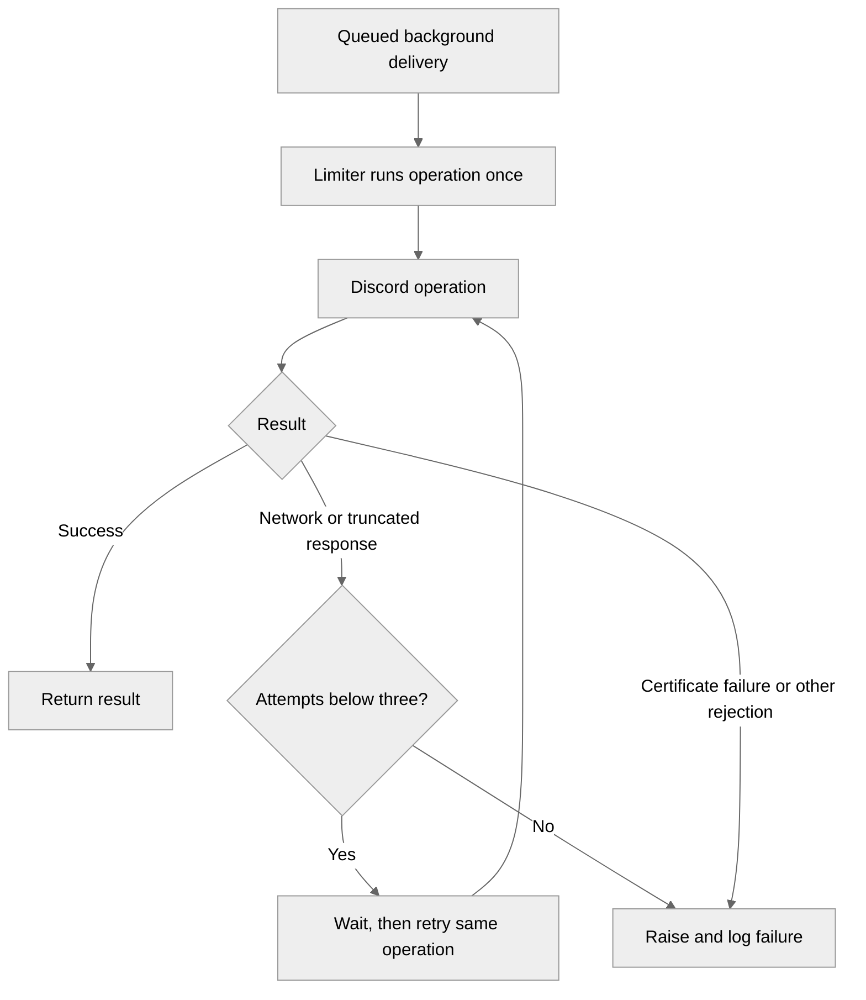

# Recent Activity in Starred Repositories
_167 active repos with 2534 new commits_

## [ai](https://github.com/topics/ai)
- [openclaw/openclaw](https://github.com/openclaw/openclaw) [341](https://github.com/openclaw/openclaw/commits): fix: wait for a busy gateway to restart before verifying a Git update

* fix: wait for busy gateways to restart before verifying Git updates

* fix: wait for deferred restarts acknowledged by the running gateway

* fix: observe the successor across supervised lease turnover

* fix: wait for a busy gateway to restart before verifying a Git update

OpenClaw-Publication: e7bd43ce-d5a7-870f-b68f-86438c652c31

* fix: preserve the failed service verdict after package rollback

* fix(update): preserve native activation and verify late Git handoffs

* fix(update): keep ownerless Git handoffs unverified

* fix(update): retain guarded recovery for an identified stale listener

* fix(update): verify native service state and keep observing a denied signal

* fix(update): identify the process lock mismatch in the cleanup diagnostic

* fix(update): verify the successor of a retired stale listener

* fix(update): poll the managed service when the restart receipt lacks its running identity

* fix(update): point stale-listener recovery at the selected profile

---------

Co-authored-by: RoboClaw <services+roboclaw@openclaw.org>
- [BasedHardware/omi](https://github.com/BasedHardware/omi) [314](https://github.com/BasedHardware/omi/commits): Add standalone Redis phone pager (#25857)

## What changed and why

SCA-2116 adds a request-based pager for the Redis pilot. The relay
admits a signed Grafana event for one rule and target, chooses the Bark
recipient server-side, and uses an operations-only Firestore database
for delivery attempts and duplicate suppression. Provider acceptance and
handset acknowledgement are recorded separately. The pager image
registration is build-only.

- **Serving-network probe.** The Helm source defines one candidate
Deployment, `omi-redis-serving-probe`, and its Prometheus scrape binding
in `prod-omi-gke / prod-omi-backend`. It uses the serving Redis RESP
transport and a workload-scoped PING-only identity. It attempts
authenticated PING every 30 seconds with a two-second overall deadline,
exports an explicit 1/0 result and a last-attempt timestamp, and
declares the selector `job="omi-redis-serving-probe",
target="prod-serving-redis"`.
- **Single Grafana rule.** Both split and combined monitoring sources
scope the paging change to `omi-redis-cache-conn-page` with
`paging_target=prod-serving-redis` and the dedicated timestamped-HMAC
receiver `Omi - Redis phone wake`. The query uses the probe selector and
retains the last state when telemetry is missing. The provisioner and
pusher importer enforce the exact UID, target and receiver. Telegram
checks remain in effect for the other managed rules.

This PR is for source-only admission. Release owns live qualification.
The probe requires separate approval for credential binding, egress, and
deployment/scrape, followed by authenticated PONG and observed 30-second
cadence on the declared selector. The isolated drill requires approved
access, signed Grafana ingress verified through the intended Bark leg,
and a witnessed handset receipt. Both Mac wakes stay active. The
five-UID release and SCA-3098 remain separate. [Reviewed release
scope](https://github.com/BasedHardware/omi/blob/d7d5853c870ab439294cd3887f7ad1d1a321b0a3/backend/paging/README.md#production-probe-placement)

## Product invariants affected

none

## How it was verified

**Current qualification at exact head
`d7d5853c870ab439294cd3887f7ad1d1a321b0a3`.**

- Independent static review returned **SHIP** for this SHA with no
actionable merge findings. All 14 Firestore budget records preserve the
entries and limits from both parents. The head includes the mainline
shard 2 and shard 8 fixes.
- Backend Unit Tests passed on run 44855146072, attempt 2. All eight
shards, guardrails and the aggregate succeeded. The Backend Hermetic
Merge Gate and the CodeQL aggregate and Python analysis also passed on
this SHA. [Backend attempt
2](https://github.com/BasedHardware/omi/actions/runs/44855146072/attempts/2)
· [Exact-head
checks](https://github.com/BasedHardware/omi/commit/d7d5853c870ab439294cd3887f7ad1d1a321b0a3/checks)
- Worker 1 validated the merged budget JSON and passed all 55 budget
fixtures, 913 Firestore index-guard tests across seven suites including
the query-driver contracts, and 47 preflight checks. The shallow
checkout skipped enforcement of the 90-day failure-class history check.

### Historical evidence

- Backend run 44855146072, attempt 1, exceeded the unchanged shard 5 CPU
timing guard. Attempt 2 supersedes that result on the same SHA.
[Historical attempt
1](https://github.com/BasedHardware/omi/actions/runs/44855146072/attempts/1)
- The superseded candidate `3dc4ab2990da30e4a2e48e2b22b5b7614436b0f7`
passed hosted runtime source closure. Its shard 2 HPA selection test hit
the CPU timing guard, while all 39 cases in that test file passed
locally. An earlier candidate `780280cf85087f03d8cf0ab4b71eff7dd94d7a2c`
passed all eight backend shards. [Historical source
closure](https://github.com/BasedHardware/omi/actions/runs/44775396695)
· [Historical shard
2](https://github.com/BasedHardware/omi/actions/runs/44775396364/job/136424201307)
· [Earlier backend
run](https://github.com/BasedHardware/omi/actions/runs/44717561189)
- Earlier local receipts cover the linux/amd64 pager image and its
19-module offline dependency probe, the Firestore emulator with
intercepted Bark, signed admission and delivery behavior, OIDC key
refresh recovery, and the PromQL outage, maintenance, stale-signal and
recovery cases. Local Firestore measurements were first admission 2
reads/2 writes, duplicate 1/0, first attempt 3/3, and retry 2/2.
[Earlier hosted source
closure](https://github.com/BasedHardware/omi/actions/runs/44717561168)

## Tests

`backend/paging/fixture.py`, `backend/paging/redis_probe/fixture.py`,
`backend/paging/redis-probe.test.yml`, monitoring notification and
alert-rule contracts, and Firestore collection-budget and query-driver
contracts.

## UI evidence

UI-Evidence: none

## Failure class (fixes)

Failure-Class: none
- [NousResearch/hermes-agent](https://github.com/NousResearch/hermes-agent) [195](https://github.com/NousResearch/hermes-agent/commits): test(skills): pin that a skill_view dedup stub keeps the entry it points at

The release is keyed on the call that recorded the entry, so the stub a
repeat view returns (which never records) can't drop it. Nothing pinned
that: a third view after a stubbed second view must still get the stub.
Release by (name, file) or re-stamping the entry with the stub's call id
both fail this test.

Suggested by @danfye on #151194.
- [unslothai/unsloth](https://github.com/unslothai/unsloth) [148](https://github.com/unslothai/unsloth/commits): Tests: give the SyntheticDataKit short-timeout wall-clock test room for runner jitter (#18721)

## Problem


`tests/test_synthetic_vllm_startup_failure.py::test_a_short_timeout_returns_promptly`
failed on an unrelated PR (#18705, base `fe5340fc99`) in `Repo tests
(CPU, rest-2)`:

```
AssertionError: took 0.58s to honour a 0.05s timeout
assert 0.5803256030001194 < 0.5
```

## Cause

The test measures wall-clock time under xdist on a shared runner. It
used `poll_interval = 1.0` and a `0.5s` bound, so only 0.45s of headroom
separated a correct run from a failure, and a busy runner used it up.
`SyntheticDataKit._await_vllm_server` itself is correct: each wait is
capped at the time left (`min(poll_interval, remaining)`), and the
arithmetic is pinned deterministically by
`test_no_single_wait_outruns_the_callers_timeout`.

## Fix

The test now uses `poll_interval = 10.0` with a `5.0s` bound. The
regression it guards (an uncapped lap waiting the whole interval) now
takes 10s, so it still fails clearly, while a correct run has seconds of
slack instead of under half a second. Test-only change.

## Verification

- `tests/test_synthetic_vllm_startup_failure.py`: 23 passed (0.84s).
- Sabotage: making `_await_vllm_server` wait the full `poll_interval`
(dropping the `min(..., remaining)` cap) fails the test with `took
10.00s to honour a 0.05s timeout`. Restored afterwards.
- [QwenLM/qwen-code](https://github.com/QwenLM/qwen-code) [63](https://github.com/QwenLM/qwen-code/commits): chore(release): v0.28.3 [skip ci]

* chore(release): v0.28.3

* docs(changelog): sync for v0.28.3

---------

Co-authored-by: github-actions[bot] <github-actions[bot]@users.noreply.github.com>
- [kortix-ai/CompanyOS](https://github.com/kortix-ai/CompanyOS) [42](https://github.com/kortix-ai/CompanyOS/commits): fix(manifest): check trigger run agents (KRTX-5050) (#12967)

## Demo video

No demo video: code-only change.

## Quick verification

Outcome: KRTX-5050 rejects undeclared agents in `on`/`run` triggers.
POST and PATCH refuse new manifest errors before committing.

- The validator reports `triggers[i].run.agent`; declared agents,
`default`, `mykortix`, its legacy alias, and omitted agents remain
valid. Flat references remain checked.
- Root cause: cross-validation read only flat `agent`; trigger CRUD also
did not call the existing added-error validator. Reused
`addedManifestErrors` on both write paths.
- **Risk:** invalid trigger edits now return 400. Existing unrelated
manifest errors remain editable. No migration. Rollback: revert this PR.
- **Verified:** manifest-schema and API typechecks exit 0; changed API
file ESLint exits 0; 607 targeted parser tests pass; TRG-2 passes
through the local HTTP stack, including POST/PATCH refusal and unchanged
manifest read-back.

```sh
bun test packages/manifest-schema/src/__tests__/validator.test.ts packages/manifest-schema/src/__tests__/validator.v3.test.ts packages/manifest-schema/src/__tests__/validator.rules.test.ts packages/manifest-schema/src/__tests__/validator.coverage.test.ts packages/manifest-schema/src/__tests__/json-schema.conformance.test.ts
607 pass
0 fail
1601 expect() calls
Ran 607 tests across 5 files. [1336.00ms]

pnpm test -- --id TRG-2
results: 1/1 passed · 0 failed · 0 skipped · 0 todo · 1.5s
[test] PASS api-cli-flows 46.5s

pnpm --filter @kortix/manifest-schema typecheck
exit 0
pnpm --filter kortix-api typecheck
exit 0
cd apps/api && bunx eslint src/projects/routes/triggers.ts
exit 0
```

Before fix: validator regression run had `84 pass; 5 fail`. Before the
route guard, TRG-2 failed: `expected [400], got 201`. The final flow
verifies both POST and PATCH reject `ghost`, and reads the manifest back
unchanged. The existing create still returns 201.

Adapter check: `bun --no-env-file /workspace/out/run-adapter.ts`
launches the existing `trigger-on-run.test.ts` with the deterministic
local API environment: `8 pass; 0 fail; 15 expect() calls`.

Unrun: full package/release suites, prohibited during development by
repository AGENTS.md/testing. Dev deployment verification awaits merge.
No external managed Git repository or cloud sandbox is used; the local
flow uses its real bare-Git fixture and database.

Self-review: 2 items found and fixed. Final A–H review: no outstanding
defects. Caller boundary: POST/PATCH → draft → on/run serializer →
addedManifestErrors → canonical validator; the CLI shares the validator.
No helper duplication or dependency added.

suna-skills: worktree, testing, learnings, contributing (attachments and
preview references), create-pr.
ponytail: full · review: Lean already. Ship. · markers: 0

Closes https://linear.app/kortix/issue/KRTX-5050

<!-- codesmith:footer -->
---
<a
href="https://dashboardbackend.blacksmith.sh/track/enable-autofix?expires=1797812988&installation_model_id=434224&pr_number=12967&ref=codesmith_pr_footer&repository=kortix-ai%2FCompanyOS&return_to=https%3A%2F%2Fgithub.com%2Fkortix-ai%2FCompanyOS%2Fpull%2F12967&signature=1de79ac7a44ca6cc2772007901bcedf5260842cd408e94a12308196767d16d33"><picture><source
media="(prefers-color-scheme: dark)"
srcset="https://pr-comments-assets.blacksmith.sh/codesmith/autofix-with-codesmith-dark.svg"><source
media="(prefers-color-scheme: light)"
srcset="https://pr-comments-assets.blacksmith.sh/codesmith/autofix-with-codesmith-light.svg"></picture></a>
<sup><a
href="https://app.blacksmith.sh/kortix-ai/codesmith/CompanyOS/pr/12967?autoLogin=true&ref=codesmith_pr_footer">Open
in [code]smith</a> · Need help on this PR? Tag
<code>@codesmith-bot</code> with what you need.</sup>

<!-- codesmith:autofix:disabled -->
<!-- /codesmith:footer -->

Co-authored-by: Kortix Agent <292857086+agent-kortix@users.noreply.github.com>
- [langgenius/dify](https://github.com/langgenius/dify) [32](https://github.com/langgenius/dify/commits): fix(web): protect model configuration while saving (#46867)
- [t8y2/dbx](https://github.com/t8y2/dbx) [15](https://github.com/t8y2/dbx/commits): fix: close index editor table right border (#15284)
- [google/adk-python](https://github.com/google/adk-python) [6](https://github.com/google/adk-python/commits): fix: keep a langchain tool's name and description in from_config

Merge https://github.com/google/adk-python/pull/7901

LangchainTool now treats an empty name or description like a missing one
and falls back to the wrapped tool's own value, as CrewaiTool does. Direct
calls such as LangchainTool(tool, description='') keep the tool's
description instead of blanking it.

Fixes #7900

PiperOrigin-RevId: 1026773820
- [s2b-dev/smart-second-brain](https://github.com/s2b-dev/smart-second-brain) [4](https://github.com/s2b-dev/smart-second-brain/commits): release: 2.6.0

A visible task list for multi-step work (#569), clarifying questions from the
agent (#504), Hugging Face as a provider with browser sign-in (#575), and the UI
in ten more languages (#579). Context-overflow recovery and refusal messages
(#571), Anthropic prompt caching (#570), retrieval prefixes for EmbeddingGemma,
e5 and arctic (#578), endpoint-reported context windows for OpenAI-compatible
providers (#576), quieter error notices (#574), and two summarization fixes
(#572, #573).

Co-Authored-By: Claude <noreply@anthropic.com>
- [docling-project/docling](https://github.com/docling-project/docling) [3](https://github.com/docling-project/docling/commits): feat: turn audio/video transcripts and slide media into tracks (#4752)

* fix(pptx): keep video and audio shapes and record their media file

A video shape (python-pptx Movie) was not a Picture, so the backend
skipped it and the video was absent from the document. An audio shape
came out as a plain picture of its speaker icon, with nothing to say
that it plays a file.

A video shape now becomes a picture of its poster frame, on its slide.
Video and audio pictures record the media file in a docling__video or
docling__audio meta field: the path inside the package for an embedded
file, or the link target for a linked file. The media element in
p:nvPr gives the kind; the p14:media extension or the media element
gives the relationship.

Signed-off-by: Daniel Nguyen <danielnguyenh07@gmail.com>

* fix(odf): record the video and audio file of an ODP media frame

The ODP backend skipped the draw:plugin of a media frame. Only its
draw:image preview came out, as a plain picture.

The preview picture now records the media file in the same
docling__video or docling__audio meta field as PPTX. A frame without a
preview gets an empty picture. When LibreOffice declares its generic
media type, the manifest or the file extension gives the kind.

Signed-off-by: Daniel Nguyen <danielnguyenh07@gmail.com>

* docs: describe how slide video and audio are recorded

Signed-off-by: Daniel Nguyen <danielnguyenh07@gmail.com>

* feat(pptx,odf): load the media files that a slide plays

A pipeline needs the bytes of a media file to convert it. The new
DeclarativeDocumentBackend.load_media takes the value of a
docling__video or docling__audio field and returns the bytes. The
default returns None.

The PPTX backend reads an embedded file from its package part and the
ODP backend from its archive. A linked file goes through the
ImageResourceLoader rules: a URL needs enable_remote_fetch, and a local
file needs enable_local_fetch, a document read from a Path, and a place
in the folder of the document or below it.

Signed-off-by: Daniel Nguyen <danielnguyenh07@gmail.com>

* feat(pipeline): convert slide video and audio with do_media_conversion

The new ConvertPipelineOptions.do_media_conversion (off by default)
makes the simple pipeline convert each recorded media file with the ASR
pipeline (audio) or the video pipeline (video), with the Whisper model
of media_asr_options. The result goes in a group right after the
picture: the transcript with its timestamps and, for a video, the
sampled frames. The items take the provenance and the content layer of
the picture.

A media file that cannot be loaded or converted, also for a missing
ASR extra, keeps its picture, is listed in the conversion errors, and
makes the result a partial success. A linked file that the backend
options do not allow is skipped with a warning.

Signed-off-by: Daniel Nguyen <danielnguyenh07@gmail.com>

* docs: describe the conversion of slide video and audio

Signed-off-by: Daniel Nguyen <danielnguyenh07@gmail.com>

* style(odf): restore the blank line lost in the merge with main

Signed-off-by: Daniel Nguyen <danielnguyenh07@gmail.com>

* fix(media): handle legacy containers and media shown on several slides

From the review of Steve-Allison:

- Older decks embed .wmv, .m4v, .mpg, .mpeg, .flv, .asf, .wma or
  .aiff. With LibreOffice's generic media type, the ODP backend did not
  record such a file. media_kind() now knows these containers.
- The video pipeline reads only some containers. A video in another one
  is recorded but not converted, with a warning, so the deck no longer
  becomes a partial success for a file that cannot be converted at all.
- A media part that several slides show is converted once; each slide
  gets its copy of the result.

A video without an audio track already converts to its frames without
an error; a test now covers it.

Signed-off-by: Daniel Nguyen <danielnguyenh07@gmail.com>

* feat(asr): put the transcript in a track and optionally keep the media

Add the transcript items to one TrackItem instead of the body. With the new
keep_media option (--keep-media), reference the input file as the track's audio,
or video for a video file, so that e.g. a DocLang archive stores it. Only file
inputs are supported, and the CLI then keeps them in place.

Signed-off-by: Panos Vagenas <pva@zurich.ibm.com>

* feat: put video and WebVTT transcripts in a track

Like ASR, add the frames and transcript of a video, and the cues of a WebVTT file,
to one TrackItem. Frames become instants at their timestamp. The video pipeline
also takes keep_media (--keep-media), which references the input file as the
track's video.

Signed-off-by: Panos Vagenas <pva@zurich.ibm.com>

* feat(cli): keep the source in DCLX archives

With the new --keep-source option, store the input file unchanged in the archive
written by --to dclx, with the file name and media type of the document's origin.
Only file inputs have a source to store. A source that is also the media of a
track (--keep-media) is stored once.

Signed-off-by: Panos Vagenas <pva@zurich.ibm.com>

* feat(media): turn slide video and audio into tracks

A video or audio object on a PPTX or ODP slide becomes a track, with its poster
frame or icon as the cover and a MediaRef to the media file, in place of a picture
with a docling__video or docling__audio meta field. With do_media_conversion, the
transcript and frames go in that track instead of a group after the picture. The
new keep_media option (also --keep-media) holds the media file in the track, so
that a DocLang archive stores it. Media in a container that a track cannot
reference yet, such as .wmv, stays a picture.

Signed-off-by: Panos Vagenas <pva@zurich.ibm.com>

* fix(asr): use standard media types for audio inputs

Signed-off-by: Panos Vagenas <pva@zurich.ibm.com>

* fix(asr): strip the segment text of native Whisper

Signed-off-by: Panos Vagenas <pva@zurich.ibm.com>

* feat(cli): transcribe slide media with --convert-media

Signed-off-by: Panos Vagenas <pva@zurich.ibm.com>

* feat(media): keep the media of older decks in tracks

Signed-off-by: Panos Vagenas <pva@zurich.ibm.com>

* test: follow DocLang 0.10 and the new track media types

Signed-off-by: Panos Vagenas <pva@zurich.ibm.com>

* fix(deps): require docling-core 2.108.0

Signed-off-by: Panos Vagenas <pva@zurich.ibm.com>

* test: follow the title detection of docling-core 2.107 in the LaTeX ground truth

Signed-off-by: Panos Vagenas <pva@zurich.ibm.com>

---------

Signed-off-by: Daniel Nguyen <danielnguyenh07@gmail.com>
Signed-off-by: Nguyen Hoang Duong <danielnguyenh07@gmail.com>
Signed-off-by: Panos Vagenas <pva@zurich.ibm.com>
Co-authored-by: Panos Vagenas <pva@zurich.ibm.com>
- [lutzroeder/netron](https://github.com/lutzroeder/netron) [3](https://github.com/lutzroeder/netron/commits): Update to 9.3.7
- [github/spec-kit](https://github.com/github/spec-kit) [2](https://github.com/github/spec-kit/commits): fix(extensions): describe extension list options accurately (#5496)

Explain the installation hint in list help and point catalog discovery to extension search.

Assisted-by: OpenAI Codex (model: GPT-6.2, autonomous)
- [google-gemini/gemini-cli](https://github.com/google-gemini/gemini-cli) [2](https://github.com/google-gemini/gemini-cli/commits): fix(cli): resume most recently active session instead of most recently started (#30389)
- [google/magika](https://github.com/google/magika) [2](https://github.com/google/magika/commits): Gracefully exit from trampoline workflow for pre-releases (#1641)
- [akdeb/ElatoAI](https://github.com/akdeb/ElatoAI) [1](https://github.com/akdeb/ElatoAI/commits): updating assembly ai to 3-step voice pipeline
- [openai/openai-agents-python](https://github.com/openai/openai-agents-python) [1](https://github.com/openai/openai-agents-python/commits): docs: Upgrade the GPT-Live demo to 1.1 (#6101)

feat: Upgrade the GPT-Live demo to 1.1

Demonstrate speech-triggered standby with a 20-second idle timeout and hosted web search in managed Responses. Add a responsive conversation timeline, call controls, and optional event diagnostics.
- [specstoryai/getspecstory](https://github.com/specstoryai/getspecstory) [1](https://github.com/specstoryai/getspecstory/commits): Merge pull request #413 from specstoryai/dependabot/github_actions/actions-minor-patch-325cffb680

Bump the actions-minor-patch group with 2 updates
- [steel-dev/steel-browser](https://github.com/steel-dev/steel-browser) [1](https://github.com/steel-dev/steel-browser/commits): fix(cdp): Puppeteer Basic Auth with request filtering enabled (#442)
- [XiaomiMiMo/MiMo-Code](https://github.com/XiaomiMiMo/MiMo-Code) [1](https://github.com/XiaomiMiMo/MiMo-Code/commits): feat(skill): scan skills at the trigger and deliver the catalog as user-turn deltas (#2840)

* feat(skill): scan skills at the trigger and deliver the catalog as user-turn deltas

Skill discovery no longer caches for the process lifetime: each turn
boundary, command lookup, and skill-name miss rescans roots with a
stat-keyed parse cache. The catalog moves from the system tail to a
persisted user-turn reminder (entry, then deltas), so the system prompt
stays stable while new sessions and existing ones see skill changes.
Slash commands list live skills without waiting for MCP servers.

* fix(skill): keep the prefix profile stable and harden live skill refresh

Trust current skill directories in the external_directory guard instead of
rebuilding the agent, whose permission is hashed into the prefix profile key.
Make refresh tickets join only scans that started after the request, close
the interruption window, retry empty remote pulls, and apply the legacy
catalog strip in compaction while keeping host-supplied content.

* fix(skill): drop the external_directory skill-directory bypass

An early return in the guard skipped explicit deny rules. Keep the agent
permission fixed (as on main) and leave post-startup trust out of scope.

* fix(skill): strip engine catalog copies beyond host-supplied blocks

* docs(skill): finalize skill-catalog-live feature document

* docs(skill): point skill-catalog-live spec at its PR

* docs(skill): record the fixed skill-directory allowlist as a known limitation

## [ai-agents](https://github.com/topics/ai-agents)
- [earthtojake/text-to-cad](https://github.com/earthtojake/text-to-cad) [2](https://github.com/earthtojake/text-to-cad/commits): Shop: the Centauri Carbon 2's store link, and a site-verification tag (#908)

Not a release: `VERSION` is untouched.

## What changes

- `apps/docs/src/lib/shop-links.ts`: the Elegoo Centauri Carbon 2's
`/go/` link now goes through Elegoo's store link, landing on the same
product page.
- `apps/docs/src/app/layout.tsx`: every page's `<head>` carries `<meta
name="impact-site-verification">` with the site's verification ID, in
the form the verifier asks for (`value`) and with `content` as well.
Next's metadata API only writes `content`, so the tag is in the layout's
`<head>` directly. It is already live on texttocad.dev; this keeps it
there through deploys from `main`.

## Checks

- `npm --prefix apps/docs run check`: lint, build and icon check pass.
- The new link resolves to
`us.elegoo.com/products/centauri-carbon-2-combo`.

---
_Generated by [Claude Code](https://claude.ai/code)_

---------

Co-authored-by: Claude <noreply@anthropic.com>
- [steipete/agent-scripts](https://github.com/steipete/agent-scripts) [2](https://github.com/steipete/agent-scripts/commits): build(deps): refresh browser and transcript tooling (#67)

Refresh Puppeteer Core to 25.18.1 and youtube-transcript-plus to 2.0.5 with matching lockfiles and unchanged runtime floors. Clarify the frontend-design skill's trigger so agents load it when building interfaces whose design quality matters. Fixes #66; thanks @visormatt.

Validation: skill metadata validation, browser-helper tests/build/CLI smoke, and all four transcript regression tests pass on an isolated Linux machine. Dependency audit reports zero vulnerabilities. Independent P0–P2 review is clean. No releases, tags, or project version changes.
- [lemomo-ai/lemo-opuscar](https://github.com/lemomo-ai/lemo-opuscar) [1](https://github.com/lemomo-ai/lemo-opuscar/commits): Licence wording: we license only what we hold; the commercial licence covers the library, minus a stated list

- LICENSE and both READMEs: our licensable contributions to the films are CC BY 4.0; the six narration tracks,
  Clawd and third-party works re-created in the films need their own legal basis, even inside a complete film;
  a commercial licence covers the library version named in the agreement and later ones, and lists its exclusions;
  licences already given stay irrevocable (EARLIER VERSIONS)
- CREDITS: per-track music links (Kevin MacLeod, Scott Buckley), Salamander piano credited as CC BY 3.0,
  the Ford collection's contractor-film caveat (also in SOURCES), the demo-image rule in manga-panels and
  text-flash-cuts said as a rule of the style, not a licence term
- REUSE.toml: Noto Sans SC for Neon Tubes' traced glyphs, the topojson-client and world-atlas licence texts
- voice pack: now voice-2.tar, with the Apache 2.0 text and its sources (core/tts); voice.tar stays on the
  release for clones that pin its sha256. New packs carry no owner names in their tar headers
- gallery pages and the films repository's README say the same

Claude-Session: https://claude.ai/code/session_01H613eyNMMBZocg6LoocajM
- [slopus/happy](https://github.com/slopus/happy) [1](https://github.com/slopus/happy/commits): fix(android): keep Play Billing's first answer so a second one can't crash the app

Play Billing 8.3.0 answers a request twice when it doesn't finish in 28.5 s:
its main-thread timeout cancels the request (interrupting the worker's
reconnect wait) and answers "Timeout communicating with service", and the
interrupted worker answers SERVICE_DISCONNECTED to the same listener.
PlayBilling resumed its continuation on each answer, so the second threw
IllegalStateException: Already resumed (store build 167 crash in
PlayBilling.monthly's onProductDetailsResponse).

Every listener-based call (monthly, owned, acknowledge, connect) now keeps
only the first answer via an AtomicBoolean.

## [claude-code](https://github.com/topics/claude-code)
- [Piebald-AI/claude-code-system-prompts](https://github.com/Piebald-AI/claude-code-system-prompts) [2](https://github.com/Piebald-AI/claude-code-system-prompts/commits): Update changelog for v2.1.330
- [frontier-harness-eval/eval](https://github.com/frontier-harness-eval/eval) [1](https://github.com/frontier-harness-eval/eval/commits): Merge pull request #40 from frontier-harness-eval/release/v1.1

Replace v1.0 content with the v1.1 evaluation

## [deep-learning](https://github.com/topics/deep-learning)
- [skypilot-org/skypilot](https://github.com/skypilot-org/skypilot) [8](https://github.com/skypilot-org/skypilot/commits): [Test] Cap NCCL message size in test_efa to avoid 900s timeout (#11459)

Claude-Session: https://claude.ai/code/session_01LKJmNnLwTk9VrKWAjFiYVD

Co-authored-by: Claude Opus 5.5 <noreply@anthropic.com>
- [Developer-Y/cs-video-courses](https://github.com/Developer-Y/cs-video-courses) [3](https://github.com/Developer-Y/cs-video-courses/commits): Add new course links for CMU programs
- [mlfoundations/open_clip](https://github.com/mlfoundations/open_clip) [2](https://github.com/mlfoundations/open_clip/commits): Add factorized x/y pos_embed option to genlap/genlip models. Tweak some small details of in-fusion addition.

## [distributed-systems](https://github.com/topics/distributed-systems)
- [databendlabs/openraft](https://github.com/databendlabs/openraft) [24](https://github.com/databendlabs/openraft/commits): docs: rt-tokio: show how to run local tasks on an own runtime

# Summary

The docs of `TokioRuntime` now say that, when tasks need not be
`Send`, an application that builds its own Tokio runtime must run
Openraft inside a `LocalSet` or a `LocalRuntime`, and show how with
`LocalSet::run_until`.

# Details

In single-threaded mode, `TokioRuntime::spawn` calls `spawn_local`,
which panics outside a `LocalSet` or, from tokio 1.51, a
`LocalRuntime`. `TokioRuntime::block_on` sets up a `LocalSet`, but an
application that drove Openraft on a runtime it built itself, such as
a current-thread runtime, panicked at the first spawn, and the docs
did not say why.

The doc example builds a current-thread runtime and spawns a task
inside `LocalSet::run_until`. The same code works whether tasks need
to be `Send` or not, so the doctest runs in every mode. The new test
`test_spawn_non_send_task_on_own_runtime` does the same in
single-threaded mode, with a task that holds an `Rc`.
- [bloomberg/blazingmq](https://github.com/bloomberg/blazingmq) [6](https://github.com/bloomberg/blazingmq/commits): Fix[bmqp::RejectMessageIterator]: reject zero header/per-message words

Signed-off-by: Yuan Jing Vincent Yan <yyan82@bloomberg.net>

## [embedded](https://github.com/topics/embedded)
- [hathach/tinyusb](https://github.com/hathach/tinyusb) [12](https://github.com/hathach/tinyusb/commits): Merge pull request #4586 from tyeth/pio-usb-hcd-deinit

pio_usb: add hcd_deinit(), so tuh_deinit() and tuh_init() work
- [rhaiscript/rhai](https://github.com/rhaiscript/rhai) [3](https://github.com/rhaiscript/rhai/commits): Fix test outputs and warnings.
- [wasm-micro-runtime/wasm-micro-runtime](https://github.com/wasm-micro-runtime/wasm-micro-runtime) [3](https://github.com/wasm-micro-runtime/wasm-micro-runtime/commits): test(runtime-common): add API tests for wasm_runtime_common.c

Add two cases files to runtime-common/base: one for the APIs that read a module (package type and version, import/export descriptors, type accessors, log level, version, instantiation arguments) and one for the APIs that need an instance or an execution environment (exported globals and tables, function signatures, variadic/indirect/raw native calls, user and custom data, terminate, module heap helpers). They run on a new api.wat fixture and, in the aot run mode, on its aot form too.

Signed-off-by: liang.he@intel.com <liang.he@intel.com>

## [esp32](https://github.com/topics/esp32)
- [esphome/esphome](https://github.com/esphome/esphome) [45](https://github.com/esphome/esphome/commits): [serial_proxy] Report a USB device as connected only after its setup has finished (#22980)
- [schreibfaul1/ESP32-audioI2S](https://github.com/schreibfaul1/ESP32-audioI2S) [12](https://github.com/schreibfaul1/ESP32-audioI2S/commits): Merge pull request #1433 from schreibfaul1/parseOgg()-in-flac

Parse ogg() in flac
- [arendst/Tasmota](https://github.com/arendst/Tasmota) [9](https://github.com/arendst/Tasmota/commits): Fix duplicate SDMMC detection
- [crosspoint-reader/crosspoint-reader](https://github.com/crosspoint-reader/crosspoint-reader) [8](https://github.com/crosspoint-reader/crosspoint-reader/commits): Fix header layout to preserve theme-specific positioning

Refactor headerBandTopShift to only move the status row to a shared slot while keeping title and action buttons at their theme-specific positions. Remove device bezel clearance from the shift calculation since it should stay in headerOffsetY. This ensures header elements render consistently across themes regardless of board-specific offsets.
- [espressif/idf-extra-components](https://github.com/espressif/idf-extra-components) [6](https://github.com/espressif/idf-extra-components/commits): Merge pull request #926 from suda-morris/auto/raylib-mdbook-docs-a7c3

docs(raylib): add mdBook programming guide
- [rmk-rs/rmk](https://github.com/rmk-rs/rmk) [4](https://github.com/rmk-rs/rmk/commits): Merge pull request #1464 from rmk-rs/fix/dongle-dfu-winusb-guid

fix(usb): register a WinUSB interface GUID for the dongle DFU runtime

## [golang](https://github.com/topics/golang)
- [d2lang/d2](https://github.com/d2lang/d2) [23](https://github.com/d2lang/d2/commits): Merge pull request #2994 from d2lang/chore/release-0.9.1-dependencies

deps: update Go and release tooling for v0.9.1

- sent from alixander's Codex
- [ClickHouse/clickhouse-go](https://github.com/ClickHouse/clickhouse-go) [4](https://github.com/ClickHouse/clickhouse-go/commits): fix: bind complete named parameters containing dollar signs (#2030)

* fix: bind complete named parameters containing dollar signs

* test: cover sql.Named with a $ in the name

* test: tighten the tests for dollar signs in named parameters

Move the unit cases into bind_test.go next to the other named bind
tests and drop the subtests that pass without the fix. Use
TestProtocols and one helper in the issue test, and check the
client error text.

Co-Authored-By: Claude Opus 5.5 <noreply@anthropic.com>

---------

Co-authored-by: Kaviraj Kanagaraj <kavirajkanagaraj@gmail.com>
Co-authored-by: Joe S <joe.spadola@clickhouse.com>
Co-authored-by: Claude Opus 5.5 <noreply@anthropic.com>
- [twmb/franz-go](https://github.com/twmb/franz-go) [4](https://github.com/twmb/franz-go/commits): Merge pull request #1578 from r-vasquez/sr-guid-schema-locator

sr: support schema GUIDs in ConfluentHeader
- [gojue/ecapture](https://github.com/gojue/ecapture) [1](https://github.com/gojue/ecapture/commits): *: replace legacy output flags with Protobuf v2 streams (#1094)

Separate configuration updates, output destinations and subscriptions
so startup options clearly describe their behavior. Remove legacy CLI
flags without compatibility aliases or silent payload reinterpretation.

Unify runtime logs and capture events across repeatable outputs. Keep
native keylog and pcapng artifacts separate from JSON files, preserve
records across reload, and give late subscribers independent headers.
Publish typed v2 records and require the ecapture.v2 WebSocket protocol.

Update receiver examples, CLI help, migration guides, wiki instructions
and core Linux tests. Preserve literal escapes in file URIs and reject
abnormal subscription closure instead of treating it as completed output.
Adapt CLI edge checks and TLS benchmarks to the new output contract.

Validation: Linux arm64 CO-RE build, production lint, core/shared race
tests, 102 core E2E cases, 11 CLI edge cases and text/keylog smoke runs.
The all-package race attempt only failed existing MySQL tests requiring
a local mysqld binary. Non-core E2E was not run.

Signed-off-by: CFC4N <cfc4n.cs@gmail.com>
- [wader/fq](https://github.com/wader/fq) [1](https://github.com/wader/fq/commits): Merge pull request #1437 from wader/bump-gomod-gopacket-1.8.0

Update gomod-gopacket to 1.8.0 from 1.7.7

## [ios](https://github.com/topics/ios)
- [ly05010419/MacNativeGames](https://github.com/ly05010419/MacNativeGames) [33](https://github.com/ly05010419/MacNativeGames/commits): feat(ios): Zelda's pipeline archive in Animal Crossing and Odyssey; no full warm-up at every start

The ports warmed every shader library at every start (Odyssey: 61,896 items). They now use Tears of the
Kingdom's pipeline archive, shared rather than copied:
- totk_pipeline_archive{,_files,_folders,_publish}.h, nvn_archive_map.h and nvn_compiler_retry.h move to
  shared/ unchanged and are linked into totk, acnh and odyssey; the ports' old private archive (schema 3,
  one file per pipeline) is gone. totk_pipeline_archive_port.h / _port_fill.h: TotK's pso_new / cs_new_
  archive flow and its pipeline-archive packaging mode for the ports.
- The ports' hosts get the pipeline-archive mode (loader.c) and a bundle id (game_info.plist, Mac only) so
  Metal's archive builder can write; with a valid archive the warm-up skips libraries-only work, as TotK's.
- device_pipelines.py make(): TotK build_ipa.py's pipeline steps, called by it and by build_port_ipa.py, so
  the port IPAs carry pipelines-<gpu> files for the device GPUs (--device-gpu).
- Tests: PipelineArchive in test_ios_ports_unified.py (shared headers, archive hooks, host mode, make()).

Co-Authored-By: Claude Opus 5.5 <noreply@anthropic.com>
- [tw93/MiaoYan](https://github.com/tw93/MiaoYan) [17](https://github.com/tw93/MiaoYan/commits): docs(incidents): I-62, prose above a table went over the table on every keystroke

Row for 59461505: introduced by d792e0c4, in the daily build between the two, caught by CI's run of the timing test and now by its relative limit.
- [DIYgod/pinky](https://github.com/DIYgod/pinky) [6](https://github.com/DIYgod/pinky/commits): chore(release): 2026.1121.1

Co-Authored-By: Claude Opus 5.5 <noreply@anthropic.com>
- [davesc63/GeoPort](https://github.com/davesc63/GeoPort) [5](https://github.com/davesc63/GeoPort/commits): chore(broadcast): update Desktop broadcast message [gp-ops]
- [doronz88/pymobiledevice3](https://github.com/doronz88/pymobiledevice3) [4](https://github.com/doronz88/pymobiledevice3/commits): Merge pull request #2221 from doronz88/docs/webinspector-blank-frame-cause

webinspector: Describe why a large message stalls
- [fastlane/fastlane](https://github.com/fastlane/fastlane) [4](https://github.com/fastlane/fastlane/commits): [Ruby] Ruby 3.3 is now the minimum (dropping Ruby 3.2) (#30477)

* chore: move to Ruby 3.3 min

* chore: ruby 3.4 is suggested

* chore: remove google-cloud-env lock

* chore: move to modern openssl to support 4.0
- [Snapchat/Valdi](https://github.com/Snapchat/Valdi) [4](https://github.com/Snapchat/Valdi/commits): Internal Change

GitOrigin-RevId: aee25af304e4323f562a23f6daef3d2a0b767cd5
- [electrikmilk/cherri](https://github.com/electrikmilk/cherri) [1](https://github.com/electrikmilk/cherri/commits): Remove the unsigned Shortcut when signing to an -o path

removeUnsigned checked for the signed file at the default location next
to the source, so with -o it returned early and left
<name>_unsigned.shortcut behind. Check outputPath and inputPath, the
paths createShortcut signs to and from.

Fixes #235
- [SwiftOldDriver/iOS-Weekly](https://github.com/SwiftOldDriver/iOS-Weekly) [1](https://github.com/SwiftOldDriver/iOS-Weekly/commits): fix #5512

## [javascript](https://github.com/topics/javascript)
- [alyssaxuu/screenity](https://github.com/alyssaxuu/screenity) [1](https://github.com/alyssaxuu/screenity/commits): Faster back-to-back recordings, failed uploads kept on your computer, more reliable tab and area recording starts
- [tdewolff/minify](https://github.com/tdewolff/minify) [1](https://github.com/tdewolff/minify/commits): Merge pull request #1095 from titimoby/fix/issue-1091/python-package-macos

Fix Python sdist shipping a prebuilt shared library

## [llm](https://github.com/topics/llm)
- [BerriAI/litellm](https://github.com/BerriAI/litellm) [116](https://github.com/BerriAI/litellm/commits): test(e2e): run codex in fast mode under the real model name (#49899)

* test(e2e): run codex in fast mode under the real model name as a team model

Each test registers its deployment as a team model named after the real model, on a throwaway team with a
team key, so parallel tests never share one pooled deployment. Fast mode sets service_tier to priority the
way /fast does and must still answer with a value only reachable through the gateway, on every setup

* test(e2e): check codex fast mode really asks the gateway for the fast tier

The Fast mode row only checked the answer, so it passed the same if the fast setting quietly stopped
doing anything. It now reads whether the gateway's Codex catalog offers the priority tier for the model,
and checks the requests the gateway logged for that key carried service_tier priority when it does and
never asked for it when it doesn't

* test(e2e): fail codex fast mode when the gateway logged too few requests

With no spend log rows the tier checks ran over an empty list and passed. The test now requires at least
the two requests a command round trip makes before it checks their tiers
- [yetone/magpie](https://github.com/yetone/magpie) [62](https://github.com/yetone/magpie/commits): gui: a two-line partner tile's icon sits at the top, by the name

The add sheet's partner tiles with a tagline (.tile.two) centred the icon
on both lines. It now sits at the top beside the name, the way a list row
with a subtitle does. The ✓ and the count stay centred.

Run:
- Full GUI suite on mica, concurrency 3, at c2e6e4aa8 + this change:
  29126 pass, 1170 fail across 156 files. mica's load was 37 on 12
  cores during the run.
- The 8 red files that reach the add sheet or partner tiles were rerun
  alone on mica, at origin/main 604f707d2 with and without this change
  (add-sheet-custom, add-sponsor-me, old-webkit, plugin-partners,
  provider-env-paste, remote-magpie, tencent-cloud, vertex-editor).
  - Same reds both ways, already filed: #6570 (old-webkit), #4398 and
    #5013 (remote-magpie), #4321 (tencent-cloud), #7038 and #4720
    (vertex-editor).
  - The one difference, add-sheet-custom chromium (page error, topUpRate
    of null), was rerun 3x on each side: 1 of 3 red on both. Filed as
    #7390.

Not tried: the other 148 red files at base. They don't load the add sheet
tiles; that was checked by grep, not by running them.
- [jundot/omlx](https://github.com/jundot/omlx) [27](https://github.com/jundot/omlx/commits): feat(oq): quantize Inkling 2 Mini

oQ now accepts the inkling2_loop model type. The sanitizer maps the loop controllers and message queries, and calibration walks the layer visits in run order, so a looped layer sees all three passes. Its sensitivity is the worst of its passes. The runtime loader now casts each loop part before the final stack so oQ can replay it, with the same values.
- [browser-use/browser-use](https://github.com/browser-use/browser-use) [19](https://github.com/browser-use/browser-use/commits): 1.0.8rc1: cached judge, SSH sign-in, step-limit answers and 3 fixes (#6489)

1.0.8rc1: the 6 approved fixes on top of 1.0.7, merged as one release so
main gets a single CI run.

| PR | change |
|---|---|
| #6457 | the judge asks as one more turn of the run, so the provider
reads the run from its cache |
| #6427 | no API key over SSH or headless: sign in with a link and a
code instead of stopping |
| #6453 | DeepSeek/Qwen at the step limit: a refused forced final call
is asked again without forcing |
| #6455 | bu.type never prints a password field's value |
| #6456 | `Browser(cdp_url=...)` attaches the one open page instead of a
new blank tab |
| #6461 | Browser Use gateway calls reserve credit for 16,384 output
tokens, not 32,768 |

**Version:** 1.0.7 was released on 11-20 (MCP replies before the client
times out), so this rc is 1.0.8rc1.

**Conflicts resolved:**
- `loop.py` Session gets both new fields: `unforced` from #6453 and
`request_params` from #6457.
- README and `examples/simple.py` keep #6427's sign-in lines, at this
version.

**Proof:** main + all 6, locally: `pytest tests/ci -m "not chrome"` 964
passed. Judge, loop, browser, llm and ultrafast suites: 305 passed.
pyright: 0 errors. Every PR was green on its own head. BU Bench v2.1,
200 tasks, judge on, the first 4 PRs vs 1.0.6: score 78.3 vs 76.3 (a
tie), model cost $0.164 vs $0.199 per task.

**Risk:** a pre-release; `pip install browser-use` stays on 1.0.7.
Rollback: revert the merge commit and yank the rc.

<!-- This is an auto-generated description by cubic. -->
---
## Summary by cubic
1.0.8rc1: six approved changes from 1.0.7 merged as one release
candidate, so main gets a single CI run. `pip install browser-use` stays
on 1.0.7; this pre-release is for testing.

**Changes**
- The judge asks as one more turn of the run, so the provider reads it
from its prompt cache; it keeps the run's model settings and effort,
sees the run's status and result, and a tool call or answer that does
not match the schema falls back to a separate judge request.
- A missing key over SSH or headless Linux signs in with a link and a
device code instead of stopping; the missing-key path also sends gate
telemetry (enums only, no credentials), and `Browser()` falls back to
the gateway model's key when no other is set.
- At the step limit, a refused forced final call is retried without
forcing instead of ending the run with an error.
- `bu.type` never prints a password field's value into the trace, logs,
or judge prompt.
- `Browser(cdp_url=...)` attaches the one open page instead of opening a
new blank tab.
- Gateway calls reserve credit for 16,384 output tokens, not 32,768, so
a small balance no longer refuses calls it can pay for.

**Release notes**
- `loop.py`'s Session gets both merged fields: `unforced` and
`request_params`.
- README and `examples/simple.py` keep the sign-in lines at this
version.
- Validation: 964 CI tests pass locally, pyright is clean, and BU Bench
v2.1 scores 78.3 vs 76.3 on 1.0.6 at $0.164 vs $0.199 per task.
- Rollback: revert the merge commit and yank the rc.

<sup>Written for commit 8e6ac139e3067db036cbb94ded3c4c266dd7f85e.
Summary will update on new commits.</sup>

<a
href="https://cubic.dev/pr/browser-use/browser-use/pull/6489?utm_source=github"
target="_blank" rel="noopener noreferrer"
data-no-image-dialog="true"><picture><source
media="(prefers-color-scheme: dark)"
srcset="https://www.cubic.dev/buttons/review-in-cubic-dark.svg"><source
media="(prefers-color-scheme: light)"
srcset="https://www.cubic.dev/buttons/review-in-cubic-light.svg"></picture></a>
<a
href="https://www.cubic.dev/action/auto-fix/pr/browser-use/browser-use/6489?returnTo=https%3A%2F%2Fgithub.com%2Fbrowser-use%2Fbrowser-use%2Fpull%2F6489&source=description"
target="_blank" rel="noopener noreferrer"
data-no-image-dialog="true"><picture><source
media="(prefers-color-scheme: dark)"
srcset="https://www.cubic.dev/buttons/turn-on-auto-fix-dark.svg"><source
media="(prefers-color-scheme: light)"
srcset="https://www.cubic.dev/buttons/turn-on-auto-fix-light.svg"></picture></a>

<!-- End of auto-generated description by cubic. -->
- [gptme/gptme](https://github.com/gptme/gptme) [16](https://github.com/gptme/gptme/commits): docs(browser): state that output limits count kept content, not the marker (#5038)

Follow-up to #5034. GPTME_BROWSER_MAX_OUTPUT_CHARS (and the MCP bound)
limit retained page characters; the omission notice and saved-file path
are appended on top. Document that in config.rst (the browser variable
was undocumented), the design doc, mcp.rst and the helper docstring, and
replace the loose length assertion with an exact contract test.

Git-Session-Id: 39e728d0-5706-4e78-907e-ca0f3a27f1e6
- [jjang-ai/vmlx](https://github.com/jjang-ai/vmlx) [14](https://github.com/jjang-ai/vmlx/commits): Observe engine request lifecycle for cancellation idle checks (#397)
- [CherryHQ/cherry-studio](https://github.com/CherryHQ/cherry-studio) [6](https://github.com/CherryHQ/cherry-studio/commits): perf(messages): start oversized completed tool histories collapsed (#24547)

### What this PR does

Before this PR: agent message lists always pass `expandToolSteps: true`,
so every completed process group mounts its full tool history on first
paint. In a long agent turn this reached ~12k–16k DOM nodes per group
(one group held 211,844 characters of tool output), even though most of
it sits far off-screen.

After this PR: ordinary turns keep the current auto-expanded behavior. A
completed history with more than 80 entries or more than 100 KiB of tool
payload text starts collapsed and can be expanded with the existing
process trigger. An explicit user toggle still wins through the message
disclosure cache.

### Why we need it and why it was done in this way

Runtime captures of the main renderer showed the largest expanded groups
at 11,939 and 16,256 DOM nodes (one group: 211,844 characters, 26 tool
blocks), while the visible message list only held ~2.4k nodes. The
top-level history is auto-expanded in agent sessions because
`agentMessageListAdapter` sets `expandToolSteps: true`, independent of
the thinking auto-collapse preference.

The fix is a render-budget guard in the existing `defaultExpanded`
decision:

- cap by entry count (cheap) and by a bounded payload-length estimate
(never materialises a JSON string, early-exits at the budget,
depth-limited);
- keep explicit disclosure state authoritative;
- leave the `collapseCompletedToolHistory: false` inline path unchanged.

Alternatives considered: unmounting expanded history for keep-alive
background tabs (React 19 `<Activity>`) would cut more DOM, but it
changes tab-switch cost and inner state, so it is out of scope here.

### Breaking changes

None. Behavior changes only for histories above the thresholds, which
start collapsed instead of expanded.

### Special notes for your reviewer

The two thresholds are empirical (80 entries / 100 KiB). The largest
observed expanded group was 211,844 characters; a normal turn in the
same session stayed around 39k characters. Explicit user expansion is
never overridden.

### Validation

- `pnpm exec vitest run --project renderer
src/renderer/components/chat/messages`: 115 files / 1,232 tests passed,
including two new cases (81 entries and a 120 KB tool output start
collapsed, and still expand on click).
- `pnpm typecheck:web` passed.
- `oxfmt`, `oxlint --deny-warnings`, and `eslint` on the changed files
passed.

```release-note
Start very large completed tool histories collapsed so long agent turns no longer mount tens of thousands of DOM nodes on open.
```

---------

Signed-off-by: NatsUIJM <NatsUIJM@users.noreply.github.com>
Co-authored-by: NatsUIJM <NatsUIJM@users.noreply.github.com>
- [OpenHands/OpenHands](https://github.com/OpenHands/OpenHands) [6](https://github.com/OpenHands/OpenHands/commits): chore(compat): require agent-server 1.63.1 (#19923)

Co-authored-by: Claude <noreply@anthropic.com>

## [macos](https://github.com/topics/macos)
- [trycua/cua](https://github.com/trycua/cua) [27](https://github.com/trycua/cua/commits): feat(spaces): send Super from the right ⌘ to Linux and Windows Spaces (#8236)

* test(spaces): the right ⌘ held alone reaches a Linux or Windows Space as Super

Fails until the viewers stop mapping the right ⌘ to Control (#5345).

* feat(spaces): send Super from the right ⌘ to Linux and Windows Spaces

A Mac viewer sent both ⌘ and Control to a Linux or Windows Space as
Control, so nothing reached the guest as Super and Super-driven desktops
(Hyprland on Omarchy) could not be used from the keyboard. The left ⌘
still goes as Control; the right ⌘ held alone now goes as Super in the
native viewer (InputModifier.superKey from the device ⌘ bits), the app's
web session and the HTML5 viewer (CommandSides).

Fixes #5345

* test(spaces): the right ⌘ survives focus loss and its V is not a paste

* fix(spaces): reset the ⌘ sides on focus loss and send the right ⌘+V as Super+V

* test(spaces): the right ⌘+V pastes on a guest that keeps ⌘

* fix(spaces): send Super+V as keys only to a guest that takes ⌘ as Control
- [pqrs-org/Karabiner-Elements](https://github.com/pqrs-org/Karabiner-Elements) [6](https://github.com/pqrs-org/Karabiner-Elements/commits): Update NEWS
- [mattt/iMCP](https://github.com/mattt/iMCP) [3](https://github.com/mattt/iMCP/commits): Use plain-language system voice in folder-access alerts (#382)
- [acsandmann/rift](https://github.com/acsandmann/rift) [1](https://github.com/acsandmann/rift/commits): chore: single commit eventoutcome (#700)

* init

* fixes

* fixes

* y

* y

## [python](https://github.com/topics/python)
- [adafruit/circuitpython](https://github.com/adafruit/circuitpython) [19](https://github.com/adafruit/circuitpython/commits): Merge pull request #11938 from adafruit/zephyr-autogen-board-info

Regenerate zephyr-cp autogenerated board info
- [vacanza/holidays](https://github.com/vacanza/holidays) [5](https://github.com/vacanza/holidays/commits): Update Bolsas y Mercados Argentinos holidays: add Ukrainian language support (#4191)
- [pyodide/pyodide](https://github.com/pyodide/pyodide) [3](https://github.com/pyodide/pyodide/commits): TST Run JSPI tests on Firefox (#6572)
- [xlwings/xlwings](https://github.com/xlwings/xlwings) [3](https://github.com/xlwings/xlwings/commits): changelog
- [CadQuery/cadquery](https://github.com/CadQuery/cadquery) [2](https://github.com/CadQuery/cadquery/commits): Drop triangles with coincident vertices from Shape.tessellate (#2122)

Where a surface collapses to a point (sphere poles, a cone apex, a revolved
profile ending on its axis, the center of a horn torus, the corner patches of
a filleted box), BRepMesh creates several nodes with identical coordinates.
The triangles between them have zero area and were passed on to the AMF, 3MF
and TJS exports. Skip them; the vertex list is unchanged.
- [gunthercox/ChatterBot](https://github.com/gunthercox/ChatterBot) [2](https://github.com/gunthercox/ChatterBot/commits): Update version to 1.2.17
- [aiogram/aiogram](https://github.com/aiogram/aiogram) [1](https://github.com/aiogram/aiogram/commits): Registry AG4010: PyPy is not supported in 4.x (PD-35) (#2040)

Pairs with the dev-4.x change that drops PyPy from 4.x.

Co-authored-by: Claude Sonnet 5.5 <noreply@anthropic.com>
- [pymupdf/PyMuPDF](https://github.com/pymupdf/PyMuPDF) [1](https://github.com/pymupdf/PyMuPDF/commits): Docs: adds marketing link to PDF.co on homepage.
- [yihong0618/xiaogpt](https://github.com/yihong0618/xiaogpt) [1](https://github.com/yihong0618/xiaogpt/commits): fix: #623

Signed-off-by: yihong0618 <zouzou0208@gmail.com>

## [rust](https://github.com/topics/rust)
- [dora-rs/dora](https://github.com/dora-rs/dora) [12](https://github.com/dora-rs/dora/commits): [19.04] feat(ros2-bridge): let a YAML action server's handler accept or reject goals (#4248)

* [19.04] feat(dora-message, dora-core): ros2 `accept: auto | handler` for action servers

A new optional `ros2:` field for a YAML action server: `auto` (the
default) accepts each goal on arrival, `handler` lets the handler accept
or reject it on a `goal_response` input. The field is appended last, so
the wire-format gate sees an addition; `ros2:` is outside the 1.x
guarantee. validate_ros2_accept checks that `accept` is only set on an
action server and that `accept: handler` has a `goal_response` input; it
runs on the resolution path too, so `dora start` enforces it.

Refs #4234

Co-Authored-By: Claude Opus 5.5 <noreply@anthropic.com>

* [19.04] feat(ros2-bridge): let the handler accept or reject action goals

With `accept: handler`, the YAML action server forwards each new goal on
`goal` and answers the ROS 2 client once the handler answers on
`goal_response` (`goal_id` metadata, a one-element boolean array). Goals
waiting for the handler count toward the 8-goal limit; one without an
answer within 10 s is rejected, as are those still waiting when the
dataflow stops. With a `cancel` output, the handler is told about a goal
that timed out or failed to start after it accepted it.

On DDS the main loop accepts (accept_goal + start_executing_goal, shared
with auto mode as accept_and_start) or rejects the goal, so acceptance and
cancels stay serialized there. On Zenoh the SendGoal request is answered
then. A ticker thread (try_send, so it never blocks goal or cancel events)
drives the timeout for both transports.

Refs #4234

Co-Authored-By: Claude Opus 5.5 <noreply@anthropic.com>

* [19.04] feat(examples), ci(ros2-dds): an accepting handler, and accept/reject cells

dataflow-accept.yml runs the Fibonacci server with `accept: handler`; the
example handler answers `goal_response` when it declares that output and
rejects orders above 46, whose last value overflows i32. The DDS interop
matrix gains yaml-action-server-accept and yaml-action-server-reject;
action_peer.py gets --order and --expect-reject.

Refs #4234

Co-Authored-By: Claude Opus 5.5 <noreply@anthropic.com>

* [19.04] docs: accepting action goals in the YAML bridge; changelog

Refs #4234

Co-Authored-By: Claude Opus 5.5 <noreply@anthropic.com>

* [19.04] refactor(ros2-bridge): infer handler-decided goals from a goal_response input

Drop the `accept: auto | handler` key. Adding a public field to
`Ros2BridgeConfig` is a breaking change for cargo-semver-checks: the
struct can be built with a literal, so the Breaking changes gate fails
against v1.1.0. The bridge now waits for the handler's decision when
the node declares a `goal_response` input, the same way it handles
cancels when the node declares a `cancel` output. The YAML schema and
the `dora-message` API are unchanged.

Co-Authored-By: Claude Opus 5.5 <noreply@anthropic.com>

---------

Co-authored-by: Claude Opus 5.5 <noreply@anthropic.com>
- [retsimx/tlsr8266_mesh](https://github.com/retsimx/tlsr8266_mesh) [8](https://github.com/retsimx/tlsr8266_mesh/commits): feat(runtime): upgrade to embassy 0.10 with dynamic TMR0 alarms (#52)

Replace the embassy 0.3/0.1 stack that could never sleep: __pender and
set_alarm_callback were no-ops, so a waking task was only re-polled when
a yield_now() spin loop happened to run, and TMR0 fired at a fixed 1 Hz
no matter which deadline had been registered.

Restore the real executor contract. __pender records work in
WORK_PENDING; run() clears the flag, polls, and only then enters the CPU
idle stall (reg_pwdn_ctrl = 0x80, FldPwdnCtrl::Sleep) when no work
arrived. The stall is entered under irq_disable()/irq_restore() with the
wake mask copied from the live reg_irq_mask, so wake sources match the
enabled ones: masking with 0x00ff_ffff drops the FLD_IRQ::EN field in
bits 24-31, and USB_250US_EN stays out because that mask never enables
it. read_reg_irq_en() after the restore flushes the bus write, so a
pending interrupt re-masks before the next poll.

Drive embassy-time from a real queue instead of a stub. MyDriver
implements embassy_time_driver::Driver with now() and schedule_wake(),
and TMR0 is reprogrammed to the earliest queued deadline, capped at one
second so clock_time64() keeps extending the 32-bit reg_system_tick
across its wrap. arm_tmr0() touches only the 8-bit reg_tmr_ctrl8 view of
0x620: a 32-bit reg_tmr_ctrl read-modify-write also covers 0x623
(reg_tmr_sta), where writing a stale value back would silently clear a
pending TMR1 or watchdog flag. The arm order is disable, tick 0,
capt = clamp(delta, 32, 1 s), clear TMR0_STA, enable.

Give the executor static storage with static_cell::StaticCell and drop
the nightly type_alias_impl_trait feature. Delete `static mut SPAWNER`:
it stored &spawner from the init closure over a stack temporary and was
then dereferenced from UART interrupt context. uart_receiver and
uart_sender are now spawned in App::run before irq_enable(), and
uart_sender parks on a new started_signal until handle_rx accepts the
first host frame, so a headless light no longer retries DMA TX of its
boot banners every 100 ms.

Rebase the OTA timeout on elapsed time. TMR0 no longer ticks at 1 Hz, so
dispatcher.rs gates the OTA_UPDATE_TIMEOUT_SECONDS decrement on a
module-scoped LAST_OTA_TIMEOUT_TICK plus clock_time64(); it restamps
while OTA is idle, so the first interrupt after OTA starts cannot
decrement the counter immediately.

Verified on 12 MHz and 16 MHz TLSR8266 boards with the 6-stage HIL
acceptance suite; cargo fmt --check, clippy with -D warnings, 1038 unit
tests and both make check size gates pass.

Closes #39
- [embassy-rs/embassy](https://github.com/embassy-rs/embassy) [7](https://github.com/embassy-rs/embassy/commits): Merge pull request #7604 from leftger/feat/embassy-usb-mtp

embassy-usb: add MTP (Media Transfer Protocol) device class
- [lakehq/sail](https://github.com/lakehq/sail) [4](https://github.com/lakehq/sail/commits): fix: reuse Parquet footers for Iceberg tables and scope file caches by object store (#3068)
- [EspressoSystems/jellyfish](https://github.com/EspressoSystems/jellyfish) [2](https://github.com/EspressoSystems/jellyfish/commits): ci: add cargo-hack feature checks (#944)

- New check-each-feature CI job runs `cargo hack check --each-feature`
  on every PR.
- Weekly periodic job runs `--feature-powerset --depth 2`.
- icicle* features are excluded (they require CUDA).
- Fix jf-pcs failing to compile without std: debug ark_std::println!
  calls in multilinear_kzg/batching.rs are now gated on feature = "std".
  This was hidden by feature unification in the existing no-std/wasm jobs.

Closes #154

Co-authored-by: Claude Opus 5.5 <noreply@anthropic.com>
- [notify-rs/notify](https://github.com/notify-rs/notify) [2](https://github.com/notify-rs/notify/commits): chore: prepare notify v9.0.0 and others (#1117)
- [nextest-rs/nextest](https://github.com/nextest-rs/nextest) [1](https://github.com/nextest-rs/nextest/commits): [meta] fix nightly CI, check build directory layouts (#3726)

Nightly Cargo changed the indentation of its warning about the fixture's
legacy `.cargo/config`. `normalize_nextest_stderr` stripped that warning
by matching its exact text, so three `config_paths` snapshots started
failing on nightly.

Rename the fixture's config to `.cargo/config.toml`, so Cargo no longer
warns, and remove the filter.

Cargo 1.100 also made the new build directory layout the default, so `-Z
build-dir-new-layout` does nothing now, and nightly warns about it.
Remove it from the build-dir job.
- [probe-rs/probe-rs](https://github.com/probe-rs/probe-rs) [1](https://github.com/probe-rs/probe-rs/commits): Feed nRF91 WDT while running flash algos (#4755)
- [rust-ml/linfa](https://github.com/rust-ml/linfa) [1](https://github.com/rust-ml/linfa/commits): ci: fix the Rust 1.88 build and stable lints (#467)

## [sqlite](https://github.com/topics/sqlite)
- [benbjohnson/litestream](https://github.com/benbjohnson/litestream) [2](https://github.com/benbjohnson/litestream/commits): fix(vfs): run the extension race suite in CI (#1643)
- [canonical/dqlite](https://github.com/canonical/dqlite) [2](https://github.com/canonical/dqlite/commits): fix(exec): reject writes that return rows before running them (#923)

## [wearable](https://github.com/topics/wearable), [wearables](https://github.com/topics/wearables)
- [OpenStrap/edge](https://github.com/OpenStrap/edge) [78](https://github.com/OpenStrap/edge/commits): headless heal shouldn't re-pair a forgotten band (#833)

* headless generation heal no longer re-pairs a band forgotten mid-connect

* onlyIfPaired trusts the device row only; engine-state heals use it too

* heal recheck paired row inside the transaction
- [Mentra-Community/MentraOS](https://github.com/Mentra-Community/MentraOS) [4](https://github.com/Mentra-Community/MentraOS/commits): Merge pull request #1535 from Mentra-Community/nicolo/call-meet-zoom-hotspot

Zoom and Meet over the glasses hotspot, a steadier relay, and H.264 passthrough

GitOrigin-RevId: bb57794199ad3b3350371a5ec2757b2b5bd5ac89

## Other
- [ccusage/ccusage](https://github.com/ccusage/ccusage) [66](https://github.com/ccusage/ccusage/commits): perf(rust): cut 23-50 KB from the release binary by sharing summary, entry, and breakdown sorts (#2417)
- [earendil-works/pi](https://github.com/earendil-works/pi) [56](https://github.com/earendil-works/pi/commits): fix(p2): subagent models action lists every provider, unknown models suggest close matches

The models action cut getAvailable() at 200 lines; with 202 Bedrock models sorted first, every other provider
(anthropic included) was dropped. It now takes an optional model filter (a provider or words of an id or name),
lists up to 100 matches in full and otherwise each provider with its count. The unknown-model error names up to
five close matches, the requested provider's first.

Also updates the subagent MCP test to the whole CallToolResult scripts get since 1acc72acd.
- [openai/codex](https://github.com/openai/codex) [44](https://github.com/openai/codex/commits): Use a shared `ToolCallId` for dispatched tool invocations (#62888)

## Why

Dispatched invocations, model-visible Responses calls, and Code Mode's
per-cell runtime calls use IDs with different roles. A dedicated Rust type
makes the dispatch identity explicit in APIs that carry it.

## What changed

Add `codex-tool-call-id` and use its `ToolCallId` across core tool dispatch,
nested Code Mode calls, and rollout tracing. The type wraps a string and
continues to serialize as a string.

GitOrigin-RevId: 119de57a9af840c4de72895adc9acdd0ed15b4fd
- [block/buzz](https://github.com/block/buzz) [38](https://github.com/block/buzz/commits): fix(mobile): name identity-link mention pills from their key (#9841)

Follow-up to [#9699 mention
typing](https://github.com/block/buzz/pull/9699), fixing two identity
problems found in its review.

**Identity-link pills name the key they open.** An edit writes each
mention as an identity link, `[@Name](nostr:npub1…)`, and every message
from any client draws such a link as a pill. Mobile showed the label
written in the link, so `[@Wes](nostr:<mallory>)` drew an ordinary
`@Wes` pill that opened Mallory's profile, and two namesakes in an
edited message both read `Scout`. The pill now shows the name its key
resolves to in the channel (with the namesake qualifier and agent icon),
as buzz-app's `ProfileMention` already does. The written label shows
only when the key has no name on this device (no profile, directory or
roster name), never a compact npub in its place. This holds whether or
not the link's key is also tagged. A pill requests its key's profile
when uncached, so a written label gives way to the key's name once it
loads.

Edits carry no `p` tag, so an identity-link pill resolves its own key.
In channel, thread and forum rows the pill watches that one key's
channel label (with the namesake qualifier and agent icon) and requests
the key's profile when it builds, so only links that actually draw a
pill cost a lookup, whatever Markdown surrounds them. Inbox and search
previews draw identity links the same way, taking keys from the preview
pieces they render. These keys never feed the text bindings, so plain
`@Name` text still binds only through signed tags.

**Typed names group the way the text scan reads them.** The composer
grouped the roster by `toLowerCase` while the scan folds names with
`foldMentionLabel`. With members `Sam` and `ſam`, typing `@ſam` sent
Sam's `p` tag. Grouping, lookup and the send-time key qualifier now all
fold, so namesakes under folding fail as ambiguous, as other namesakes
already do.

**Linked lookups stay current and bounded.** Pills and preview rows
request their keys through the profile cache's revalidation path. A name
restored from the last launch is revalidated, so a renamed key's link
shows its current name. A lookup that fails while offline is retried
once the relay reconnects, including when the reconnect comes while that
lookup is still on the wire. A key the relay says has no profile is not
asked for again for five minutes, and the cache remembers at most 1,000
such keys per community. Previews keep tilde and quoted code fences
literal and read blockquotes as the full message does, and load only the
links on lines they draw. Editing a message folds historical names the
way the scan does, so a name two tagged people share under folding seeds
no chip. Rendering binds signed names by the same fold, so with signed
`Sam` and `ſam` a plain `@Sam` stays text instead of drawing Sam's pill.

Desktop (buzz-app) already names identity-link chips from the key and
needs no change.

### Validation

Rows add no per-message work: message bodies are no longer scanned for
links. Each drawn identity-link pill adds one label watch for its own
key.

Added tests:
- [Channel page journey
step](mobile/test/features/channels/channel_detail_page_test.dart): an
edited message linking `[@Wes]` to Mallory's key draws `Mallory`, and
two edited `Scout` namesakes draw distinct qualified labels, through the
real channel row.
- [Channel page journey
step](mobile/test/features/channels/channel_detail_page_test.dart): a
link to a key with no name here keeps its written label.
- [Preview identity
link](mobile/test/features/channels/message_content/preview_text_test.dart):
an inbox/search preview shows the key's resolved name, or the written
label when unknown.
- [Preview
keys](mobile/test/features/channels/message_content/preview_text_test.dart):
a preview loads only links it draws (not ones in code or past its line
limit), including labels with brackets.

Full-app run (iOS simulator, debug build, signed in to a test
community): posted a message with a spoofed identity link, a link to a
key with no profile here, and a link inside inline code. The spoofed
link drew the key's real name as a pill and opened that person's
profile; the unknown key kept its written label; the code span stayed
raw. The same message drew matching pills in search results and in the
thread view.
- [Channel row
loads](mobile/test/features/channels/channel_detail_page_test.dart): a
row requests profiles only for links it draws as pills, not ones in a
quoted code fence or an HTML comment.
- [Folded chip
qualifiers](mobile/test/features/channels/compose_bar_test/exact_mention_tests.dart):
picked `@Sam` and `@ſam` chips both carry their keys on send.
- [Ambiguous typed names
table](mobile/test/features/channels/compose_bar_test/exact_mention_tests.dart):
`Sam` and `ſam` in either roster order now refuse `@ſam` as ambiguous.

- [Restart and reconnect
journey](mobile/test/features/channels/channel_detail_page_test.dart): a
restored old name and an offline first lookup both resolve after the
relay reconnects, on the same mounted pills, and a key with no profile
is not requested again.
- [Preview
fences](mobile/test/features/channels/message_content/preview_text_test.dart):
tilde and quoted fences keep links and Markdown literal and load no
keys.
- [Overtaken
lookup](mobile/test/shared/profile/user_cache_provider_test.dart): a
reconnect during a link's failing lookup asks once more after it
settles.
- [Folded signed
names](mobile/test/features/channels/message_content_exact_mentions_test.dart):
signed `Sam` and `ſam` in either tag order leave `@Sam` as text in the
message and its preview.
- [Folded edit
chips](mobile/test/features/channels/message_edit_sheet_test.dart):
`Sam` and `ſam` tagged in either order open as text, with no chip.
- [Non-member
labels](mobile/test/shared/identity_names/identity_names_test.dart): a
non-member labels the same with or without the roster shortcut,
including names shaped like qualifiers.

### Regressions

- **Performance:** rows do no new scanning; each drawn identity-link
pill adds one label watch. A non-member whose name can't collide no
longer re-resolves the whole roster.
- **Mention semantics:** unchanged for tagged mentions and plain text.
Only identity-link pills change, from the written label to the key's
resolved name.
- **Composer:** names that differ only under Unicode folding (`ſ`/`s`,
`µ`/`μ`, final `ς`/`σ`) are now one name when matching typed text, so a
typed one between two such members asks for a pick instead of silently
choosing one. Picked chips are unaffected.

---------

Signed-off-by: Tom Brow <tomb@block.xyz>
Co-authored-by: studio <dc2fc481343672df31a689840c09299972e704dac592e0da6f18486646a7ee3e@buzz>
- [lancedb/lancedb](https://github.com/lancedb/lancedb) [36](https://github.com/lancedb/lancedb/commits): feat(python)!: make job data access method-only (#5095)

Make all Python `Job` and `AsyncJob` data access method-only. Cached
property accessors are private and underscore-prefixed; public reads use
`id()`, `state()`, `job_type()`, `creation_ms()`, `spec()`, `result()`
and `failure()`. `checkout_latest()` refreshes the complete cached
registry record in place and returns `None`.

```python
job.checkout_latest()
print(job.state(), job.result(), job.failure())
print(job.id(), job.job_type(), job.creation_ms(), job.spec())
```

Cached read methods are synchronous on both handle types. Async handles
use `await job.checkout_latest()` for the live refresh; event history
remains a separate request through `events()`. Update Python SDK
callers, tests and guides to use method calls, including
progress/timeout handling and bounded repr. Cover method-only visibility
and holistic snapshot freshness through both sync and async clients.

BREAKING CHANGE: Python job data access now requires method calls, such
as `job.state()` instead of `job.state`. No property compatibility
aliases remain.

Fixes
https://linear.app/lancedb/issue/ENT-3902/sdk-make-cached-versus-live-job-accessors-unambiguous
- [public-apis/public-apis](https://github.com/public-apis/public-apis) [30](https://github.com/public-apis/public-apis/commits): Merge pull request #8904 from kdumontm/patch-1

Add Lineup Atlas API
- [facebookincubator/muse-gadget-sdk](https://github.com/facebookincubator/muse-gadget-sdk) [26](https://github.com/facebookincubator/muse-gadget-sdk/commits): docs: list the avatar overlays and the board motion hooks (#476)

devices/README.md names the avatar-sync and avatar-animations overlays,
and the muse_board_t field table in devices/AGENTS.md covers
motion_enable and motion_read.
- [meta/idb](https://github.com/meta/idb) [20](https://github.com/meta/idb/commits): Fix 106 redundant_void_return violations

Summary:
NOTE: This diff does not enable the rule. It uses SwiftLint's autocorrect to fix 106 violations in 37 files, mostly tests. The next diff fixes the other 67, which need a human review. 16 violations in 9 files stay: there the autocorrect doesn't compile or changes behavior.

It leaves these files unchanged:
- `fbobjc/Apps/Instagram/AppLibraries/BaselMac/MCEMacFontRegistrar/MCEMacFontRegistrar/MCEMacFontRegistrar.swift`: the autocorrect doesn't compile
- `fbobjc/Apps/Instagram/AppLibraries/Shared/IGQuantumSignalsKit/IGQuantumSignalsSwift/IGQuantumSignalsTrustedWallClock.swift`: the autocorrect doesn't compile
- `fbobjc/Apps/Instagram/AppLibraries/Shared/IGSearchChaining/IGSearchChaining/__tests__/IGSearchChainingFeedLifecycleTests.swift`: the autocorrect changes behavior. Without `-> Void`, each `will { … in Task.onMain { … } }` closure is a single expression returning a `Task`, so it picks another `will` overload and the stubbed `updateModels` never records a response (`IGSearchChainingTests` failed in CI)
- `fbobjc/Apps/Instagram/Features/Direct/IGMinorEducationFlowPlugin/IGMinorEducationFlowPlugin/IGMinorEducationFlowManager.swift`: the autocorrect doesn't compile
- `fbobjc/Libraries/CACapture/CACapture/core/mainview/CAMainViewModel.swift`: the autocorrect doesn't compile
- `fbobjc/Libraries/FWA/Common/AppleHealthKit/AppleHealthKit/__tests__/AppleHealthManagerTests.swift`: the autocorrect doesn't compile
- `fbobjc/Libraries/FWA/Common/FWAGallery/FWAGallery/FWAGalleryViewModel.swift`: the autocorrect doesn't compile
- `fbobjc/Libraries/FWA/Features/Ring/MuseLiveReplyVoice/MuseLiveReplySpeaker.swift`: the autocorrect doesn't compile
- `fbobjc/Libraries/Hatch/Voice/HCHVoiceCallUI/HCHVoiceInternalSettingsView.swift`: the autocorrect doesn't compile

## What the rule does
[redundant_void_return](https://realm.github.io/SwiftLint/redundant_void_return.html): Returning Void in a function declaration is redundant.

## Rule info
- **Type**: default (not opt-in), kind [idiomatic](https://realm.github.io/SwiftLint/Enums/RuleKind.html), correctable
- **Options**: `include_closures` (this diff keeps the defaults)

## Example
**Before**:
```swift
try { () throws -> Void in
```

**After**:
```swift
try { () throws in
```

## Why it helps
`-> Void` adds nothing to a function or closure that returns nothing, so dropping it removes noise from signatures.

___

landed-with-radar-review

Differential Revision: D133295454

fbshipit-source-id: 9b5102e98cf2f874dbb06e1094ee548d0ea7df6b
- [embassy-rs/stm32-data](https://github.com/embassy-rs/stm32-data) [14](https://github.com/embassy-rs/stm32-data/commits): Merge pull request #987 from Humminghead/i2s-f303xc

Add I2S support for STM32F303 and STM32F3 series
- [Le0Michine/FusionGridfinityGenerator](https://github.com/Le0Michine/FusionGridfinityGenerator) [14](https://github.com/Le0Michine/FusionGridfinityGenerator/commits): Activate the component that was active before a bin or baseplate was built (#223)

* Activate the component that was active before a bin or baseplate was built

The builders activate the new component to build into it and nothing
switched back, so after OK the new bin or baseplate stayed the active
component and Fusion showed every other component translucent. The
generate step now restores the component that was active before, the
root component when that one is gone, also when the build fails.

Co-Authored-By: Claude Opus 5.5 <noreply@anthropic.com>

* Keep the build error when the component can't be activated again

A failed rebuild may leave the timeline rolled back before the component
that was active, activating it then would raise in place of the build
error. Such a failure is logged instead. The unit test loads commonUtils
into a package of its own, so no other test finds its stand-ins.

Co-Authored-By: Claude Opus 5.5 <noreply@anthropic.com>

---------

Co-authored-by: Claude Opus 5.5 <noreply@anthropic.com>
- [meshtastic/python](https://github.com/meshtastic/python) [14](https://github.com/meshtastic/python/commits): Merge pull request #1021 from meshtastic/dependabot/pip/pytest-9.0.3

Bump pytest from 8.4.2 to 9.0.3
- [mozilla/sccache](https://github.com/mozilla/sccache) [14](https://github.com/mozilla/sccache/commits): client-side: run each compile on a current-thread runtime

A client-side invocation built a multi-thread runtime with two workers,
which it then mostly waited on: the compile runs in a child process and
cache I/O goes over IPC. Starting those threads in every invocation made
a cache hit 1.3ms slower (13.6ms to 12.3ms per hit, one at a time, for a
file whose server-mode hit takes 8ms).

Use the current-thread runtime server mode clients already use. Blocking
work still goes to the blocking thread pool.
- [signalapp/libsignal](https://github.com/signalapp/libsignal) [13](https://github.com/signalapp/libsignal/commits): backups: Add deletedTombstone to Group
- [jdx/mise](https://github.com/jdx/mise) [12](https://github.com/jdx/mise/commits): feat(upgrade): add a per-tool bump option to exclude a tool from --bump (#15947)

`mise upgrade --bump` rewrites every tool's request past its configured
range. For some tools that is never wanted: `node = "lts"` bumps to a
non-LTS Current, Java vendor selectors bump to an unrelated version, and
deliberately pinned tools get rewritten. Until now the only control was
`-x` on every invocation, which tools that run `mise upgrade` for you
(such as topgrade) cannot pass.

A tool can now opt out with a `bump` option:

```toml
[tools]
node = { version = "lts", bump = false }
```

`mise upgrade --bump` and `mise outdated --bump` then treat that tool
like plain `mise upgrade`: it is upgraded within its request and
mise.toml is not rewritten. Plain `upgrade` is unaffected. Naming the
tool (`mise upgrade node --bump`, `mise outdated --bump node`) still
bumps it, so an explicit request wins over the config.

`bump` is not available in `.tool-versions`, which has no table to hold
it.

`mise outdated` now passes the tools it was asked about as a filter
rather than only narrowing the toolset, so it can tell a named tool from
a sweep. Output for existing configs is unchanged.

Discussion: https://github.com/jdx/mise/discussions/15946

Verified with a new e2e test (`test_upgrade_bump_option`) and the
existing bump tests. `cargo clippy` reports one unrelated error in
`crates/mise-ui` that also fails on `origin/main`.

*AI-assisted — Tool: Claude Code; model: unavailable; version: 2.1.326.*

🤖 Generated with [Claude Code](https://claude.com/claude-code)

<!-- CURSOR_SUMMARY -->
---

> [!NOTE]
> **Medium Risk**
> Changes core upgrade/outdated/bump resolution and config rewrite
behavior; mistakes could skip intended config bumps or leave vulnerable
versions in range, though defaults preserve existing behavior and e2e
tests cover the new path.
> 
> **Overview**
> Adds a per-tool **`bump`** option in `mise.toml` (default true). When
set to **`false`**, broad **`mise upgrade --bump`** and **`mise outdated
--bump`** behave like a normal in-range upgrade: the tool updates within
its version request and **`mise.toml` is not rewritten**; **`--pin`** on
a sweep also skips rewriting those entries.
> 
> **Explicit tool names on the CLI still bump** even when `bump =
false`. Outdated/upgrade paths use new **`OutdatedSelection`** fields
(`named_tools`, `honor_bump_option`) and **`bump_applies` /
`bump_enabled()`** to decide when backend-wide “past the range”
resolution applies. User-facing hints and vulnerability warnings call
out opt-out tools and how to bump them by name.
> 
> Documentation, JSON schema, and an e2e test
(`test_upgrade_bump_option`) cover the option; `bump` is not supported
in `.tool-versions`.
> 
> <sup>Reviewed by [Cursor Bugbot](https://cursor.com/bugbot) for commit
a30612b6fcc1e2ae58d0781c6f0fb1abd135a38c. Bugbot is set up for automated
code reviews on this repo. Configure
[here](https://www.cursor.com/dashboard/bugbot).</sup>
<!-- /CURSOR_SUMMARY -->

<!-- This is an auto-generated comment: release notes by coderabbit.ai
-->
<!-- coderabbit-ai-generated:v1 -->

## Summary by CodeRabbit

* **New Features**
* Added a `bump` option for tools in `mise.toml`. Set it to `false` to
exclude a tool from broad `mise upgrade --bump` and `mise outdated
--bump` operations; upgrades within its requested version range remain
available.
* Explicitly naming a tool with `--bump` includes it even when `bump =
false`.
* Outdated and upgrade notices provide tool-specific commands when
opted-out tools have newer releases. `--pin` does not rewrite their
configuration.
* **Documentation**
* Updated configuration documentation and schemas. The setting is not
available in `.tool-versions`.
<!-- end of auto-generated comment: release notes by coderabbit.ai -->

---------

Co-authored-by: gitfool <750121+gitfool@users.noreply.github.com>
Co-authored-by: Claude Sonnet 5.5 <noreply@anthropic.com>
- [so-fancy/diff-so-fancy](https://github.com/so-fancy/diff-so-fancy) [12](https://github.com/so-fancy/diff-so-fancy/commits): Update the POD to talk about new Lazygit features
- [koalaman/shellcheck](https://github.com/koalaman/shellcheck) [11](https://github.com/koalaman/shellcheck/commits): Use GNU ld for linking so Windows binary can be stripped
- [supermerill/SuperSlicer](https://github.com/supermerill/SuperSlicer) [11](https://github.com/supermerill/SuperSlicer/commits): Test the Windows signing caller check and document activation limits

Run the packaging worker input check under PowerShell for allowed and refused callers. Document that the tag check before draft creation is not atomic and needs tag protection, and that production signing must not be enabled before the production token moves to a protected release-signing environment. Remove obsolete signed RC dispatch rows.
- [ophub/amlogic-s9xxx-armbian](https://github.com/ophub/amlogic-s9xxx-armbian) [10](https://github.com/ophub/amlogic-s9xxx-armbian/commits): Update model
- [06066060606060/P4can-universal-unlock](https://github.com/06066060606060/P4can-universal-unlock) [9](https://github.com/06066060606060/P4can-universal-unlock/commits): Update image size in README.md
- [anthropics/claude-code](https://github.com/anthropics/claude-code) [9](https://github.com/anthropics/claude-code/commits): chore: Update mods/
- [AcademySoftwareFoundation/OpenShadingLanguage](https://github.com/AcademySoftwareFoundation/OpenShadingLanguage) [8](https://github.com/AcademySoftwareFoundation/OpenShadingLanguage/commits): fix(dual): fmod derivs ignored divisor; safe_log2/log10 name lookup (#2205)

All along (and I'm pretty sure my mistake in not reasoning it though
properly), our implementation of fmod(a,b) with derivs failed to to
take b's rate of change into consideration. Basically, we assumed
b was constant. (Which I bet it usually is in practice, so we never
noticed this.)

More detailed in-the-weeds explanation from Claude:

fmod(a,b) = a - N*b where N = trunc(a/b) is piecewise constant, so its
derivative is a' - N*b'. All implementations only passed through a's
derivs and dropped the -N*b' term (and if only b had derivs, the result
got zero derivs). This was the case in the Dual safe_fmod in dual.h
(used by the cpp backend and the no-bitcode fallback) and in the
llvm_gen_modulus code generators for both the scalar and batched LLVM
backends. Fix all three. The extra computation only happens when b has
derivs, so the common fmod(x, constant) case is unchanged. For b == 0,
N is taken to be 0, preserving the old pass-through of a's derivs.

Also, the Dual safe_log2 and safe_log10 in dual.h called unqualified
safe_log2/safe_log10 on the float value, which only resolves if a float
version happens to be visible in the OSL namespace (dual.h alone did not
compile when they were instantiated). Qualify them as OIIO:: like
safe_log already does. These are only used when USE_FAST_MATH=OFF.

Add an fmod-with-varying-divisor case to testsuite/derivs.

Assisted-by: Claude Code / Claude Opus 5.5

Signed-off-by: Larry Gritz <lg@larrygritz.com>
- [cline/cline](https://github.com/cline/cline) [8](https://github.com/cline/cline/commits): Add third party licenses to the desktop app (#15816)

* Add third party licenses to the desktop app

* address comments

* fix tests
- [simplisticton/common-macros](https://github.com/simplisticton/common-macros) [8](https://github.com/simplisticton/common-macros/commits): Merge branch 'main' of github.com:simplisticton/common-macros
- [siteline/swiftui-introspect](https://github.com/siteline/swiftui-introspect) [8](https://github.com/siteline/swiftui-introspect/commits): docs: add an article on idempotent customization (#543)
- [THU-MAIC/OpenMAIC](https://github.com/THU-MAIC/OpenMAIC) [8](https://github.com/THU-MAIC/OpenMAIC/commits): ci(e2e): group shards by file duration instead of test count (#2369)

Assign spec files to the three E2E shards explicitly (PBL / phone + generation / everything else) instead of slicing by test count, which put every slow spec in the last shard and made it set the time of every run.

Co-Authored-By: Claude Opus 5.5 <noreply@anthropic.com>
- [antonmedv/fx](https://github.com/antonmedv/fx) [7](https://github.com/antonmedv/fx/commits): Release 40.0.2
- [huggingface/AnyLanguageModel](https://github.com/huggingface/AnyLanguageModel) [7](https://github.com/huggingface/AnyLanguageModel/commits): Bump README install snippets to 1.4.1 (#438)
- [jeromefroe/lru-rs](https://github.com/jeromefroe/lru-rs) [7](https://github.com/jeromefroe/lru-rs/commits): Merge pull request #255 from jeromefroe/jerome/prepare-0-19-1-release

Prepare 0.19.1 release
- [usetrmnl/trmnl-firmware](https://github.com/usetrmnl/trmnl-firmware) [7](https://github.com/usetrmnl/trmnl-firmware/commits): Fixes high sleep current of BWRY panels (#598)

The BWRY panels exhibit high sleep current (600uA) when light sleep is requested; the current should be around 10uA. This changes the sleep mode to deep sleep which does achieve the very low sleep current.
- [weichsel/ZIPFoundation](https://github.com/weichsel/ZIPFoundation) [7](https://github.com/weichsel/ZIPFoundation/commits): Merge pull request #447 from weichsel/fix/posix-tilde-symlink-resolution

Only treat a leading slash as absolute when resolving POSIX paths
- [espressif/esp-nn](https://github.com/espressif/esp-nn) [5](https://github.com/espressif/esp-nn/commits): Merge branch 'contrib/jameslavrenz/pie-batch-fc' into 'master'

perf(fc/pie): weight-stationary batched FC for P4 and S31 (GH #63)

See merge request espressif/esp-nn!99
- [fishjar/kiss-translator](https://github.com/fishjar/kiss-translator) [5](https://github.com/fishjar/kiss-translator/commits): fix: 移除触屏段落翻译底部状态条 (#1410)
- [ggml-org/whisper.cpp](https://github.com/ggml-org/whisper.cpp) [5](https://github.com/ggml-org/whisper.cpp/commits): ci : update CUDA 11.8.0 CUBLAS version to 11.11.3.6 (#4195)

This commit update the CUBLAS_VER for the Cuda Toolkit 11.8.0 to be
11.11.3.6.

The motivation for this is that the current version is missing a number
of enums causing a CI failure:
```console
D:\a\whisper.cpp\whisper.cpp\ggml\src\ggml-cuda\fp8.cu(134):
error: identifier "CUBLASLT_MATMUL_DESC_B_SCALE_POINTER" is undefined

D:\a\whisper.cpp\whisper.cpp\ggml\src\ggml-cuda\fp8.cu(138):
error: identifier "CUBLASLT_MATMUL_DESC_A_SCALE_POINTER" is undefined
```
The specific version was suggested in the comment referenced below.

Inspecting the updated  library we can indeed see these enums:
```console
$ unzip -p libcublas-windows-x86_64-11.11.3.6-archive.zip '*/cublasLt.h' | grep SCALE_POINTER
  CUBLASLT_MATMUL_DESC_A_SCALE_POINTER = 17,
  CUBLASLT_MATMUL_DESC_B_SCALE_POINTER = 18,
  CUBLASLT_MATMUL_DESC_C_SCALE_POINTER = 19,
  CUBLASLT_MATMUL_DESC_D_SCALE_POINTER = 20,
  CUBLASLT_MATMUL_DESC_EPILOGUE_AUX_SCALE_POINTER = 23,
```

Refs: https://github.com/ggml-org/llama.cpp/pull/32638#issuecomment-7032786769
- [openclaw/acpx](https://github.com/openclaw/acpx) [5](https://github.com/openclaw/acpx/commits): build(deps): refresh filesystem runtime and development tools (#1044)

Update the guarded filesystem runtime and development toolchain as one validated dependency set. Retain ACP SDK 1.x, the existing security overrides, the dependency cooldown, runtime floors, and package version.
- [zhaohongxuan/obsidian-weread-plugin](https://github.com/zhaohongxuan/obsidian-weread-plugin) [5](https://github.com/zhaohongxuan/obsidian-weread-plugin/commits): Merge pull request #521 from zhaohongxuan/fix/lint-warnings
- [alibaba/open-code-review](https://github.com/alibaba/open-code-review) [4](https://github.com/alibaba/open-code-review/commits): fix(pages): recover partial-locale fallback and fragment navigation (#2000)
- [cursor/community-plugins](https://github.com/cursor/community-plugins) [4](https://github.com/cursor/community-plugins/commits): Merge pull request #580 from cursor/cloud-app-import

Grok Bot: run bulk app imports on the site, from a table of candidates
- [formkit/formkit](https://github.com/formkit/formkit) [4](https://github.com/formkit/formkit/commits): feat(addons): experimental createWebMCPPlugin — expose forms to browser agents (#1824) (#1832)

* feat(addons): experimental createWebMCPPlugin exposes forms as WebMCP tools (#1824)

* feat(addons): webmcp plugin refuses password fills unless sensitive: true; add zero-cost and React tests
- [huggingface/lerobot](https://github.com/huggingface/lerobot) [4](https://github.com/huggingface/lerobot/commits): feat(processor): add JointReorderProcessorStep (#5446)

* feat(processor): add JointReorderProcessorStep

* Update PolicyFeature shape calculation in joint_reorder_processo
Signed-off-by: Martino Russi <77496684+nepyope@users.noreply.github.com>

---------

Signed-off-by: Martino Russi <77496684+nepyope@users.noreply.github.com>
- [pixelsign/html5-device-mockups](https://github.com/pixelsign/html5-device-mockups) [4](https://github.com/pixelsign/html5-device-mockups/commits): update device list
- [KOP-XIAO/QuantumultX](https://github.com/KOP-XIAO/QuantumultX) [3](https://github.com/KOP-XIAO/QuantumultX/commits): Simplify Hysteria2 entry in parser header
- [linkedin/Selene](https://github.com/linkedin/Selene) [3](https://github.com/linkedin/Selene/commits): Merge pull request #4 from krayc425/krayc425-add-spm-support

Add Swift Package Manager support
- [adafruit/Adafruit-GFX-Library](https://github.com/adafruit/Adafruit-GFX-Library) [2](https://github.com/adafruit/Adafruit-GFX-Library/commits): Merge pull request #552 from mikeysklar/spitft-drawbitmap

Make drawBitmap() with a background color much faster on TFTs
- [anthropics/anthropic-sdk-python](https://github.com/anthropics/anthropic-sdk-python) [2](https://github.com/anthropics/anthropic-sdk-python/commits): Merge pull request #1156 from anthropics/synced/published

release: 2.12.0
- [Automattic/simplenote-macos](https://github.com/Automattic/simplenote-macos) [2](https://github.com/Automattic/simplenote-macos/commits): Move Mac CI to Xcode 27.2 (#1307)
- [KlipperScreen/KlipperScreen](https://github.com/KlipperScreen/KlipperScreen) [2](https://github.com/KlipperScreen/KlipperScreen/commits): fix: re-sort macros when the sort button is pressed (#1808)

change_sort scheduled reload_macros, but reload_macros returns early unless macros_dirty is set, so the button only flipped its icon. The list is now marked dirty before the reload so it is rebuilt in the new order.
- [markedjs/marked](https://github.com/markedjs/marked) [2](https://github.com/markedjs/marked/commits): fix: wait for CLI error output before exiting (#4263)

Co-authored-by: 梁镇贤 <251972984+xiaoyao-666-coder@users.noreply.github.com>
- [react/yoga](https://github.com/react/yoga) [2](https://github.com/react/yoga/commits): Update GoogleTest for Clang 21 compatibility (#2097)
- [SCons/scons](https://github.com/SCons/scons) [2](https://github.com/SCons/scons/commits): Merge pull request #4960 from Repiteo/3.15-pyproject

Explicitly support Python 3.15
- [TactilityProject/Tactility](https://github.com/TactilityProject/Tactility) [2](https://github.com/TactilityProject/Tactility/commits): Decrease pixel clock frequency to 20MHz (#767)

### Summary
Fixes #763 Issue

Lowers `pixel-clock-hz` from `40000000` (40 MHz) to `20000000` (20 MHz) in `waveshare,s3-touch-amoled-206.dts` while keeping `.psram_dma_direct = 1`.

### Root Cause & Testing on Hardware
Tested on the **Waveshare ESP32-S3-Touch-AMOLED-2.06**:
1. **With `psram_dma_direct = 0`:** SD card apps load without freezing, *but* fast UI swiping triggers `spicommon_dma_setup_priv_buffer: Failed to allocate priv TX buffer` and severe screen glitches because internal SRAM is too tight for 64KB DMA bounce buffers.
2. **With `psram_dma_direct = 1` and `pixel-clock-hz = <20000000>`:** Keeping PSRAM direct DMA active eliminates the internal SRAM allocation errors during swiping, while lowering the QSPI pixel clock to 20 MHz prevents `SPI2` (display) + `SPI3` (SDSPI) from saturating PSRAM DMA bandwidth (`DMA TX underflow`) when loading `.elf` apps from the SD card.

Verified on physical hardware: UI swiping is completely glitch-free and SD-installed `.elf` apps launch cleanly with zero errors.
- [tobi/qmd](https://github.com/tobi/qmd) [2](https://github.com/tobi/qmd/commits): Merge pull request #1129 from flipcyde101/fix/embedding-context-batch-size

Keep pooled embedding input in a single evaluation batch
- [78/micropixel](https://github.com/78/micropixel) [1](https://github.com/78/micropixel/commits): Merge pull request #39 from stonehorse113/bouffalo/freertos-wamr

feat(bouffalo): add FreeRTOS and RV32 AOT WAMR platform
- [Alishahryar1/free-claude-code](https://github.com/Alishahryar1/free-claude-code) [1](https://github.com/Alishahryar1/free-claude-code/commits): patch: Stop re-running failed background message deliveries (#2494)

## Why

`MessagingRateLimiter.fire_and_forget` re-enqueued a failed background
task up to twice when the error text contained "connect", "timeout" or
"broken". Since #2428, delivery retries belong to the platform adapters,
so this was a second, text-matched retry layer:

- **Duplicate calls.** Telegram's `_with_retry` already spends up to 3
calls on a network error. A final `ConnectError` then went through the
limiter loop twice more, so one background edit could take up to 9
Telegram calls plus extra sleeps.
- **Stale edits.** Edits to one message share the dedup key
`edit:{chat_id}:{message_id}`. A retry re-enqueued the old edit under
that key. Queue compaction then swapped it in for a newer pending edit,
or it ran after a newer edit that had already landed. Either way the
message was left showing old text.
- **Inconsistent matching.** Telegram's `TimedOut` reads "Timed out",
which never matched "timeout", while connect errors did.

Removing that loop exposed a gap on Discord, which had no app-level
retry. discord.py retries 429s, 5xx and the macOS and Windows connection
resets (errno 54 and 10054) itself. It lets the Linux reset (104), DNS
failures, refused connections, server disconnects and timeouts through.
The limiter caught some of those only because their text contained
"connect". Waited-on Discord deliveries never had any retry for them.

## How

- `fire_and_forget` runs the task once through `enqueue` and logs a
failure with its dedup key and exception type. Exception text is logged
only when error details are enabled, same as before.
- `DiscordMessenger` gets a `_with_retry` that drives the shared
`delivery_failures.decide()`, like Telegram's.
`aiohttp.ClientConnectionError`, `aiohttp.ClientPayloadError` (a
response cut off midway) and `TimeoutError` count as network failures
and share the 3-call budget with 1s and 2s backoff. Everything else,
including `DiscordServerError` after discord.py's own tries and
certificate verification failures, raises at once, so the two layers do
not nest. Send, fetch plus edit, and fetch plus delete are each retried
as one operation. The existing `NotFound` and `Forbidden` handling is
unchanged.
- Each send carries one nonce, reused on every attempt. discord.py sends
it with `enforce_nonce`, so Discord returns the existing message instead
of posting a duplicate when a retried send had already landed.
- Accepted overlap: a macOS or Windows reset that outlasts discord.py's
5 tries gets up to 2 more calls from us.
- Accepted tradeoff: Discord only remembers a nonce for a few minutes.
If a send lands but its response is lost, and discord.py then waits out
a multi-minute 429 inside the retry, the retry can post a second
message. Discord's send rate limits reset within seconds, so this needs
a rate limit real traffic should not hit. Bounding it would mean timing
discord.py's internal waits or changing its rate-limit handling for
every request.

Tests:

- `test_fire_and_forget_runs_failed_task_once` fails on main with 3
runs.
- Discord: an edit after a Linux reset is delivered, a retried send
reuses its nonce, a rejected edit is not retried, persistent network
failures stop after 3 calls, an edit after a truncated response is
delivered, and a certificate failure is not retried. Five of these fail
before the change that fixes them.
- `test_fire_and_forget_failure_logged` makes `enqueue` itself fail, so
only the wrapper can produce the log. Checked that it fails with that
log removed.

#2327 is closed separately. Everything it describes was fixed by #2428.

Local checks: `scripts/ci.ps1 -Skip playwright,macos-desktop` passed on
the Discord retry commit (11516 passed, 17 skipped). After the last
commit, ruff, ty and the messaging suite passed (531 passed, 1 skipped).

🤖 Generated with [Claude Code](https://claude.com/claude-code)


<!-- greptile_comment -->

<!-- greptile_summary -->

<h2><a
href="https://app.greptile.com/api/retrigger?id=113864824&amp;sig=805b60b6b6e38b8f26ad1c4216970fde371fa887b8179c1a787e21eee45f5bdd"><picture><source
media="(prefers-color-scheme: dark)"
srcset="https://greptile-static-assets.s3.amazonaws.com/badges/RetriggerDark.svg?v=2"><source
media="(prefers-color-scheme: light)"
srcset="https://greptile-static-assets.s3.amazonaws.com/badges/Retrigger.svg?v=2"></picture></a><a
href="https://app.greptile.com/-/switch-tenant?tenant=alishahryar1&amp;next=%2FAlishahryar1%2Ffree-claude-code%2Fpull%2F2494&amp;utm_source=greptile_review&amp;utm_medium=github&amp;utm_campaign=view_in_greptile"><picture><source
media="(prefers-color-scheme: dark)"
srcset="https://greptile-static-assets.s3.amazonaws.com/badges/ViewInGreptileDark.svg?v=2"><source
media="(prefers-color-scheme: light)"
srcset="https://greptile-static-assets.s3.amazonaws.com/badges/ViewInGreptile.svg?v=2"></picture></a>Confidence Score: 5/5</h2>

<!-- greptile-impact-verdict --> The PR appears safe to merge; no
actionable new issue was found.

<details open><summary><h3>Summary</h3></summary>

This PR removes background retries from `MessagingRateLimiter` and puts
Discord delivery retries in `DiscordMessenger`.

- Background message tasks are enqueued once instead of being replayed
after failures.
- Discord deliveries retry selected network failures without duplicating
sends.
</details>

<details open><summary><h3>Diagram</h3></summary>


</details>

<!-- greptile_confidence_score:5 -->

<sub>Reviews (3) · Last reviewed commit: ["Retry truncated Discord
responses, not
c..."](https://github.com/alishahryar1/free-claude-code/commit/963a78c33070f0ce730926ce34854903a67891c1)
· [Reviewed by
Greptile](https://www.greptile.com/?utm_source=greptile_review&utm_medium=github&utm_campaign=review_public&utm_content=alishahryar1/free-claude-code)</sub>

<!-- /greptile_comment -->

---------

Co-authored-by: Claude Opus 5.5 <noreply@anthropic.com>
- [anthropics/claude-agent-sdk-python](https://github.com/anthropics/claude-agent-sdk-python) [1](https://github.com/anthropics/claude-agent-sdk-python/commits): chore: bump bundled CLI version to 2.1.330
- [anthropics/claude-cookbooks](https://github.com/anthropics/claude-cookbooks) [1](https://github.com/anthropics/claude-cookbooks/commits): ci: use claude-code-action v1 (#979)

Move the six workflow steps from a commit of v1.0.132 to the v1 tag, so
that they get new releases. Set the model and permission mode, whose
defaults changed since, and skip the two notebook comment steps on pull
requests from forks, as lint-format.yml already does.

Co-authored-by: Claude <noreply@anthropic.com>
- [apple/swift-log](https://github.com/apple/swift-log) [1](https://github.com/apple/swift-log/commits): bump minimum Swift tools version to 6.2.3 (#534)

closes #533
- [astral-sh/ty](https://github.com/astral-sh/ty) [1](https://github.com/astral-sh/ty/commits): Rewrite changelogs when preparing ty releases (#5078)

Rewrite the generated changelog with the shared action and ty's guidance
for Ruff submodule history, diagnostics, and Typeshed links. Commit the
rewrite separately from the version bump.

`prepare-release` runs Rooster with a read-only token and caching
disabled, rewrites the changelog, and hands off the commits in a Git
bundle. Only `push-release` gets OIDC and can mint the write token to
push the branch and open or update the release PR. This keeps repository
write credentials out of the editor's job.
- [awesomedata/awesome-public-datasets](https://github.com/awesomedata/awesome-public-datasets) [1](https://github.com/awesomedata/awesome-public-datasets/commits): Update README sha: 5493fd3e5d4b8af01630588947932198203ada40
- [buildroot/buildroot](https://github.com/buildroot/buildroot) [1](https://github.com/buildroot/buildroot/commits): support/testing: test_usbip: fix with eudev 3.2.15

Since the update to eudev 3.2.15 the QEMU USB keyboard and mouse both
show up as "QEMU Tablet" in lsusb output due to a hwdb update [1],
causing the test to fail because it expects to find exactly one
keyboard by name initially. Qemu's emulated keyboard, mouse and tablet
devices all share a usb vid+pid. When they were not present in hwdb,
lsusb fell back to showing the usb device descriptor string. As the
vid/pid pair is now present in the hwdb version used in updated eudev,
it maps all three to "QEMU Tablet".

Make the test identify the device by its ID (vendor:product) instead
so hwdb changed make no difference. The unused USB mouse shares the
same ID, remove it so there is only one device with that ID.

[1] https://github.com/eudev-project/eudev/commit/27542cfe3c5f0f9e71d9e3be1f9430d00d7c8551

Fixes: f6c2c6a086ae1a5857f99514324ebf4038dab31a ("package/eudev: bump version to 3.2.15")

Signed-off-by: Fiona Klute <fiona.klute@gmx.de>
[Marcus: add explanation of why the name displayed by lsusb changed]
Signed-off-by: Marcus Hoffmann <buildroot@bubu1.eu>
- [bumptech/glide](https://github.com/bumptech/glide) [1](https://github.com/bumptech/glide/commits): Add opt-in BufferQueue.DiscardableBuilder with discard() and lock-free chunk allocations

Cancelled Cronet image downloads retain their queued ByteBuffer response chunks inside BufferQueue.Builder until the asynchronous onCanceled callback finishes on the single serializer thread. Leaves BufferQueue.builder() unchanged (unsynchronized) and adds a package-private BufferQueue.discardableBuilder() variant with synchronized discard() and lock-free chunk allocations for opt-in callers.

PiperOrigin-RevId: 1026185627
- [cherry-embedded/CherryUSB](https://github.com/cherry-embedded/CherryUSB) [1](https://github.com/cherry-embedded/CherryUSB/commits): add(port/wch): add wch usbss device controller port
- [espressif/esp-matter](https://github.com/espressif/esp-matter) [1](https://github.com/espressif/esp-matter/commits): Merge branch 'fix/otherwise-conformance' into 'main'

Fix otherwise conformance handling in data model generator

See merge request app-frameworks/esp-matter!1799
- [espressif/esp-tflite-micro](https://github.com/espressif/esp-tflite-micro) [1](https://github.com/espressif/esp-tflite-micro/commits): Merge branch 'ci/sync_gh_tflite-micro' into 'master'

Sync esp-tflite-micro from github - 1797750

See merge request app-frameworks/esp-tflite-micro!219
- [homebridge/homebridge](https://github.com/homebridge/homebridge) [1](https://github.com/homebridge/homebridge/commits): ci: refresh upstream Homebridge dependencies daily and on demand for alpha and beta

Adds Refresh Homebridge Upstream Dependencies, as in homebridge-config-ui-x and
HAP-NodeJS: homebridge/dependency-bot opens a PR on the highest alpha-* / beta-*
branch that auto-merges when the required checks pass. Runs daily at 06:47 UTC,
after HAP-NodeJS (05:17), and on demand.

Adds the alpha and beta bot configs here too, so each new alpha-* / beta-* branch
cut from latest starts with its config.

Co-Authored-By: Claude Opus 5.5 <noreply@anthropic.com>
- [huggingface/smolagents](https://github.com/huggingface/smolagents) [1](https://github.com/huggingface/smolagents/commits): Monitor: include PlanningStep tokens in monitor totals (Fixes #3187) (#3206)
- [lexrus/LTMorphingLabel](https://github.com/lexrus/LTMorphingLabel) [1](https://github.com/lexrus/LTMorphingLabel/commits): Update README.md
- [libvips/libvips](https://github.com/libvips/libvips) [1](https://github.com/libvips/libvips/commits): CIFuzz: install GLib wrap dynamically for TSan builds (#5336)
- [mkuthan/homelab-public](https://github.com/mkuthan/homelab-public) [1](https://github.com/mkuthan/homelab-public/commits): Update shutter range and backlight settings in docs
- [openclaw/gogcli](https://github.com/openclaw/gogcli) [1](https://github.com/openclaw/gogcli/commits): build(deps): refresh Go clients and tracking worker tools (#1343)

Refresh MCP, Google API and protocol modules, Go networking, OpenTelemetry auto SDK, and tracking-worker dependencies while retaining runtime floors, the 24-hour worker cooldown, and security overrides.

Verified with make ci, worker checks, govulncheck, dependency audit, independent P0–P2 review, and exact-head cross-platform CI.
- [OpenEPaperLink/OpenEPaperLink](https://github.com/OpenEPaperLink/OpenEPaperLink) [1](https://github.com/OpenEPaperLink/OpenEPaperLink/commits): Added 11" BWR tagtype
- [peterhinch/micropython-nano-gui](https://github.com/peterhinch/micropython-nano-gui) [1](https://github.com/peterhinch/micropython-nano-gui/commits): ST7306.py: Fast rotate for portrait mode.
- [pinojs/pino-pretty](https://github.com/pinojs/pino-pretty) [1](https://github.com/pinojs/pino-pretty/commits): Fixes jsdoc and adds verification in CI (#698)
- [realworld-apps/realworld](https://github.com/realworld-apps/realworld) [1](https://github.com/realworld-apps/realworld/commits): specs: now checking no additional keys are passed by the backend

following a data leak in an implementation, reported by https://github.com/dream-reader
- [servo/rust-url](https://github.com/servo/rust-url) [1](https://github.com/servo/rust-url/commits): Bump url to 2.5.9 and form_urlencoded to 1.2.3 (#1188)
- [the-via/keyboards](https://github.com/the-via/keyboards) [1](https://github.com/the-via/keyboards/commits): Add showIf condition for firmware version check
- [TRIIIS-LABS/firmware-taby](https://github.com/TRIIIS-LABS/firmware-taby) [1](https://github.com/TRIIIS-LABS/firmware-taby/commits): Nine clip-on hats for the Taby 1.64, with the scripts to make more

Adds hardware/amoled-1.64/V1/hats: a clip that holds a printed hat on the
Taby's top edge, nine simple hats built on it (beanie, party cone, top hat,
Santa, traffic cone, crown, cat ears, bucket hat, spiky hair), and the two
Python scripts that generate them, so anyone can add a hat of their own.

Each hat has a one-piece STL, one STL per colour where it has two, and a
Bambu Studio project for the P2S. Colours are level bands by height, so a
plate needs only a few filament swaps.

The clip's grip was chosen from five printed test clips. The hats are
checked against the case meshes but were not printed when added, so the
entry is marked as a prototype.

Also lists the hats in the hardware catalog and shows them in the main
README and the printing guide.

Co-Authored-By: Claude Fable 5.2 <noreply@anthropic.com>
- [verl-project/verl](https://github.com/verl-project/verl) [1](https://github.com/verl-project/verl/commits): [vllm, rollout, perf] refactor: read sampled-token log-probs from flat lists (#8689)

### What does this PR do?

Reads sampled-token log-probs from vLLM's flat lists instead of one
`Logprob` dict per generated token, and makes
the prompt log-prob reader work with flat lists. Outputs are unchanged.
In a standalone AsyncLLM benchmark on one
B300, rollout wall time fell from 6.99 s to 6.29 s (−10%).

Today `rollout.calculate_log_probs=True` without a top-k head sends
`logprobs=0` without `flat_logprobs`, so vLLM
builds a dict for every token and the server walks those dicts to get
one float each. #8010 turned on flat lists
for the top-k path only, because `if sampling_params["logprobs"]:` is
false for `0`.

### Checklist Before Starting

- [x] Search for similar PRs:
https://github.com/verl-project/verl/pulls?q=is%3Apr+flat_logprobs. Only
#8010 (merged,
  top-k path) matches, so this does not duplicate an existing PR.
- [x] Format the PR title as `[{modules}] {type}: {description}`

### Test

```bash
# vLLM 0.30, one B300 (model path redacted)
VLLM_TOPK_SUPPORT_MODEL_PATH=<Qwen3-0.6B-sized checkpoint> \
  python3 -m pytest -q -rA tests/workers/rollout/rollout_vllm/test_vllm_topk_support.py

pre-commit run --files $(git diff --name-only origin/main)
# all hooks passed
```

- The new test runs the same prompts, including a one-token prompt, with
sampled and prompt log-probs and
`flat_logprobs` off and on (greedy). Tokens, sampled log-probs and
`extract_prompt_logprobs` output must match
  exactly. `vllm.yml` runs this file.
- On vLLM 0.24, `extract_prompt_logprobs` on main raises `IndexError`
for a one-token prompt with flat lists; with
  this PR it returns the same result as the dict path.

Benchmark: standalone `AsyncLLM` on one B300 (vLLM 0.30, mp executor,
`max_num_seqs=256`,
`logprobs_mode=processed_logprobs`), a Qwen3-0.6B-sized model, 496
requests submitted together with output lengths
fixed to a real rollout's (226K tokens). Two runs per mode, spread ≤
0.14 s.

| Mode | Rollout wall time | Front-end CPU | Front-end GC |
|---|---|---|---|
| `logprobs=0`, dict (main) | 6.99 s | 6.85 s | 3.26 s |
| `logprobs=0`, flat (this PR) | **6.29 s (−10%)** | 6.03 s | 2.67 s |
| `logprobs=None` (reference) | 4.96 s | 1.90 s | 0.00 s |

In this workload the `AsyncLLM` process is CPU-bound once log-probs are
on, and the gain comes from less Python
object and GC work in that process. GPU-bound workloads may gain less.

### API and Usage Example

No API or config change.

### Design & Code Changes

- `verl/workers/rollout/vllm_rollout/vllm_async_server.py`: request
`flat_logprobs` whenever log-probs are requested
(`logprobs is not None`, previously `> 0`), and read the `logprobs=0`
path with `extract_sampled_logprobs`.
- `verl/workers/rollout/utils.py`: add `extract_sampled_logprobs`, which
takes the first entry of each flat row, the
  sampled token.
- `verl/workers/rollout/vllm_rollout/utils.py`:
`extract_prompt_logprobs` reads rows by index from 1 instead of
slicing `[1:]`. With the flag on, prompt log-probs are `FlatLogprobs`
too, and in vLLM < 0.29 an empty slice (a
  one-token prompt) raises `IndexError`.
- `TokenOutput.log_probs` is still a list of floats. Top-k extraction
uses the existing path. Both paths benefit
  from the one-token prompt fix. SGLang and TRT-LLM are unchanged.

### Checklist Before Submitting

- [x] Read the [Contribute
Guide](https://github.com/verl-project/verl/blob/main/CONTRIBUTING.md).
- [x] pre-commit on the changed files, as above. Full-repo pre-commit
was not run.
- [x] Add / Update [the
documentation](https://github.com/verl-project/verl/tree/main/docs). Not
needed: no user-facing change.
- [x] Add unit or end-to-end test(s) to [the CI
workflow](https://github.com/verl-project/verl/tree/main/.github/workflows):
the new test runs in `vllm.yml`.
- [ ] Once your PR is ready for CI, send a message in [the `ci-request`
channel](https://verl-project.slack.com/archives/C091TCESWB1).
- [ ] If your PR is related to the `recipe` submodule, update the
submodule reference. N/A.

AI assistance (GitHub Copilot) was used for this change.

Co-authored-by: Copilot <223556219+Copilot@users.noreply.github.com>